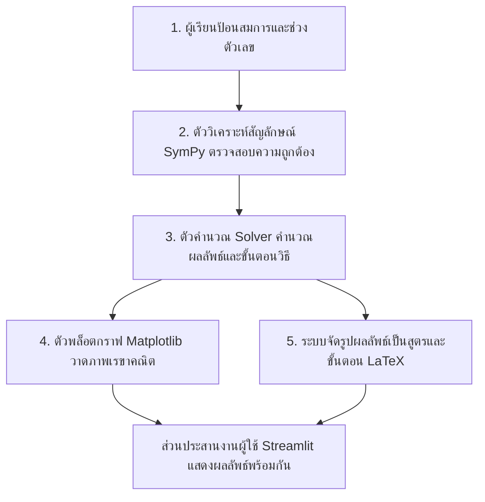

# บทนำและคำแนะนำการใช้งานสำหรับนิสิต

คู่มือฉบับนี้จัดทำขึ้นเพื่อให้นิสิตทั้งสองคน คือ **นางสาวขวัญเรือน สำเนียงดี (แอร์)** และ **นางสาวเบญจกัฬยาณี พิทยากูล (ชิชา)** ใช้เตรียมความพร้อมและซักซ้อมก่อนขึ้นนำเสนอโครงงานจริง โดยมุ่งเน้นการสร้างความเข้าใจในระดับ **มโนทัศน์ (Concept)** และ **ภาพรวมการทำงาน (High-Level Flow)** ของระบบทั้ง 7 โมดูล โดยไม่จำเป็นต้องท่องจำชื่อตัวแปรหรือคำสั่งโปรแกรมมิ่งในภาษาไพทอนที่ซับซ้อน

### การแบ่งบทบาทความรับผิดชอบหลัก
1. **นางสาวขวัญเรือน (แอร์):** รับผิดชอบหลักใน **โมดูลที่ 1 ถึง โมดูลที่ 4** (ลิมิต, อนุพันธ์, ผลรวมรีมันน์, การแทนค่าตัวแปร $u$) ควบคู่กับการนำเสนอผลการทดสอบระบบอัตโนมัติ 265 ข้อ
2. **นางสาวเบญจกัฬยาณี (ชิชา):** รับผิดชอบหลักใน **โมดูลที่ 5 ถึง โมดูลที่ 7** (พื้นที่ระหว่างเส้นโค้ง, ปริมาตรทรงตัน, ปริพันธ์ไม่ตรงแบบ) ควบคู่กับสถาปัตยกรรมระบบ และผลการประเมินความพึงพอใจ/SUS

---

# แผนภาพภาพรวมการทำงานของระบบ (System Architecture Pipeline)

เมื่อผู้ใช้พิมพ์สมการคณิตศาสตร์และกดปุ่มคำนวณในหน้าเว็บ ทุกโมดูลจะประมวลผลผ่าน 4 ขั้นตอนมาตรฐานเดียวกันเสมอ ดังนี้:



```
+-----------------------------------------------------------------------------------+
|  1. ข้อมูลนำเข้า (Input)          | สมการ f(x) และช่วงตัวเลข [a, b]               |
+-----------------------------------------------------------------------------------+
                                         │
                                         ▼
+-----------------------------------------------------------------------------------+
|  2. ตรวจสอบนิพจน์ (SymPy Parse)   | ตรวจสอบไวยากรณ์, แปลงสัญลักษณ์, สแกนโดเมน     |
+-----------------------------------------------------------------------------------+
                                         │
                                         ▼
+-----------------------------------------------------------------------------------+
|  3. คำนวณขั้นตอนวิธี (Solver Engine) │ แบ่งช่วง, หาปฏิยานุพันธ์, คำนวณค่าประมาณ      |
+-----------------------------------------------------------------------------------+
                    │                                    │
                    ▼                                    ▼
+------------------------------------+   +------------------------------------------+
|  4. พล็อตกราฟ (Matplotlib Visual)   |   |  5. จัดรูปสมการ (LaTeX Steps Generator)   |
|  - วาดเส้นโค้งและจุดวิกฤต          |   |  - แสดงนิยามและสูตรคณิตศาสตร์            |
|  - วาดแถบแท่ง/ระบายสีพื้นที่        |   |  - แสดงการแทนค่าตัวเลขทีละขั้นตอน        |
+------------------------------------+   +------------------------------------------+
                    │                                    │
                    └─────────────────┬──────────────────┘
                                      ▼
+-----------------------------------------------------------------------------------+
|  6. หน้าจอแสดงผล (Streamlit UI)    | แสดงผลทั้งกราฟ ตัวเลขสรุป และขั้นตอนอย่างเป็นระเบียบ |
+-----------------------------------------------------------------------------------+
```

---

# รายละเอียดเจาะลึก 7 โมดูลหลัก

## โมดูลที่ 1 ลิมิตและความต่อเนื่อง (Limit and Continuity)
*ผู้รับผิดชอบหลัก: นางสาวขวัญเรือน (แอร์)*

### แผนภาพโฟลว์การทำงาน
```mermaid
graph LR
    In[ป้อน f(x) และจุด a] --> Sym[SymPy ตรวจสอบโดเมน และหาลิมิตซ้าย-ขวา]
    Sym --> Vis[Matplotlib พล็อตกราฟจุดโปร่ง/จุดทึบ]
    Sym --> Tex[LaTeX แสดงขั้นตอนการทอนตัวประกอบ]
```

### สคริปต์พูดสรุป 3 ประโยค
> "โมดูลนี้ช่วยให้ผู้เรียนเห็นว่า ลิมิตไม่ใช่แค่การนำตัวเลขไปแทนค่าในสูตร แต่คือการสังเกตว่ากราฟทั้งสองฝั่งกำลังวิ่งเข้าหาความสูงเดียวกันหรือไม่ ระบบจะตรวจสอบว่าลิมิตซ้ายและลิมิตขวาเท่ากันหรือไม่ พร้อมทั้งวาดกราฟแสดงจุดโปร่ง (Hole) ให้เห็นอย่างชัดเจน ทำให้ผู้เรียนเข้าใจว่าทำไมรูปแบบศูนย์หารด้วยศูนย์ $\frac{0}{0}$ จึงยังสามารถหาค่าลิมิตได้โดยไม่ต้องท่องจำสูตรลัดค่ะ"

### บัตรคำถาม-คำตอบเจาะลึก (Defense Flashcard)
* **สมการตัวแทน:** $f(x) = \frac{x^2 - 1}{x - 1}$ เมื่อ $x \to 1$
* **คำถามที่กรรมการอาจซักถาม:** "เมื่อผู้เรียนแทนค่า $x = 1$ จะเกิด $\frac{0}{0}$ ระบบบอกว่ามีลิมิตเท่ากับ 2 ทำไมถึงไม่ตอบว่าหาค่าไม่ได้ เพราะส่วนเป็นศูนย์?"
* **แนวทางการตอบ:**
  > "กราบเรียนอาจารย์ค่ะ สัญลักษณ์ $\frac{0}{0}$ เป็นเพียงรูปแบบยังไม่กำหนด (Indeterminate Form) ไม่ใช่การนำเลขศูนย์มาหารด้วยศูนย์จริงในทางเลขคณิต แต่หมายถึงตัวเศษ $(x^2-1)$ และตัวส่วน $(x-1)$ ต่างกำลังวิ่งเข้าใกล้ศูนย์พร้อม ๆ กันเมื่อ $x$ วิ่งเข้าใกล้ 1 ระบบของเราจึงแสดงให้ผู้เรียนเห็นกราฟจริงว่ามีจุดโปร่งที่ $(1, 2)$ และแสดงขั้นตอนการแยกตัวประกอบเพื่อตัดทอนตัวร่วม $(x-1)$ ออก ทำให้ทราบว่าอัตราส่วนนี้ลู่เข้าสู่ค่า 2 ค่ะ"

---

## โมดูลที่ 2 อนุพันธ์และเส้นสัมผัส (Tangent Line and Derivative)
*ผู้รับผิดชอบหลัก: นางสาวขวัญเรือน (แอร์)*

### แผนภาพโฟลว์การทำงาน
```mermaid
graph LR
    In[ป้อน f(x) และจุด x=a] --> Sym[SymPy คำนวณความชัน f'(a) ผ่านนิยามลิมิต]
    Sym --> Vis[Matplotlib วาดเส้นสัมผัสเปรียบเทียบกับเส้นตัดโค้ง]
    Sym --> Tex[LaTeX แสดงสมการเส้นสัมผัส y - y0 = m(x - x0)]
```

### สคริปต์พูดสรุป 3 ประโยค
> "โมดูลนี้จำลองมโนทัศน์ว่า เส้นสัมผัสกราฟเกิดจากการเลื่อนจุดตัดสองจุดบนเส้นโค้งให้ขยับเข้าใกล้กันจนกลายเป็นจุดเดียวกัน ผู้เรียนสามารถปรับลดระยะห่าง $\Delta x$ เพื่อสังเกตการหมุนของเส้นตัดที่ลู่เข้าทาบเป็นเส้นสัมผัสได้อย่างเป็นรูปธรรม และหากฟังก์ชันมีจุดหักมุม ระบบจะตรวจสอบและแจ้งเตือนทันทีว่าไม่สามารถหาอนุพันธ์ที่จุดนั้นได้ค่ะ"

### บัตรคำถาม-คำตอบเจาะลึก (Defense Flashcard)
* **สมการตัวแทน:** $f(x) = |x|$ ที่จุด $x = 0$
* **คำถามที่กรรมการอาจซักถาม:** "ทำไมฟังก์ชันค่าสัมบูรณ์ต่อเนื่องที่จุด 0 แต่ระบบถึงสรุปว่าหาอนุพันธ์ไม่ได้ และไม่มีเส้นสัมผัส?"
* **แนวทางการตอบ:**
  > "กราบเรียนอาจารย์ค่ะ นิยามของอนุพันธ์คือลิมิตของความชันของเส้นตัดโค้ง เมื่อพิจารณาฟังก์ชัน $|x|$ ที่จุด 0 ความชันทางฝั่งซ้ายของกราฟมีค่าคงที่เท่ากับ $-1$ แต่ความชันทางฝั่งขวามีค่าคงที่เท่ากับ $+1$ เนื่องจากลิมิตสองด้านไม่เท่ากัน อนุพันธ์ $f'(0)$ จึงไม่มีอยู่ ในทางเรขาคณิตจุดนี้เป็นจุดมุม (Corner Point) ทำให้ไม่สามารถวางเส้นสัมผัสที่มีความชันเพียงค่าเดียวได้ ระบบจึงรายงานสถานะว่าหาอนุพันธ์ไม่ได้ค่ะ"

---

## โมดูลที่ 3 ผลรวมรีมันน์ (Riemann Sums)
*ผู้รับผิดชอบหลัก: นางสาวขวัญเรือน (แอร์)*

### แผนภาพโฟลว์การทำงาน
```mermaid
graph LR
    In[ป้อน f(x), ช่วง [a,b], จำนวนช่วง n] --> Sym[แบ่งช่วงย่อย Δx และคำนวณความสูงตามจุดตัวแทน]
    Sym --> Vis[Matplotlib วาดแท่งสี่เหลี่ยม Ln, Rn, Mn]
    Sym --> Tex[LaTeX เปรียบเทียบค่าประมาณกับค่าจริงของอินทิกรัล]
```

### สคริปต์พูดสรุป 3 ประโยค
> "โมดูลนี้เปลี่ยนการอินทิเกรตที่เป็นนามธรรมให้กลายเป็นการต่อบล็อกสี่เหลี่ยมผืนผ้าที่ผู้เรียนมองเห็นและจับต้องได้ ผู้เรียนสามารถปรับจำนวนช่วง $n$ ตั้งแต่ 2 ถึง 100 เพื่อสังเกตว่าเมื่อแท่งสี่เหลี่ยมยิ่งแคบลง พื้นที่รวมจะยิ่งลู่เข้าหาพื้นที่ใต้กราฟที่แท้จริง และระบบสามารถแสดงการเปรียบเทียบผลรวมฝั่งซ้าย ฝั่งขวา และจุดกึ่งกลางได้พร้อมกันในหน้าจอเดียวค่ะ"

### บัตรคำถาม-คำตอบเจาะลึก (Defense Flashcard)
* **สมการตัวแทน:** $f(x) = \frac{1}{x}$ บนช่วง $[0, 1]$
* **คำถามที่กรรมการอาจซักถาม:** "ถ้าผู้เรียนใส่ฟังก์ชัน $\frac{1}{x}$ บนช่วง $[0, 1]$ ซึ่งมีขั้วอนันต์ที่ 0 ทำไมผลรวมรีมันน์ของระบบยังมีตัวเลขออกมาได้ แล้วตัวเลขนั้นแทนพื้นที่จริงหรือไม่?"
* **แนวทางการตอบ:**
  > "กราบเรียนอาจารย์ค่ะ ในทางขั้นตอนวิธี หากจุดตัวแทนไม่ได้สุ่มตกที่ตำแหน่ง $x = 0$ พอดี โปรแกรมจะนำความสูงที่จุดตัวอย่างมาคูณความกว้าง $\Delta x$ แล้วบวกกันได้ตามสูตรพีชคณิตปกติ แต่ในทางคณิตศาสตร์ ค่านี้ **ไม่ใช่ค่าประมาณของปริพันธ์** เนื่องจากฟังก์ชันไม่ต่อเนื่องและไม่มีขอบเขตบนช่วงปิด $[0, 1]$ ทำให้อินทิกรัลจริงลู่ออก ซึ่งเป็นข้อจำกัดที่ระบบบันทึกไว้ว่าผลรวมรีมันน์จะรับประกันการลู่เข้าสู่อินทิกรัลได้ ก็ต่อเมื่อฟังก์ชันมีความต่อเนื่องบนช่วงปิดเท่านั้นค่ะ"

---

## โมดูลที่ 4 เทคนิคการอินทิเกรตแบบแทนค่าตัวแปร $u$ (Integration by Substitution)
*ผู้รับผิดชอบหลัก: นางสาวขวัญเรือน (แอร์)*

### แผนภาพโฟลว์การทำงาน
```mermaid
graph LR
    In[ป้อน f(x) และเลือกตัวแปร u] --> Sym[SymPy หา du และตรวจสอบการตัดทอนตัวแปรเดิม]
    Sym --> Bound[คำนวณขอบเขตใหม่: u(a) และ u(b)]
    Bound --> Tex[LaTeX แสดงขั้นตอนการอินทิเกรตบนแกน u อย่างสมบูรณ์]
```

### สคริปต์พูดสรุป 3 ประโยค
> "โมดูลนี้ช่วยแนะนำขั้นตอนการเปลี่ยนตัวแปร $u$ ทีละก้าว โดยมีระบบตรวจสอบความถูกต้องว่าตัวแปร $u$ ที่ผู้เรียนเลือกสามารถตัดทอนตัวแปร $x$ เดิมให้หมดไปได้จริงหรือไม่ ระบบจะแสดงขั้นตอนการเปลี่ยนขอบเขตของการอินทิเกรตจากแกนเดิมไปเป็นแกน $u$ อย่างชัดเจน เพื่อป้องกันข้อผิดพลาดที่ผู้เรียนมักลืมเปลี่ยนขอบเขต และแสดงวิธีทำสรุปออกมาอย่างละเอียดค่ะ"

### บัตรคำถาม-คำตอบเจาะลึก (Defense Flashcard)
* **สมการตัวแทน:** $\int_0^1 2x\sqrt{x^2 + 1}\,dx$ กำหนดให้ $u = x^2 + 1$
* **คำถามที่กรรมการอาจซักถาม:** "ทำไมในกรณีปริพันธ์จำกัดเขต ระบบถึงแนะนำให้เปลี่ยนขอบเขตเป็น $u = 1$ ถึง $u = 2$ แทนที่จะอินทิเกรตแบบไม่จำกัดเขตแล้วแทน $x$ กลับ?"
* **แนวทางการตอบ:**
  > "กราบเรียนอาจารย์ค่ะ การเปลี่ยนขอบเขตตามทฤษฎีบทการแทนค่าตัวแปร $\int_a^b f(g(x))g'(x)\,dx = \int_{g(a)}^{g(b)} f(u)\,du$ มีข้อดีสำคัญสองประการ คือ ประการแรก ช่วยรักษาความหมายทางเรขาคณิตของพื้นที่ใต้เส้นโค้งบนระบบพิกัดใหม่ได้อย่างถูกต้อง และประการที่สอง ในเชิงจิตวิทยาการเรียนรู้ การเปลี่ยนขอบเขตทันทีช่วยลดภาระทางปัญญา (Cognitive Load) และตัดความเสี่ยงที่ผู้เรียนจะลืมแปลงตัวแปรกลับก่อนแทนค่าขอบเขตตัวเลขเดิมค่ะ"

---

## โมดูลที่ 5 พื้นที่ระหว่างเส้นโค้ง (Area Between Curves)
*ผู้รับผิดชอบหลัก: นางสาวเบญจกัฬยาณี (ชิชา)*

### แผนภาพโฟลว์การทำงาน
```mermaid
graph LR
    In[ป้อน f(x), g(x) และช่วง [a,b]] --> Sym[SymPy หาจุดตัดทั้งหมด f(x) - g(x) = 0]
    Sym --> Split[แบ่งช่วงย่อยและตรวจสอบฟังก์ชันบน-ล่าง]
    Split --> Vis[Matplotlib ระบายสีพื้นที่แยกตามช่วงย่อย]
    Split --> Tex[LaTeX แสดงผลรวมของปริพันธ์ค่าสัมบูรณ์]
```

### สคริปต์พูดสรุป 3 ประโยค
> "โมดูลนี้ช่วยให้ผู้เรียนหาพื้นที่ปิดล้อมระหว่างสองเส้นโค้งได้อย่างถูกต้องโดยไม่ต้องกังวลเรื่องการสลับตำแหน่งของกราฟ ระบบจะค้นหาจุดตัดทั้งหมดบนช่วงโดยอัตโนมัติ และแบ่งช่วงอินทิเกรตย่อยเพื่อนำฟังก์ชันบนลบด้วยฟังก์ชันล่างเสมอ พร้อมทั้งระบายสีพื้นที่ให้เห็นอย่างชัดเจน ป้องกันปัญหาพื้นที่เหนือแกนและใต้แกนหักล้างกันจนคำนวณผิดค่ะ"

### บัตรคำถาม-คำตอบเจาะลึก (Defense Flashcard)
* **สมการตัวแทน:** หาพื้นที่ระหว่าง $f(x) = \sin x$ และ $g(x) = \cos x$ บนช่วง $[0, 2\pi]$
* **คำถามที่กรรมการอาจซักถาม:** "ทำไมเราถึงไม่อินทิเกรต $\int_0^{2\pi} (\sin x - \cos x)\,dx$ รวดเดียว ทำไมต้องแยกช่วง?"
* **แนวทางการตอบ:**
  > "กราบเรียนอาจารย์ค่ะ พื้นที่ทางเรขาคณิตเป็นปริมาณที่ไม่เป็นลบเสมอ หากเราอินทิเกรตฟังก์ชันผลต่างรวดเดียวตลอดช่วง $[0, 2\pi]$ โดยไม่หาจุดตัด กราฟของ $\sin x$ และ $\cos x$ จะตัดกันที่จุด $x = \frac{\pi}{4}$ และ $x = \frac{5\pi}{4}$ ทำให้มีบางช่วงที่ฟังก์ชันหนึ่งอยู่สูงกว่าอีกฟังก์ชันหนึ่ง การคำนวณรวดเดียวจะทำให้พื้นที่ช่วงที่อยู่เหนือแกนและใต้แกนหักล้างกันเองจนได้ค่าเป็น 0 ซึ่งขัดกับความเป็นจริง ระบบจึงต้องหาจุดตัดและแยกอินทิเกรตเป็น 3 ช่วงย่อยตามนิยาม $A = \int_a^b |f(x) - g(x)|\,dx$ ค่ะ"

---

## โมดูลที่ 6 ปริมาตรทรงตันจากการหมุน (Volume of Solids of Revolution)
*ผู้รับผิดชอบหลัก: นางสาวเบญจกัฬยาณี (ชิชา)*

### แผนภาพโฟลว์การทำงาน
```mermaid
graph LR
    In[ป้อน f(x), g(x) และแกนหมุน] --> Class[จำแนกประเภท: จานกลม หรือ วงแหวน]
    Class --> Vis[Matplotlib วาดภาพพื้นที่หมุนและแว่นหน้าตัด 2D/3D]
    Class --> Tex[LaTeX แสดงสูตรปริมาตรหน้าตัดแว่นบางสะสม]
```

### สคริปต์พูดสรุป 3 ประโยค
> "โมดูลนี้ช่วยให้ผู้เรียนมองเห็นภาพการหมุนพื้นที่สองมิติรอบแกนเพื่อประกอบขึ้นเป็นรูปทรงตันสามมิติได้อย่างชัดเจน ระบบจะวิเคราะห์โดยอัตโนมัติว่าพื้นที่ที่หมุนนั้นแนบชิดกับแกนหมุนจนเกิดเป็นวิธีจานกลม (Disk Method) หรือมีรูกลวงตรงกลางจนต้องใช้วิธีวงแหวน (Washer Method) พร้อมแสดงภาพแว่นหน้าตัดบาง ๆ เพื่อให้เห็นที่มาของสูตรปริมาตรอย่างแท้จริงค่ะ"

### บัตรคำถาม-คำตอบเจาะลึก (Defense Flashcard)
* **สมการตัวแทน:** หมุนพื้นที่ระหว่าง $y = x$ และ $y = x^2$ รอบแกน $x$
* **คำถามที่กรรมการอาจซักถาม:** "ในวิธีวงแหวน ทำไมสูตรพื้นที่หน้าตัดจึงเป็น $\pi(R^2 - r^2)$ ทำไมผู้เรียนบางคนถึงชอบจำผิดเป็น $\pi(R - r)^2$ และระบบมีวิธีอธิบายอย่างไร?"
* **แนวทางการตอบ:**
  > "กราบเรียนอาจารย์ค่ะ นี่เป็นหนึ่งในจุดเข้าใจผิดที่พบบ่อยที่สุดของผู้เรียน หน้าตัดของทรงตันแบบมีรูกลวงคือพื้นที่ของวงกลมใหญ่ลบด้วยพื้นที่ของวงกลมเล็กที่กลวงออกไป นั่นคือ $\pi R^2 - \pi r^2 = \pi(R^2 - r^2)$ ในขณะที่สูตร $\pi(R - r)^2$ คือพื้นที่ของวงกลมเดี่ยวที่มีรัศมีเท่ากับความหนาของวงแหวน ซึ่งให้ค่าน้อยกว่าความเป็นจริงอย่างมาก ระบบของเราจึงออกแบบกราฟิกแสดงวงกลมสองวงซ้อนกันพร้อมระบายสีพื้นที่เฉพาะเนื้อวงแหวน เพื่อแก้จุดเข้าใจผิดนี้ในเชิงภาพค่ะ"

---

## โมดูลที่ 7 ปริพันธ์ไม่ตรงแบบ (Improper Integrals)
*ผู้รับผิดชอบหลัก: นางสาวเบญจกัฬยาณี (ชิชา)*

### แผนภาพโฟลว์การทำงาน
```mermaid
graph LR
    In[ป้อน f(x) และช่วงที่มีอนันต์หรือจุดเอกฐาน] --> Class[จำแนกประเภท: ชนิดที่ 1 อนันต์ หรือ ชนิดที่ 2 มีขั้ว]
    Class --> Lim[แปลงอินทิกรัลให้อยู่ในรูปลิมิตของตัวแปร t]
    Lim --> Eval[SymPy คำนวณลิมิตและตรวจสอบการลู่เข้า/ลู่ออก]
    Eval --> Vis[Matplotlib วาดกราฟปลายหางลู่เข้าสู่เส้นกำกับ]
```

### สคริปต์พูดสรุป 3 ประโยค
> "โมดูลนี้ช่วยคลายความสับสนเรื่องปริพันธ์ไม่ตรงแบบ ทั้งกรณีที่ขอบเขตของการอินทิเกรตทอดยาวไปจนถึงอนันต์ และกรณีที่ฟังก์ชันวิ่งพุ่งขึ้นสู่อนันต์ภายในช่วง ระบบจะแปลงอินทิกรัลให้อยู่ในรูปลิมิตตามนิยามที่ถูกต้อง และตรวจสอบว่าพื้นที่ใต้กราฟลู่เข้าหาตัวเลขจำกัด หรือลู่ออกสู่อนันต์ พร้อมแสดงกราฟปลายหางลู่เข้าเพื่อยืนยันคำตอบในเชิงประจักษ์ค่ะ"

### บัตรคำถาม-คำตอบเจาะลึก (Defense Flashcard)
* **สมการตัวแทน:** $\int_{-1}^1 \frac{1}{x}\,dx$
* **คำถามที่กรรมการอาจซักถาม:** "ฟังก์ชัน $f(x) = \frac{1}{x}$ เป็นฟังก์ชันคี่และช่วง $[-1, 1]$ สมมาตรรอบจุดกำเนิด ทำไมคำตอบของปริพันธ์นี้จึงไม่ใช่ 0?"
* **แนวทางการตอบ:**
  > "กราบเรียนอาจารย์ค่ะ แม้ว่า $f(x) = \frac{1}{x}$ จะเป็นฟังก์ชันคี่ แต่ที่จุด $x = 0$ ซึ่งอยู่ภายในช่วงเป็นจุดเอกฐานอนันต์ (Infinite Singularity) ตามนิยามของปริพันธ์ไม่ตรงแบบชนิดที่ 2 เราต้องแยกช่วงการอินทิเกรตออกเป็นสองส่วนอิสระ คือ $\lim_{t\to 0^-} \int_{-1}^t \frac{1}{x}\,dx$ และ $\lim_{s\to 0^+} \int_s^1 \frac{1}{x}\,dx$ เนื่องจากทั้งสองลิมิตต่างลู่ออกสู่อนันต์ ปริพันธ์รวมจึง **ลู่ออก (Diverges)** การนำค่า $+\infty$ และ $-\infty$ มาหักล้างกันให้เป็นศูนย์นั้นทำได้เฉพาะในการนิยามแบบค่าหลักของโคชี (Cauchy Principal Value) เท่านั้น ซึ่งไม่ใช่ความหมายของปริพันธ์รีมันน์มาตรฐาน และระบบของเราได้แสดงการเตือนจุดนี้อย่างชัดเจนค่ะ"

---

# ข้อแนะนำการตอบคำถามภาพรวมในห้องสอบ

1. **เมื่อกรรมการถามเรื่องสถาปัตยกรรมหรือโค้ด:**
   - ให้นิสิตตอบโดยเน้นที่ **หน้าที่ (Function)** มากกว่าตัวโค้ด เช่น "เราใช้คลังคำนวณเชิงสัญลักษณ์ SymPy ในการตรวจสอบนิพจน์คณิตศาสตร์ และใช้ Matplotlib ในการวาดกราฟเรขาคณิตแบบไดนามิกค่ะ"
2. **เมื่อกรรมการถามคำถามที่ระบบยังทำไม่ได้:**
   - ห้ามตอบว่าระบบทำได้เด็ดขาด ให้ตอบอย่างมั่นใจและซื่อสัตย์ว่า "กรณีที่อาจารย์ยกตัวอย่าง เป็นข้อจำกัดหนึ่งที่คณะผู้วิจัยได้ค้นพบและบันทึกไว้ในบทที่ 5 เรียบร้อยแล้วค่ะ ซึ่งในปัจจุบันระบบจะแสดงข้อความแจ้งเตือนปฏิเสธการคำนวณเพื่อความปลอดภัย และเป็นแนวทางสำคัญในการพัฒนาต่อยอดในอนาคตค่ะ"
3. **เมื่อกรรมการถามเรื่องเฉลยภาคผนวก ง:**
   - ให้นิสิตหยิบ **ใบบันทึกข้อผิดพลาดและข้อสังเกต (Errata Notes)** ขึ้นมาชี้แจงว่า ระบบในเว็บมีการสุ่มตัวเลือก 4 ตัวเลือก แต่ในขั้นตอนการ Export รายงานลงเล่มเกิดปัญหาทางเทคนิคของสคริปต์ที่ดึงตัวเลือกแรกออกมาเสมอ และคณะผู้วิจัยได้แนบตารางเฉลยสมดุล 4:4:4:4 มาให้กรรมการพิจารณาควบคู่กันค่ะ
