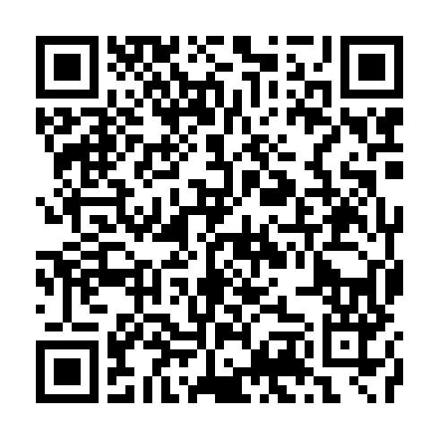

# ภาคผนวก ก
# เครื่องมือการวิจัยและแบบประเมินความสะดวกในการใช้งาน (System Usability Scale: SUS)

การประเมินประสิทธิภาพและคุณภาพของเว็บแอปพลิเคชันช่วยเรียนคณิตศาสตร์สำหรับแคลคูลัสเบื้องต้น (Calculus Learning Sandbox) อาศัยเครื่องมือการวิจัยที่ได้รับการออกแบบตามระเบียบวิธีวิจัยเชิงประเมินและทฤษฎีการออกแบบการสอน เพื่อรวบรวมข้อมูลเชิงประจักษ์จากกลุ่มผู้เรียนเป้าหมาย โดยครอบคลุมทั้งมิติด้านความสะดวกในการใช้งาน คุณลักษณะเชิงเทคนิคและเรขาคณิต และความพึงพอใจต่อการจัดกระบวนการเรียนรู้

เครื่องมือหลักที่ใช้ในการวิจัยประกอบด้วย **แบบสอบถามประเมินความพึงพอใจและประสิทธิภาพการใช้งานเว็บแอปพลิเคชัน** ซึ่งจัดทำขึ้นในรูปแบบดิจิทัลผ่านกูเกิลฟอร์ม (Google Forms) และติดตั้งช่องทางเชื่อมต่อโดยตรงผ่านส่วนประสานงานผู้ใช้ของเว็บแอปพลิเคชัน โครงสร้างของแบบสอบถามแบ่งออกเป็น 4 ตอนหลัก ดังนี้

1. **ตอนที่ 1 ข้อมูลทั่วไปและภูมิหลังทางการศึกษาของผู้ตอบแบบสอบถาม (General Background and Demographics):** สำรวจสถานะทางการศึกษา สถาบัน แผนการเรียน ประสบการณ์เดิมในวิชาแคลคูลัส เจตคติต่อวิชา อุปกรณ์ที่ใช้ทดสอบ และโมดูลบทเรียนที่ได้ทดลองใช้งานจริง
2. **ตอนที่ 2 แบบประเมินความพึงพอใจต่อคุณลักษณะของระบบ 4 ด้าน (System Characteristics and Pedagogical Satisfaction):** ข้อคำถามมาตรวัดประมาณค่า (Likert Scale) 5 ระดับ จำนวน 20 ข้อ ครอบคลุมด้านการออกแบบส่วนประสานงานผู้ใช้ ด้านฟังก์ชันเชิงโต้ตอบและการประมวลผลคำนวณ ด้านเนื้อหาและการส่งเสริมมโนทัศน์ และด้านเจตคติและแรงจูงใจในการเรียนรู้
3. **ตอนที่ 3 แบบประเมินความสะดวกในการใช้งานระบบตามมาตรฐานสากล (System Usability Scale: SUS):** ข้อคำถามมาตรฐานสากล 10 ข้อ ประกอบด้วยข้อความเชิงบวก 5 ข้อ และเชิงลบ 5 ข้อ พร้อมระบบการแปลงค่าน้ำหนักคะแนนเป็นดัชนีรวม 100 คะแนน
4. **ตอนที่ 4 แบบสอบถามปลายเปิดและข้อเสนอแนะเพื่อการพัฒนาระบบ (Open-ended Feedback and Future Enhancements):** เปิดโอกาสให้ผู้ตอบแบบสอบถามระบุฟังก์ชันที่ประทับใจ ข้อขัดข้องทางเทคนิคที่พบ หัวข้อคณิตศาสตร์ที่ต้องการให้พัฒนาเพิ่มเติม และข้อเสนอแนะเชิงประยุกต์สำหรับการจัดการเรียนการสอน

## ก.1 โครงสร้างแบบสอบถามและตารางข้อคำถามภาษาไทยฉบับสมบูรณ์

### ก.1.1 ตอนที่ 1: ข้อมูลทั่วไปและภูมิหลังทางการศึกษาของผู้ตอบแบบสอบถาม

ตอนที่ 1 ทำหน้าที่เก็บรวบรวมตัวแปรเชิงคุณลักษณะของผู้เรียน เพื่อใช้ในการจำแนกกลุ่มประชากรและวิเคราะห์ความสัมพันธ์กับระดับความพึงพอใจ โดยมีรายการตัวแปรและตัวเลือกคำตอบดังแสดงในตารางที่ ก.1

ตารางที่ ก.1 รายการข้อคำถามตอนที่ 1: ข้อมูลทั่วไปและภูมิหลังทางการศึกษา

| ลำดับที่ | ตัวแปรและรายการสำรวจ | รูปแบบการตอบ | รายละเอียดตัวเลือกคำตอบในแบบสอบถาม |
|:---:|:---|:---|:---|
| 1 | ระดับการศึกษาปัจจุบัน | เลือกตอบได้ 1 ตัวเลือก (Single Choice) | • มัธยมศึกษาตอนปลาย (ม.5 หรือ ม.6) • ปริญญาตรี ชั้นปีที่ 1 หรือ 2 • ปริญญาตรี ชั้นปีที่ 3 หรือ 4 • ระดับบัณฑิตศึกษา (ป.โท หรือ ป.เอก) • บุคคลทั่วไป หรือ อื่นๆ (โปรดระบุ) |
| 2 | สถาบันการศึกษาในปัจจุบัน หรือสถาบันที่เคยศึกษา | รายการเลื่อนลง (Dropdown) / เลือกตอบ | • มหาวิทยาลัยเกษตรศาสตร์ (กำแพงแสน / บางเขน / ศรีราชา / สกลนคร) • ม.เทคโนโลยีสุรนารี / มรภ.นครราชสีมา / มทร.อีสาน • มหาวิทยาลัยรัฐ หรือ ในกำกับของรัฐ (จุฬาฯ, มธ., มหิดล ฯลฯ) • กลุ่มมหาวิทยาลัยราชภัฏ หรือ ราชมงคล ทั่วประเทศ • โรงเรียนมัธยมศึกษา (โปรดระบุ) • สถาบันอื่นๆ (โปรดระบุ) |
| 3 | กลุ่มสาขาวิชา หรือแผนการเรียน | เลือกตอบได้ 1 ตัวเลือก (Single Choice) | • กลุ่มวิศวกรรมศาสตร์ • วิทยาการคอมพิวเตอร์ หรือ เทคโนโลยีสารสนเทศ • วิทยาศาสตร์บริสุทธิ์และประยุกต์ หรือ คณิตศาสตร์ • แผนการเรียนวิทย์-คณิต (ระดับมัธยมศึกษา) • ครุศาสตร์ หรือ ศึกษาศาสตร์ (คณิตศาสตร์/วิทยาศาสตร์) • บริหารธุรกิจ หรือ เศรษฐศาสตร์ หรือ บัญชี • สาขาวิชาอื่นๆ (โปรดระบุ) |
| 4 | ประสบการณ์การเรียนรู้ในวิชาแคลคูลัส (Calculus) | เลือกตอบได้ 1 ตัวเลือก (Single Choice) | • เคยศึกษาในระดับ ม.ปลาย (ม.6) • กำลังศึกษาในระดับอุดมศึกษา (Cal 1 หรือ Cal 2) • เคยศึกษาและสอบผ่านมาแล้ว (ต้องการทบทวน) • ยังไม่เคยศึกษาแคลคูลัสอย่างเป็นทางการ |
| 5 | เจตคติต่อวิชาแคลคูลัส ก่อนได้ทดลองใช้งานเว็บแอปพลิเคชัน | เลือกตอบได้ 1 ตัวเลือก (Single Choice) | • รู้สึกยากมาก และกังวลในการทำความเข้าใจ • รู้สึกยากปานกลาง แต่พอเข้าใจได้ถ้ามีตัวช่วย • รู้สึกน่าสนใจและชอบแก้โจทย์ปัญหา • รู้สึกเฉยๆ หรือไม่มีความเห็นเป็นพิเศษ |
| 6 | อุปกรณ์หลักที่ใช้ในการทดสอบเว็บแอปพลิเคชัน | เลือกตอบได้ 1 ตัวเลือก (Single Choice) | • คอมพิวเตอร์ตั้งโต๊ะ หรือ โน้ตบุ๊ก (Desktop/Notebook PC) • แท็บเล็ต (iPad หรือ Android Tablet) • สมาร์ตโฟน (Smartphone) |
| 7 | บทเรียนหรือโมดูลในระบบที่ได้ทดลองใช้งาน | เลือกตอบได้หลายตัวเลือก (Multiple Checkboxes) | • ผลบวกรีมันน์เชิงโต้ตอบ (Riemann Sum) • ปริมาตรทรงตันจากการหมุน (Volume of Solids) • การหาพื้นที่ระหว่างเส้นโค้ง (Area Between Curves) • ลิมิตและความต่อเนื่อง (Limits & Continuity) • เส้นสัมผัสและอนุพันธ์ (Tangent & Derivative) • เทคนิคการแทนค่า (Substitution Method) • ปริพันธ์ไม่ตรงแบบ (Improper Integrals) • เครื่องคำนวณแคลคูลัสและระบบแบบทดสอบ (Solver & Quiz) |

### ก.1.2 ตอนที่ 2: แบบประเมินความพึงพอใจต่อคุณลักษณะของระบบ 4 ด้าน

ตอนที่ 2 เป็นการวัดระดับความคิดเห็นและความพึงพอใจต่อคุณลักษณะของระบบผ่านเกณฑ์มาตรวัดประมาณค่า 5 ระดับ (Likert Scale) จำนวนรวม 20 ข้อคำถาม โดยกำหนดค่าน้ำหนักคะแนนสำหรับการคำนวณสถิติดังนี้

- **5 คะแนน:** หมายถึง มีความพึงพอใจในระดับมากที่สุด (Strongly Agree)
- **4 คะแนน:** หมายถึง มีความพึงพอใจในระดับมาก (Agree)
- **3 คะแนน:** หมายถึง มีความพึงพอใจในระดับปานกลาง (Neutral)
- **2 คะแนน:** หมายถึง มีความพึงพอใจในระดับน้อย (Disagree)
- **1 คะแนน:** หมายถึง มีความพึงพอใจในระดับน้อยที่สุด (Strongly Disagree)

เกณฑ์การแปลผลคะแนนเฉลี่ย ($\bar{x}$) อิงตามเกณฑ์การวิเคราะห์ข้อมูลทางสถิติ ดังนี้

- **4.51 – 5.00:** ระดับความพึงพอใจมากที่สุด
- **3.51 – 4.50:** ระดับความพึงพอใจมาก
- **2.51 – 3.50:** ระดับความพึงพอใจปานกลาง
- **1.51 – 2.50:** ระดับความพึงพอใจน้อย
- **1.00 – 1.50:** ระดับความพึงพอใจน้อยที่สุด

รายละเอียดข้อคำถามครบทั้ง 4 ด้าน แสดงในตารางที่ ก.2 ถึง ตารางที่ ก.5

ตารางที่ ก.2 ข้อคำถามด้านที่ 1: การออกแบบส่วนประสานงานผู้ใช้และประสบการณ์ผู้ใช้ (UI/UX)

| ข้อที่ | รายการประเมินความพึงพอใจ | ระดับ 5 | ระดับ 4 | ระดับ 3 | ระดับ 2 | ระดับ 1 |
|:---:|:---|:---:|:---:|:---:|:---:|:---:|
| 1.1 | การจัดวางองค์ประกอบและโครงสร้างหน้าจอมีความเป็นระเบียบ สวยงาม และสบายตา | | | | | |
| 1.2 | การจัดหมวดหมู่เมนูนำทางชัดเจน สามารถเข้าถึงบทเรียนและหัวข้อต่างๆ ได้สะดวกรวดเร็ว | | | | | |
| 1.3 | ขนาดตัวอักษร รูปแบบฟอนต์ภาษาไทย และการแสดงผลสูตรคณิตศาสตร์มีความคมชัดและอ่านง่าย | | | | | |
| 1.4 | การตอบสนองของระบบเมื่อเลื่อนสไลเดอร์หรือคลิกปุ่มโต้ตอบมีความลื่นไหล รวดเร็ว ไม่ติดขัด | | | | | |
| 1.5 | ความสะดวกในการป้อนสมการและฟังก์ชันคณิตศาสตร์ผ่านช่องรับข้อมูลและแป้นพิมพ์จำลอง | | | | | |

ตารางที่ ก.3 ข้อคำถามด้านที่ 2: ฟังก์ชันเชิงโต้ตอบและการประมวลผลทางคณิตศาสตร์ (Interactive Functionality)

| ข้อที่ | รายการประเมินความพึงพอใจ | ระดับ 5 | ระดับ 4 | ระดับ 3 | ระดับ 2 | ระดับ 1 |
|:---:|:---|:---:|:---:|:---:|:---:|:---:|
| 2.1 | กราฟจำลองเชิงเรขาคณิตแบบพลวัตช่วยให้เห็นการเปลี่ยนแปลงทางคณิตศาสตร์ได้ทันทีเมื่อปรับค่า | | | | | |
| 2.2 | ระบบตรวจสอบความถูกต้องทางคณิตศาสตร์ด้วย SymPy มีความแม่นยำและน่าเชื่อถือสูง | | | | | |
| 2.3 | การแสดงผลเฉลยแบบมีเงื่อนไขช่วยส่งเสริมให้ผู้เรียนคิดวิเคราะห์ก่อนดูผลลัพธ์ขั้นตอนคำนวณ | | | | | |
| 2.4 | ระบบมีการแจ้งเตือนและชี้แนะจุดที่มักเข้าใจผิด เช่น จุดตัด ขอบเขต หรือการหารด้วยศูนย์ | | | | | |
| 2.5 | ระบบแบบทดสอบและคำอธิบายเฉลยช่วยตรวจสอบความเข้าใจและทบทวนเนื้อหาได้ตรงจุด | | | | | |

ตารางที่ ก.4 ข้อคำถามด้านที่ 3: ด้านเนื้อหาและการส่งเสริมมโนทัศน์ทางคณิตศาสตร์ (Pedagogical Content)

| ข้อที่ | รายการประเมินความพึงพอใจ | ระดับ 5 | ระดับ 4 | ระดับ 3 | ระดับ 2 | ระดับ 1 |
|:---:|:---|:---:|:---:|:---:|:---:|:---:|
| 3.1 | เนื้อหาบทเรียนและตัวอย่างโจทย์มีความถูกต้อง สมบูรณ์ และสอดคล้องกับหลักสูตรแคลคูลัส | | | | | |
| 3.2 | การจำลองเชิงภาพช่วยแปลงแนวคิดนามธรรมของการอินทิเกรต ให้เห็นเป็นรูปธรรมเชิงเรขาคณิต | | | | | |
| 3.3 | คำอธิบายทฤษฎีและขั้นตอนการคำนวณภาษาไทยมีความกระชับ ชัดเจน และเข้าใจง่าย | | | | | |
| 3.4 | กิจกรรมในระบบช่วยเชื่อมโยงความสัมพันธ์ระหว่างการจัดรูปพีชคณิตและการมองภาพเรขาคณิต | | | | | |
| 3.5 | เอกสารอ้างอิงและทฤษฎีบทเสริมท้ายบทเรียนมีความสมบูรณ์ เป็นประโยชน์ต่อการค้นคว้าเพิ่มเติม | | | | | |

ตารางที่ ก.5 ข้อคำถามด้านที่ 4: ด้านเจตคติและแรงจูงใจในการเรียนรู้ (Attitude & Learning Motivation)

| ข้อที่ | รายการประเมินความพึงพอใจ | ระดับ 5 | ระดับ 4 | ระดับ 3 | ระดับ 2 | ระดับ 1 |
|:---:|:---|:---:|:---:|:---:|:---:|:---:|
| 4.1 | การเรียนรู้ผ่านเว็บแอปพลิเคชันช่วยลดความกังวลหรือความรู้สึกกลัวต่อวิชาแคลคูลัส | | | | | |
| 4.2 | ระบบกระตุ้นความสนใจ ความอยากรู้อยากเห็น และส่งเสริมการเรียนรู้ด้วยตนเอง | | | | | |
| 4.3 | ผู้เรียนมีความมั่นใจในการทำโจทย์และการสอบในหัวข้อการอินทิเกรตเพิ่มมากขึ้น | | | | | |
| 4.4 | มีความต้องการนำเว็บแอปพลิเคชันนี้ไปใช้ทบทวนบทเรียนซ้ำในอนาคต | | | | | |
| 4.5 | มีความเต็มใจและพร้อมที่จะแนะนำเว็บแอปพลิเคชันนี้ให้แก่เพื่อนหรือรุ่นน้องใช้งาน | | | | | |

## ก.2 แบบประเมินความสะดวกในการใช้งานตามมาตรฐานสากล (System Usability Scale: SUS)

### ก.2.1 นิยามและรายการข้อคำถามมาตรฐาน SUS

แบบประเมินความสะดวกในการใช้งานระบบตามมาตรฐานสากล (System Usability Scale: SUS) พัฒนาขึ้นโดย John Brooke (1996) เป็นเครื่องมือวัดการยอมรับและประสิทธิภาพการใช้งานระบบที่เป็นที่ยอมรับในระดับสากล ประกอบด้วยข้อคำถาม 10 ข้อ มีมาตรวัดความคิดเห็น 5 ระดับ (1 = ไม่เห็นด้วยอย่างยิ่ง จนถึง 5 = เห็นด้วยอย่างยิ่ง)

โครงสร้างของ SUS มีลักษณะพิเศษคือ สลับข้อความเชิงบวก (Positive Statements ในข้อคี่) และข้อความเชิงลบ (Negative Statements ในข้อคู่) เพื่อลดความลำเอียงจากการตอบของผู้ใช้ (Response Bias) ดังแสดงในตารางที่ ก.6

ตารางที่ ก.6 ข้อคำถามมาตรฐาน System Usability Scale (SUS) และสูตรการคิดคะแนนแปลง

| ข้อที่ | ข้อความประเมินตามมาตรฐาน SUS ภาษาไทย | ทิศทางของข้อความ | สูตรการคำนวณคะแนนแปลงย่อย ($s_i$) |
|:---:|:---|:---:|:---:|
| 1 | ข้าพเจ้าคิดว่ามีความต้องการใช้งานเว็บแอปพลิเคชันนี้อย่างสม่ำเสมอในการเรียนรู้ | เชิงบวก ($+$) | $s_1 = X_1 - 1$ |
| 2 | ข้าพเจ้ารู้สึกว่าเว็บแอปพลิเคชันนี้มีความซับซ้อนโดยไม่จำเป็น | เชิงลบ ($-$) | $s_2 = 5 - X_2$ |
| 3 | ข้าพเจ้าคิดว่าเว็บแอปพลิเคชันนี้ใช้งานได้ง่ายและสะดวก | เชิงบวก ($+$) | $s_3 = X_3 - 1$ |
| 4 | ข้าพเจ้าคิดว่าจำเป็นต้องได้รับความช่วยเหลือจากผู้เชี่ยวชาญจึงจะสามารถใช้งานระบบนี้ได้ | เชิงลบ ($-$) | $s_4 = 5 - X_4$ |
| 5 | ข้าพเจ้ารู้สึกว่าฟังก์ชันต่างๆ ในเว็บแอปพลิเคชันนี้ถูกผสานรวมกันได้อย่างเป็นระบบ | เชิงบวก ($+$) | $s_5 = X_5 - 1$ |
| 6 | ข้าพเจ้ารู้สึกว่าระบบมีความไม่สม่ำเสมอหรือไม่คงเส้นคงวาในการทำงานมากเกินไป | เชิงลบ ($-$) | $s_6 = 5 - X_6$ |
| 7 | ข้าพเจ้าคิดว่าผู้เรียนส่วนใหญ่จะสามารถเรียนรู้และใช้งานระบบนี้ได้อย่างรวดเร็ว | เชิงบวก ($+$) | $s_7 = X_7 - 1$ |
| 8 | ข้าพเจ้ารู้สึกว่าระบบนี้ใช้งานยุ่งยากและเทอะทะ | เชิงลบ ($-$) | $s_8 = 5 - X_8$ |
| 9 | ข้าพเจ้ารู้สึกมั่นใจและสบายใจในการใช้งานเว็บแอปพลิเคชันนี้ด้วยตนเอง | เชิงบวก ($+$) | $s_9 = X_9 - 1$ |
| 10 | ข้าพเจ้าจำเป็นต้องเรียนรู้สิ่งต่างๆ เพิ่มเติมเป็นจำนวนมากก่อนเริ่มต้นใช้งานระบบนี้ได้ | เชิงลบ ($-$) | $s_{10} = 5 - X_{10}$ |

### ก.2.2 ระเบียบวิธีคำนวณคะแนน SUS และเกณฑ์การแปลผลทางสถิติ

การแปลงผลคะแนนจากการตอบแบบประเมินของกลุ่มตัวอย่างแต่ละรายสู่คะแนนมาตรฐาน SUS รวม (สเกล 0 ถึง 100) ดำเนินการตามขั้นตอนวิธีคำนวณดังนี้

1. **การแปลงคะแนนรายข้อ (Item Normalization):**
   - สำหรับข้อคี่ (ข้อ 1, 3, 5, 7, 9): นำคะแนนดิบที่ผู้ตอบเลือก ($X_i$) ลบด้วย 1 จะได้คะแนนแปลงย่อย $s_i = X_i - 1$ (มีค่าระหว่าง 0 ถึง 4)
   - สำหรับข้อคู่ (ข้อ 2, 4, 6, 8, 10): นำค่า 5 ลบด้วยคะแนนดิบที่ผู้ตอบเลือก ($X_i$) จะได้คะแนนแปลงย่อย $s_i = 5 - X_i$ (มีค่าระหว่าง 0 ถึง 4)

2. **การรวมคะแนนและการปรับสเกลร้อยละ (Score Scaling):**
   - รวมคะแนนแปลงย่อยของทั้ง 10 ข้อ: $S_{\text{raw}} = \sum_{i=1}^{10} s_i$ (มีค่ารวมระหว่าง 0 ถึง 40 คะแนน)
   - คูณผลรวมด้วยตัวคูณคงที่ $2.5$ เพื่อปรับสเกลให้มีคะแนนเต็ม 100 คะแนน:
     $$\text{SUS Score} = S_{\text{raw}} \times 2.5 = 2.5 \times \sum_{i=1}^{10} s_i$$

3. **การแปลผลและการตัดเกรดมาตรฐาน (Benchmarking & Interpretation):**
   - การแปลผลคะแนน SUS อาศัยงานวิจัยเกณฑ์มาตรฐานของ Bangor, Kortum, and Miller (2008) และ Sauro (2011) ซึ่งได้กำหนดเกณฑ์การยอมรับ (Acceptability Range), การตัดเกรดผลการประเมิน (Grade Scale), คำคุณศัพท์บอกระดับ (Adjective Rating), และการจัดกลุ่มตามเกณฑ์ Net Promoter Score (NPS) ดังแสดงในตารางที่ ก.7

ตารางที่ ก.7 เกณฑ์การแปลผลระดับคะแนน System Usability Scale (SUS) ตามมาตรฐานสากล

| ช่วงคะแนน SUS | การตัดเกรด (Grade) | ช่วงการยอมรับ (Acceptability) | คำอธิบายระดับคุณภาพ (Adjective Rating) | กลุ่มประเมิน NPS (NPS Category) |
|:---:|:---:|:---:|:---|:---:|
| มากกว่า 80.3 | A | ยอมรับได้ดีเยี่ยม (Acceptable) | ดีเยี่ยมอย่างยิ่ง (Excellent / Best Imaginable) | ผู้สนับสนุนระบบ (Promoter) |
| 74.0 – 80.3 | B | ยอมรับได้ (Acceptable) | ดีมาก (Good) | ผู้มีท่าทีเป็นกลาง (Passive) |
| 68.0 – 73.9 | C | ยอมรับได้ขั้นต่ำ (Acceptable / Marginal) | พอใช้ถึงดี (Good / Above Average) | ผู้มีท่าทีเป็นกลาง (Passive) |
| 51.0 – 67.9 | D | ก้ำกึ่ง / ต้องปรับปรุง (Marginal) | พอใช้ / ปานกลาง (OK) | ผู้ไม่แนะนำระบบ (Detractor) |
| ต่ำกว่า 51.0 | F | ยอมรับไม่ได้ (Not Acceptable) | แย่ถึงแย่มาก (Poor / Awful) | ผู้ไม่แนะนำระบบ (Detractor) |

เกณฑ์มาตรฐานสากลระบุว่า คะแนนเฉลี่ย SUS ที่ระดับ 68.0 คะแนน ถือเป็นค่าเฉลี่ยมาตรฐาน (Industry Benchmark Average) หากระบบใดได้คะแนนเกินกว่า 68.0 ขึ้นไป ถือว่าระบบมีความสะดวกในการใช้งานผ่านเกณฑ์มาตรฐาน และหากได้คะแนนเกินกว่า 80.3 คะแนน ถือว่าอยู่ในกลุ่ม 10% แรกของระบบที่ใช้งานง่ายในระดับสากล

## ก.3 ตอนที่ 4: แบบสอบถามปลายเปิดและข้อเสนอแนะเพื่อการพัฒนาระบบ

ตอนที่ 4 มุ่งเน้นการเก็บรวบรวมข้อมูลเชิงคุณภาพ (Qualitative Feedback) เพื่อนำข้อคิดเห็น ข้อสังเกต และปัญหาการใช้งานจริงจากกลุ่มตัวอย่างมาสังเคราะห์เป็นแนวทางการปรับปรุงระบบ โดยประกอบด้วย 4 ประเด็นหลัก ได้แก่

1. **ประเด็นที่ 1 คุณลักษณะหรือฟังก์ชันที่ประทับใจ:** ฟังก์ชันหรือเครื่องมือใดในระบบที่ผู้เรียนรู้สึกประทับใจ หรือช่วยให้เกิดความเข้าใจในบทเรียนแคลคูลัสได้ชัดเจนที่สุด (เช่น กราฟรีมันน์สองมิติ, การแจกแจงวิธีทำทีละขั้น, หรือระบบคำใบ้ในแบบทดสอบ)
2. **ประเด็นที่ 2 ปัญหาและอุปสรรคที่พบ:** ข้อขัดข้องทางเทคนิค ความล่าช้าในการเรนเดอร์กราฟ ปัญหาการจัดวางบนหน้าจอสมาร์ตโฟน หรือความสับสนในการใช้งานที่พบระหว่างการทดสอบ
3. **ประเด็นที่ 3 หัวข้อคณิตศาสตร์ที่ต้องการให้พัฒนาเพิ่มเติม:** สำรวจความต้องการของผู้เรียนในเนื้อหาแคลคูลัสขั้นสูงขึ้นไป เช่น เทคนิคการแยกเศษส่วนย่อย (Partial Fractions), การแทนค่าตรีโกณมิติ (Trigonometric Substitution), การจำลองภาพเรขาคณิตสามมิติ (Interactive 3D), และระเบียบวิธีเปลือกทรงกระบอก (Cylindrical Shell Method)
4. **ประเด็นที่ 4 ข้อเสนอแนะเชิงประยุกต์:** คำแนะนำสำหรับการนำเว็บแอปพลิเคชันไปใช้สนับสนุนการจัดการเรียนการสอนในชั้นเรียนจริง หรือการนำไปบูรณาการเป็นสื่อการสอนเสริมสำหรับนิสิตระดับปริญญาตรี

## ก.4 ช่องทางการเข้าถึงแบบสอบถามออนไลน์และคิวอาร์โค้ด

เพื่อให้กลุ่มตัวอย่างสามารถเข้าถึงแบบประเมินได้อย่างสะดวก รวดเร็ว และเป็นมิตรต่อการใช้งานบนทุกอุปกรณ์ คณะผู้จัดทำได้นำแบบสอบถามทั้งหมดขึ้นสู่ระบบกูเกิลฟอร์ม (Google Forms) และสร้างจุดเชื่อมต่อทั้งในรูปแบบไฮเปอร์ลิงก์และคิวอาร์โค้ด (QR Code) ไว้ในหน้า "แบบประเมินความพึงพอใจ" (`pages/survey.py`) ของเว็บแอปพลิเคชัน

### ก.4.1 ลิงก์เข้าถึงแบบสอบถามออนไลน์

- **ที่อยู่ออนไลน์ (Google Forms URL):** <https://docs.google.com/forms/d/e/1FAIpQLSeKgS8Wl1phirB6tJuJMNM4SP8y_4k6v5xSQy_NkkM57Nxvzg/viewform>
- **เมนูเข้าถึงภายในเว็บแอปพลิเคชัน:** ผู้ใช้งานสามารถเข้าสู่เมนูนำทางแถบข้าง (Sidebar) เลือกหมวดหมู่ "การประเมินและการตั้งค่า" -> "แบบประเมินความพึงพอใจ" จากนั้นคลิกปุ่ม "เปิดแบบประเมินความพึงพอใจ (Google Forms)" เพื่อเข้าสู่แบบสอบถามได้ทันที

### ก.4.2 คิวอาร์โค้ดสำหรับสแกนผ่านอุปกรณ์เคลื่อนที่

สำหรับผู้เรียนที่เข้าใช้งานเว็บแอปพลิเคชันผ่านเครื่องคอมพิวเตอร์ตั้งโต๊ะ สามารถใช้กล้องสมาร์ตโฟนหรือแท็บเล็ตสแกนคิวอาร์โค้ดที่ปรากฏในภาพที่ ก.1 เพื่อเปิดทำแบบสอบถามบนอุปกรณ์พกพาได้อย่างสะดวก

{width=45%}

คิวอาร์โค้ดดังกล่าวได้รับการตรวจสอบความถูกต้องแล้ว โดยจะนำทางผู้เรียนเข้าสู่แบบสอบถามฉบับจริงโดยตรง ข้อมูลคำตอบทั้งหมดจะถูกบันทึกเข้าสู่ฐานข้อมูลกูเกิลชีต (Google Sheets) เพื่อนำไปประมวลผลทางสถิติและวิเคราะห์ดัชนี SUS อย่างเป็นระบบต่อไป
