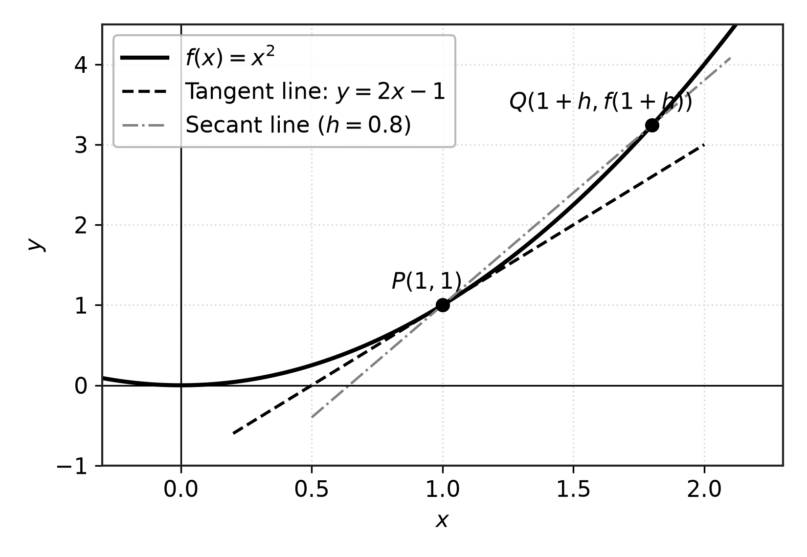
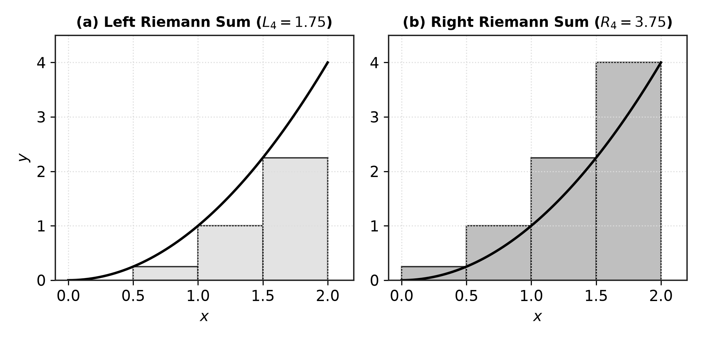
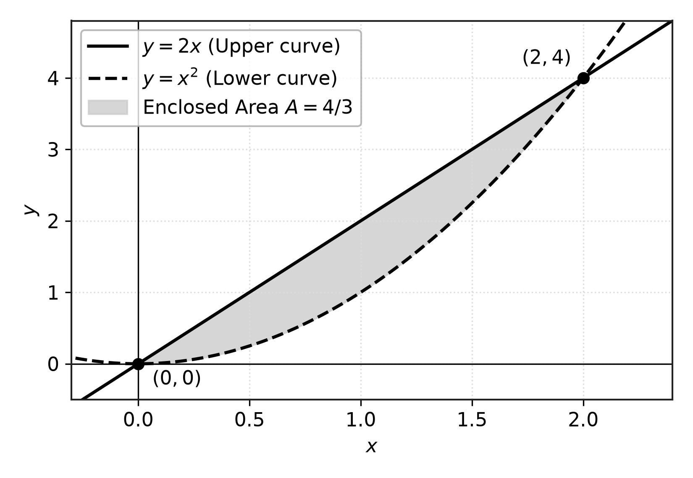
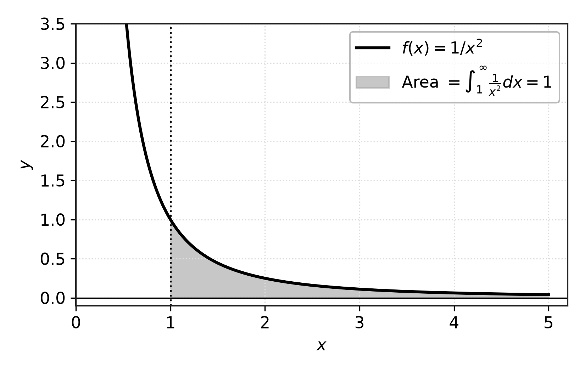

# บทที่ 2
# วรรณกรรมและทฤษฎีที่เกี่ยวข้อง

การพัฒนาเว็บแอปพลิเคชันช่วยเรียนคณิตศาสตร์สำหรับแคลคูลัสเบื้องต้น ผู้จัดทำได้ทำการศึกษา รวบรวมหลักการทางคณิตศาสตร์ เทคโนโลยีซอฟต์แวร์ กรอบแนวคิดการออกแบบการสอน และงานวิจัยที่เกี่ยวข้อง เพื่อใช้เป็นกรอบทฤษฎีและแนวทางในการพัฒนาระบบ โดยแบ่งเนื้อหาออกเป็น 5 หัวข้อหลัก ดังนี้

2.1 ทฤษฎีคณิตศาสตร์สำหรับแคลคูลัสเบื้องต้น
2.2 เทคโนโลยีและเครื่องมือที่ใช้ในการพัฒนา
2.3 กรอบแนวคิดการจัดนั่งร้านทางปัญญาและการออกแบบแบบทดสอบ
2.4 การประเมินความสะดวกในการใช้งาน
2.5 งานวิจัยที่เกี่ยวข้อง

## 2.1 ทฤษฎีคณิตศาสตร์สำหรับแคลคูลัสเบื้องต้น

เนื้อหาคณิตศาสตร์ในโครงงานนี้มุ่งเน้นการเสริมสร้างความเข้าใจทางเรขาคณิตควบคู่กับความถูกต้องแม่นยำในการคำนวณ ครอบคลุม 7 หัวข้อสำคัญ ได้แก่

### 2.1.1 ลิมิตเข้าใกล้จุดและความต่อเนื่อง (Limits and Continuity)

ลิมิตของฟังก์ชันเป็นแนวคิดพื้นฐานที่อธิบายพฤติกรรมของค่าฟังก์ชัน $f(x)$ เมื่อตัวแปร $x$ มีค่าเข้าใกล้จุด $a$ ใด ๆ 

**นิยามและความหมายทางเรขาคณิตของลิมิต:**
เรากล่าวว่าลิมิตของ $f(x)$ เมื่อ $x$ เข้าใกล้ $a$ มีค่าเท่ากับ $L$ เขียนแทนด้วยสัญลักษณ์
$$\lim_{x \to a} f(x) = L$$
ก็ต่อเมื่อ ลิมิตด้านซ้ายและลิมิตด้านขวามีค่าเท่ากัน นั่นคือ $\lim_{x \to a^-} f(x) = \lim_{x \to a^+} f(x) = L$ ในเชิงเรขาคณิต หมายถึงเมื่อจุดบนเส้นโค้งเคลื่อนที่เข้าใกล้พิกัด $x = a$ จากทั้งสองทิศทาง ค่าบนแกน $y$ จะลู่เข้าสู่ระดับความสูง $L$ เดียวกัน หากลิมิตซ้ายและขวาไม่เท่ากัน จะถือว่าลิมิตหาค่าไม่ได้

**นิยามความต่อเนื่องของฟังก์ชัน (Continuity):**
ฟังก์ชัน $f(x)$ จะมีความต่อเนื่อง ณ จุด $x = a$ ก็ต่อเมื่อสอดคล้องกับเงื่อนไขทางคณิตศาสตร์ครบทั้ง 3 ข้อ ดังนี้

1. $f(a)$ นิยามและหาค่าได้จริงในโดเมนของฟังก์ชัน
2. $\lim_{x \to a} f(x)$ มีค่าเป็นจำนวนจริง
3. $\lim_{x \to a} f(x) = f(a)$

หากฟังก์ชันขาดเงื่อนไขข้อใดข้อหนึ่ง จะส่งผลให้ฟังก์ชันเกิดภาวะไม่ต่อเนื่อง (Discontinuity) ซึ่งในระบบช่วยเรียนรู้ได้จำแนกจุดไม่ต่อเนื่องออกเป็น 3 ลักษณะสำคัญ ดังแสดงในตารางที่ 2.1

ตารางที่ 2.1 การจำแนกประเภทของจุดไม่ต่อเนื่องและลักษณะทางเรขาคณิต

| ประเภทจุดไม่ต่อเนื่อง | เงื่อนไขทางคณิตศาสตร์ | ลักษณะกราฟทางเรขาคณิต | ตัวอย่างฟังก์ชัน |
|:---|:---|:---|:---|
| **จุดไม่ต่อเนื่องแบบขจัดได้** (Removable Discontinuity) | $\lim_{x \to a} f(x)$ หาค่าได้ แต่ $\lim_{x \to a} f(x) \neq f(a)$ หรือ $f(a)$ ไม่นิยาม | กราฟเป็นเส้นเรียบต่อเนื่อง แต่มีจุดโปร่งหรือรูโหว่เพียงจุดเดียว | $f(x) = \frac{x^2 - 9}{x - 3}$ ที่ $x = 3$ |
| **จุดไม่ต่อเนื่องแบบกระโดด** (Jump Discontinuity) | $\lim_{x \to a^-} f(x)$ และ $\lim_{x \to a^+} f(x)$ หาค่าได้ แต่มีค่าไม่เท่ากัน | กราฟขาดตอนและกระโดดเปลี่ยนระดับความสูงอย่างกะทันหัน | $f(x) = \frac{|x|}{x}$ ที่ $x = 0$ |
| **จุดไม่ต่อเนื่องแบบอนันต์** (Infinite Discontinuity) | ลิมิตข้างใดข้างหนึ่งมีค่าพุ่งเข้าสู่อนันต์ ($+\infty$ หรือ $-\infty$) | กราฟพุ่งชันเข้าสู่เส้นกำกับแนวดิ่ง (Vertical Asymptote) | $f(x) = \frac{1}{x - 2}$ ที่ $x = 2$ |

ในกรณีที่การแทนค่าโดยตรง $f(a)$ นำไปสู่รูปแบบยังไม่กำหนด (Indeterminate Forms) เช่น $\frac{0}{0}$ จำเป็นต้องจัดรูปทางพีชคณิตด้วยการแยกตัวประกอบหรือการคูณด้วยสังยุคก่อนคำนวณค่าลิมิต

**ตัวอย่างที่ 2.1 (การแทนค่าโดยตรง):**
จงหาค่าของ $\lim_{x \to 2} (3x^2 - 4x + 1)$
*วิธีทำ:* เนื่องจากฟังก์ชันพหุนามมีความต่อเนื่องที่ทุกจุดตามเงื่อนไขความต่อเนื่อง สามารถแทนค่า $x = 2$ ได้โดยตรง
$$\lim_{x \to 2} (3x^2 - 4x + 1) = 3(2)^2 - 4(2) + 1 = 12 - 8 + 1 = 5$$
*ความหมายทางเรขาคณิต:* เมื่อ $x$ มีค่าเข้าใกล้ 2 เส้นกราฟพาราโบลาจะลู่เข้าสู่พิกัด $(2, 5)$ บนระนาบ

**ตัวอย่างที่ 2.2 (รูปแบบยังไม่กำหนด 0/0):**
จงหาค่าของ $\lim_{x \to 3} \frac{x^2 - 9}{x - 3}$
*วิธีทำ:* เมื่อแทนค่า $x = 3$ จะได้เศษส่วนอยู่ในรูปแบบ $\frac{0}{0}$ ซึ่งยังสรุปค่าไม่ได้ จึงทำการแยกตัวประกอบตัวเศษ
$$\lim_{x \to 3} \frac{x^2 - 9}{x - 3} = \lim_{x \to 3} \frac{(x - 3)(x + 3)}{x - 3}$$
เมื่อ $x \neq 3$ สามารถทอนพจน์ $(x - 3)$ ได้ จะได้
$$\lim_{x \to 3} (x + 3) = 3 + 3 = 6$$
*ความหมายทางเรขาคณิต:* กราฟของฟังก์ชันนี้เป็นเส้นตรง $y = x + 3$ ที่มีจุดโปร่งที่พิกัด $(3, 6)$ ค่าลิมิตบอกระดับความสูงของจุดโปร่งนี้ จัดเป็นจุดไม่ต่อเนื่องแบบขจัดได้

### 2.1.2 เส้นสัมผัสและอนุพันธ์ (Tangent Lines and Derivatives)

อนุพันธ์ของฟังก์ชันอธิบายอัตราการเปลี่ยนแปลงขณะใดขณะหนึ่ง และในเชิงเรขาคณิตหมายถึงความชันของเส้นสัมผัสเส้นโค้ง ณ จุดใด ๆ

**นิยามและความหมายทางเรขาคณิต:**
อนุพันธ์ของฟังก์ชัน $f(x)$ ณ จุด $x = a$ กำหนดโดยลิมิตของความชันของเส้นตัดคอร์ด (Secant Line) เมื่อระยะห่าง $h$ ลู่เข้าสู่ศูนย์
$$f'(a) = \lim_{h \to 0} \frac{f(a+h) - f(a)}{h}$$
สมการเส้นสัมผัสกราฟ $y = f(x)$ ณ จุด $(a, f(a))$ คำนวณได้จากสมการจุดและความชัน
$$y - f(a) = f'(a)(x - a)$$

{width=65%}

**ตัวอย่างที่ 2.3 (การหาความชันและสมการเส้นสัมผัส):**
กำหนดให้ $f(x) = x^2$ จงหาสมการเส้นสัมผัสกราฟ ณ จุดที่ $x = 1$
*วิธีทำ:* หาค่าความสูงที่จุดสัมผัส $f(1) = (1)^2 = 1$
หาฟังก์ชันอนุพันธ์ $f'(x) = 2x$ ดังนั้นความชันของเส้นสัมผัส ณ $x = 1$ คือ $m = f'(1) = 2(1) = 2$
สร้างสมการเส้นสัมผัสจากจุด $(1, 1)$ และความชัน $m = 2$
$$y - 1 = 2(x - 1) \implies y = 2x - 1$$
*ความหมายทางเรขาคณิต:* เส้นตรง $y = 2x - 1$ สัมผัสเส้นโค้งพาราโบลา $y = x^2$ พอดีที่จุด $(1, 1)$ ดังแสดงในภาพที่ 2.1

**ตัวอย่างที่ 2.4 (การวิเคราะห์ความชันและค่าสุดขีดสัมพัทธ์):**
กำหนดให้ $f(x) = x^3 - 3x$ จงหาจุดบนกราฟที่มีเส้นสัมผัสขนานกับแกน $x$ พร้อมจำแนกลักษณะของจุดดังกล่าว
*วิธีทำ:* เส้นสัมผัสขนานกับแกน $x$ หมายถึงความชันเป็นศูนย์ ($f'(x) = 0$)
คำนวณอนุพันธ์อันดับหนึ่ง $f'(x) = 3x^2 - 3$
กำหนดให้ $3x^2 - 3 = 0 \implies 3(x^2 - 1) = 0 \implies x = 1, -1$
เมื่อ $x = 1$ ได้ $f(1) = 1^3 - 3(1) = -2$ พิกัดคือ $(1, -2)$
เมื่อ $x = -1$ ได้ $f(-1) = (-1)^3 - 3(-1) = 2$ พิกัดคือ $(-1, 2)$
ตรวจสอบลักษณะจุดด้วยการทดสอบอนุพันธ์อันดับสอง (Second Derivative Test):
คำนวณ $f''(x) = 6x$

- ที่จุด $(1, -2)$: $f''(1) = 6(1) = 6 > 0$ กราฟมีลักษณะหงาย จึงเป็นจุดต่ำสุดสัมพัทธ์
- ที่จุด $(-1, 2)$: $f''(-1) = 6(-1) = -6 < 0$ กราฟมีลักษณะคว่ำ จึงเป็นจุดสูงสุดสัมพัทธ์
*ความหมายทางเรขาคณิต:* กราฟมีจุดราบสองจุด คือ จุดต่ำสุดสัมพัทธ์ $(1, -2)$ และจุดสูงสุดสัมพัทธ์ $(-1, 2)$ ซึ่งเส้นสัมผัสมีลักษณะเป็นแนวนอน

### 2.1.3 ผลรวมรีมันน์และการอินทิเกรตตรงแบบ (Riemann Sums and Definite Integrals)

ผลรวมรีมันน์เป็นเครื่องมือในการประมาณพื้นที่ปิดล้อมใต้เส้นโค้งด้วยผลรวมของพื้นที่แท่งสี่เหลี่ยมผืนผ้า ก่อนจะนำไปสู่นิยามของปริพันธ์จำกัดเขตและทฤษฎีบทหลักมูลของแคลคูลัส

**นิยามและความหมายทางเรขาคณิต:**
พิจารณาฟังก์ชัน $f(x)$ บนช่วงปิด $[a, b]$ แบ่งช่วงออกเป็น $n$ ช่วงย่อยเท่า ๆ กัน แต่ละช่วงมีความกว้าง $\Delta x = \frac{b - a}{n}$ ผลรวมรีมันน์กำหนดโดย
$$S_n = \sum_{i=1}^n f(x_i^*) \Delta x$$
โดยที่ $x_i^*$ คือจุดตัวแทนในแต่ละช่วงย่อย ซึ่งมีสูตรการคำนวณพิกัด 3 รูปแบบมาตรฐาน ดังนี้

1. ผลรวมรีมันน์ทางซ้าย (Left Riemann Sum): $x_i^* = a + (i - 1)\Delta x$
2. ผลรวมรีมันน์ทางขวา (Right Riemann Sum): $x_i^* = a + i\Delta x$
3. ผลรวมรีมันน์จุดกึ่งกลาง (Midpoint Riemann Sum): $x_i^* = a + \left(i - \frac{1}{2}\right)\Delta x$

เมื่อเพิ่มจำนวนแท่งสี่เหลี่ยมให้เข้าสู่อนันต์ ($n \to \infty$) ค่าผลรวมจะลู่เข้าสู่ค่าปริพันธ์จำกัดเขต
$$\int_a^b f(x)\,dx = \lim_{n \to \infty} \sum_{i=1}^n f(x_i^*) \Delta x$$

**ทฤษฎีบทหลักมูลของแคลคูลัส (Fundamental Theorem of Calculus: FTC):**
ความเชื่อมโยงระหว่างการหาอนุพันธ์กับการคำนวณปริพันธ์สรุปผ่านทฤษฎีบท 2 ส่วน:

- **ส่วนที่ 1:** หาก $f$ มีความต่อเนื่องบนช่วง $[a, b]$ และกำหนดฟังก์ชัน $g(x) = \int_a^x f(t)\,dt$ แล้ว $g'(x) = f(x)$
- **ส่วนที่ 2:** หาก $F$ เป็นปฏิยานุพันธ์ของ $f$ บนช่วง $[a, b]$ (นั่นคือ $F'(x) = f(x)$) แล้ว
$$\int_a^b f(x)\,dx = F(b) - F(a)$$

{width=85%}

**ตัวอย่างที่ 2.5 (การประมาณค่าด้วยผลรวมรีมันน์ทางซ้ายและขวา):**
จงประมาณค่าของ $\int_0^2 x^2\,dx$ โดยใช้ผลรวมรีมันน์ที่มีจำนวนช่วงย่อย $n = 4$
*วิธีทำ:* ความกว้างแต่ละช่วงย่อย $\Delta x = \frac{2 - 0}{4} = 0.5$ จุดแบ่งช่วงย่อยคือ $x = 0, 0.5, 1.0, 1.5, 2.0$

1. ผลรวมรีมันน์ทางซ้าย (ใช้จุด $x_i^* = 0, 0.5, 1.0, 1.5$):
$$L_4 = [f(0) + f(0.5) + f(1.0) + f(1.5)](0.5) = [0 + 0.25 + 1.0 + 2.25](0.5) = (3.5)(0.5) = 1.75$$

2. ผลรวมรีมันน์ทางขวา (ใช้จุด $x_i^* = 0.5, 1.0, 1.5, 2.0$):
$$R_4 = [f(0.5) + f(1.0) + f(1.5) + f(2.0)](0.5) = [0.25 + 1.0 + 2.25 + 4.0](0.5) = (7.5)(0.5) = 3.75$$
*ความหมายทางเรขาคณิต:* เนื่องจาก $f(x) = x^2$ เป็นฟังก์ชันเพิ่มบน $[0, 2]$ แท่งสี่เหลี่ยมทางซ้ายจะอยู่ใต้เส้นโค้ง ($L_4$ ให้ค่าประมาณต่ำกว่าจริง) และแท่งทางขวาจะล้นเส้นโค้ง ($R_4$ ให้ค่าประมาณสูงกว่าจริง) ดังแสดงในภาพที่ 2.2 โดยค่าจริงคำนวณผ่านทฤษฎีบทหลักมูลของแคลคูลัสได้เท่ากับ $\int_0^2 x^2\,dx = [\frac{x^3}{3}]_0^2 = \frac{8}{3} \approx 2.6667$

**ตัวอย่างที่ 2.6 (ผลรวมรีมันน์จุดกึ่งกลาง):**
จงประมาณค่าของ $\int_1^3 (2x + 1)\,dx$ โดยใช้จุดกึ่งกลางที่มี $n = 4$
*วิธีทำ:* ความกว้างช่วงย่อย $\Delta x = \frac{3 - 1}{4} = 0.5$
จุดกึ่งกลางคำนวณจากสูตร $x_i^* = 1 + (i - 0.5)(0.5)$ ได้แก่ $x_1^* = 1.25, x_2^* = 1.75, x_3^* = 2.25, x_4^* = 2.75$
คำนวณค่าฟังก์ชัน:
$f(1.25) = 2(1.25) + 1 = 3.5$
$f(1.75) = 2(1.75) + 1 = 4.5$
$f(2.25) = 2(2.25) + 1 = 5.5$
$f(2.75) = 2(2.75) + 1 = 6.5$
คำนวณผลรวมจุดกึ่งกลาง:
$$M_4 = [3.5 + 4.5 + 5.5 + 6.5](0.5) = (20.0)(0.5) = 10.0$$
*ความหมายทางเรขาคณิต:* ค่าที่ได้เท่ากับค่าปริพันธ์จริงพอดี $\int_1^3 (2x + 1)\,dx = [x^2 + x]_1^3 = (9 + 3) - (1 + 1) = 10$ เนื่องจากฟังก์ชันเส้นตรงทำให้พื้นที่สามเหลี่ยมส่วนที่เกินและขาดหักล้างกันพอดี

### 2.1.4 เทคนิคการอินทิเกรต (Integration Techniques)

การคำนวณปริพันธ์ของฟังก์ชันที่ซับซ้อนต้องอาศัยเทคนิคการแปลงรูปเพื่อให้เข้าสู่สูตรมาตรฐาน

**นิยามและสูตรหลัก:**

1. **การอินทิเกรตโดยการแทนค่าตัวแปร (Integration by Substitution):** อาศัยกฎลูกโซ่แบบย้อนกลับ เมื่อตัวถูกอินทิเกรตอยู่ในรูป $f(g(x))g'(x)$ ให้กำหนดตัวแปรใหม่ $u = g(x)$ จะได้ $du = g'(x)dx$ ส่งผลให้
$$\int f(g(x))g'(x)\,dx = \int f(u)\,du$$

2. **การอินทิเกรตทีละส่วน (Integration by Parts):** อาศัยอนุพันธ์ของผลคูณสองฟังก์ชัน มีสูตรคำนวณคือ
$$\int u\,dv = uv - \int v\,du$$
การเลือกฟังก์ชัน $u$ ยึดตามลำดับความสำคัญของกฎ **LIATE** เพื่อให้ได้ฟังก์ชันที่หาอนุพันธ์แล้วลดรูปได้ง่ายที่สุด ดังนี้:

- **L:** ฟังก์ชันลอการิทึม (Logarithmic Functions เช่น $\ln x$)
- **I:** ฟังก์ชันตรีโกณมิติผกผัน (Inverse Trigonometric Functions เช่น $\arctan x$)
- **A:** ฟังก์ชันพีชคณิตและพหุนาม (Algebraic Functions เช่น $x^2, 3x$)
- **T:** ฟังก์ชันตรีโกณมิติ (Trigonometric Functions เช่น $\sin x, \cos x$)
- **E:** ฟังก์ชันเลขชี้กำลัง (Exponential Functions เช่น $e^x, 2^x$)

**ตัวอย่างที่ 2.7 (การแทนค่าตัวแปร u):**
จงหาค่าของ $\int 2x \cos(x^2)\,dx$
*วิธีทำ:* กำหนดให้ $u = x^2$ จะได้อนุพันธ์ $\frac{du}{dx} = 2x \implies du = 2x\,dx$
แทนค่าลงในปริพันธ์เดิม:
$$\int \cos(u)\,du = \sin(u) + C = \sin(x^2) + C$$

**ตัวอย่างที่ 2.8 (การอินทิเกรตทีละส่วนตามกฎ LIATE):**
จงหาค่าของ $\int x e^x\,dx$
*วิธีทำ:* พิจารณาตามกฎ LIATE ระหว่างฟังก์ชันพีชคณิต $x$ (A) กับฟังก์ชันเลขชี้กำลัง $e^x$ (E) จึงเลือกฟังก์ชันพีชคณิตเป็น $u$:
กำหนดให้ $u = x \implies du = dx$
กำหนดให้ $dv = e^x\,dx \implies v = \int e^x\,dx = e^x$
แทนค่าลงในสูตร $\int u\,dv = uv - \int v\,du$:
$$\int x e^x\,dx = x e^x - \int e^x\,dx = x e^x - e^x + C = (x - 1)e^x + C$$

### 2.1.5 พื้นที่ระหว่างเส้นโค้ง (Area Between Curves)

**นิยามและความหมายทางเรขาคณิต:**
กำหนดให้ $f(x)$ และ $g(x)$ เป็นฟังก์ชันต่อเนื่องบนช่วง $[a, b]$ โดยที่ $f(x) \ge g(x)$ ตลอดช่วง พื้นที่ปิดล้อมระหว่างเส้นโค้งทั้งสองตั้งแต่ $x = a$ ถึง $x = b$ กำหนดโดย
$$A = \int_a^b [f(x) - g(x)]\,dx$$
ในเชิงเรขาคณิต $f(x) - g(x)$ แทนความสูงของแถบพื้นที่ย่อยในแนวดิ่ง หากเส้นกราฟตัดกันภายในช่วง ต้องหาจุดตัดทั้งหมดเพื่อแบ่งช่วงอินทิเกรตให้ฟังก์ชันตัวบนลบฟังก์ชันตัวล่างเสมอ

{width=65%}

**ตัวอย่างที่ 2.9 (พื้นที่ปิดล้อมระหว่างพาราโบลากับแกน x):**
จงหาพื้นที่ของบริเวณที่ปิดล้อมด้วยเส้นโค้ง $y = 2x - x^2$ และแกน $x$ ($y = 0$)
*วิธีทำ:* หาจุดตัดของกราฟโดยกำหนดให้ $2x - x^2 = 0 \implies x(2 - x) = 0 \implies x = 0, 2$
บนช่วง $[0, 2]$ พบว่าพาราโบลาอยู่เหนือแกน $x$ ($2x - x^2 \ge 0$) เสมอ
$$A = \int_0^2 (2x - x^2)\,dx = \left[ x^2 - \frac{x^3}{3} \right]_0^2 = \left( 4 - \frac{8}{3} \right) - 0 = \frac{4}{3}$$
*ความหมายทางเรขาคณิต:* พื้นที่ปิดล้อมใต้โดมพาราโบลามีขนาดเท่ากับ $\frac{4}{3}$ ตารางหน่วย

**ตัวอย่างที่ 2.10 (พื้นที่ระหว่างสองเส้นโค้งที่มีจุดตัด):**
จงหาพื้นที่ปิดล้อมระหว่างเส้นตรง $y = 2x$ และพาราโบลา $y = x^2$
*วิธีทำ:* หาจุดตัดโดยแก้สมการ $2x = x^2 \implies x^2 - 2x = 0 \implies x(x - 2) = 0 \implies x = 0, 2$
บนช่วง $[0, 2]$ เส้นตรงอยู่เหนือเส้นโค้งพาราโบลา ($2x \ge x^2$)
$$A = \int_0^2 (2x - x^2)\,dx = \left[ x^2 - \frac{x^3}{3} \right]_0^2 = 4 - \frac{8}{3} = \frac{4}{3}$$
*ความหมายทางเรขาคณิต:* แถบแรเงาระหว่างเส้นตรง $y = 2x$ กับพาราโบลา $y = x^2$ แสดงพื้นที่ขนาด $\frac{4}{3}$ ตารางหน่วย ดังแสดงในภาพที่ 2.3

### 2.1.6 ปริมาตรทรงตันที่เกิดจากการหมุน (Volumes of Solids of Revolution)

การหมุนบริเวณพื้นที่บนระนาบ $xy$ รอบแกนหมุนจะทำให้เกิดรูปทรงตันสามมิติ ซึ่งสามารถคำนวณปริมาตรได้ด้วยการรวมพื้นที่หน้าตัดย่อย

**นิยามและสูตรหลัก:**

1. **วิธีจาน (Disk Method):** ใช้เมื่อบริเวณพื้นที่แนบสนิทกับแกนหมุน โดยมีสูตรการหมุนรอบแกน $x$ คือ
$$V = \pi \int_a^b [f(x)]^2\,dx$$

2. **วิธีวงแหวน (Washer Method):** ใช้เมื่อมีช่องว่างระหว่างพื้นที่กับแกนหมุน โดยมีรัศมีภายนอก $R(x)$ และรัศมีภายใน $r(x)$
$$V = \pi \int_a^b \left( [R(x)]^2 - [r(x)]^2 \right) dx$$

**ตัวอย่างที่ 2.11 (วิธีจาน):**
จงหาปริมาตรของทรงตันที่เกิดจากการหมุนบริเวณใต้กราฟ $y = \sqrt{x}$ จาก $x = 0$ ถึง $x = 4$ รอบแกน $x$
*วิธีทำ:* ใช้สูตรวิธีจานโดยมีรัศมี $R(x) = \sqrt{x}$
$$V = \pi \int_0^4 (\sqrt{x})^2\,dx = \pi \int_0^4 x\,dx = \pi \left[ \frac{x^2}{2} \right]_0^4 = \pi \left( \frac{16}{2} - 0 \right) = 8\pi$$
*ความหมายทางเรขาคณิต:* ทรงตันที่ได้มีลักษณะเป็นรูปพาราโบลาคว่ำสามมิติ (Paraboloid) ที่มีปริมาตร $8\pi$ ลูกบาศก์หน่วย

**ตัวอย่างที่ 2.12 (วิธีวงแหวน):**
จงหาปริมาตรที่เกิดจากการหมุนบริเวณปิดล้อมด้วย $y = x$ และ $y = x^2$ รอบแกน $x$
*วิธีทำ:* จุดตัดของทั้งสองกราฟคือ $x = 0$ และ $x = 1$
บนช่วง $[0, 1]$ รัศมีภายนอกคือเส้นตรง $R(x) = x$ และรัศมีภายในคือพาราโบลา $r(x) = x^2$
$$V = \pi \int_0^1 \left( (x)^2 - (x^2)^2 \right) dx = \pi \int_0^1 (x^2 - x^4)\,dx = \pi \left[ \frac{x^3}{3} - \frac{x^5}{5} \right]_0^1 = \pi \left( \frac{1}{3} - \frac{1}{5} \right) = \frac{2\pi}{15}$$
*ความหมายทางเรขาคณิต:* ทรงตันที่ได้มีลักษณะกลวงตรงกลางคล้ายกรวยที่มีผิวโค้งด้านใน

### 2.1.7 ปริพันธ์ไม่ตรงแบบ (Improper Integrals)

ปริพันธ์ไม่ตรงแบบคือปริพันธ์ที่ช่วงของการอินทิเกรตหรือฟังก์ชันตัวถูกอินทิเกรตมีภาวะอนันต์ ซึ่งแบ่งออกเป็น 2 ชนิดหลัก:

1. **ปริพันธ์ไม่ตรงแบบชนิดที่ 1 (ช่วงอนันต์):** มีขอบเขตการอินทิเกรตเป็นอนันต์ เช่น
$$\int_a^{\infty} f(x)\,dx = \lim_{t \to \infty} \int_a^t f(x)\,dx$$

2. **ปริพันธ์ไม่ตรงแบบชนิดที่ 2 (จุดไม่ต่อเนื่องแบบอนันต์):** ฟังก์ชันมีจุดเอกฐาน (Singularity) ภายในช่วง เช่น หาก $f(x)$ มีค่าพุ่งสู่อนันต์ที่จุดปลาย $x = b$ จะนิยามผ่านลิมิตข้างเดียว
$$\int_a^b f(x)\,dx = \lim_{t \to b^-} \int_a^t f(x)\,dx$$

หากค่าลิมิตหาได้เป็นจำนวนจริง จะกล่าวว่าปริพันธ์นั้น **ลู่เข้า (Converges)** แต่หากลิมิตหาค่าไม่ได้หรือเป็นอนันต์ จะกล่าวว่าปริพันธ์นั้น **ลู่ออก (Diverges)**

{width=65%}

**ตัวอย่างที่ 2.13 (ปริพันธ์ไม่ตรงแบบชนิดที่ 1 ที่ลู่เข้า):**
จงตรวจสอบการลู่เข้าของ $\int_1^{\infty} \frac{1}{x^2}\,dx$
*วิธีทำ:* เขียนรูปปริพันธ์ในรูปลิมิต
$$\int_1^{\infty} \frac{1}{x^2}\,dx = \lim_{t \to \infty} \int_1^t x^{-2}\\,dx = \lim_{t \to \infty} \left[ -\frac{1}{x} \right]_1^t = \lim_{t \to \infty} \left( -\frac{1}{t} - (-1) \right) = 0 + 1 = 1$$
*ความหมายทางเรขาคณิต:* แม้ว่าหางของเส้นกราฟ $y = \frac{1}{x^2}$ จะทอดยาวไปจนถึงอนันต์ทางขวา แต่พื้นที่ปิดล้อมใต้เส้นโค้งมีขนาดจำกัดและลู่เข้าสู่ 1 ตารางหน่วย ดังแสดงในภาพที่ 2.4

**ตัวอย่างที่ 2.14 (ปริพันธ์ไม่ตรงแบบชนิดที่ 2 ที่มีจุดเอกฐาน):**
จงตรวจสอบการลู่เข้าของ $\int_0^1 \frac{1}{\sqrt{x}}\,dx$
*วิธีทำ:* ฟังก์ชันมีจุดเอกฐานแนวดิ่งที่ $x = 0$ (ไม่นิยาม) จึงเป็นปริพันธ์ไม่ตรงแบบชนิดที่ 2 เขียนในรูปลิมิตข้างเดียว
$$\int_0^1 x^{-1/2}\,dx = \lim_{t \to 0^+} \int_t^1 x^{-1/2}\,dx = \lim_{t \to 0^+} [2\sqrt{x}]_t^1 = \lim_{t \to 0^+} (2 - 2\sqrt{t}) = 2 - 0 = 2$$
*ความหมายทางเรขาคณิต:* แม้กราฟจะพุ่งขึ้นสู่แกน $y$ อย่างไม่มีที่สิ้นสุด แต่พื้นที่ปิดล้อมระหว่างกราฟกับแกน $y$ บนช่วง $[0, 1]$ ลู่เข้าสู่ค่า 2 ตารางหน่วย

## 2.2 เทคโนโลยีและเครื่องมือที่ใช้ในการพัฒนา

การพัฒนาเว็บแอปพลิเคชันเลือกใช้เครื่องมือที่มุ่งเน้นการเป็นกลไกขับเคลื่อนการคำนวณทางคณิตศาสตร์อย่างแม่นยำและแสดงผลได้อย่างรวดเร็ว

### 2.2.1 ภาษาไพธอนและไลบรารีสตรีมลิต (Python and Streamlit)
ภาษาไพธอน (Python) เป็นภาษาโปรแกรมระดับสูงที่มีจุดเด่นด้านไวยากรณ์ที่กระชับและมีระบบนิเวศของไลบรารีทางวิทยาศาสตร์ที่สมบูรณ์ โครงงานนี้เลือกใช้ไลบรารีสตรีมลิต (Streamlit) ทำหน้าที่เป็นแกนควบคุมการทำงานหลักของเว็บแอปพลิเคชัน โดยสตรีมลิตช่วยให้สามารถสร้างส่วนประสานงานผู้ใช้ที่ตอบสนองแบบเรียลไทม์ (Reactive UI) จัดการระบบนำทางหลายหน้า (Multi-page Navigation) และควบคุมสถานะของตัวแปร (Session State) ในการจำลองกราฟและบันทึกคะแนนสอบได้โดยไม่ต้องอาศัยสถาปัตยกรรมเว็บเซิร์ฟเวอร์ที่ซับซ้อน

### 2.2.2 ไลบรารีซิมไพ (SymPy) ในฐานะระบบพีชคณิตคอมพิวเตอร์
ไลบรารีซิมไพ (SymPy) ทำหน้าที่เป็นกลไกประมวลผลพีชคณิตคอมพิวเตอร์ (CAS) ประจำระบบ ซึ่งแตกต่างจากไลบรารีคำนวณเชิงตัวเลขทั่วไปตรงที่ซิมไพจัดการตัวแปรในรูปสัญลักษณ์ที่คงค่าความแม่นยำทางคณิตศาสตร์ 100% เช่น การคงรูปเศษส่วน $\frac{1}{3}$ หรือค่าคงตัว $\pi$ โดยไม่มีปัญหาความคลาดเคลื่อนจากการปัดเศษทศนิยม (Floating-point error) ซิมไพถูกนำมาใช้ในการคำนวณอนุพันธ์ ปริพันธ์ การแยกตัวประกอบ และการตรวจสอบเงื่อนไขความถูกต้องของสมการ

### 2.2.3 ไลบรารีแมตพลอตลิบ (Matplotlib) และระบบเคเท็ก (KaTeX)
ไลบรารีแมตพลอตลิบ (Matplotlib) ทำหน้าที่สร้างกราฟสองมิติ กราฟเส้นสัมผัส แท่งสี่เหลี่ยมผลรวมรีมันน์ และการแรเงาพื้นที่ปิดล้อม โดยทำงานร่วมกับระบบเคเท็ก (KaTeX) ซึ่งเป็นระบบเรนเดอร์สมการคณิตศาสตร์ประสิทธิภาพสูงบนเว็บเบราว์เซอร์ ช่วยให้สูตร นิยาม และขั้นตอนวิธีทำแสดงผลในรูปแบบสัญลักษณ์มาตรฐานทางวิชาการที่คมชัดและถูกต้อง

## 2.3 กรอบแนวคิดการจัดนั่งร้านทางปัญญาและการออกแบบแบบทดสอบ

### 2.3.1 การจัดนั่งร้านทางปัญญา (Instructional Scaffolding)
การจัดนั่งร้านทางปัญญาเป็นทฤษฎีการออกแบบการสอนที่มุ่งเน้นการให้ความช่วยเหลือแก่ผู้เรียนในระดับที่เหมาะสมกับความสามารถ แล้วค่อย ๆ ลดระดับการช่วยเหลือลงเมื่อผู้เรียนเริ่มเกิดความชำนาญ โครงงานนี้นำหลักการดังกล่าวมาปรับใช้ในการออกแบบบทเรียน 4 ขั้นตอน:

1. การนำเสนอแนวคิดและกราฟจำลองเพื่อให้เห็นภาพรวม
2. การให้ผู้เรียนทดลองปรับตัวแปรบนกราฟเพื่อสังเกตความสัมพันธ์
3. การแสดงวิธีทำอย่างเป็นลำดับขั้นพร้อมอธิบายเหตุผลและข้อควรระวัง
4. การให้แบบฝึกหัดที่มาพร้อมระบบคำใบ้ชี้แนะแนวทางแทนการเฉลยทันที

### 2.3.2 การจำแนกระดับของแบบทดสอบ
เพื่อวัดความเข้าใจของผู้เรียนอย่างเป็นระบบ คลังแบบทดสอบจำนวน 80 ข้อถูกจำแนกออกเป็น 3 ระดับตามระดับความลึกในการคิด:

1. **ระดับมโนทัศน์และสูตรพื้นฐาน:** ทดสอบความจำและความเข้าใจนิยาม เช่น การอ่านค่าจุดตัด หรือการระบุสูตรอนุพันธ์
2. **ระดับการฝึกคำนวณ:** ทดสอบทักษะการแก้โจทย์ตามขั้นตอน เช่น การคำนวณพื้นที่ปิดล้อม หรือการอินทิเกรตโดยการแทนค่า
3. **ระดับการวิเคราะห์และตรวจสอบจุดผิด:** ทดสอบความเข้าใจในเงื่อนไขพิเศษ เช่น การตรวจสอบลิมิตที่ไม่ต่อเนื่อง หรือการจัดการรูปแบบยังไม่กำหนด

## 2.4 การประเมินความสะดวกในการใช้งาน (System Usability Scale: SUS)

การประเมินความสะดวกในการใช้งานใช้แบบประเมินมาตรฐานสากล (System Usability Scale: SUS) ของ John Brooke ซึ่งประกอบด้วยข้อคำถาม 10 ข้อ มีมาตรวัดประมาณค่า 5 ระดับ (ตั้งแต่ 1 = ไม่เห็นด้วยอย่างยิ่ง ถึง 5 = เห็นด้วยอย่างยิ่ง) ดังแสดงในตารางที่ 2.2

ตารางที่ 2.2 ข้อคำถามมาตรฐานในแบบประเมินความสะดวกในการใช้งาน (SUS)

| ลำดับที่ | ข้อความคำถามประเมิน |
|:---|:---|
| 1 | ฉันคิดว่าฉันอยากใช้เว็บแอปพลิเคชันนี้บ่อย ๆ |
| 2 | ฉันพบว่าเว็บแอปพลิเคชันนี้มีความซับซ้อนโดยไม่จำเป็น |
| 3 | ฉันคิดว่าเว็บแอปพลิเคชันนี้ใช้งานได้ง่าย |
| 4 | ฉันคิดว่าฉันต้องได้รับความช่วยเหลือจากผู้เชี่ยวชาญจึงจะสามารถใช้งานเว็บแอปพลิเคชันนี้ได้ |
| 5 | ฉันพบว่าระบบต่าง ๆ ในเว็บแอปพลิเคชันนี้ทำงานประสานกันได้อย่างลงตัว |
| 6 | ฉันคิดว่าเว็บแอปพลิเคชันนี้มีความไม่สอดคล้องกันในการทำงานมากเกินไป |
| 7 | ฉันคิดว่าคนส่วนใหญ่จะสามารถเรียนรู้การใช้งานเว็บแอปพลิเคชันนี้ได้อย่างรวดเร็ว |
| 8 | ฉันพบว่าเว็บแอปพลิเคชันนี้มีความยุ่งยากในการใช้งาน |
| 9 | ฉันรู้สึกมั่นใจมากในการใช้งานเว็บแอปพลิเคชันนี้ |
| 10 | ฉันจำเป็นต้องเรียนรู้หลายสิ่งก่อนที่จะสามารถเริ่มต้นใช้งานเว็บแอปพลิเคชันนี้ได้ |

**เกณฑ์การคำนวณและแปลผลคะแนน:**

1. ข้อคี่ (1, 3, 5, 7, 9): คะแนนข้อ = คะแนนที่ผู้เรียนตอบ - 1
2. ข้อคู่ (2, 4, 6, 8, 10): คะแนนข้อ = 5 - คะแนนที่ผู้เรียนตอบ
3. รวมคะแนนทั้ง 10 ข้อ แล้วคูณด้วย 2.5 จะได้คะแนนรวมในช่วง 0 ถึง 100 คะแนน
เกณฑ์มาตรฐานกำหนดว่า ระบบที่มีคะแนน SUS ตั้งแต่ 68 คะแนนขึ้นไป ถือว่าผ่านเกณฑ์มาตรฐานการใช้งานในระดับดี (Above Average / Acceptable)

## 2.5 งานวิจัยที่เกี่ยวข้อง

การศึกษาค้นคว้างานวิจัยและทฤษฎีการศึกษาคณิตศาสตร์ที่เกี่ยวข้อง พบประเด็นสำคัญที่สนับสนุนแนวทางการพัฒนาโครงงาน ดังนี้

Tall และ Vinner (1981) ได้เสนอกรอบแนวคิดเรื่อง "ภาพตัวแทนมโนทัศน์และนิยามมโนทัศน์" (Concept Image and Concept Definition) โดยชี้ว่าผู้เรียนมักสร้างความเข้าใจทางคณิตศาสตร์จากโครงสร้างทางจิตและภาพเรขาคณิตที่สะสมในสมอง (Concept Image) มากกว่าการท่องจำนิยามตัวอักษรที่เป็นทางการ (Concept Definition) การใช้สื่อที่แสดงภาพกราฟแบบเคลื่อนไหวปรับค่าได้ จึงเป็นสะพานเชื่อมสำคัญที่ช่วยให้ผู้เรียนเข้าใจนิยามของลิมิตและอนุพันธ์ได้อย่างลึกซึ้ง

Dubinsky (1991) ได้พัฒนาทฤษฎี APOS (Action, Process, Object, Schema) ซึ่งอธิบายการเรียนรู้คณิตศาสตร์ระดับอุดมศึกษาว่า ผู้เรียนต้องเริ่มต้นจากการลงมือกระทำ (Action) เช่น การทดลองคำนวณหรือปรับค่า จากนั้นพัฒนาเป็นกระบวนการคิดในสมอง (Process) ก่อนจะตกผลึกเป็นวัตถุทางคณิตศาสตร์ที่จับต้องได้ (Object) การออกแบบเว็บแอปพลิเคชันให้ผู้เรียนได้เลื่อนปรับค่าพารามิเตอร์และสังเกตผลแบบเรียลไทม์จึงสอดรับกับขั้น Action และ Process โดยตรง

สุริยัน ขัดขันจง (2567) ได้ศึกษาผลสัมฤทธิ์ทางการเรียนในกระบวนวิชาแคลคูลัสสำหรับนักศึกษาระดับปริญญาตรี เรื่อง ลิมิตและความต่อเนื่อง โดยใช้การสอนที่เน้นการสร้างมโนทัศน์ร่วมกับโปรแกรมพลวัตทางคณิตศาสตร์ พบว่าคะแนนผลสัมฤทธิ์ทางการเรียนของนักศึกษาหลังเรียนสูงกว่าก่อนเรียนอย่างมีนัยสำคัญทางสถิติที่ระดับ .05 โดยการจำลองกราฟแบบโต้ตอบช่วยให้นักศึกษาสามารถมองเห็นพฤติกรรมการลู่เข้าของลิมิตและจำแนกจุดไม่ต่อเนื่องได้อย่างเป็นรูปธรรม

สุภัทรา เกิดมงคล และ กัญญาภัค ภัยแคล้ว (2562) ได้ศึกษาผลการใช้โปรแกรมคณิตศาสตร์เชิงโต้ตอบร่วมกับการสืบเสาะหาความรู้ในรายวิชาแคลคูลัส 1 ระดับปริญญาตรี เรื่อง การประยุกต์อินทิกรัลจำกัดเขต พบว่านักศึกษามีผลสัมฤทธิ์ทางการเรียนหลังเรียนสูงกว่าก่อนเรียนอย่างมีนัยสำคัญทางสถิติที่ระดับ .05 และมีความพึงพอใจต่อการใช้โปรแกรมในการจำลองพื้นที่และปริมาตรในระดับมากที่สุด เนื่องจากช่วยลดความซับซ้อนในการนึกภาพสามมิติ

Meagher (2005) ได้ศึกษาความเข้าใจเรื่องอนุพันธ์ของผู้เรียนในสภาพแวดล้อมที่ใช้ระบบพีชคณิตคอมพิวเตอร์ (CAS) พบว่าการใช้ CAS ช่วยให้ผู้เรียนก้าวข้ามอุปสรรคของการคิดคำนวณพีชคณิตที่ผิดพลาด และมุ่งเน้นไปที่การทำความเข้าใจความหมายของอัตราการเปลี่ยนแปลงและความชันของเส้นสัมผัสกราฟได้อย่างลึกซึ้งยิ่งขึ้น
