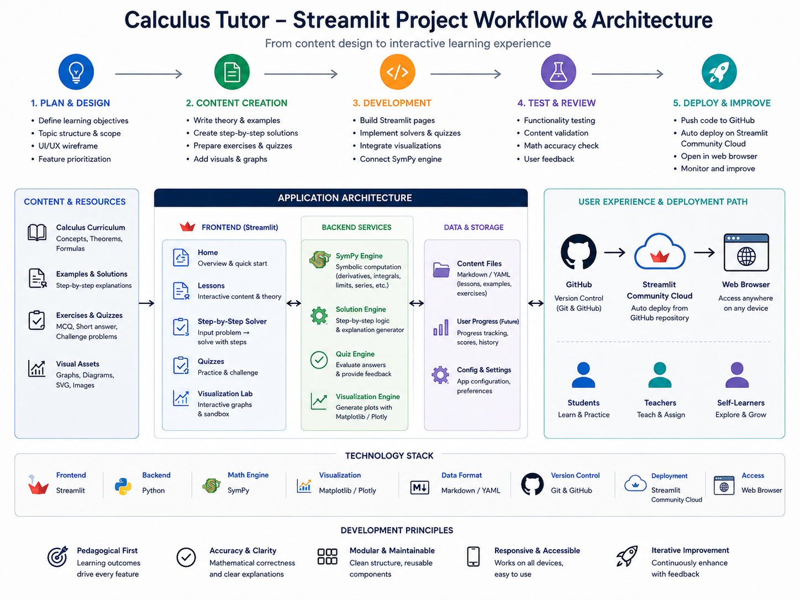
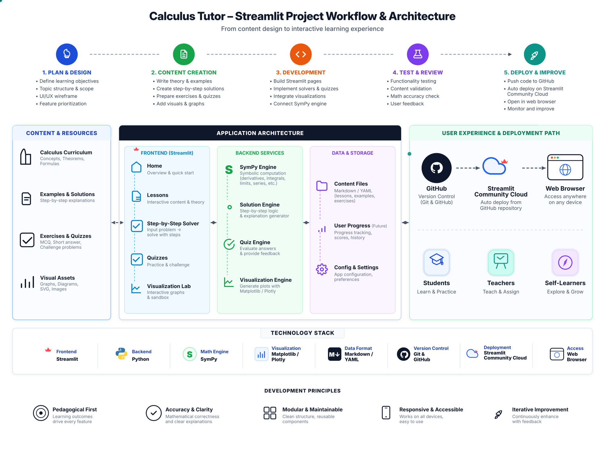
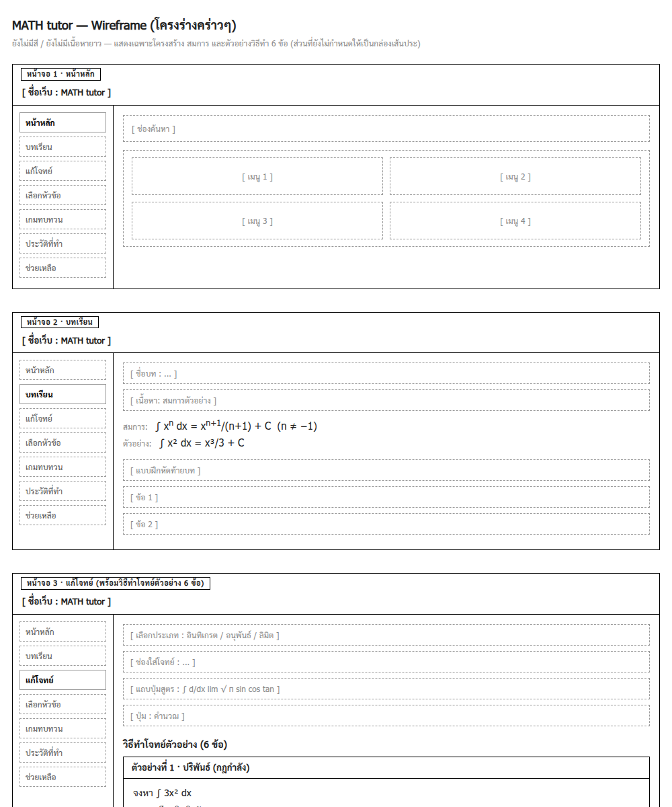

# บทที่ 3
# วิธีการดำเนินโครงงาน

การดำเนินโครงงานการพัฒนาเว็บแอปพลิเคชันช่วยเรียนคณิตศาสตร์สำหรับแคลคูลัสเบื้องต้น มุ่งเน้นการบูรณาการหลักการทางวิศวกรรมซอฟต์แวร์เข้ากับหลักการสอนคณิตศาสตร์อย่างเป็นระบบ โดยให้ความสำคัญกับการคำนวณเชิงสัญลักษณ์ที่ถูกต้องแม่นยำผ่านระบบพีชคณิตคอมพิวเตอร์ (Computer Algebra System: CAS) ภายในเครื่องแม่ข่ายโดยไม่พึ่งพาบริการภายนอก และการออกแบบส่วนประสานงานผู้ใช้ที่ช่วยลดภาระทางปัญญาของผู้เรียน โดยมีรายละเอียดขั้นตอนและวิธีการดำเนินงานดังต่อไปนี้

## 3.1 แผนและขั้นตอนการดำเนินงาน (Development Workflow)

กระบวนการพัฒนาโครงงานดำเนินตามวงจรการพัฒนาซอฟต์แวร์ (Software Development Life Cycle: SDLC) ร่วมกับแนวคิดการพัฒนาแบบทำซ้ำและเพิ่มส่วนขยาย (Iterative and Incremental Development) โดยแบ่งออกเป็น 5 ขั้นตอนหลัก ดังแสดงในภาพที่ 3.1

{width=85%}

จากภาพที่ 3.1 กระบวนการพัฒนาโครงงานประกอบด้วย 5 ขั้นตอนหลักที่มีความต่อเนื่องกัน ดังนี้

1. **การวางแผนและกำหนดความต้องการ:**
   - รวบรวมปัญหาและข้อจำกัดในการเรียนรู้แคลคูลัสเบื้องต้นของผู้เรียน โดยเฉพาะหัวข้อลิมิต อนุพันธ์ และปริพันธ์
   - กำหนดวัตถุประสงค์เชิงพฤติกรรมและผลลัพธ์การเรียนรู้ที่คาดหวังในแต่ละบทเรียน
   - ออกแบบผังโครงสร้างบทเรียน และจัดทำโครงร่างหน้าจอต้นแบบ (UI Wireframe)

2. **การจัดเตรียมเนื้อหาและคลังแบบทดสอบ:**
   - สังเคราะห์เนื้อหาทฤษฎี นิยาม กฎเกณฑ์ และข้อสังเกตทางคณิตศาสตร์ให้ครอบคลุม 7 บทเรียนหลัก
   - คัดเลือกและออกแบบตัวอย่างโจทย์ที่มีระดับความยากแบบเป็นลำดับขั้น
   - จัดทำคลังข้อสอบจำนวน 80 ข้อ พร้อมจัดทำคำอธิบายเฉลยละเอียดและคำใบ้เพื่อนำทางความคิด

3. **การพัฒนาระบบและโมดูลคำนวณ:**
   - พัฒนาส่วนประสานงานผู้ใช้เชิงโต้ตอบด้วยภาษาไพธอนและไลบรารีสตรีมลิต (Streamlit)
   - สร้างโมดูลคำนวณคณิตศาสตร์เชิงสัญลักษณ์ด้วยไลบรารีซิมไพ (SymPy) โดยแยกตรรกะการประมวลผลออกจากส่วนแสดงผลอย่างเด็ดขาด
   - พัฒนาระบบแสดงผลกราฟทางเรขาคณิตด้วยไลบรารีแมตพลอตลิบ (Matplotlib) และระบบเรนเดอร์สมการด้วยเคเท็ก (KaTeX)

4. **การทดสอบและทบทวนความถูกต้อง:**
   - ดำเนินการทดสอบหน่วยย่อยอัตโนมัติด้วยเฟรมเวิร์กไพเทสต์ (Pytest) ครอบคลุมฟังก์ชันการคำนวณทุกโมดูล
   - ตรวจสอบความถูกต้องของสัญลักษณ์ทางคณิตศาสตร์และการจัดรูปสมการ
   - ทดสอบความทนทานต่อกรณีขอบเขตวิกฤต เช่น จุดที่ฟังก์ชันไม่ต่อเนื่อง ลิมิตที่หาค่าไม่ได้ และรูปแบบยังไม่กำหนด

5. **การเผยแพร่และประเมินผลระบบ:**
   - ควบคุมเวอร์ชันของซอร์สโค้ดผ่านระบบควบคุมเวอร์ชันกิต (Git) บนบริการกิตฮับ (GitHub)
   - เปิดให้นิสิตกลุ่มตัวอย่างเข้าทดลองใช้งานเว็บแอปพลิเคชัน และเก็บรวบรวมข้อมูลการประเมินความสะดวกในการใช้งาน (SUS)

## 3.2 สถาปัตยกรรมระบบ (System Architecture)

ระบบถูกออกแบบตามสถาปัตยกรรมแบบแบ่งชั้น (Layered Architecture) โดยแบ่งความรับผิดชอบออกเป็น 3 ส่วนหลักอย่างชัดเจน เพื่อให้ระบบมีความเป็นระเบียบ บำรุงรักษาง่าย และรองรับการขยายฟังก์ชันในอนาคต ดังแสดงในภาพที่ 3.2

{width=85%}

จากภาพที่ 3.2 สถาปัตยกรรมระบบประกอบด้วย 3 ชั้นหลัก ดังนี้

### 3.2.1 ส่วนประสานงานผู้ใช้ (Presentation Layer)
ทำหน้าที่รับข้อมูลนำเข้าจากผู้เรียนผ่านวิดเจ็ตต่าง ๆ เช่น ช่องกรอกฟังก์ชัน แถบเลื่อนปรับค่าตัวเลข และปุ่มตัวเลือก จากนั้นส่งต่อข้อมูลไปยังส่วนคำนวณ และนำผลลัพธ์ที่ได้กลับมาแสดงผลในรูปของกราฟเรขาคณิตสองมิติและสมการคณิตศาสตร์ที่จัดรูปแบบอย่างสวยงาม ชั้นนี้พัฒนาด้วยไลบรารีสตรีมลิต และมีการจัดสรรหน้าเว็บออกเป็น 15 หน้าผ่านระบบนำทางหลัก `st.navigation` แบ่งเป็น 4 หมวดหมู่: ภาพรวมระบบ, โมดูลการเรียนรู้ (7 บทเรียน), เครื่องมือและการประเมิน (เครื่องคิดเลข, แบบทดสอบ, แบบสอบถาม), และข้อมูลโครงงาน

### 3.2.2 ส่วนบริการประมวลผลคำนวณ (Computation Layer)
ทำหน้าที่เป็นมันสมองของระบบ ประกอบด้วยโมดูลตัวแก้ปัญหา (Solvers) ที่เขียนด้วยภาษาไพธอนและซิมไพ โดยทำหน้าที่คำนวณทางคณิตศาสตร์เชิงสัญลักษณ์ แยกตัวประกอบ ตรวจสอบโดเมน สร้างลำดับขั้นตอนวิธีทำ และตรวจจับกรณีข้อผิดพลาด ชั้นนี้ถูกออกแบบให้เป็นฟังก์ชันบริสุทธิ์ (Pure Functions) ปราศจากการผูกติดกับหน้าจอแสดงผล ทำให้สามารถนำไปทดสอบความถูกต้องทางคณิตศาสตร์แบบอัตโนมัติด้วย Pytest ได้อย่างสมบูรณ์โดยไม่ต้องเปิดเบราว์เซอร์

### 3.2.3 ส่วนจัดเก็บข้อมูลและบทเรียน (Data & Content Layer)
ทำหน้าที่จัดเก็บเนื้อหาบทเรียนภาษาไทยในรูปแบบมาร์กดาวน์ (Markdown) และคลังข้อสอบ 80 ข้อในรูปแบบเจสัน (JSON) ช่วยให้สามารถปรับปรุงเนื้อหาหรือเพิ่มข้อสอบใหม่ได้โดยไม่ต้องแก้ไขโค้ดโปรแกรม

### 3.2.4 วงจรการทำงานแบบทำซ้ำและการจัดการสถานะเซสชัน (Execution Lifecycle & Session State)
เนื่องจากเฟรมเวิร์กสตรีมลิตมีวงจรการทำงานแบบประมวลผลซ้ำทั้งหน้า (Reactive Rerun Loop) เมื่อผู้เรียนมีปฏิสัมพันธ์กับหน้าจอ เช่น การเลื่อนแถบสไลเดอร์หรือการกดปุ่ม โค้ดในหน้านั้นจะถูกประมวลผลใหม่ตั้งแต่บรรทัดแรก เพื่อป้องกันไม่ให้ข้อมูลสูญหายหรือเกิดการคำนวณซ้ำซ้อน ระบบจึงบริหารจัดการข้อมูลผ่านหน่วยความจำเซสชัน (`st.session_state`) ดังนี้:

1. **การบันทึกผลคะแนนและประวัติการสอบ:** จัดเก็บคะแนนแบบทดสอบและคำตอบของผู้เรียนข้ามหน้าเว็บ เพื่อให้สามารถนำผลไปแสดงในหน้าประวัติคะแนนได้โดยไม่ถูกรีเซ็ต
2. **กลไกการหน่วงเวลาเฉลย (Delayed Scaffolding):** บันทึกสถานะว่าผู้เรียนตอบถูกในรอบใด เพื่อควบคุมการแสดงคำใบ้และการเฉลยวิธีทำทีละขั้น
3. **การแยกชั้นคำนวณเพื่อความเสถียร:** การแยกฟังก์ชันคำนวณออกมาเป็นโมดูลอิสระ ช่วยให้การคำนวณเชิงสัญลักษณ์ของ SymPy คงความถูกต้องและไม่ได้รับผลกระทบจากการจัดเรียงหน้าจอใหม่

### 3.2.5 มาตรฐานสัญญาข้อมูลการส่งคืนผลลัพธ์ 5 มิติ (Universal Step Contract)
เพื่อให้ส่วนแสดงผลหน้าจอและส่วนคำนวณหลังบ้านสามารถสื่อสารกันได้อย่างแม่นยำ ระบบจึงกำหนด "สัญญาข้อมูลมาตรฐาน 5 มิติ" (Universal Step Contract) ในรูปแบบโครงสร้างดิกชันนารี (Dictionary) เพื่อให้ทุกโมดูลส่งมอบเนื้อหาการสอนที่ครบถ้วนสม่ำเสมอ ดังแสดงในตารางที่ 3.1

ตารางที่ 3.1 ข้อกำหนด 5 มิติในสัญญามาตรฐานการส่งคืนผลลัพธ์

| มิติที่ | องค์ประกอบในสัญญาข้อมูล | ความหมายและหน้าที่ทางคณิตศาสตร์ | ตัวอย่างผลลัพธ์ที่ส่งคืน |
|:---:|:---|:---|:---|
| 1 | `goal_and_rule` | ระบุเป้าหมาย ทฤษฎีบท หรือสูตรหลักที่เลือกใช้ | การแยกตัวประกอบเพื่อทอนพจน์ หรือ กฎ LIATE |
| 2 | `variable_setup` | กำหนดตัวแปรเสริม การแทนค่า หรือจุดอ้างอิง | กำหนด $u = x^2, du = 2x\,dx$ หรือ $x_0 = 1$ |
| 3 | `algebraic_steps` | แจกแจงขั้นตอนการแปลงรูปพีชคณิตทีละขั้น | แทนค่าในสูตร, ทอนเศษส่วน, หรืออินทิเกรตทีละพจน์ |
| 4 | `domain_boundary` | ตรวจสอบโดเมน จุดเอกฐาน และเงื่อนไขวิกฤต | ตรวจสอบจุดโปร่ง $x \neq 3$ หรือเงื่อนไข $f(x) \ge g(x)$ |
| 5 | `pedagogical_note` | สรุปความหมายทางเรขาคณิตและข้อควรระวัง | แจ้งเตือนพื้นที่สุทธิมีเครื่องหมาย หรือพิกัดจุดวกกลับ |

**ตัวอย่างรูปธรรมการทำงานของสัญญาข้อมูล:**
เมื่อผู้เรียนป้อนโจทย์ $\lim_{x \to 3} \frac{x^2 - 9}{x - 3}$ โมดูลคำนวณลิมิตจะประมวลผลและส่งข้อมูลคืนตามสัญญา 5 มิติ:

1. `goal_and_rule`: ระบุเป้าหมายว่าเป็นการหาลิมิตของฟังก์ชันตรรกยะที่มีรูปแบบยังไม่กำหนด $\frac{0}{0}$
2. `variable_setup`: กำหนดจุดเข้าใกล้คือ $x \to 3$
3. `algebraic_steps`: แสดงขั้นตอนแยกตัวประกอบเป็น $\frac{(x-3)(x+3)}{x-3}$ และทอนพจน์เหลือ $x+3$ ก่อนแทนค่าได้ 6
4. `domain_boundary`: ระบุข้อจำกัดของโดเมนว่า $x \neq 3$
5. `pedagogical_note`: อธิบายความหมายทางเรขาคณิตว่ากราฟมีจุดโปร่งที่พิกัด $(3, 6)$

## 3.3 กรอบแนวคิดการจัดนั่งร้านทางปัญญา (Instructional Scaffolding Framework)

การออกแบบปฏิสัมพันธ์ในแต่ละบทเรียนยึดตามหลักการจัดนั่งร้านทางปัญญา เพื่อช่วยนำทางความคิดและลดความสับสนของผู้เรียน โดยแบ่งขั้นตอนในหน้าจอออกเป็น 4 ระดับ:

1. **ระดับที่ 1 การเปิดรับแนวคิดผ่านภาพจำลอง:** นำเสนอทฤษฎีและกราฟเริ่มต้นเพื่อให้เห็นภาพรวมทางเรขาคณิตก่อนเข้าสู่สูตร
2. **ระดับที่ 2 การทดลองปรับตัวแปร:** ให้ผู้เรียนเลื่อนแถบปรับค่า เช่น ปรับค่า $x$ เพื่อดูการลู่เข้า หรือปรับจำนวนแท่งสี่เหลี่ยม $n$ เพื่อสังเกตพื้นที่
3. **ระดับที่ 3 การศึกษาขั้นตอนวิธีทำ:** นำเสนอวิธีทำละเอียดทีละขั้น มีการระบุกฎเกณฑ์ที่ใช้ การแปลงรูปพีชคณิต และข้อสังเกตมโนทัศน์
4. **ระดับที่ 4 การฝึกฝนและถอนตัวช่วย:** มีแบบฝึกหัดที่ให้ผู้เรียนทดลองตอบ หากตอบผิด ระบบจะมีคำใบ้แนะนำแนวทางแทนการบอกคำตอบทันที

นอกจากนี้ ระบบยังมี **กลไกตรวจจับจุดเข้าใจผิด (Misconception Detection)** คอยตรวจสอบเงื่อนไขทางคณิตศาสตร์แบบเรียลไทม์ เช่น:

- แจ้งเตือนเมื่อลิมิตซ้ายและขวาไม่เท่ากัน
- แจ้งเตือนเมื่อการอินทิเกรตข้ามจุดเอกฐานที่ฟังก์ชันไม่ต่อเนื่อง
- แจ้งเตือนเรื่องพื้นที่สุทธิมีเครื่องหมาย (Net Signed Area) เมื่อกราฟอยู่ใต้แกน $x$ เพื่อไม่ให้ผู้เรียนสับสนกับขนาดของพื้นที่จริง

## 3.4 การออกแบบส่วนติดต่อผู้ใช้และผังหน้าจอต้นแบบ (UI Wireframe)

การออกแบบหน้าจอคำนึงถึงความสะดวกในการใช้งานของผู้เรียนเป็นหลัก โดยยึดหลักเกณฑ์สำคัญ ดังนี้:

1. จัดวางเครื่องมือควบคุมและกราฟไว้ในบริเวณที่มองเห็นได้ชัดเจนโดยไม่ต้องเลื่อนหน้าจอมากเกินไป
2. ใช้รูปแบบตัวอักษรและสีที่สบายตา เหมาะสำหรับการอ่านสมการคณิตศาสตร์
3. ปฏิบัติตามมาตรฐานสากลโดยไม่มีการใช้อีโมจิที่อาจบดบังความเป็นทางการ แต่ใช้ไอคอนสัญลักษณ์มาตรฐานแทน
4. หน้าจอสามารถปรับขนาดให้เหมาะสมกับอุปกรณ์คอมพิวเตอร์และสมาร์ตโฟนได้โดยอัตโนมัติ

ผังหน้าจอต้นแบบที่ใช้เป็นกรอบในการพัฒนาแสดงดังภาพที่ 3.3

{width=85%}

## 3.5 ขั้นตอนวิธีและการประมวลผลเชิงสัญลักษณ์ในแต่ละโมดูล

ระบบประกอบด้วยโมดูลบทเรียนเชิงโต้ตอบ 7 หัวข้อ และเครื่องมือเสริม 2 ส่วน โดยสรุปหน้าที่และตัวแก้ปัญหาที่รับผิดชอบดังแสดงในตารางที่ 3.2

ตารางที่ 3.2 รายละเอียดโมดูลบทเรียนเชิงโต้ตอบ 7 หัวข้อและเครื่องมือเสริม

| ลำดับ | ชื่อโมดูลบทเรียน | ไฟล์โมดูลและตัวแก้ปัญหา | หน้าที่หลักและตรรกะการประมวลผล |
|:---|:---|:---|:---|
| 1 | ลิมิตเข้าใกล้จุดและความต่อเนื่อง | limit_solver.py | คำนวณลิมิตสองด้าน จำแนกจุดไม่ต่อเนื่อง และตรวจสอบรูปแบบ 0/0 |
| 2 | เส้นสัมผัสและอนุพันธ์ | tangent_solver.py | คำนวณอนุพันธ์ ความชัน และปฏิเสธการวาดเส้นสัมผัสที่จุดมุมแหลม |
| 3 | ผลรวมรีมันน์ | riemann_solver.py | ประมาณพื้นที่ด้วยสี่เหลี่ยม 3 รูปแบบ และคำนวณผลรวมสุทธิ |
| 4 | เทคนิคการอินทิเกรต | substitution_solver.py | ตัดสินใจเลือก u-Sub หรือ By Parts ตามกฎ LIATE พร้อมสกัดตัวแปร |
| 5 | พื้นที่ระหว่างเส้นโค้ง | area_solver.py | คำนวณจุดตัดจริง ทดสอบเครื่องหมายจุดกึ่งกลาง และแรเงาพื้นที่ |
| 6 | ปริมาตรทรงตันจากการหมุน | volume_solver.py | คำนวณปริมาตรตามวิธีจานและวิธีวงแหวนรอบแกนหมุน |
| 7 | ปริพันธ์ไม่ตรงแบบ | improper_solver.py | คำนวณลิมิตบนช่วงอนันต์ ดักจับจุดเอกฐาน และประเมินการลู่เข้า |
| เสริม 1 | เครื่องคำนวณแคลคูลัสขั้นสูง | sympy_solver.py | แก้โจทย์อนุพันธ์และปริพันธ์เชิงสัญลักษณ์ทั่วไป |
| เสริม 2 | คลังแบบทดสอบมโนทัศน์ | quiz.py | จัดการทดสอบ 80 ข้อ 3 ระดับ พร้อมระบบคำใบ้และสุ่มตัวเลือก |

### 3.5.1 โมดูลลิมิตเข้าใกล้จุดและความต่อเนื่อง (limit_solver.py)
ตรรกะการประมวลผลของโมดูลลิมิตดำเนินตามลำดับการวิเคราะห์ 5 ขั้นตอน:

1. ทำการแทนค่าโดยตรง (Direct Substitution) หากฟังก์ชันต่อเนื่องและได้ค่าจริง จะส่งคืนคำตอบทันที
2. หากผลลัพธ์อยู่ในรูปแบบยังไม่กำหนด $\frac{0}{0}$ ระบบจะใช้อัลกอริทึมแยกตัวประกอบ (Factoring) ของซิมไพเพื่อทอนพจน์ร่วม หรือใช้การคูณด้วยสังยุคในกรณีฟังก์ชันติดกรณฑ์
3. คำนวณลิมิตข้างเดียวทั้งทางซ้ายและทางขวา ($\lim_{x \to a^-}$ และ $\lim_{x \to a^+}$)
4. เปรียบเทียบลิมิตซ้ายและขวา หากไม่เท่ากันจะสรุปว่าลิมิตหาค่าไม่ได้ (Does Not Exist: DNE) พร้อมระบุว่าเป็นจุดไม่ต่อเนื่องแบบกระโดด หรือแบบอนันต์
5. ตรวจสอบพฤติกรรมกวัดแกว่งไม่สิ้นสุด (Oscillation) เช่น $\sin(1/x)$ เมื่อ $x \to 0$ เพื่อแจ้งเตือนผู้เรียนอย่างถูกต้อง

### 3.5.2 โมดูลเส้นสัมผัสและอนุพันธ์ (tangent_solver.py)
รับฟังก์ชัน $f(x)$ และพิกัดจุดสัมผัส $x = a$ จากนั้นคำนวณอนุพันธ์ $f'(x)$ แทนค่าเพื่อหาความชัน $m = f'(a)$ และสร้างสมการเส้นสัมผัส $y - f(a) = m(x - a)$ นอกจากนี้ ระบบยังคำนวณอัตราส่วนผลต่างของลิมิตข้างเดียว ($f'_\pm(a)$) เพื่อตรวจสอบว่าฟังก์ชันหาอนุพันธ์ได้จริงหรือไม่ หากพบว่าเป็นจุดมุมแหลม (Cusp / Corner Point) เช่น $|x|$ ที่ $x = 0$ ระบบจะแจ้งเตือนว่าฟังก์ชันไม่มีอนุพันธ์ ณ จุดดังกล่าว และปฏิเสธการวาดเส้นสัมผัสแนวนอนลวง

### 3.5.3 โมดูลผลรวมรีมันน์ (riemann_solver.py)
คำนวณความกว้างช่วงย่อย $\Delta x = \frac{b-a}{n}$ และหาพิกัดจุดตัวแทน $x_i^*$ ตามวิธีที่เลือก (ซ้าย ขวา หรือกึ่งกลาง) จากนั้นคำนวณผลรวมของพื้นที่สี่เหลี่ยมแต่ละแท่ง พร้อมทั้งคำนวณค่าปริพันธ์จริงผ่านทฤษฎีบทหลักมูลของแคลคูลัส เพื่อเปรียบเทียบค่าความคลาดเคลื่อนและทิศทางการประมาณค่า (สูงกว่าหรือต่ำกว่าจริง) โดยระบบจะคำนวณเครื่องหมายของพื้นที่ย่อยแต่ละแท่งอย่างละเอียดเพื่อแสดงผลรวมสุทธิมีเครื่องหมาย

### 3.5.4 โมดูลเทคนิคการอินทิเกรต (substitution_solver.py)
ระบบออกแบบผังการตัดสินใจ (Decision Flow) ในการวิเคราะห์โครงสร้างตัวถูกอินทิเกรต:

- **กรณีการแทนค่าตัวแปร $u$:** ค้นหาพจน์ฟังก์ชันประกอบ $g(x)$ จากโครงสร้างไวยากรณ์สมการ (AST) เช่น พจน์ภายในเลขยกกำลัง หรืออาร์กิวเมนต์ของฟังก์ชันอดิศัย จากนั้นหาอนุพันธ์ $g'(x)$ และตรวจสอบว่าสามารถตัดทอนตัวแปรเดิมได้หมดสิ้นหรือไม่ หากตัดทอนได้สำเร็จจะแปลงรูปเข้าสู่ $\int f(u)\,du$
- **กรณีการอินทิเกรตทีละส่วน:** เมื่อพบผลคูณของสองฟังก์ชันต่างชนิด ระบบจะจัดสรรตัวแปร $u$ และ $dv$ ตามกฎ **LIATE** อย่างเคร่งครัด โดยเลือกฟังก์ชันที่มีลำดับความสำคัญสูงสุดเป็น $u$ และฟังก์ชันที่เหลือเป็น $dv$ พร้อมแจกแจงขั้นตอน $uv - \int v\,du$ ได้สูงสุด 2 ชั้น

### 3.5.5 โมดูลพื้นที่ระหว่างเส้นโค้ง (area_solver.py)
อัลกอริทึมคำนวณพื้นที่ได้รับการออกแบบให้รักษาความไม่แปรเปลี่ยนเชิงเรขาคณิต (Geometric Invariance):

1. ทำการแปลงรากคี่ด้วยฟังก์ชัน `real_root` ของซิมไพ เพื่อป้องกันไม่ให้เกิดค่าจำนวนเชิงซ้อนบนย่านตัวเลขลบ
2. แก้สมการหาจุดตัดจริงทั้งหมดระหว่าง $f(x)$ และ $g(x)$ บนช่วงที่กำหนด
3. ซอยย่อยช่วงอินทิเกรตตามจุดตัด และทำการทดสอบเครื่องหมาย ณ จุดกึ่งกลางของแต่ละช่วงย่อย (Midpoint Sign Test) เพื่อจัดให้ฟังก์ชันที่อยู่ด้านบนเป็นตัวตั้งลบด้วยฟังก์ชันตัวล่างเสมอ
4. คำนวณผลรวมพื้นที่ปิดล้อมสุทธิและส่งคืนพิกัดสำหรับแรเงากราฟ

### 3.5.6 โมดูลปริมาตรทรงตันที่เกิดจากการหมุน (volume_solver.py)
วิเคราะห์ความสัมพันธ์ระหว่างบริเวณพื้นที่กับแกนหมุน:

- หากพื้นที่แนบชิดแกนหมุน จะประมวลผลด้วยวิธีจาน $V = \pi \int [f(x)]^2\,dx$
- หากมีช่องว่างระหว่างพื้นที่กับแกนหมุน จะสกัดรัศมีภายนอก $R(x)$ และรัศมีภายใน $r(x)$ เพื่อประมวลผลด้วยวิธีวงแหวน $V = \pi \int [R(x)^2 - r(x)^2]\,dx$

### 3.5.7 โมดูลปริพันธ์ไม่ตรงแบบ (improper_solver.py)
วิเคราะห์ทั้งปริพันธ์ไม่ตรงแบบชนิดที่ 1 (ช่วงอนันต์) และชนิดที่ 2 (จุดไม่ต่อเนื่องแบบอนันต์):

- ตรวจสอบเส้นกำกับแนวดิ่งหรือจุดเอกฐานภายในช่วง $[a, b]$ หากพบจะแยกช่วงอินทิเกรตออกจากกันเพื่อป้องกันการหักล้างค่าอนันต์ที่ผิดพลาด
- แปลงขอบเขตที่มีปัญหาให้อยู่ในรูปลิมิตของตัวแปรเสริม $t$
- คำนวณปริพันธ์และประเมินค่าลิมิต หากได้ค่าจำกัดจะระบุว่าลู่เข้า พร้อมแสดงพื้นที่ใต้กราฟ แต่หากลิมิตเป็นอนันต์จะสรุปว่าลู่ออก

### 3.5.8 เครื่องคำนวณแคลคูลัสขั้นสูง (sympy_solver.py)
ทำหน้าที่เป็นเครื่องคิดเลขอเนกประสงค์สำหรับผู้เรียนที่ต้องการตรวจสอบโจทย์ทั่วไป รองรับการหาอนุพันธ์และปริพันธ์เชิงสัญลักษณ์ทั้งแบบจำกัดเขตและไม่จำกัดเขต

### 3.5.9 คลังแบบทดสอบมโนทัศน์และระบบคำใบ้ (quiz.py)
จัดการชุดข้อสอบจำนวน 80 ข้อ แบ่งตาม 3 ระดับความยากง่าย มีระบบสุ่มข้อสอบ สลับตัวเลือกคำตอบ และแสดงคำใบ้เมื่อผู้เรียนต้องการความช่วยเหลือ พร้อมทั้งบันทึกคะแนนรวมเพื่อสะท้อนพัฒนาการเรียนรู้

## 3.6 แผนการทดสอบระบบและการประเมินผล

เพื่อให้มั่นใจในความถูกต้องและความเสถียรของระบบ โครงงานได้กำหนดแผนการทดสอบออกเป็น 3 ระดับ:

1. **การทดสอบหน่วยย่อยอัตโนมัติ (Automated Unit Testing):** ใช้เฟรมเวิร์ก Pytest ในการสร้างชุดทดสอบครอบคลุมฟังก์ชันการคำนวณของ Solver ทุกตัว รวมทั้งสิ้น 250 กรณีทดสอบ
2. **การทดสอบความทนทานต่อกรณีขอบเขตวิกฤต (Boundary Stress Testing):** ทดสอบความสามารถและข้อจำกัดของระบบผ่านกรณีทดสอบฟังก์ชันทางคณิตศาสตร์ 144 กรณี เพื่อจำแนกขอบเขตที่ระบบรองรับได้อย่างแน่นอนและกรณีที่ระบบปฏิเสธการคำนวณ
3. **การทดสอบการใช้งานเสมือนจริงบนเบราว์เซอร์ (Browser Stress Testing):** ใช้เบราว์เซอร์จำลองพฤติกรรมการคลิก การสลับหน้า และการป้อนฟังก์ชันครบทั้ง 15 หน้า เพื่อตรวจสอบว่าไม่มีข้อผิดพลาดของระบบหรือการแสดงผลสมการค้าง
4. **การประเมินความสะดวกในการใช้งานและการยอมรับของผู้เรียน (Usability Evaluation):** นำระบบไปทดลองใช้กับนิสิตกลุ่มตัวอย่าง และประเมินผลผ่านแบบประเมินมาตรฐาน SUS 10 ข้อคำถาม และแบบประเมินความพึงพอใจ 4 ด้าน
