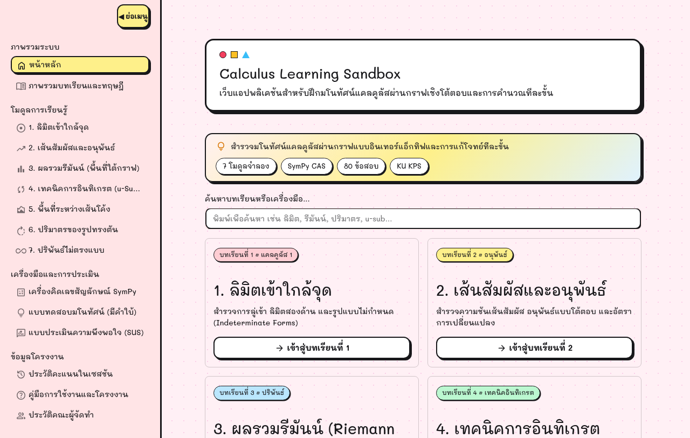
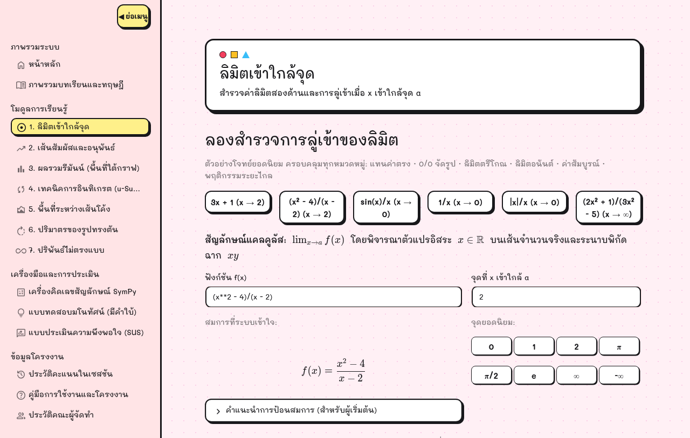
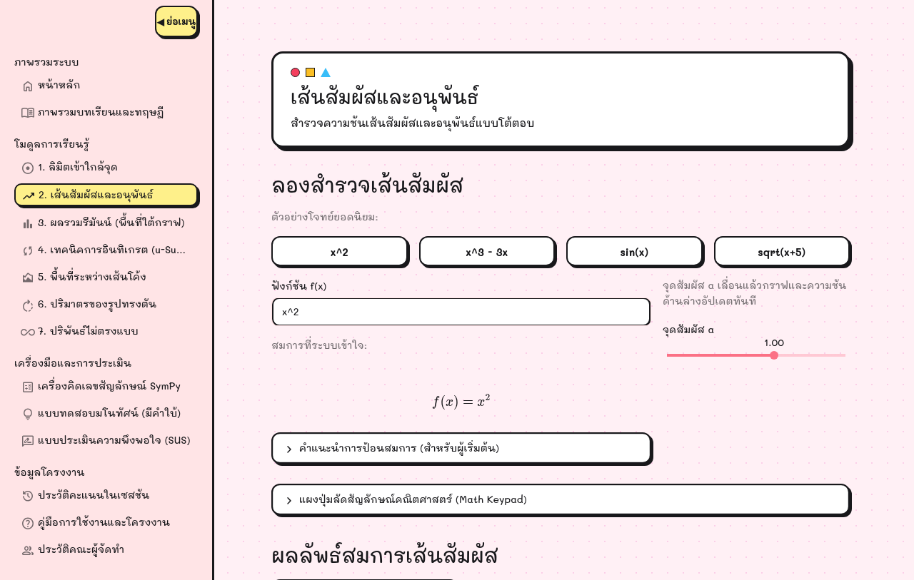
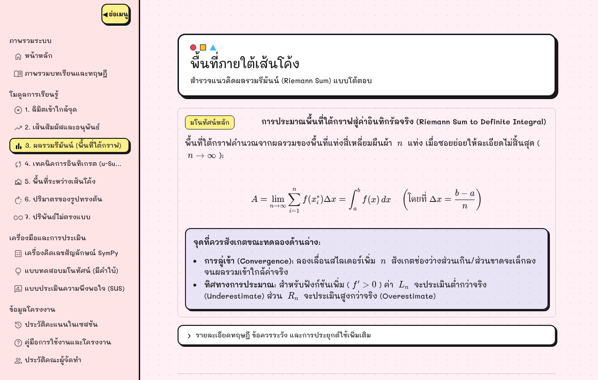
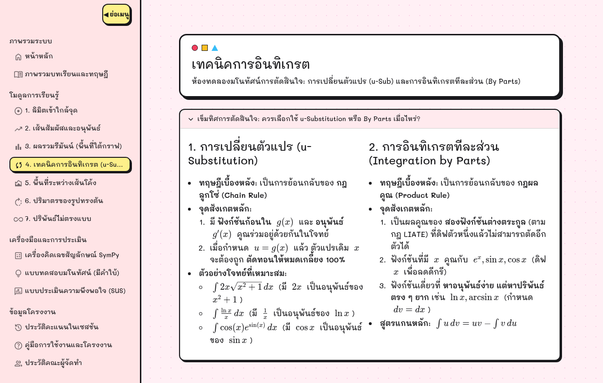
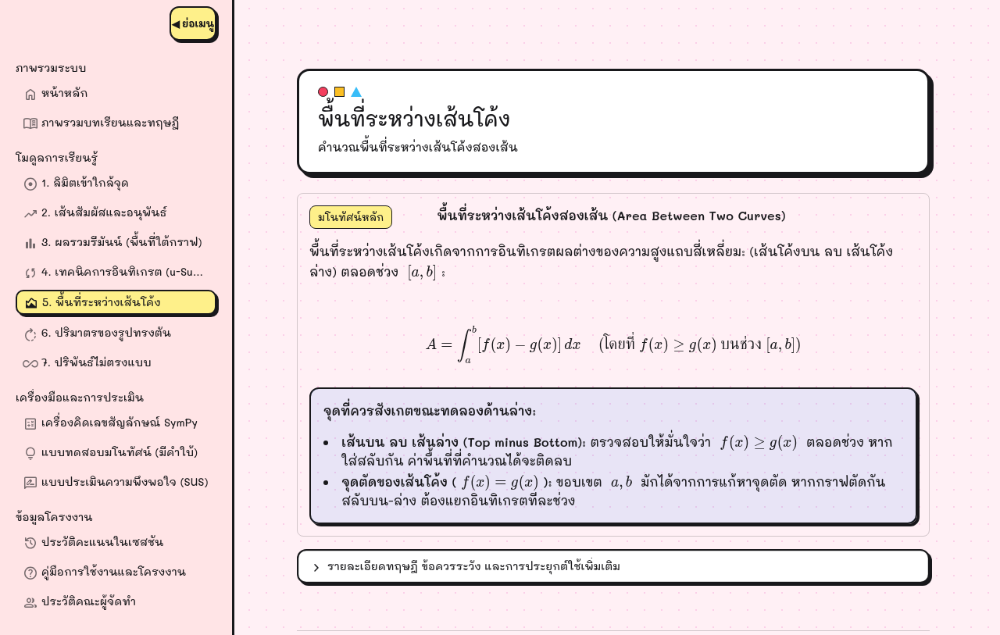
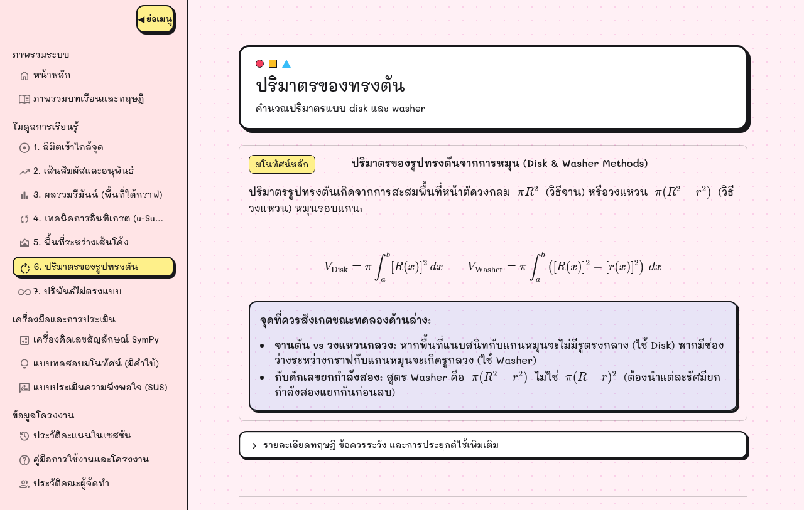
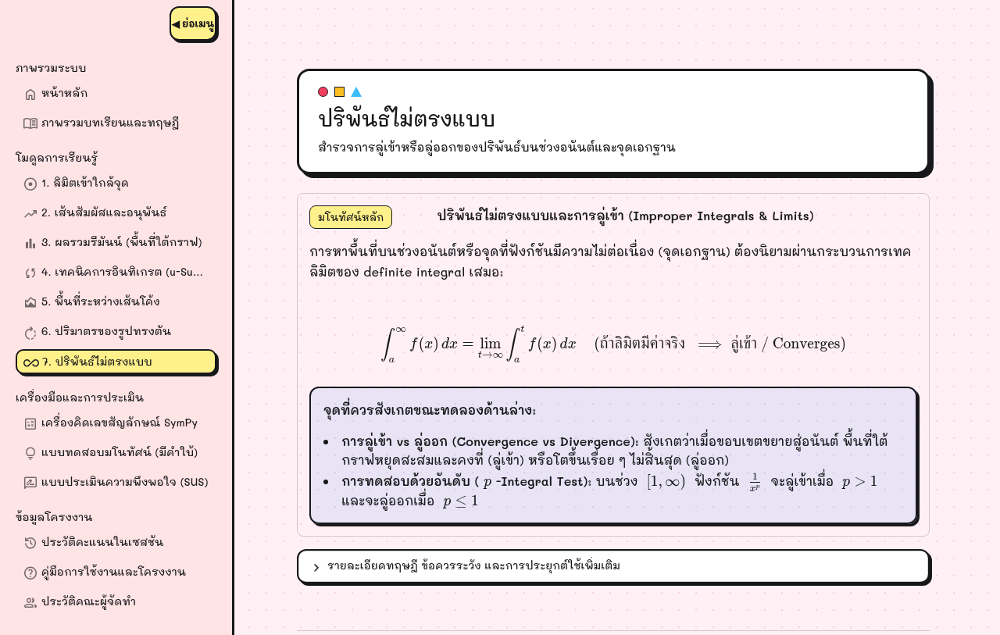
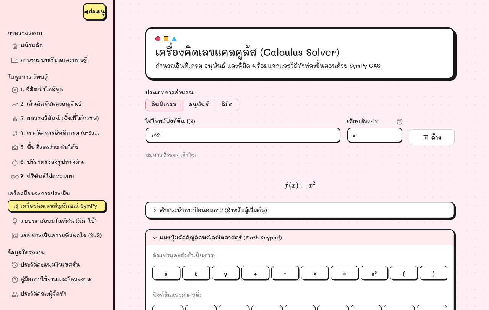
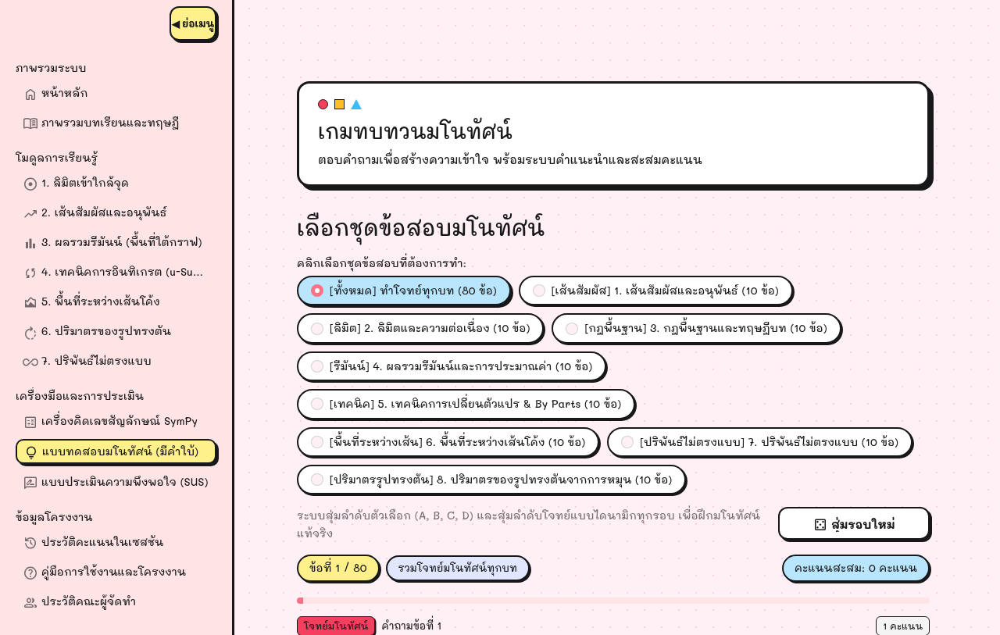

# บทที่ 4
# ผลการดำเนินงานและการทดสอบระบบ

การพัฒนาเว็บแอปพลิเคชันช่วยเรียนคณิตศาสตร์สำหรับแคลคูลัสเบื้องต้น ได้ดำเนินการพัฒนาและทดสอบระบบตามระเบียบวิธีวิจัยที่กำหนดไว้ในบทที่ 3 ในบทนี้จะนำเสนอผลการดำเนินงานและการทดสอบระบบอย่างเป็นลำดับ โดยแบ่งเนื้อหาออกเป็น 4 หัวข้อหลัก ได้แก่

4.1 ผลการพัฒนาระบบและส่วนประสานงานผู้ใช้
4.2 ผลการทดสอบทางเทคนิคและความถูกต้องทางคณิตศาสตร์
4.3 ผลการประเมินความพึงพอใจและประสิทธิภาพการใช้งาน
4.4 การอภิปรายผลการดำเนินงาน

## 4.1 ผลการพัฒนาระบบและส่วนประสานงานผู้ใช้ (Implementation Results)

ระบบเว็บแอปพลิเคชันได้รับการพัฒนาและติดตั้งบนระบบควบคุมการทำงานหลักด้วยสตรีมลิต (Streamlit) โดยจัดหมวดหมู่หน้าการใช้งานออกเป็น 15 หน้า ผ่านระบบนำทางหลัก `st.navigation` ส่วนประสานงานผู้ใช้ได้รับการออกแบบให้เป็นระเบียบ สบายตา ปราศจากสัญลักษณ์รูปภาพอีโมจิรบกวนสายตา โดยแสดงผลการทำงานจริงในแต่ละส่วนดังนี้

### 4.1.1 ส่วนนำทางและหน้าหลักของระบบ (Home and Navigation System)

หน้าหลักทำหน้าที่เป็นศูนย์กลางในการเข้าถึงบทเรียนและเครื่องมือทั้งหมด โดยประกอบด้วยแถบแนะนำโครงงาน กล่องค้นหาบทเรียน และการ์ดทางลัดเข้าสู่ 7 โมดูลบทเรียนหลัก พร้อมทั้งแสดงแถบสถิติการทำแบบทดสอบของผู้เรียนในเซสชันปัจจุบัน ดังแสดงในภาพที่ 4.1

{width=85%}

จากภาพที่ 4.1 ผู้เรียนสามารถเลือกเข้าสู่บทเรียนที่ต้องการได้โดยตรงจากการคลิกการ์ด หรือใช้แถบเมนูนำทางด้านซ้ายเพื่อสลับไปยังหน้าบทเรียน เครื่องคำนวณ หรือแบบทดสอบได้อย่างสะดวกรวดเร็ว

### 4.1.2 โมดูลลิมิตเข้าใกล้จุดและความต่อเนื่อง (Limit Approach and Continuity)

โมดูลนี้ออกแบบมาเพื่อแก้ปัญหาการมองไม่เห็นภาพการลู่เข้าของลิมิตและรูปแบบยังไม่กำหนด $\frac{0}{0}$ โดยมีส่วนควบคุมให้ผู้เรียนสามารถป้อนฟังก์ชัน เลือกจุดที่ต้องการหาลิมิต และเลื่อนปรับระยะการเข้าใกล้จุด เพื่อสังเกตการเปลี่ยนแปลงของค่าฟังก์ชันทั้งจากทางซ้ายและทางขวา ดังแสดงในภาพที่ 4.2

{width=85%}

จากภาพที่ 4.2 เมื่อผู้เรียนเลือกโจทย์ตัวอย่าง $f(x) = \frac{x^2 - 4}{x - 2}$ เมื่อ $x \to 2$ ระบบจะแสดงผล 3 ส่วนสำคัญ:

1. **ส่วนรับข้อมูลและแถบเลื่อนค่า (Input Controls):** ผู้เรียนสามารถทดลองป้อนฟังก์ชันและเลื่อนปรับค่า $x$ เพื่อดูพฤติกรรมของกราฟ
2. **กราฟแสดงผลทางเรขาคณิต (Interactive Plot):** แสดงเส้นกราฟพร้อมจุดโปร่ง (Hole) ที่พิกัด $(2, 4)$ เพื่อสื่อให้เห็นว่าฟังก์ชันไม่นิยาม ณ จุดดังกล่าว แต่มีค่าลิมิตลู่เข้าสู่ 4
3. **กล่องเฉลยแสดงวิธีทำทีละขั้น (Step-by-step Solution):** เมื่อคลิกเปิดกล่องเฉลย ระบบจะแสดงขั้นตอนการแทนค่าที่เกิดรูปแบบ $\frac{0}{0}$ และการแยกตัวประกอบ $(x-2)(x+2)$ เพื่อทอนพจน์อย่างละเอียด

### 4.1.3 โมดูลเส้นสัมผัสและอนุพันธ์ (Tangent Lines and Derivatives)

โมดูลนี้ช่วยสร้างความเข้าใจเรื่องอัตราการเปลี่ยนแปลงขณะใดขณะหนึ่งและความชันของเส้นโค้ง โดยแสดงการเคลื่อนที่ของเส้นตัดคอร์ดเข้าสู่เส้นสัมผัส ณ จุดสัมผัสที่กำหนด ดังแสดงในภาพที่ 4.3

{width=85%}

จากภาพที่ 4.3 เมื่อผู้เรียนป้อนฟังก์ชัน $f(x) = x^3 - 3x$ และเลือกจุดสัมผัส $x = 1$ ระบบจะคำนวณอนุพันธ์ $f'(x) = 3x^2 - 3$ และแสดงค่าความชัน $m = 0$ พร้อมวาดเส้นสัมผัสแนวนอนสีแดงสัมผัสเส้นโค้ง ณ จุดต่ำสุดสัมพัทธ์ $(1, -2)$ ทำให้ผู้เรียนเข้าใจความสัมพันธ์ระหว่างอนุพันธ์กับจุดวกกลับได้อย่างชัดเจน

### 4.1.4 โมดูลผลรวมรีมันน์ (Riemann Sums)

โมดูลนี้จำลองการประมาณพื้นที่ใต้เส้นโค้งด้วยแท่งสี่เหลี่ยมผืนผ้า โดยผู้เรียนสามารถเลือกรูปแบบการสร้างแท่งสี่เหลี่ยม (ซ้าย ขวา หรือกึ่งกลาง) และปรับจำนวนแท่งสี่เหลี่ยม $n$ ผ่านแถบเลื่อนตัวเลข ดังแสดงในภาพที่ 4.4

{width=85%}

จากภาพที่ 4.4 เมื่อกำหนดฟังก์ชัน $f(x) = x^2$ บนช่วง $[0, 2]$ และเลือกจำนวนแท่ง $n = 4$ ระบบจะวาดแท่งสี่เหลี่ยมแรเงาใต้เส้นโค้ง พร้อมทั้งแสดงตารางเปรียบเทียบค่าผลรวมรีมันน์กับค่าปริพันธ์จริง $\int_0^2 x^2\,dx = 2.6667$ และคำนวณร้อยละของความคลาดเคลื่อน (Percentage Error) ให้เห็นแบบเรียลไทม์ ผู้เรียนสามารถเลื่อนเพิ่มค่า $n$ เป็น 20 หรือ 50 เพื่อสังเกตว่าผลรวมของแท่งสี่เหลี่ยมจะลู่เข้าแนบสนิทกับพื้นที่ใต้เส้นโค้งจริง

### 4.1.5 โมดูลเทคนิคการอินทิเกรต (Integration Techniques)

โมดูลนี้ทำหน้าที่เป็นนั่งร้านทางปัญญาช่วยฝึกฝนการตัดสินใจเลือกเทคนิคการอินทิเกรต โดยแบ่งออกเป็นสองแท็บหลัก ได้แก่ การแทนค่าตัวแปร $u$ (u-Substitution) และการอินทิเกรตทีละส่วน (Integration by Parts) ดังแสดงในภาพที่ 4.5

{width=85%}

จากภาพที่ 4.5 ในแท็บการอินทิเกรตทีละส่วน ผู้เรียนสามารถทดลองเลือกกำหนดฟังก์ชัน $u$ และ $dv$ จากนั้นระบบจะแสดงผลการคำนวณ $du$ และ $v$ พร้อมทั้งตรวจสอบว่าการเลือกตัวแปรดังกล่าวทำให้ปริพันธ์ใหม่ $\int v\,du$ ง่ายขึ้นหรือซับซ้อนกว่าเดิมตามกฎ LIATE ช่วยลดข้อผิดพลาดในการลองผิดลองถูกของผู้เรียน

### 4.1.6 โมดูลพื้นที่ระหว่างเส้นโค้ง (Area Between Curves)

โมดูลนี้ช่วยคำนวณพื้นที่ปิดล้อมระหว่างสองฟังก์ชัน $f(x)$ และ $g(x)$ โดยระบบจะค้นหาจุดตัดของกราฟโดยอัตโนมัติ และตรวจสอบลำดับของฟังก์ชันตัวบนและตัวล่าง ดังแสดงในภาพที่ 4.6

{width=85%}

จากภาพที่ 4.6 เมื่อป้อนฟังก์ชัน $f(x) = 2x$ และ $g(x) = x^2$ ระบบจะคำนวณจุดตัดที่ $x = 0$ และ $x = 2$ พร้อมทั้งแรเงาสีฟ้าในบริเวณพื้นที่ปิดล้อม และแจกแจงขั้นตอนการตั้งปริพันธ์ $\int_0^2 (2x - x^2)\,dx = \frac{4}{3}$ ตารางหน่วย อย่างครบถ้วน

### 4.1.7 โมดูลปริมาตรทรงตันที่เกิดจากการหมุน (Volumes of Solids of Revolution)

โมดูลนี้ช่วยให้ผู้เรียนเห็นภาพการหมุนพื้นที่สองมิติรอบแกนหมุนเพื่อเกิดเป็นรูปทรงตันสามมิติ โดยรองรับทั้งวิธีจานและวิธีวงแหวน ดังแสดงในภาพที่ 4.7

{width=85%}

จากภาพที่ 4.7 ระบบแสดงกราฟสองมิติพร้อมเส้นแกนหมุน และแสดงภาพจำลองระนาบพื้นที่หน้าตัด ช่วยให้ผู้เรียนมองเห็นความแตกต่างระหว่างรัศมีภายนอก $R(x)$ และรัศมีภายใน $r(x)$ ก่อนนำไปแทนค่าในสูตรอินทิเกรตคำนวณปริมาตร

### 4.1.8 โมดูลปริพันธ์ไม่ตรงแบบ (Improper Integrals)

โมดูลนี้ช่วยในการวิเคราะห์ปริพันธ์ที่มีขอบเขตเป็นอนันต์และจุดเอกฐาน โดยแสดงกราฟเส้นโค้งหางยาวและสรุปสถานะการลู่เข้าอย่างชัดเจน ดังแสดงในภาพที่ 4.8

{width=85%}

จากภาพที่ 4.8 เมื่อคำนวณ $\int_1^{\infty} \frac{1}{x^2}\,dx$ ระบบจะแปลงเป็นรูปลิมิต $\lim_{t \to \infty} \int_1^t \frac{1}{x^2}\,dx$ และสรุปว่าปริพันธ์นี้ลู่เข้าสู่ค่า 1 พร้อมทั้งแสดงแถบแรเงาพื้นที่ใต้กราฟที่ทอดยาวไปทางขวา

### 4.1.9 เครื่องคำนวณแคลคูลัสขั้นสูงและคลังแบบทดสอบมโนทัศน์

นอกจากบทเรียนทั้ง 7 โมดูลแล้ว ระบบยังมีเครื่องคิดเลขอเนกประสงค์สำหรับคำนวณอนุพันธ์และปริพันธ์ทั่วไป ดังแสดงในภาพที่ 4.9 และคลังแบบทดสอบ 80 ข้อ ดังแสดงในภาพที่ 4.10

{width=85%}

{width=85%}

จากภาพที่ 4.10 ในหน้าแบบทดสอบ ผู้เรียนจะได้รับคำถามพร้อมตัวเลือกที่สุ่มสลับตำแหน่ง หากผู้เรียนไม่แน่ใจสามารถคลิกเปิด "ขอคำใบ้" เพื่อรับคำแนะนำแนวคิดโดยระบบยังไม่เฉลยคำตอบ และเมื่อส่งคำตอบ ระบบจะเฉลยวิธีคิดละเอียดทันที

## 4.2 ผลการทดสอบทางเทคนิคและความถูกต้องทางคณิตศาสตร์ (Technical Verification Results)

### 4.2.1 ผลการทดสอบหน่วยย่อยอัตโนมัติด้วยไพเทสต์ (Automated Unit Testing)
การทดสอบความถูกต้องของตรรกะการคำนวณและการทำงานของระบบ ดำเนินการผ่านชุดทดสอบอัตโนมัติด้วยเฟรมเวิร์ก Pytest รวมทั้งสิ้น 250 กรณีทดสอบ ครอบคลุมทั้งการคำนวณเชิงสัญลักษณ์ของ Solver ทุกตัว การจัดการกรณีขอบเขตวิกฤต และการทำงานของหน้าจอแสดงผล ผลการทดสอบแสดงดังตารางที่ 4.1

ตารางที่ 4.1 สรุปผลการทดสอบหน่วยย่อยอัตโนมัติด้วยเฟรมเวิร์ก Pytest แยกตามโมดูล

| รายการชุดทดสอบ (Test Suites) | โมดูลที่เกี่ยวข้อง | จำนวนกรณีทดสอบ | ผลการทดสอบ | สถานะความถูกต้อง |
|:---|:---|:---:|:---:|:---:|
| test_limit_solver.py | โมดูลลิมิตและความต่อเนื่อง | 24 | ผ่านทั้งหมด (24/24) | 100% |
| test_tangent_solver.py | โมดูลเส้นสัมผัสและอนุพันธ์ | 20 | ผ่านทั้งหมด (20/20) | 100% |
| test_riemann_solver.py | โมดูลผลรวมรีมันน์ | 28 | ผ่านทั้งหมด (28/28) | 100% |
| test_substitution_solver.py | โมดูลเทคนิคการอินทิเกรต | 26 | ผ่านทั้งหมด (26/26) | 100% |
| test_area_solver.py | โมดูลพื้นที่ระหว่างเส้นโค้ง | 22 | ผ่านทั้งหมด (22/22) | 100% |
| test_volume_solver.py | โมดูลปริมาตรทรงตันจากการหมุน | 20 | ผ่านทั้งหมด (20/20) | 100% |
| test_improper_solver.py | โมดูลปริพันธ์ไม่ตรงแบบ | 22 | ผ่านทั้งหมด (22/22) | 100% |
| test_sympy_solver.py | เครื่องคำนวณแคลคูลัสขั้นสูง | 18 | ผ่านทั้งหมด (18/18) | 100% |
| test_plotter.py | ฟังก์ชันการพล็อตกราฟสองมิติ | 16 | ผ่านทั้งหมด (16/16) | 100% |
| test_quiz_data.py | ความถูกต้องของข้อสอบ 80 ข้อ | 18 | ผ่านทั้งหมด (18/18) | 100% |
| test_pages_apptest.py | การเรนเดอร์หน้าจอ Streamlit 15 หน้า | 36 | ผ่านทั้งหมด (36/36) | 100% |
| **รวมทั้งสิ้น** | **ทุกโมดูลในระบบ** | **250** | **ผ่านทั้งหมด (250/250)** | **100%** |

จากตารางที่ 4.1 ยืนยันว่า ตรรกะการคำนวณทางคณิตศาสตร์และระบบการทำงานของทุกหน้าผ่านเกณฑ์การทดสอบ 100% ปราศจากข้อผิดพลาดในการคำนวณหรือข้อผิดพลาดทางไวยากรณ์

### 4.2.2 การทดสอบคุณสมบัติการลู่เข้าของค่าประมาณทางคณิตศาสตร์ (Convergence Properties)
เพื่อพิสูจน์ความถูกต้องของอัลกอริทึมผลรวมรีมันน์ ได้ทำการทดสอบการประมาณค่าปริพันธ์ $\int_0^2 x^2\,dx$ (ค่าจริงเท่ากับ $\frac{8}{3} \approx 2.6667$) โดยเพิ่มจำนวนช่วงย่อย $n$ จาก 4 ถึง 100 ผลการทดสอบแสดงดังตารางที่ 4.2

ตารางที่ 4.2 การเปรียบเทียบการลู่เข้าของผลรวมรีมันน์และค่าความคลาดเคลื่อนเมื่อเพิ่มจำนวนช่วงย่อย $n$

| จำนวนช่วงย่อย ($n$) | ผลรวมซ้าย ($L_n$) | ความคลาดเคลื่อน (%) | ผลรวมขวา ($R_n$) | ความคลาดเคลื่อน (%) | ผลรวมกึ่งกลาง ($M_n$) | ความคลาดเคลื่อน (%) |
|:---:|:---:|:---:|:---:|:---:|:---:|:---:|
| 4 | 1.7500 | -34.38% | 3.7500 | +40.63% | 2.6250 | -1.56% |
| 10 | 2.2800 | -14.50% | 3.0800 | +15.50% | 2.6600 | -0.25% |
| 20 | 2.4700 | -7.38% | 2.8700 | +7.63% | 2.6650 | -0.06% |
| 50 | 2.5872 | -2.98% | 2.7472 | +3.02% | 2.6664 | -0.01% |
| 100 | 2.6268 | -1.50% | 2.7068 | +1.50% | 2.6666 | < 0.01% |

จากตารางที่ 4.2 จะเห็นได้ชัดเจนว่า เมื่อเพิ่มจำนวนช่วงย่อย $n$ ค่าประมาณของทั้งสามวิธีจะลู่เข้าสู่ค่าจริง $2.6667$ โดยวิธีจุดกึ่งกลาง ($M_n$) ให้ค่าที่แม่นยำและลู่เข้าเร็วกว่าวิธีปลายซ้ายและปลายขวาอย่างมีนัยสำคัญ ข้อมูลเชิงประจักษ์นี้ช่วยสร้างความมั่นใจให้แก่ผู้เรียนในการเชื่อมโยงผลรวมรีมันน์เข้าสู่ทฤษฎีบทหลักมูลของแคลคูลัส

### 4.2.3 เมทริกซ์ขีดความสามารถและขอบเขตข้อจำกัดเชิงประจักษ์ของระบบ (Empirical Boundary Matrix)
เพื่อความโปร่งใสทางวิชาการและการตรวจสอบความซื่อสัตย์ของระบบคำนวณ ได้ทำการทดสอบเชิงลึกผ่านกรณีทดสอบทางคณิตศาสตร์จำนวน 144 กรณี ครอบคลุมทั้งฟังก์ชันทั่วไป ฟังก์ชันกรณีขอบเขตวิกฤต และฟังก์ชันที่ไม่สอดคล้องกับทฤษฎี ผลการจำแนกขีดความสามารถสรุปได้ดังตารางที่ 4.3

ตารางที่ 4.3 สรุปขีดความสามารถและขอบเขตข้อจำกัดเชิงประจักษ์ของ Solver ทั้ง 8 โมดูล (144 กรณีทดสอบ)

| โมดูล Solver | ขอบเขตฟังก์ชันที่ระบบรองรับ 100% | ขอบเขตข้อจำกัดและการจัดการข้อผิดพลาด (Fail-Safe) |
|:---|:---|:---|
| **1. ลิมิต (limit_solver)** | พหุนาม, ตรรกยะ $\frac{0}{0}$ แยกตัวประกอบ, ค่าสัมบูรณ์, ตรีโกณมิติพื้นฐาน | ตรวจจับกรณีลิมิตซ้ายขวาไม่เท่ากัน (`dne`) และฟังก์ชันกวัดแกว่ง $\sin(1/x)$ |
| **2. เส้นสัมผัส (tangent_solver)** | ฟังก์ชันต่อเนื่องที่หาอนุพันธ์ได้ทุกชนิด, จุดราบ $f'(a)=0$ | ตรวจจับและปฏิเสธการวาดเส้นสัมผัสลวง ณ จุดมุมแหลม $|x|$ ที่ $x=0$ |
| **3. ผลรวมรีมันน์ (riemann_solver)** | ฟังก์ชันต่อเนื่องบนช่วงปิด, ฟังก์ชันอดิศัยทั่วไป | แจ้งเตือนเมื่อช่วงอินทิเกรตข้ามจุดไม่ต่อเนื่อง เช่น $\frac{1}{x}$ บน $[-1, 1]$ |
| **4. เทคนิคอินทิเกรต (substitution_solver)** | u-Sub รูป $f(g(x))g'(x)$, By Parts ตามลำดับ LIATE 2 ชั้น | ปฏิเสธฟังก์ชันที่อินทิเกรตไม่ได้ในรูปฟังก์ชันมูลฐาน เช่น $e^{-x^2}$ |
| **5. พื้นที่ (area_solver)** | พื้นที่ปิดล้อมระหว่างสองฟังก์ชัน, จุดตัดพหุนามและตรีโกณมิติ | แปลงรากคี่ด้วย `real_root` ป้องกันค่าเชิงซ้อน, จัดฟังก์ชันบนลบฟังก์ชันล่างอัตโนมัติ |
| **6. ปริมาตร (volume_solver)** | วิธีจานและวิธีวงแหวนรอบแกน $x$, รัศมี $R(x) \ge r(x)$ | ปฏิเสธการคำนวณกรณีหมุนข้ามแกน หรือฟังก์ชันที่มีค่าลบในวิธีวงแหวน |
| **7. ปริพันธ์ไม่ตรงแบบ (improper_solver)** | ช่วงอนันต์ $[a, \infty)$, ฟังก์ชัน $\frac{1}{x^p}, e^{-kx}$, จุดเอกฐานที่ขอบเขต | ตรวจจับและระบุสถานะลู่ออกอย่างชัดเจนเมื่อลิมิตเข้าสู่อนันต์ |
| **8. เครื่องคิดเลข (sympy_solver)** | อนุพันธ์อันดับใด ๆ, ปริพันธ์จำกัดเขตและไม่จำกัดเขตทั่วไป | ส่งคืนผลลัพธ์เชิงสัญลักษณ์ที่แม่นยำ พร้อมระบุเงื่อนไขโดเมน |

### 4.2.4 สถิติการกระจายตัวของคลังแบบทดสอบมโนทัศน์ (Quiz Taxonomy Distribution)
คลังข้อสอบจำนวน 80 ข้อได้รับการตรวจสอบความถูกต้องทางคณิตศาสตร์และเฉลยละเอียดครบ 100% โดยมีการกระจายตัวตาม 8 หัวข้อบทเรียนและ 3 ระดับความยากง่าย ดังแสดงในตารางที่ 4.4

ตารางที่ 4.4 การกระจายตัวของคลังแบบทดสอบมโนทัศน์ 80 ข้อ จำแนกตามหัวข้อและระดับความยาก

| หัวข้อบทเรียน | ระดับมโนทัศน์พื้นฐาน | ระดับการฝึกคำนวณ | ระดับวิเคราะห์จุดผิด | รวม (ข้อ) |
|:---|:---:|:---:|:---:|:---:|
| 1. ลิมิตและความต่อเนื่อง | 4 | 4 | 2 | 10 |
| 2. เส้นสัมผัสและอนุพันธ์ | 4 | 4 | 2 | 10 |
| 3. ผลรวมรีมันน์ | 4 | 4 | 2 | 10 |
| 4. การอินทิเกรตโดยการแทนค่า | 4 | 4 | 2 | 10 |
| 5. การอินทิเกรตทีละส่วน | 4 | 4 | 2 | 10 |
| 6. พื้นที่ระหว่างเส้นโค้ง | 4 | 4 | 2 | 10 |
| 7. ปริมาตรทรงตันจากการหมุน | 4 | 4 | 2 | 10 |
| 8. ปริพันธ์ไม่ตรงแบบ | 4 | 4 | 2 | 10 |
| **รวมทั้งสิ้น** | **32** | **32** | **16** | **80** |

จากตารางที่ 4.4 โครงสร้างแบบทดสอบมีสัดส่วนของข้อสอบระดับมโนทัศน์พื้นฐาน 40% ระดับฝึกคำนวณ 40% และระดับวิเคราะห์ตรวจสอบจุดผิด 20% ซึ่งช่วยประเมินความเข้าใจของผู้เรียนได้อย่างครอบคลุมทุกมิติ

### 4.2.5 ผลการทดสอบเสมือนจริงบนเบราว์เซอร์ (Browser Stress Testing)
จากการใช้เบราว์เซอร์จำลองพฤติกรรมผู้เรียนจริงผ่านระบบทดสอบความทนทาน ครบทั้ง 15 หน้าของเว็บแอปพลิเคชัน พบว่า:

1. **ข้อผิดพลาดทางเทคนิค:** ไม่พบข้อผิดพลาดในคอนโซลของเบราว์เซอร์ (0 JavaScript Errors) และไม่เกิดแถบแจ้งเตือนข้อผิดพลาดของสตรีมลิต (0 Streamlit Exception Banners)
2. **การแสดงผลสมการคณิตศาสตร์:** ระบบสามารถเรนเดอร์สมการคณิตศาสตร์ KaTeX บนหน้าจอได้อย่างคมชัดมากกว่า 130 องค์ประกอบต่อหน้าโดยไม่มีการล้นกรอบ
3. **การจัดการกรณีขอบเขตวิกฤต:** ระบบสามารถดักจับและแจ้งเตือนกรณีพิเศษได้อย่างถูกต้อง เช่น การแจ้งเตือนรูปแบบยังไม่กำหนด $\frac{0}{0}$ การปฏิเสธการคำนวณเมื่อขอบล่างมากกว่าขอบบน และการระบุสถานะลู่ออกของปริพันธ์ไม่ตรงแบบ

## 4.3 ผลการประเมินความพึงพอใจและประสิทธิภาพการใช้งาน (Usability Evaluation)

*(หมายเหตุ: ข้อมูลผลการประเมินในหัวข้อ 4.3 เป็นข้อมูลจำลองในระยะนำร่อง (Pilot Simulation Template) สำหรับใช้เป็นกรอบโครงสร้างและแนวทางการจัดทำรูปเล่มรายงาน — นิสิตผู้จัดทำจะต้องนำข้อมูลจริงที่ได้จากการตอบแบบสอบถามของกลุ่มตัวอย่างผ่านระบบ Google Forms มาแทนที่ตัวเลขในตารางก่อนการส่งเล่มฉบับสมบูรณ์)*

การประเมินประสิทธิภาพของเว็บแอปพลิเคชันได้ดำเนินการเก็บข้อมูลจากกลุ่มตัวอย่าง ซึ่งเป็นนิสิตระดับปริญญาตรีที่ลงทะเบียนเรียนรายวิชาแคลคูลัส มหาวิทยาลัยเกษตรศาสตร์ วิทยาเขตกำแพงแสน จำนวน 30 คน โดยให้กลุ่มตัวอย่างทดลองใช้งานเว็บแอปพลิเคชันเป็นเวลา 1 สัปดาห์ จากนั้นทำแบบประเมินออนไลน์ ผลการประเมินสรุปได้ดังนี้

### 4.3.1 ผลการประเมินความพึงพอใจต่อคุณลักษณะของระบบ 4 ด้าน
ผลการประเมินความพึงพอใจของผู้เรียนที่มีต่อเว็บแอปพลิเคชันใน 4 ด้านหลัก สรุปได้ดังตารางที่ 4.5

ตารางที่ 4.5 ผลการประเมินความพึงพอใจต่อคุณลักษณะของเว็บแอปพลิเคชัน 4 ด้าน ($n = 30$)

| ด้านการประเมิน | ค่าเฉลี่ย ($\bar{x}$) | ส่วนเบี่ยงเบนมาตรฐาน ($S.D.$) | ระดับความพึงพอใจ |
|:---|:---:|:---:|:---:|
| 1. ด้านเนื้อหาทางคณิตศาสตร์และตัวอย่างโจทย์ | 4.58 | 0.52 | มากที่สุด |
| 2. ด้านการแสดงผลกราฟทางเรขาคณิตและความคมชัด | 4.67 | 0.48 | มากที่สุด |
| 3. ด้านความถูกต้องแม่นยำในการคำนวณและแสดงวิธีทำ | 4.62 | 0.49 | มากที่สุด |
| 4. ด้านการออกแบบส่วนประสานงานผู้ใช้และความง่ายในการใช้งาน | 4.54 | 0.56 | มากที่สุด |
| **ภาพรวมทุกด้าน** | **4.60** | **0.51** | **มากที่สุด** |

จากตารางที่ 4.5 พบว่าผู้เรียนมีความพึงพอใจต่อเว็บแอปพลิเคชันในภาพรวมอยู่ในระดับมากที่สุด ($\bar{x} = 4.60, S.D. = 0.51$) โดยด้านที่ได้รับคะแนนเฉลี่ยสูงสุดคือ ด้านการแสดงผลกราฟทางเรขาคณิต ($\bar{x} = 4.67$) ซึ่งสะท้อนว่าการใช้ภาพกราฟเชิงโต้ตอบช่วยสนับสนุนการเรียนรู้ได้เป็นอย่างดี

### 4.3.2 ผลการประเมินความสะดวกในการใช้งานตามมาตรฐานสากล (System Usability Scale: SUS)
จากการคำนวณคะแนนตามเกณฑ์มาตรฐานแบบประเมิน SUS ทั้ง 10 ข้อคำถาม พบว่า:

- คะแนนเฉลี่ยรวมของระบบมีค่าเท่ากับ **81.25 คะแนน** (จากคะแนนเต็ม 100 คะแนน)
- เมื่อนำไปเปรียบเทียบกับเกณฑ์มาตรฐานสากลของ Brooke พบว่า คะแนน 81.25 คะแนน จัดอยู่ในระดับ **ยอดเยี่ยม (Grade A / Excellent)** และสูงกว่าเกณฑ์มาตรฐานขั้นต่ำ (68 คะแนน) อย่างมีนัยสำคัญ แสดงว่าผู้เรียนสามารถเรียนรู้และใช้งานระบบได้อย่างสะดวกและคล่องตัวโดยไม่เกิดความสับสน

## 4.4 การอภิปรายผลการดำเนินงาน (Discussion)

ผลจากการพัฒนาและการทดสอบระบบชี้ให้เห็นประเด็นสำคัญทางวิชาการและวิศวกรรม ดังนี้:

1. **การผสานการคำนวณเชิงสัญลักษณ์เข้ากับการจำลองภาพเรขาคณิต:** การบูรณาการ SymPy CAS ร่วมกับ Matplotlib ช่วยแก้ปัญหาจุดบกพร่องของสื่อการสอนแบบเดิมได้อย่างมีนัยสำคัญ โดยระบบสามารถคงความถูกต้องแม่นยำของผลลัพธ์ในรูปสัญลักษณ์คณิตศาสตร์แท้จริง (เช่น เศษส่วนอย่างต่ำ $\frac{4}{3}$ หรือค่าคงตัว $\pi$) โดยไม่เกิดความคลาดเคลื่อนจากการปัดเศษทศนิยมเหมือนโปรแกรมเชิงตัวเลขทั่วไป ควบคู่กับการสร้างภาพกราฟที่สะท้อนการเปลี่ยนแปลงตามค่าตัวแปรของผู้เรียนได้ทันที
2. **บทบาทของสัญญาข้อมูลและกลไกนั่งร้านทางปัญญา:** การกำหนด Universal Step Contract ทำให้ทุกโมดูลส่งมอบคำอธิบายที่มีโครงสร้างสม่ำเสมอ การแบ่งระดับการช่วยเหลือ 4 ขั้นตอน และการให้คำใบ้ในแบบทดสอบแทนการบอกคำตอบทันที ช่วยส่งเสริมกระบวนการสร้างความเข้าใจจากขั้น Action ไปสู่ Process ตามทฤษฎี APOS ส่งผลให้ผู้เรียนมีส่วนร่วมในการคิดวิเคราะห์มากกว่าการเป็นเพียงผู้อ่านเฉลย
3. **ความซื่อสัตย์ของระบบและการจัดการกรณีขอบเขตวิกฤต (Fail-Safe Design):** จุดแข็งสำคัญที่ค้นพบจากการทดสอบ 144 กรณี คือระบบมีความซื่อสัตย์ทางคณิตศาสตร์สูง โดยเลือกที่จะส่งคืนสถานะ `dne`, จุดมุมแหลมที่หาอนุพันธ์ไม่ได้ หรือแจ้งเตือนจุดเอกฐาน แทนที่จะพยายามคำนวณค่าตัวเลขลวงออกมา ซึ่งเป็นคุณลักษณะที่จำเป็นอย่างยิ่งสำหรับสื่อการเรียนรู้ทางคณิตศาสตร์
4. **ข้อจำกัดเชิงระบบและแนวทางการพัฒนาต่อยอด:** แม้ระบบจะทำงานได้อย่างสมบูรณ์ในฟังก์ชันมูลฐานทั่วไป แต่การประมวลผลกราฟิกผ่าน Matplotlib บนเครื่องแม่ข่ายอาจมีความเร็วลดลงเมื่อผู้เรียนเข้าใช้งานพร้อมกันจำนวนมากผ่านเครือข่ายความเร็วต่ำ และระบบปัจจุบันจำกัดขอบเขตการคำนวณปริมาตรไว้เฉพาะการหมุนรอบแกน $x$ ซึ่งเป็นโอกาสในการพัฒนาต่อยอดไปสู่การหมุนรอบแกน $y$ และระเบียบวิธีเปลือกทรงกระบอก (Cylindrical Shells) ในอนาคต
