

## บทคัดย่อ

โครงงานนี้มีวัตถุประสงค์เพื่อออกแบบและพัฒนาเว็บแอปพลิเคชันช่วยเรียนคณิตศาสตร์สำหรับแคลคูลัสเบื้องต้น (Calculus Learning Sandbox) เพื่อสนับสนุนการจัดการเรียนรู้ของนิสิตนักศึกษาระดับอุดมศึกษาและผู้สนใจศึกษาแคลคูลัส โดยมุ่งเน้นการส่งเสริมความเข้าใจเชิงมโนทัศน์และการมองภาพทางเรขาคณิต ลดการพึ่งพาการท่องจำสูตร และช่วยให้ผู้เรียนตระหนักถึงแนวคิดที่คลาดเคลื่อน (Misconceptions) ซึ่งพบบ่อยในวิชาแคลคูลัส

ระบบได้รับการพัฒนาด้วยภาษาไพธอน (Python) และสตรีมลิต (Streamlit) โดยใช้ไลบรารีซิมไพ (SymPy) สำหรับการคำนวณเชิงสัญลักษณ์และการแสดงขั้นตอนวิธีทำอย่างละเอียด และใช้ไลบรารีแมตพลอตลิบ (Matplotlib) ร่วมกับเคเท็ก (KaTeX) ในการสร้างภาพกราฟเรขาคณิตพลวัตที่ปรับเปลี่ยนตามการป้อนข้อมูลของผู้เรียน เนื้อหาครอบคลุม 7 โมดูลหลัก ได้แก่ ลิมิตและความต่อเนื่อง เส้นสัมผัสและอนุพันธ์ ผลรวมรีมันน์ เทคนิคการอินทิเกรต พื้นที่ระหว่างเส้นโค้ง ปริมาตรทรงตันที่เกิดจากการหมุน และปริพันธ์ไม่ตรงแบบ พร้อมเครื่องคำนวณแคลคูลัสขั้นสูงและคลังแบบทดสอบมโนทัศน์ 80 ข้อ ที่มีระบบคำใบ้และกลไกการจัดนั่งร้านทางปัญญา

ผลการตรวจสอบความถูกต้องทางเทคนิคผ่านการทดสอบหน่วยย่อยอัตโนมัติด้วยเฟรมเวิร์ก Pytest ผ่านการทดสอบทั้งหมด 265 กรณีทดสอบ (อัตราผ่าน 100% ครอบคลุมร้อยละ 73 ของคำสั่งทั้งระบบ) สำหรับผลการประเมินจากกลุ่มผู้เรียนระดับอุดมศึกษาที่มีประสบการณ์การเรียนแคลคูลัส (รวม 50 คน) พบว่าผู้เรียนมีความพึงพอใจต่อคุณลักษณะของระบบในภาพรวม 4 ด้าน อยู่ในระดับมากที่สุด (ค่าเฉลี่ย x̄ = 4.63, S.D. = 0.58) และเมื่อประเมินความสะดวกในการใช้งานตามเกณฑ์มาตรฐานสากล System Usability Scale (SUS) และคัดกรองความลำเอียงจากการกาดิ่ง (Non-straight-liners, n = 29 คน) พบว่ามีคะแนนเฉลี่ย 73.53 คะแนน (S.D. = 15.95, ช่วงความเชื่อมั่น 95% อยู่ที่ [67.7, 79.3]) ซึ่งจัดอยู่ในเกณฑ์ระดับดี (Grade B / Good) สูงกว่าเกณฑ์มาตรฐานสากล 68.0 คะแนน แสดงให้เห็นว่าเว็บแอปพลิเคชันมีความสะดวกในการใช้งานและพร้อมสนับสนุนกระบวนการเรียนรู้แคลคูลัสเบื้องต้นด้วยตนเองได้อย่างมีประสิทธิภาพ

\noindent
**คำสำคัญ:** แคลคูลัสเบื้องต้น, เว็บแอปพลิเคชันช่วยเรียนรู้, พีชคณิตคอมพิวเตอร์, การจำลองทางเรขาคณิต, สตรีมลิต, มาตรวัดความสะดวกในการใช้งาน

\newpage

## Abstract

This project aimed to design and develop an interactive web application to support the learning of introductory calculus, titled *Calculus Learning Sandbox*, for undergraduate students and independent learners. The application is designed to enhance conceptual understanding and geometric intuition, reduce rote memorization, and help learners identify common mathematical misconceptions.

The application was built using Python and Streamlit, incorporating SymPy for rigorous symbolic computation and step-by-step mathematical derivations, alongside Matplotlib and KaTeX for dynamic geometric plots and mathematical typography. The learning system encompasses seven interactive modules: Limits and Continuity, Tangent Lines and Derivatives, Riemann Sums, Integration Techniques, Area Between Curves, Volumes of Solids of Revolution, and Improper Integrals, complemented by an advanced symbolic solver and an 80-item concept quiz bank with hint-based scaffolding.

Technical verification demonstrated a 100% pass rate across 265 automated Pytest unit tests (with 73% overall code coverage) alongside 144 boundary stress test cases. User evaluation conducted with 50 undergraduate learners revealed a highly positive reception, with an overall satisfaction score of 4.63 out of 5.00 (SD = 0.58). Usability evaluated via the System Usability Scale (SUS), following screening for straight-lining acquiescence bias (n = 29), yielded a defensible mean score of 73.53 (SD = 15.95, 95% CI [67.7, 79.3]), corresponding to a "Good" rating (Grade B) above the global benchmark of 68.0. These findings indicate that the application serves as a robust, accessible digital sandbox for self-directed calculus learning.

\noindent
**Keywords:** Introductory Calculus, Learning Web Application, Computer Algebra System, Geometric Simulation, Streamlit, System Usability Scale




# บทที่ 1
# บทนำ

## 1.1 ความเป็นมาและความสำคัญของโครงงาน

เทคโนโลยีสารสนเทศและระบบเครือข่ายอินเทอร์เน็ตมีบทบาทสำคัญต่อการจัดการศึกษาระดับอุดมศึกษาอย่างต่อเนื่อง ส่งผลให้รูปแบบการเรียนรู้ปรับเปลี่ยนจากการรับฟังการบรรยายในชั้นเรียนเพียงอย่างเดียว ไปสู่การเรียนรู้ด้วยตนเองผ่านสื่ออิเล็กทรอนิกส์ การพัฒนาสื่อการเรียนรู้ในรูปแบบเว็บแอปพลิเคชัน (Web Application) จึงเป็นแนวทางสำคัญในการส่งเสริมกระบวนการจัดการเรียนรู้ให้มีประสิทธิภาพและตอบสนองต่อผู้เรียนยุคดิจิทัลได้อย่างตรงจุด

วิชาแคลคูลัสเบื้องต้นเป็นรากฐานสำคัญของการศึกษาระดับปริญญาตรีในหลากหลายสาขาวิชา ทั้งคณิตศาสตร์ วิทยาศาสตร์ วิศวกรรมศาสตร์ เทคโนโลยีดิจิทัล และเศรษฐศาสตร์ เนื้อหาของวิชาประกอบด้วยแนวคิดที่มีความซับซ้อนและเป็นนามธรรมสูง โดยเฉพาะหัวข้อลิมิต อนุพันธ์ และปริพันธ์ ซึ่งต้องอาศัยทั้งความเข้าใจเชิงเรขาคณิตและการฝึกฝนทักษะการคำนวณเชิงพีชคณิตอย่างเป็นระบบ จากรายงานการวิจัยด้านการเรียนการสอนแคลคูลัสระดับอุดมศึกษาและข้อคิดเห็นของนิสิตผู้เรียนรายวิชาแคลคูลัส 1 พบว่าผู้เรียนส่วนใหญ่ประสบปัญหาสำคัญ 3 ประการ ได้แก่

1. **ความยากในการเชื่อมโยงแนวคิดเชิงนามธรรมเข้ากับภาพทางเรขาคณิต:** เช่น การมองไม่เห็นภาพการลู่เข้าของเส้นสัมผัสในเรื่องอนุพันธ์ หรือการประมาณพื้นที่แท่งสี่เหลี่ยมในผลรวมรีมันน์ที่ลู่เข้าสู่ค่าปริพันธ์จริง
2. **การขาดคำอธิบายขั้นตอนวิธีทำอย่างเป็นลำดับขั้น:** สื่อการเรียนรู้และโปรแกรมคำนวณสำเร็จรูปส่วนใหญ่ในปัจจุบัน มักแสดงเพียงผลลัพธ์สุดท้าย แต่ไม่ได้แจกแจงขั้นตอนการแปลงรูปทางพีชคณิต หรือจำเป็นต้องเสียค่าใช้จ่ายเพิ่มเติมเพื่อเข้าถึงวิธีทำ
3. **การขาดกลไกสะท้อนจุดเข้าใจผิดของผู้เรียน:** ผู้เรียนมักทำข้อผิดพลาดซ้ำในกรณีขอบเขตวิกฤต เช่น การแทนค่าลิมิตในรูปแบบยังไม่กำหนด การลืมกระจายค่าผลต่าง หรือความสับสนเรื่องพื้นที่ที่มีค่าเป็นลบในปริพันธ์จำกัดเขต

แม้ว่าในปัจจุบันจะมีเครื่องมือดิจิทัลทางการศึกษาและเทคโนโลยีปัญญาประดิษฐ์แพร่หลายอย่างกว้างขวาง แต่เครื่องมือส่วนใหญ่ยังคงมีข้อจำกัดในการนำมาใช้เป็นสื่อสนับสนุนการเรียนรู้ด้วยตนเองอย่างแท้จริง ผู้จัดทำจึงได้ทำการวิเคราะห์ช่องว่างทางเทคโนโลยี (Gap Analysis) โดยเปรียบเทียบคุณลักษณะของเครื่องมือดิจิทัลช่วยเรียนรู้คณิตศาสตร์ที่นิยมใช้งานในปัจจุบัน 3 กลุ่มหลัก เทียบกับเว็บแอปพลิเคชันที่พัฒนาขึ้น ดังแสดงในตารางที่ 1.1

ตารางที่ 1.1 การเปรียบเทียบคุณลักษณะของเครื่องมือดิจิทัลช่วยเรียนรู้คณิตศาสตร์

| ประเภทเครื่องมือดิจิทัล | บทบาทและหน้าที่หลัก | รูปแบบการมีปฏิสัมพันธ์ | การแจกแจงขั้นตอนวิธีทำ | การตรวจจับจุดเข้าใจผิดและแจ้งเตือน |
|:---|:---|:---|:---|:---|
| **ปัญญาประดิษฐ์สร้างข้อความ**<br>(เช่น ChatGPT, Gemini) | ตอบคำถามทั่วไปเชิงข้อความและแก้โจทย์ตามคำสั่ง | ปฏิสัมพันธ์ทางเดียว<br>(ป้อนคำถามและอ่านคำตอบสำเร็จรูป) | แสดงวิธีทำทั้งหมดในคราวเดียว ไม่มีการซ่อนขั้นตอนเพื่อฝึกคิด | ทำงานบนฐานความน่าจะเป็นของภาษา ขาดการพิสูจน์เชิงสัญลักษณ์ และเสี่ยงต่อข้อมูลคลาดเคลื่อน |
| **โปรแกรมคำนวณสำเร็จรูป**<br>(เช่น WolframAlpha, Symbolab) | คำนวณเชิงสัญลักษณ์และแก้โจทย์สำเร็จรูป | ปฏิสัมพันธ์ทางเดียว<br>(ป้อนสมการเพื่อรับคำตอบสุดท้าย) | มักแสดงเฉพาะคำตอบสุดท้าย ขั้นตอนวิธีทำละเอียดมีค่าใช้จ่ายสูง | ตรวจสอบได้เฉพาะไวยากรณ์คำสั่ง ไม่สามารถตรวจตรรกะความเข้าใจผิดของผู้เรียนได้ |
| **โปรแกรมวาดกราฟทั่วไป**<br>(เช่น GeoGebra, Desmos) | สร้างกราฟและจำลองภาพเรขาคณิตพลวัต | ผู้เรียนปรับกราฟอิสระ แต่ไม่มีโจทย์หรือเนื้อหาในตัว | ทำหน้าที่เป็นกระดานวาดรูป ไม่มีระบบช่วยสอนหรืออธิบายขั้นตอน | แสดงภาพตามค่าที่กำหนด ไม่มีกลไกแจ้งเตือนความเข้าใจผิด |
| **เว็บแอปพลิเคชันที่พัฒนา**<br>(Calculus Learning Sandbox) | ห้องทดลองคณิตศาสตร์ผ่านการแสดงผลเชิงเรขาคณิต | ปฏิสัมพันธ์สองทางเชิงรุก<br>(ผู้เรียนทดลองปรับค่าและเลือกวิธีทำ) | แสดงวิธีทำทีละขั้นตามทฤษฎี มีระบบคำใบ้และถอนตัวช่วยอย่างเป็นลำดับ | ใช้ระบบพีชคณิตคอมพิวเตอร์ตรวจสอบตรรกะแม่นยำ 100% พร้อมแจ้งเตือนจุดวิกฤตทันที |

จากตารางที่ 1.1 แสดงให้เห็นว่า เครื่องมือที่มีอยู่ในปัจจุบันส่วนใหญ่เป็นเพียงเครื่องมือหาคำตอบสำเร็จรูปหรือกระดานวาดรูปอิสระที่ยังขาดมิติของการจัดกระบวนการเรียนรู้ ผู้จัดทำจึงมีแนวคิดในการพัฒนาเว็บแอปพลิเคชันช่วยเรียนคณิตศาสตร์สำหรับแคลคูลัสเบื้องต้น โดยออกแบบให้มีลักษณะเป็นห้องทดลองคณิตศาสตร์ที่บูรณาการการจัดนั่งร้านทางปัญญา (Instructional Scaffolding) เข้ากับการคำนวณเชิงสัญลักษณ์ผ่านระบบพีชคณิตคอมพิวเตอร์ (Computer Algebra System: CAS) ผู้เรียนสามารถทดลองปรับเปลี่ยนค่าพารามิเตอร์ สังเกตการเปลี่ยนแปลงของกราฟแบบเรียลไทม์ และศึกษาเฉลยแสดงวิธีทำทีละขั้นที่มีการอธิบายเหตุผลทางคณิตศาสตร์อย่างเป็นระบบ เพื่อส่งเสริมทักษะการคิดวิเคราะห์และการเรียนรู้ด้วยตนเองอย่างมีประสิทธิภาพ

## 1.2 วัตถุประสงค์ของโครงงาน

1. เพื่อพัฒนาเว็บแอปพลิเคชันช่วยเรียนคณิตศาสตร์สำหรับแคลคูลัสเบื้องต้นโดยใช้ภาษาไพธอน (Python) และไลบรารีสตรีมลิต (Streamlit)
2. เพื่อรวบรวมเนื้อหา ตัวอย่างการคำนวณทีละขั้น และแบบฝึกหัดเชิงโต้ตอบครอบคลุมเนื้อหาแคลคูลัสเบื้องต้น 7 โมดูลหลักไว้ในระบบเดียว
3. เพื่อพัฒนาระบบคำนวณทางคณิตศาสตร์ที่สามารถแสดงวิธีทำและขั้นตอนการแก้ปัญหาเชิงสัญลักษณ์ได้อย่างถูกต้องแม่นยำโดยไม่พึ่งพาบริการภายนอก
4. เพื่อออกแบบและพัฒนาระบบสนับสนุนการเรียนรู้ที่ช่วยป้องกันข้อผิดพลาดที่พบบ่อย (Misconceptions) ในหัวข้อลิมิต อนุพันธ์ และปริพันธ์
5. เพื่อประเมินความพึงพอใจและประสิทธิภาพความสะดวกในการใช้งานของเว็บแอปพลิเคชันตามเกณฑ์มาตรฐานสากล

## 1.3 ขอบเขตของโครงงาน

### 1.3.1 ขอบเขตด้านเนื้อหา

เว็บแอปพลิเคชันครอบคลุมเนื้อหารายวิชาแคลคูลัสเบื้องต้น รวมทั้งสิ้น 7 โมดูลบทเรียนเชิงโต้ตอบ และเครื่องมือสนับสนุนการเรียนรู้ ดังนี้

1. **โมดูลลิมิตเข้าใกล้จุดและความต่อเนื่อง:** การสำรวจค่าลิมิตผ่านตารางตัวเลขและกราฟ การตรวจสอบลิมิตซ้ายและลิมิตขวา การจำแนกจุดไม่ต่อเนื่อง และการจัดการรูปแบบยังไม่กำหนด
2. **โมดูลเส้นสัมผัสและอนุพันธ์:** การจำลองการเคลื่อนที่ของเส้นตัดคอร์ดเข้าสู่เส้นสัมผัสกราฟ การคำนวณความชัน และการหาอนุพันธ์ของฟังก์ชัน ณ จุดที่กำหนด
3. **โมดูลผลรวมรีมันน์:** การประมาณพื้นที่ใต้กราฟด้วยผลรวมรีมันน์ทางซ้าย ทางขวา และจุดกึ่งกลาง การวิเคราะห์ผลรวมสุทธิมีเครื่องหมาย และการลู่เข้าสู่ค่าปริพันธ์ตรงแบบตามทฤษฎีบทหลักมูลของแคลคูลัส
4. **โมดูลเทคนิคการอินทิเกรต:** การฝึกทักษะการตัดสินใจเลือกเทคนิคการอินทิเกรต ได้แก่ การอินทิเกรตโดยการแทนค่าตัวแปร $u$ และการอินทิเกรตทีละส่วนตามลำดับความสำคัญของฟังก์ชัน (LIATE)
5. **โมดูลพื้นที่ระหว่างเส้นโค้ง:** การหาจุดตัดของกราฟ การกำหนดฟังก์ชันขอบบนและขอบล่าง และการคำนวณพื้นที่ปิดล้อมระหว่างสองฟังก์ชันพร้อมแถบแรเงา
6. **โมดูลปริมาตรทรงตันที่เกิดจากการหมุน:** การคำนวณปริมาตรตามวิธีจานและวิธีวงแหวนรอบแกนหมุนที่กำหนด พร้อมภาพจำลองระนาบพื้นที่หน้าตัด
7. **โมดูลปริพันธ์ไม่ตรงแบบ:** การคำนวณปริพันธ์บนช่วงอนันต์และจุดที่มีภาวะเอกฐาน การประเมินสถานะการลู่เข้าหรือลู่ออกของฟังก์ชัน
8. **เครื่องคำนวณแคลคูลัสขั้นสูง:** เครื่องมือช่วยคำนวณอนุพันธ์และปริพันธ์เชิงสัญลักษณ์พร้อมการแสดงผลสมการที่ถูกต้อง
9. **คลังแบบทดสอบมโนทัศน์:** คลังข้อสอบปรนัยจำนวน 80 ข้อ ครอบคลุม 3 ระดับความยากง่าย (ระดับมโนทัศน์พื้นฐาน ระดับการฝึกคำนวณ และระดับการวิเคราะห์ตรวจสอบจุดผิด) พร้อมระบบคำใบ้ฝึกกระบวนการคิดและบันทึกคะแนนในเซสชัน

### 1.3.2 ขอบเขตด้านเทคโนโลยีและสถาปัตยกรรมระบบ

1. **ภาษาและเฟรมเวิร์กหลัก:** พัฒนาด้วยภาษาไพธอน รุ่น 3.11 ขึ้นไป โดยใช้สตรีมลิต รุ่น 1.63 ขึ้นไป ในการจัดการส่วนประสานงานผู้ใช้และระบบนำทาง
2. **กลไกการคำนวณเชิงสัญลักษณ์:** ประมวลผลผ่านไลบรารีซิมไพ (SymPy) โดยทำงานภายในเครื่องแม่ข่ายโลคัล (Local Processing) ไม่พึ่งพาการเชื่อมต่อภายนอก
3. **การแสดงผลกราฟและสมการ:** แสดงผลกราฟเชิงโต้ตอบด้วยไลบรารีแมตพลอตลิบ (Matplotlib) และนำเสนอสมการคณิตศาสตร์ผ่านระบบเคเท็ก (KaTeX)
4. **อุปกรณ์ที่รองรับ:** ออกแบบตามมาตรฐานส่วนประสานงานผู้ใช้ที่สามารถเปิดใช้งานผ่านเว็บเบราว์เซอร์มาตรฐาน ทั้งบนเครื่องคอมพิวเตอร์ แท็บเล็ต และสมาร์ตโฟน

### 1.3.3 ขอบเขตด้านประชากร กลุ่มตัวอย่าง และการประเมินผล

1. **กลุ่มตัวอย่าง:** นิสิตระดับปริญญาตรีที่กำลังศึกษาในรายวิชาแคลคูลัส และกลุ่มผู้เรียนระดับอุดมศึกษาที่มีประสบการณ์ผ่านการเรียนแคลคูลัสมาแล้ว (รวมมหาวิทยาลัยเกษตรศาสตร์ มหาวิทยาลัยศิลปากร และสถาบันอุดมศึกษาเครือข่าย บันทึกผล ณ วันที่ 30 ตุลาคม 2569) รวมทั้งสิ้น 50 คน เพื่อทำหน้าที่ประเมินความถูกต้องของเนื้อหา ความสะดวกในการใช้งาน และความเหมาะสมในการนำไปใช้เป็นเครื่องมือนั่งร้านทางปัญญาเพื่อการทบทวนบทเรียน
2. **เครื่องมือประเมินผล:**
   - การประเมินความถูกต้องทางเทคนิคและคณิตศาสตร์ ผ่านชุดทดสอบหน่วยย่อยอัตโนมัติ (Automated Unit Tests) จำนวน 250 ข้อ และการทดสอบกรณีขอบเขตวิกฤต 144 กรณี
   - แบบประเมินความสะดวกในการใช้งานตามเกณฑ์มาตรฐานสากล System Usability Scale ฉบับปรับปรุงข้อคำถามเชิงบวก (Positive-phrased SUS) จำนวน 10 ข้อคำถาม
   - แบบประเมินความพึงพอใจต่อคุณลักษณะของระบบ 4 ด้าน ได้แก่ ด้านเนื้อหา ด้านการแสดงผลกราฟทางเรขาคณิต ด้านความถูกต้องในการคำนวณ และด้านการออกแบบส่วนประสานงานผู้ใช้ รวม 20 ข้อคำถาม

## 1.4 ประโยชน์ที่คาดว่าจะได้รับ

1. **ประโยชน์ต่อผู้เรียน:** ผู้เรียนมีสื่อการเรียนรู้เชิงโต้ตอบที่ช่วยเสริมสร้างความเข้าใจทางเรขาคณิต สามารถทดลองปรับเปลี่ยนค่าและศึกษาขั้นตอนวิธีทำได้อย่างละเอียด ส่งผลให้เข้าใจแนวคิดของแคลคูลัสได้ดียิ่งขึ้น
2. **ประโยชน์ต่อผู้สอนและการจัดการเรียนรู้:** ผู้สอนสามารถใช้เว็บแอปพลิเคชันเป็นสื่อประกอบการอธิบายในชั้นเรียนเพื่อสาธิตแนวคิดที่เป็นนามธรรมให้เห็นเป็นรูปธรรมได้อย่างชัดเจน
3. **ประโยชน์ต่อสาขาวิชาและมหาวิทยาลัย:** ได้สื่อการเรียนรู้ทางคณิตศาสตร์แบบเปิด (Open Educational Resources) ที่พัฒนาโดยนิสิตภาควิชาวิทยาการคำนวณและเทคโนโลยีดิจิทัล ซึ่งสามารถนำไปใช้สนับสนุนการจัดการเรียนการสอนในรายวิชาที่เกี่ยวข้องได้อย่างยั่งยืน

## 1.5 นิยามศัพท์เฉพาะ

1. **เว็บแอปพลิเคชันช่วยเรียนรู้:** หมายถึง โปรแกรมประยุกต์ที่พัฒนาด้วยภาษาไพธอนและสตรีมลิต ทำงานผ่านระบบเครือข่ายและเปิดใช้งานผ่านเว็บเบราว์เซอร์ ประกอบด้วยโมดูลบทเรียนเชิงโต้ตอบ เครื่องคิดเลข และระบบแบบทดสอบ เพื่อสนับสนุนการศึกษาแคลคูลัสด้วยตนเอง
2. **ระบบพีชคณิตคอมพิวเตอร์ (CAS):** หมายถึง กลไกประมวลผลทางคณิตศาสตร์เชิงสัญลักษณ์ที่ติดตั้งอยู่ภายในเว็บแอปพลิเคชัน ทำหน้าที่วิเคราะห์ จัดรูป พีชคณิต คำนวณอนุพันธ์และปริพันธ์ พร้อมทั้งแจกแจงขั้นตอนการคำนวณโดยไม่ใช้การประมาณค่าเชิงตัวเลข
3. **การจัดนั่งร้านทางปัญญา:** หมายถึง โครงสร้างการออกแบบบทเรียนที่แบ่งระดับการช่วยเหลือผู้เรียนอย่างเป็นลำดับ เริ่มตั้งแต่การนำเสนอทฤษฎี การให้ผู้เรียนทดลองปรับตัวแปรบนกราฟ การแสดงเฉลยละเอียดทีละขั้นพร้อมคำอธิบาย และการให้คำใบ้ในแบบทดสอบ
4. **การตรวจจับจุดเข้าใจผิด:** หมายถึง ฟังก์ชันการทำงานของระบบที่ตรวจสอบเงื่อนไขความถูกต้องทางคณิตศาสตร์ และแจ้งเตือนข้อผิดพลาดที่พบบ่อยโดยอัตโนมัติ เช่น รูปแบบยังไม่กำหนด ลิมิตที่หาค่าไม่ได้ หรือข้อจำกัดของโดเมนฟังก์ชัน
5. **แบบประเมินความสะดวกในการใช้งาน (SUS):** หมายถึง แบบประเมินมาตรฐานสากลจำนวน 10 ข้อคำถาม ที่ใช้ในการวัดระดับความง่าย ความคล่องตัว และความสะดวกในการใช้งานเว็บแอปพลิเคชันของผู้เรียน โดยแปลงผลคะแนนเป็นระดับมาตรฐาน 0 ถึง 100 คะแนน




# บทที่ 2
# วรรณกรรมและทฤษฎีที่เกี่ยวข้อง

การพัฒนาเว็บแอปพลิเคชันช่วยเรียนคณิตศาสตร์สำหรับแคลคูลัสเบื้องต้น ผู้จัดทำได้ทำการศึกษา รวบรวมหลักการทางคณิตศาสตร์ เทคโนโลยีซอฟต์แวร์ กรอบแนวคิดการออกแบบการสอน และงานวิจัยที่เกี่ยวข้อง เพื่อใช้เป็นกรอบทฤษฎีและแนวทางในการพัฒนาระบบ โดยแบ่งเนื้อหาออกเป็น 5 หัวข้อหลัก ดังนี้

2.1 ทฤษฎีคณิตศาสตร์สำหรับแคลคูลัสเบื้องต้น
2.2 เทคโนโลยีและเครื่องมือที่ใช้ในการพัฒนา
2.3 กรอบแนวคิดการจัดนั่งร้านทางปัญญาและการออกแบบแบบทดสอบ
2.4 การประเมินความสะดวกในการใช้งาน
2.5 งานวิจัยที่เกี่ยวข้อง

## 2.1 ทฤษฎีคณิตศาสตร์สำหรับแคลคูลัสเบื้องต้น

เนื้อหาคณิตศาสตร์ในโครงงานนี้มุ่งเน้นการเสริมสร้างความเข้าใจทางเรขาคณิตควบคู่กับความถูกต้องแม่นยำในการคำนวณ ครอบคลุม 7 หัวข้อสำคัญ ได้แก่

### 2.1.1 ลิมิตเข้าใกล้จุดและความต่อเนื่อง (Limits and Continuity)

ลิมิตของฟังก์ชันเป็นแนวคิดพื้นฐานที่อธิบายพฤติกรรมของค่าฟังก์ชัน $f(x)$ เมื่อตัวแปร $x$ มีค่าเข้าใกล้จุด $a$ ใด ๆ 

**นิยามและความหมายทางเรขาคณิตของลิมิต:**
เรากล่าวว่าลิมิตของ $f(x)$ เมื่อ $x$ เข้าใกล้ $a$ มีค่าเท่ากับ $L$ เขียนแทนด้วยสัญลักษณ์
$$\lim_{x \to a} f(x) = L$$
ก็ต่อเมื่อ ลิมิตด้านซ้ายและลิมิตด้านขวามีค่าเท่ากัน นั่นคือ $\lim_{x \to a^-} f(x) = \lim_{x \to a^+} f(x) = L$ ในเชิงเรขาคณิต หมายถึงเมื่อจุดบนเส้นโค้งเคลื่อนที่เข้าใกล้พิกัด $x = a$ จากทั้งสองทิศทาง ค่าบนแกน $y$ จะลู่เข้าสู่ระดับความสูง $L$ เดียวกัน หากลิมิตซ้ายและขวาไม่เท่ากัน จะถือว่าลิมิตหาค่าไม่ได้

**นิยามความต่อเนื่องของฟังก์ชัน (Continuity):**
ฟังก์ชัน $f(x)$ จะมีความต่อเนื่อง ณ จุด $x = a$ ก็ต่อเมื่อสอดคล้องกับเงื่อนไขทางคณิตศาสตร์ครบทั้ง 3 ข้อ ดังนี้

1. $f(a)$ นิยามและหาค่าได้จริงในโดเมนของฟังก์ชัน
2. $\lim_{x \to a} f(x)$ มีค่าเป็นจำนวนจริง
3. $\lim_{x \to a} f(x) = f(a)$

หากฟังก์ชันขาดเงื่อนไขข้อใดข้อหนึ่ง จะส่งผลให้ฟังก์ชันเกิดภาวะไม่ต่อเนื่อง (Discontinuity) ซึ่งในระบบช่วยเรียนรู้ได้จำแนกจุดไม่ต่อเนื่องออกเป็น 3 ลักษณะสำคัญ ดังแสดงในตารางที่ 2.1

ตารางที่ 2.1 การจำแนกประเภทของจุดไม่ต่อเนื่องและลักษณะทางเรขาคณิต

| ประเภทจุดไม่ต่อเนื่อง | เงื่อนไขทางคณิตศาสตร์ | ลักษณะกราฟทางเรขาคณิต | ตัวอย่างฟังก์ชัน |
|:---|:---|:---|:---|
| **จุดไม่ต่อเนื่องแบบขจัดได้**<br>(Removable Discontinuity) | $\lim_{x \to a} f(x)$ หาค่าได้ แต่ $\lim_{x \to a} f(x) \neq f(a)$ หรือ $f(a)$ ไม่นิยาม | กราฟเป็นเส้นเรียบต่อเนื่อง แต่มีจุดโปร่งหรือรูโหว่เพียงจุดเดียว | $f(x) = \frac{x^2 - 9}{x - 3}$ ที่ $x = 3$ |
| **จุดไม่ต่อเนื่องแบบกระโดด**<br>(Jump Discontinuity) | $\lim_{x \to a^-} f(x)$ และ $\lim_{x \to a^+} f(x)$ หาค่าได้ แต่มีค่าไม่เท่ากัน | กราฟขาดตอนและกระโดดเปลี่ยนระดับความสูงอย่างกะทันหัน | $f(x) = \frac{|x|}{x}$ ที่ $x = 0$ |
| **จุดไม่ต่อเนื่องแบบอนันต์**<br>(Infinite Discontinuity) | ลิมิตข้างใดข้างหนึ่งมีค่าพุ่งเข้าสู่อนันต์ ($+\infty$ หรือ $-\infty$) | กราฟพุ่งชันเข้าสู่เส้นกำกับแนวดิ่ง (Vertical Asymptote) | $f(x) = \frac{1}{x - 2}$ ที่ $x = 2$ |

ในกรณีที่การแทนค่าโดยตรง $f(a)$ นำไปสู่รูปแบบยังไม่กำหนด (Indeterminate Forms) เช่น $\frac{0}{0}$ จำเป็นต้องจัดรูปทางพีชคณิตด้วยการแยกตัวประกอบหรือการคูณด้วยสังยุคก่อนคำนวณค่าลิมิต

**ตัวอย่างที่ 2.1 (การแทนค่าโดยตรง):**
จงหาค่าของ $\lim_{x \to 2} (3x^2 - 4x + 1)$
*วิธีทำ:* เนื่องจากฟังก์ชันพหุนามมีความต่อเนื่องที่ทุกจุดตามเงื่อนไขความต่อเนื่อง สามารถแทนค่า $x = 2$ ได้โดยตรง
$$\lim_{x \to 2} (3x^2 - 4x + 1) = 3(2)^2 - 4(2) + 1 = 12 - 8 + 1 = 5$$
*ความหมายทางเรขาคณิต:* เมื่อ $x$ มีค่าเข้าใกล้ 2 เส้นกราฟพาราโบลาจะลู่เข้าสู่พิกัด $(2, 5)$ บนระนาบ

**ตัวอย่างที่ 2.2 (รูปแบบยังไม่กำหนด 0/0):**
จงหาค่าของ $\lim_{x \to 3} \frac{x^2 - 9}{x - 3}$
*วิธีทำ:* เมื่อแทนค่า $x = 3$ จะได้เศษส่วนอยู่ในรูปแบบ $\frac{0}{0}$ ซึ่งยังสรุปค่าไม่ได้ จึงทำการแยกตัวประกอบตัวเศษ
$$\lim_{x \to 3} \frac{x^2 - 9}{x - 3} = \lim_{x \to 3} \frac{(x - 3)(x + 3)}{x - 3}$$
เมื่อ $x \neq 3$ สามารถทอนพจน์ $(x - 3)$ ได้ จะได้
$$\lim_{x \to 3} (x + 3) = 3 + 3 = 6$$
*ความหมายทางเรขาคณิต:* กราฟของฟังก์ชันนี้เป็นเส้นตรง $y = x + 3$ ที่มีจุดโปร่งที่พิกัด $(3, 6)$ ค่าลิมิตบอกระดับความสูงของจุดโปร่งนี้ จัดเป็นจุดไม่ต่อเนื่องแบบขจัดได้

### 2.1.2 เส้นสัมผัสและอนุพันธ์ (Tangent Lines and Derivatives)

อนุพันธ์ของฟังก์ชันอธิบายอัตราการเปลี่ยนแปลงขณะใดขณะหนึ่ง และในเชิงเรขาคณิตหมายถึงความชันของเส้นสัมผัสเส้นโค้ง ณ จุดใด ๆ

**นิยามและความหมายทางเรขาคณิต:**
อนุพันธ์ของฟังก์ชัน $f(x)$ ณ จุด $x = a$ กำหนดโดยลิมิตของความชันของเส้นตัดคอร์ด (Secant Line) เมื่อระยะห่าง $h$ ลู่เข้าสู่ศูนย์
$$f'(a) = \lim_{h \to 0} \frac{f(a+h) - f(a)}{h}$$
สมการเส้นสัมผัสกราฟ $y = f(x)$ ณ จุด $(a, f(a))$ คำนวณได้จากสมการจุดและความชัน
$$y - f(a) = f'(a)(x - a)$$

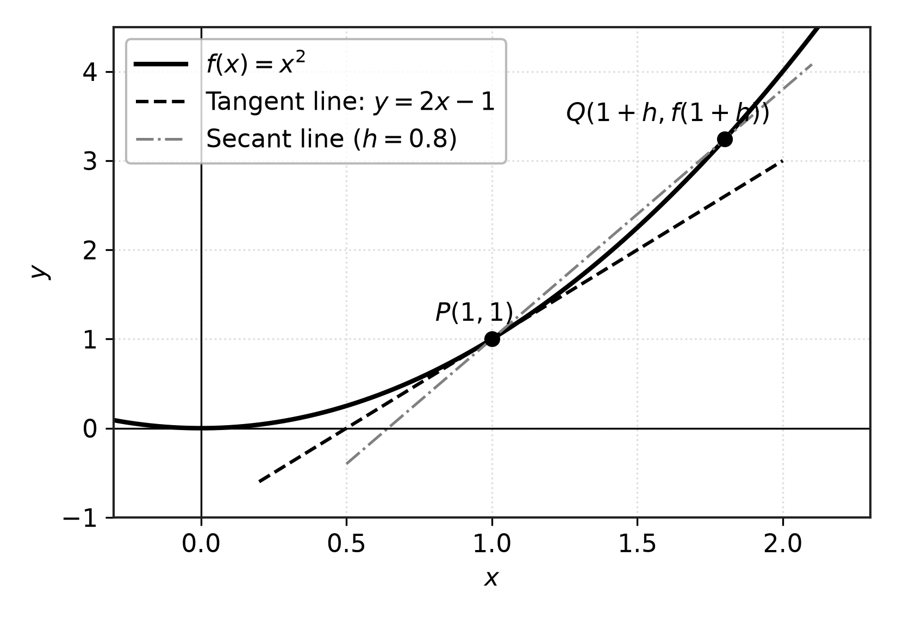{width=65%}

**ตัวอย่างที่ 2.3 (การหาความชันและสมการเส้นสัมผัส):**
กำหนดให้ $f(x) = x^2$ จงหาสมการเส้นสัมผัสกราฟ ณ จุดที่ $x = 1$
*วิธีทำ:* หาค่าความสูงที่จุดสัมผัส $f(1) = (1)^2 = 1$
หาฟังก์ชันอนุพันธ์ $f'(x) = 2x$ ดังนั้นความชันของเส้นสัมผัส ณ $x = 1$ คือ $m = f'(1) = 2(1) = 2$
สร้างสมการเส้นสัมผัสจากจุด $(1, 1)$ และความชัน $m = 2$
$$y - 1 = 2(x - 1) \implies y = 2x - 1$$
*ความหมายทางเรขาคณิต:* เส้นตรง $y = 2x - 1$ สัมผัสเส้นโค้งพาราโบลา $y = x^2$ พอดีที่จุด $(1, 1)$ ดังแสดงในภาพที่ 2.1

**ตัวอย่างที่ 2.4 (การวิเคราะห์ความชันและค่าสุดขีดสัมพัทธ์):**
กำหนดให้ $f(x) = x^3 - 3x$ จงหาจุดบนกราฟที่มีเส้นสัมผัสขนานกับแกน $x$ พร้อมจำแนกลักษณะของจุดดังกล่าว
*วิธีทำ:* เส้นสัมผัสขนานกับแกน $x$ หมายถึงความชันเป็นศูนย์ ($f'(x) = 0$)
คำนวณอนุพันธ์อันดับหนึ่ง $f'(x) = 3x^2 - 3$
กำหนดให้ $3x^2 - 3 = 0 \implies 3(x^2 - 1) = 0 \implies x = 1, -1$
เมื่อ $x = 1$ ได้ $f(1) = 1^3 - 3(1) = -2$ พิกัดคือ $(1, -2)$
เมื่อ $x = -1$ ได้ $f(-1) = (-1)^3 - 3(-1) = 2$ พิกัดคือ $(-1, 2)$
ตรวจสอบลักษณะจุดด้วยการทดสอบอนุพันธ์อันดับสอง (Second Derivative Test):
คำนวณ $f''(x) = 6x$

- ที่จุด $(1, -2)$: $f''(1) = 6(1) = 6 > 0$ กราฟมีลักษณะหงาย จึงเป็นจุดต่ำสุดสัมพัทธ์
- ที่จุด $(-1, 2)$: $f''(-1) = 6(-1) = -6 < 0$ กราฟมีลักษณะคว่ำ จึงเป็นจุดสูงสุดสัมพัทธ์
*ความหมายทางเรขาคณิต:* กราฟมีจุดราบสองจุด คือ จุดต่ำสุดสัมพัทธ์ $(1, -2)$ และจุดสูงสุดสัมพัทธ์ $(-1, 2)$ ซึ่งเส้นสัมผัสมีลักษณะเป็นแนวนอน

### 2.1.3 ผลรวมรีมันน์และการอินทิเกรตตรงแบบ (Riemann Sums and Definite Integrals)

ผลรวมรีมันน์เป็นเครื่องมือในการประมาณพื้นที่ปิดล้อมใต้เส้นโค้งด้วยผลรวมของพื้นที่แท่งสี่เหลี่ยมผืนผ้า ก่อนจะนำไปสู่นิยามของปริพันธ์จำกัดเขตและทฤษฎีบทหลักมูลของแคลคูลัส

**นิยามและความหมายทางเรขาคณิต:**
พิจารณาฟังก์ชัน $f(x)$ บนช่วงปิด $[a, b]$ แบ่งช่วงออกเป็น $n$ ช่วงย่อยเท่า ๆ กัน แต่ละช่วงมีความกว้าง $\Delta x = \frac{b - a}{n}$ ผลรวมรีมันน์กำหนดโดย
$$S_n = \sum_{i=1}^n f(x_i^*) \Delta x$$
โดยที่ $x_i^*$ คือจุดตัวแทนในแต่ละช่วงย่อย ซึ่งมีสูตรการคำนวณพิกัด 3 รูปแบบมาตรฐาน ดังนี้

1. ผลรวมรีมันน์ทางซ้าย (Left Riemann Sum): $x_i^* = a + (i - 1)\Delta x$
2. ผลรวมรีมันน์ทางขวา (Right Riemann Sum): $x_i^* = a + i\Delta x$
3. ผลรวมรีมันน์จุดกึ่งกลาง (Midpoint Riemann Sum): $x_i^* = a + \left(i - \frac{1}{2}\right)\Delta x$

เมื่อเพิ่มจำนวนแท่งสี่เหลี่ยมให้เข้าสู่อนันต์ ($n \to \infty$) ค่าผลรวมจะลู่เข้าสู่ค่าปริพันธ์จำกัดเขต
$$\int_a^b f(x)\,dx = \lim_{n \to \infty} \sum_{i=1}^n f(x_i^*) \Delta x$$

**ทฤษฎีบทหลักมูลของแคลคูลัส (Fundamental Theorem of Calculus: FTC):**
ความเชื่อมโยงระหว่างการหาอนุพันธ์กับการคำนวณปริพันธ์สรุปผ่านทฤษฎีบท 2 ส่วน:

- **ส่วนที่ 1:** หาก $f$ มีความต่อเนื่องบนช่วง $[a, b]$ และกำหนดฟังก์ชัน $g(x) = \int_a^x f(t)\,dt$ แล้ว $g'(x) = f(x)$
- **ส่วนที่ 2:** หาก $F$ เป็นปฏิยานุพันธ์ของ $f$ บนช่วง $[a, b]$ (นั่นคือ $F'(x) = f(x)$) แล้ว
$$\int_a^b f(x)\,dx = F(b) - F(a)$$

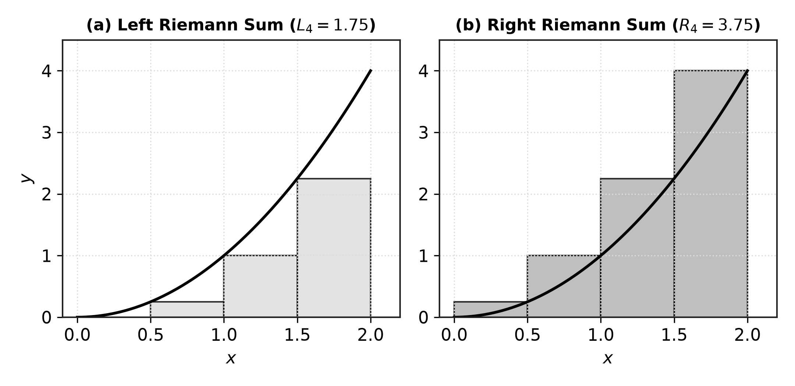{width=85%}

**ตัวอย่างที่ 2.5 (การประมาณค่าด้วยผลรวมรีมันน์ทางซ้ายและขวา):**
จงประมาณค่าของ $\int_0^2 x^2\,dx$ โดยใช้ผลรวมรีมันน์ที่มีจำนวนช่วงย่อย $n = 4$
*วิธีทำ:* ความกว้างแต่ละช่วงย่อย $\Delta x = \frac{2 - 0}{4} = 0.5$ จุดแบ่งช่วงย่อยคือ $x = 0, 0.5, 1.0, 1.5, 2.0$

1. ผลรวมรีมันน์ทางซ้าย (ใช้จุด $x_i^* = 0, 0.5, 1.0, 1.5$):
$$L_4 = [f(0) + f(0.5) + f(1.0) + f(1.5)](0.5) = [0 + 0.25 + 1.0 + 2.25](0.5) = (3.5)(0.5) = 1.75$$

2. ผลรวมรีมันน์ทางขวา (ใช้จุด $x_i^* = 0.5, 1.0, 1.5, 2.0$):
$$R_4 = [f(0.5) + f(1.0) + f(1.5) + f(2.0)](0.5) = [0.25 + 1.0 + 2.25 + 4.0](0.5) = (7.5)(0.5) = 3.75$$
*ความหมายทางเรขาคณิต:* เนื่องจาก $f(x) = x^2$ เป็นฟังก์ชันเพิ่มบน $[0, 2]$ แท่งสี่เหลี่ยมทางซ้ายจะอยู่ใต้เส้นโค้ง ($L_4$ ให้ค่าประมาณต่ำกว่าจริง) และแท่งทางขวาจะล้นเส้นโค้ง ($R_4$ ให้ค่าประมาณสูงกว่าจริง) ดังแสดงในภาพที่ 2.2 โดยค่าจริงคำนวณผ่านทฤษฎีบทหลักมูลของแคลคูลัสได้เท่ากับ $\int_0^2 x^2\,dx = [\frac{x^3}{3}]_0^2 = \frac{8}{3} \approx 2.6667$

**ตัวอย่างที่ 2.6 (ผลรวมรีมันน์จุดกึ่งกลาง):**
จงประมาณค่าของ $\int_1^3 (2x + 1)\,dx$ โดยใช้จุดกึ่งกลางที่มี $n = 4$
*วิธีทำ:* ความกว้างช่วงย่อย $\Delta x = \frac{3 - 1}{4} = 0.5$
จุดกึ่งกลางคำนวณจากสูตร $x_i^* = 1 + (i - 0.5)(0.5)$ ได้แก่ $x_1^* = 1.25, x_2^* = 1.75, x_3^* = 2.25, x_4^* = 2.75$
คำนวณค่าฟังก์ชัน:
$f(1.25) = 2(1.25) + 1 = 3.5$
$f(1.75) = 2(1.75) + 1 = 4.5$
$f(2.25) = 2(2.25) + 1 = 5.5$
$f(2.75) = 2(2.75) + 1 = 6.5$
คำนวณผลรวมจุดกึ่งกลาง:
$$M_4 = [3.5 + 4.5 + 5.5 + 6.5](0.5) = (20.0)(0.5) = 10.0$$
*ความหมายทางเรขาคณิต:* ค่าที่ได้เท่ากับค่าปริพันธ์จริงพอดี $\int_1^3 (2x + 1)\,dx = [x^2 + x]_1^3 = (9 + 3) - (1 + 1) = 10$ เนื่องจากฟังก์ชันเส้นตรงทำให้พื้นที่สามเหลี่ยมส่วนที่เกินและขาดหักล้างกันพอดี

### 2.1.4 เทคนิคการอินทิเกรต (Integration Techniques)

การคำนวณปริพันธ์ของฟังก์ชันที่ซับซ้อนต้องอาศัยเทคนิคการแปลงรูปเพื่อให้เข้าสู่สูตรมาตรฐาน

**นิยามและสูตรหลัก:**

1. **การอินทิเกรตโดยการแทนค่าตัวแปร (Integration by Substitution):** อาศัยกฎลูกโซ่แบบย้อนกลับ เมื่อตัวถูกอินทิเกรตอยู่ในรูป $f(g(x))g'(x)$ ให้กำหนดตัวแปรใหม่ $u = g(x)$ จะได้ $du = g'(x)dx$ ส่งผลให้
$$\int f(g(x))g'(x)\,dx = \int f(u)\,du$$

2. **การอินทิเกรตทีละส่วน (Integration by Parts):** อาศัยอนุพันธ์ของผลคูณสองฟังก์ชัน มีสูตรคำนวณคือ
$$\int u\,dv = uv - \int v\,du$$
การเลือกฟังก์ชัน $u$ ยึดตามลำดับความสำคัญของกฎ **LIATE** เพื่อให้ได้ฟังก์ชันที่หาอนุพันธ์แล้วลดรูปได้ง่ายที่สุด ดังนี้:

- **L:** ฟังก์ชันลอการิทึม (Logarithmic Functions เช่น $\ln x$)
- **I:** ฟังก์ชันตรีโกณมิติผกผัน (Inverse Trigonometric Functions เช่น $\arctan x$)
- **A:** ฟังก์ชันพีชคณิตและพหุนาม (Algebraic Functions เช่น $x^2, 3x$)
- **T:** ฟังก์ชันตรีโกณมิติ (Trigonometric Functions เช่น $\sin x, \cos x$)
- **E:** ฟังก์ชันเลขชี้กำลัง (Exponential Functions เช่น $e^x, 2^x$)

**ตัวอย่างที่ 2.7 (การแทนค่าตัวแปร u):**
จงหาค่าของ $\int 2x \cos(x^2)\,dx$
*วิธีทำ:* กำหนดให้ $u = x^2$ จะได้อนุพันธ์ $\frac{du}{dx} = 2x \implies du = 2x\,dx$
แทนค่าลงในปริพันธ์เดิม:
$$\int \cos(u)\,du = \sin(u) + C = \sin(x^2) + C$$

**ตัวอย่างที่ 2.8 (การอินทิเกรตทีละส่วนตามกฎ LIATE):**
จงหาค่าของ $\int x e^x\,dx$
*วิธีทำ:* พิจารณาตามกฎ LIATE ระหว่างฟังก์ชันพีชคณิต $x$ (A) กับฟังก์ชันเลขชี้กำลัง $e^x$ (E) จึงเลือกฟังก์ชันพีชคณิตเป็น $u$:
กำหนดให้ $u = x \implies du = dx$
กำหนดให้ $dv = e^x\,dx \implies v = \int e^x\,dx = e^x$
แทนค่าลงในสูตร $\int u\,dv = uv - \int v\,du$:
$$\int x e^x\,dx = x e^x - \int e^x\,dx = x e^x - e^x + C = (x - 1)e^x + C$$

### 2.1.5 พื้นที่ระหว่างเส้นโค้ง (Area Between Curves)

**นิยามและความหมายทางเรขาคณิต:**
กำหนดให้ $f(x)$ และ $g(x)$ เป็นฟังก์ชันต่อเนื่องบนช่วง $[a, b]$ โดยที่ $f(x) \ge g(x)$ ตลอดช่วง พื้นที่ปิดล้อมระหว่างเส้นโค้งทั้งสองตั้งแต่ $x = a$ ถึง $x = b$ กำหนดโดย
$$A = \int_a^b [f(x) - g(x)]\,dx$$
ในเชิงเรขาคณิต $f(x) - g(x)$ แทนความสูงของแถบพื้นที่ย่อยในแนวดิ่ง หากเส้นกราฟตัดกันภายในช่วง ต้องหาจุดตัดทั้งหมดเพื่อแบ่งช่วงอินทิเกรตให้ฟังก์ชันตัวบนลบฟังก์ชันตัวล่างเสมอ

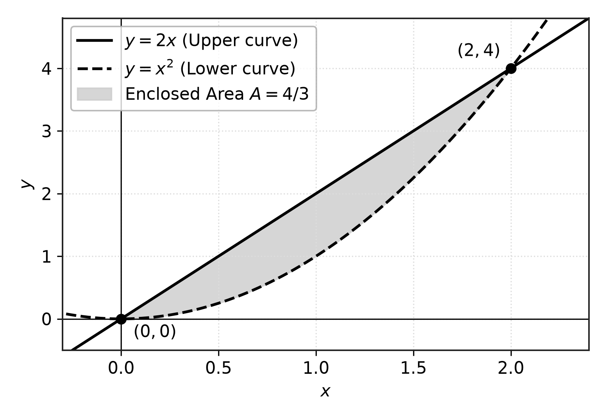{width=65%}

**ตัวอย่างที่ 2.9 (พื้นที่ปิดล้อมระหว่างพาราโบลากับแกน x):**
จงหาพื้นที่ของบริเวณที่ปิดล้อมด้วยเส้นโค้ง $y = 2x - x^2$ และแกน $x$ ($y = 0$)
*วิธีทำ:* หาจุดตัดของกราฟโดยกำหนดให้ $2x - x^2 = 0 \implies x(2 - x) = 0 \implies x = 0, 2$
บนช่วง $[0, 2]$ พบว่าพาราโบลาอยู่เหนือแกน $x$ ($2x - x^2 \ge 0$) เสมอ
$$A = \int_0^2 (2x - x^2)\,dx = \left[ x^2 - \frac{x^3}{3} \right]_0^2 = \left( 4 - \frac{8}{3} \right) - 0 = \frac{4}{3}$$
*ความหมายทางเรขาคณิต:* พื้นที่ปิดล้อมใต้โดมพาราโบลามีขนาดเท่ากับ $\frac{4}{3}$ ตารางหน่วย

**ตัวอย่างที่ 2.10 (พื้นที่ระหว่างสองเส้นโค้งที่มีจุดตัด):**
จงหาพื้นที่ปิดล้อมระหว่างเส้นตรง $y = 2x$ และพาราโบลา $y = x^2$
*วิธีทำ:* หาจุดตัดโดยแก้สมการ $2x = x^2 \implies x^2 - 2x = 0 \implies x(x - 2) = 0 \implies x = 0, 2$
บนช่วง $[0, 2]$ เส้นตรงอยู่เหนือเส้นโค้งพาราโบลา ($2x \ge x^2$)
$$A = \int_0^2 (2x - x^2)\,dx = \left[ x^2 - \frac{x^3}{3} \right]_0^2 = 4 - \frac{8}{3} = \frac{4}{3}$$
*ความหมายทางเรขาคณิต:* แถบแรเงาระหว่างเส้นตรง $y = 2x$ กับพาราโบลา $y = x^2$ แสดงพื้นที่ขนาด $\frac{4}{3}$ ตารางหน่วย ดังแสดงในภาพที่ 2.3

### 2.1.6 ปริมาตรทรงตันที่เกิดจากการหมุน (Volumes of Solids of Revolution)

การหมุนบริเวณพื้นที่บนระนาบ $xy$ รอบแกนหมุนจะทำให้เกิดรูปทรงตันสามมิติ ซึ่งสามารถคำนวณปริมาตรได้ด้วยการรวมพื้นที่หน้าตัดย่อย

**นิยามและสูตรหลัก:**

1. **วิธีจาน (Disk Method):** ใช้เมื่อบริเวณพื้นที่แนบสนิทกับแกนหมุน โดยมีสูตรการหมุนรอบแกน $x$ คือ
$$V = \pi \int_a^b [f(x)]^2\,dx$$

2. **วิธีวงแหวน (Washer Method):** ใช้เมื่อมีช่องว่างระหว่างพื้นที่กับแกนหมุน โดยมีรัศมีภายนอก $R(x)$ และรัศมีภายใน $r(x)$
$$V = \pi \int_a^b \left( [R(x)]^2 - [r(x)]^2 \right) dx$$

**ตัวอย่างที่ 2.11 (วิธีจาน):**
จงหาปริมาตรของทรงตันที่เกิดจากการหมุนบริเวณใต้กราฟ $y = \sqrt{x}$ จาก $x = 0$ ถึง $x = 4$ รอบแกน $x$
*วิธีทำ:* ใช้สูตรวิธีจานโดยมีรัศมี $R(x) = \sqrt{x}$
$$V = \pi \int_0^4 (\sqrt{x})^2\,dx = \pi \int_0^4 x\,dx = \pi \left[ \frac{x^2}{2} \right]_0^4 = \pi \left( \frac{16}{2} - 0 \right) = 8\pi$$
*ความหมายทางเรขาคณิต:* ทรงตันที่ได้มีลักษณะเป็นรูปพาราโบลาคว่ำสามมิติ (Paraboloid) ที่มีปริมาตร $8\pi$ ลูกบาศก์หน่วย

**ตัวอย่างที่ 2.12 (วิธีวงแหวน):**
จงหาปริมาตรที่เกิดจากการหมุนบริเวณปิดล้อมด้วย $y = x$ และ $y = x^2$ รอบแกน $x$
*วิธีทำ:* จุดตัดของทั้งสองกราฟคือ $x = 0$ และ $x = 1$
บนช่วง $[0, 1]$ รัศมีภายนอกคือเส้นตรง $R(x) = x$ และรัศมีภายในคือพาราโบลา $r(x) = x^2$
$$V = \pi \int_0^1 \left( (x)^2 - (x^2)^2 \right) dx = \pi \int_0^1 (x^2 - x^4)\,dx = \pi \left[ \frac{x^3}{3} - \frac{x^5}{5} \right]_0^1 = \pi \left( \frac{1}{3} - \frac{1}{5} \right) = \frac{2\pi}{15}$$
*ความหมายทางเรขาคณิต:* ทรงตันที่ได้มีลักษณะกลวงตรงกลางคล้ายกรวยที่มีผิวโค้งด้านใน

### 2.1.7 ปริพันธ์ไม่ตรงแบบ (Improper Integrals)

ปริพันธ์ไม่ตรงแบบคือปริพันธ์ที่ช่วงของการอินทิเกรตหรือฟังก์ชันตัวถูกอินทิเกรตมีภาวะอนันต์ ซึ่งแบ่งออกเป็น 2 ชนิดหลัก:

1. **ปริพันธ์ไม่ตรงแบบชนิดที่ 1 (ช่วงอนันต์):** มีขอบเขตการอินทิเกรตเป็นอนันต์ เช่น
$$\int_a^{\infty} f(x)\,dx = \lim_{t \to \infty} \int_a^t f(x)\,dx$$

2. **ปริพันธ์ไม่ตรงแบบชนิดที่ 2 (จุดไม่ต่อเนื่องแบบอนันต์):** ฟังก์ชันมีจุดเอกฐาน (Singularity) ภายในช่วง เช่น หาก $f(x)$ มีค่าพุ่งสู่อนันต์ที่จุดปลาย $x = b$ จะนิยามผ่านลิมิตข้างเดียว
$$\int_a^b f(x)\,dx = \lim_{t \to b^-} \int_a^t f(x)\,dx$$

หากค่าลิมิตหาได้เป็นจำนวนจริง จะกล่าวว่าปริพันธ์นั้น **ลู่เข้า (Converges)** แต่หากลิมิตหาค่าไม่ได้หรือเป็นอนันต์ จะกล่าวว่าปริพันธ์นั้น **ลู่ออก (Diverges)**

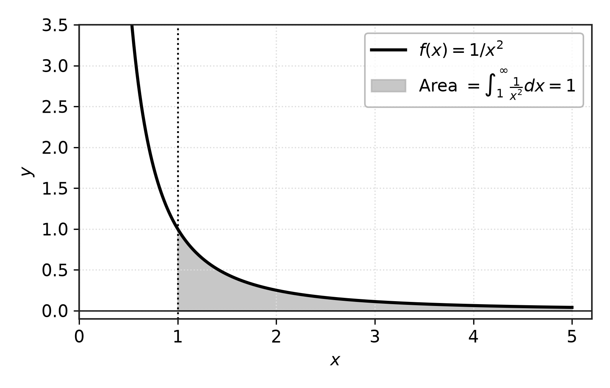{width=65%}

**ตัวอย่างที่ 2.13 (ปริพันธ์ไม่ตรงแบบชนิดที่ 1 ที่ลู่เข้า):**
จงตรวจสอบการลู่เข้าของ $\int_1^{\infty} \frac{1}{x^2}\,dx$
*วิธีทำ:* เขียนรูปปริพันธ์ในรูปลิมิต
$$\int_1^{\infty} \frac{1}{x^2}\,dx = \lim_{t \to \infty} \int_1^t x^{-2}\\,dx = \lim_{t \to \infty} \left[ -\frac{1}{x} \right]_1^t = \lim_{t \to \infty} \left( -\frac{1}{t} - (-1) \right) = 0 + 1 = 1$$
*ความหมายทางเรขาคณิต:* แม้ว่าหางของเส้นกราฟ $y = \frac{1}{x^2}$ จะทอดยาวไปจนถึงอนันต์ทางขวา แต่พื้นที่ปิดล้อมใต้เส้นโค้งมีขนาดจำกัดและลู่เข้าสู่ 1 ตารางหน่วย ดังแสดงในภาพที่ 2.4

**ตัวอย่างที่ 2.14 (ปริพันธ์ไม่ตรงแบบชนิดที่ 2 ที่มีจุดเอกฐาน):**
จงตรวจสอบการลู่เข้าของ $\int_0^1 \frac{1}{\sqrt{x}}\,dx$
*วิธีทำ:* ฟังก์ชันมีจุดเอกฐานแนวดิ่งที่ $x = 0$ (ไม่นิยาม) จึงเป็นปริพันธ์ไม่ตรงแบบชนิดที่ 2 เขียนในรูปลิมิตข้างเดียว
$$\int_0^1 x^{-1/2}\,dx = \lim_{t \to 0^+} \int_t^1 x^{-1/2}\,dx = \lim_{t \to 0^+} [2\sqrt{x}]_t^1 = \lim_{t \to 0^+} (2 - 2\sqrt{t}) = 2 - 0 = 2$$
*ความหมายทางเรขาคณิต:* แม้กราฟจะพุ่งขึ้นสู่แกน $y$ อย่างไม่มีที่สิ้นสุด แต่พื้นที่ปิดล้อมระหว่างกราฟกับแกน $y$ บนช่วง $[0, 1]$ ลู่เข้าสู่ค่า 2 ตารางหน่วย

## 2.2 เทคโนโลยีและเครื่องมือที่ใช้ในการพัฒนา

การพัฒนาเว็บแอปพลิเคชันเลือกใช้เครื่องมือที่มุ่งเน้นการเป็นกลไกขับเคลื่อนการคำนวณทางคณิตศาสตร์อย่างแม่นยำและแสดงผลได้อย่างรวดเร็ว

### 2.2.1 ภาษาไพธอนและไลบรารีสตรีมลิต (Python and Streamlit)
ภาษาไพธอน (Python) เป็นภาษาโปรแกรมระดับสูงที่มีจุดเด่นด้านไวยากรณ์ที่กระชับและมีระบบนิเวศของไลบรารีทางวิทยาศาสตร์ที่สมบูรณ์ โครงงานนี้เลือกใช้ไลบรารีสตรีมลิต (Streamlit) ทำหน้าที่เป็นแกนควบคุมการทำงานหลักของเว็บแอปพลิเคชัน โดยสตรีมลิตช่วยให้สามารถสร้างส่วนประสานงานผู้ใช้ที่ตอบสนองแบบเรียลไทม์ (Reactive UI) จัดการระบบนำทางหลายหน้า (Multi-page Navigation) และควบคุมสถานะของตัวแปร (Session State) ในการจำลองกราฟและบันทึกคะแนนสอบได้โดยไม่ต้องอาศัยสถาปัตยกรรมเว็บเซิร์ฟเวอร์ที่ซับซ้อน

### 2.2.2 ไลบรารีซิมไพ (SymPy) ในฐานะระบบพีชคณิตคอมพิวเตอร์
ไลบรารีซิมไพ (SymPy) ทำหน้าที่เป็นกลไกประมวลผลพีชคณิตคอมพิวเตอร์ (CAS) ประจำระบบ ซึ่งแตกต่างจากไลบรารีคำนวณเชิงตัวเลขทั่วไปตรงที่ซิมไพจัดการตัวแปรในรูปสัญลักษณ์ที่คงค่าความแม่นยำทางคณิตศาสตร์ 100% เช่น การคงรูปเศษส่วน $\frac{1}{3}$ หรือค่าคงตัว $\pi$ โดยไม่มีปัญหาความคลาดเคลื่อนจากการปัดเศษทศนิยม (Floating-point error) ซิมไพถูกนำมาใช้ในการคำนวณอนุพันธ์ ปริพันธ์ การแยกตัวประกอบ และการตรวจสอบเงื่อนไขความถูกต้องของสมการ

### 2.2.3 ไลบรารีแมตพลอตลิบ (Matplotlib) และระบบเคเท็ก (KaTeX)
ไลบรารีแมตพลอตลิบ (Matplotlib) ทำหน้าที่สร้างกราฟสองมิติ กราฟเส้นสัมผัส แท่งสี่เหลี่ยมผลรวมรีมันน์ และการแรเงาพื้นที่ปิดล้อม โดยทำงานร่วมกับระบบเคเท็ก (KaTeX) ซึ่งเป็นระบบเรนเดอร์สมการคณิตศาสตร์ประสิทธิภาพสูงบนเว็บเบราว์เซอร์ ช่วยให้สูตร นิยาม และขั้นตอนวิธีทำแสดงผลในรูปแบบสัญลักษณ์มาตรฐานทางวิชาการที่คมชัดและถูกต้อง

## 2.3 กรอบแนวคิดการจัดนั่งร้านทางปัญญาและการออกแบบแบบทดสอบ

### 2.3.1 การจัดนั่งร้านทางปัญญา (Instructional Scaffolding)
การจัดนั่งร้านทางปัญญาเป็นทฤษฎีการออกแบบการสอนที่มุ่งเน้นการให้ความช่วยเหลือแก่ผู้เรียนในระดับที่เหมาะสมกับความสามารถ แล้วค่อย ๆ ลดระดับการช่วยเหลือลงเมื่อผู้เรียนเริ่มเกิดความชำนาญ โครงงานนี้นำหลักการดังกล่าวมาปรับใช้ในการออกแบบบทเรียน 4 ขั้นตอน:

1. การนำเสนอแนวคิดและกราฟจำลองเพื่อให้เห็นภาพรวม
2. การให้ผู้เรียนทดลองปรับตัวแปรบนกราฟเพื่อสังเกตความสัมพันธ์
3. การแสดงวิธีทำอย่างเป็นลำดับขั้นพร้อมอธิบายเหตุผลและข้อควรระวัง
4. การให้แบบฝึกหัดที่มาพร้อมระบบคำใบ้ชี้แนะแนวทางแทนการเฉลยทันที

### 2.3.2 การจำแนกระดับของแบบทดสอบ
เพื่อวัดความเข้าใจของผู้เรียนอย่างเป็นระบบ คลังแบบทดสอบจำนวน 80 ข้อถูกจำแนกออกเป็น 3 ระดับตามระดับความลึกในการคิด:

1. **ระดับมโนทัศน์และสูตรพื้นฐาน:** ทดสอบความจำและความเข้าใจนิยาม เช่น การอ่านค่าจุดตัด หรือการระบุสูตรอนุพันธ์
2. **ระดับการฝึกคำนวณ:** ทดสอบทักษะการแก้โจทย์ตามขั้นตอน เช่น การคำนวณพื้นที่ปิดล้อม หรือการอินทิเกรตโดยการแทนค่า
3. **ระดับการวิเคราะห์และตรวจสอบจุดผิด:** ทดสอบความเข้าใจในเงื่อนไขพิเศษ เช่น การตรวจสอบลิมิตที่ไม่ต่อเนื่อง หรือการจัดการรูปแบบยังไม่กำหนด

## 2.4 การประเมินความสะดวกในการใช้งาน (System Usability Scale: SUS)

การประเมินความสะดวกในการใช้งานใช้แบบประเมินมาตรฐานสากล (System Usability Scale: SUS) ของ John Brooke ซึ่งประกอบด้วยข้อคำถาม 10 ข้อ มีมาตรวัดประมาณค่า 5 ระดับ (ตั้งแต่ 1 = ไม่เห็นด้วยอย่างยิ่ง ถึง 5 = เห็นด้วยอย่างยิ่ง) ดังแสดงในตารางที่ 2.2

ตารางที่ 2.2 ข้อคำถามมาตรฐานในแบบประเมินความสะดวกในการใช้งาน (SUS)

| ลำดับที่ | ข้อความคำถามประเมิน |
|:---|:---|
| 1 | ฉันคิดว่าฉันอยากใช้เว็บแอปพลิเคชันนี้บ่อย ๆ |
| 2 | ฉันพบว่าเว็บแอปพลิเคชันนี้มีความซับซ้อนโดยไม่จำเป็น |
| 3 | ฉันคิดว่าเว็บแอปพลิเคชันนี้ใช้งานได้ง่าย |
| 4 | ฉันคิดว่าฉันต้องได้รับความช่วยเหลือจากผู้เชี่ยวชาญจึงจะสามารถใช้งานเว็บแอปพลิเคชันนี้ได้ |
| 5 | ฉันพบว่าระบบต่าง ๆ ในเว็บแอปพลิเคชันนี้ทำงานประสานกันได้อย่างลงตัว |
| 6 | ฉันคิดว่าเว็บแอปพลิเคชันนี้มีความไม่สอดคล้องกันในการทำงานมากเกินไป |
| 7 | ฉันคิดว่าคนส่วนใหญ่จะสามารถเรียนรู้การใช้งานเว็บแอปพลิเคชันนี้ได้อย่างรวดเร็ว |
| 8 | ฉันพบว่าเว็บแอปพลิเคชันนี้มีความยุ่งยากในการใช้งาน |
| 9 | ฉันรู้สึกมั่นใจมากในการใช้งานเว็บแอปพลิเคชันนี้ |
| 10 | ฉันจำเป็นต้องเรียนรู้หลายสิ่งก่อนที่จะสามารถเริ่มต้นใช้งานเว็บแอปพลิเคชันนี้ได้ |

**เกณฑ์การคำนวณและแปลผลคะแนน:**

1. ข้อคี่ (1, 3, 5, 7, 9): คะแนนข้อ = คะแนนที่ผู้เรียนตอบ - 1
2. ข้อคู่ (2, 4, 6, 8, 10): คะแนนข้อ = 5 - คะแนนที่ผู้เรียนตอบ
3. รวมคะแนนทั้ง 10 ข้อ แล้วคูณด้วย 2.5 จะได้คะแนนรวมในช่วง 0 ถึง 100 คะแนน
เกณฑ์มาตรฐานกำหนดว่า ระบบที่มีคะแนน SUS ตั้งแต่ 68 คะแนนขึ้นไป ถือว่าผ่านเกณฑ์มาตรฐานการใช้งานในระดับดี (Above Average / Acceptable)

## 2.5 งานวิจัยที่เกี่ยวข้อง

การศึกษาค้นคว้างานวิจัยและทฤษฎีการศึกษาคณิตศาสตร์ที่เกี่ยวข้อง พบประเด็นสำคัญที่สนับสนุนแนวทางการพัฒนาโครงงาน ดังนี้

Tall และ Vinner (1981) ได้เสนอกรอบแนวคิดเรื่อง "ภาพตัวแทนมโนทัศน์และนิยามมโนทัศน์" (Concept Image and Concept Definition) โดยชี้ว่าผู้เรียนมักสร้างความเข้าใจทางคณิตศาสตร์จากโครงสร้างทางจิตและภาพเรขาคณิตที่สะสมในสมอง (Concept Image) มากกว่าการท่องจำนิยามตัวอักษรที่เป็นทางการ (Concept Definition) การใช้สื่อที่แสดงภาพกราฟแบบเคลื่อนไหวปรับค่าได้ จึงเป็นสะพานเชื่อมสำคัญที่ช่วยให้ผู้เรียนเข้าใจนิยามของลิมิตและอนุพันธ์ได้อย่างลึกซึ้ง

Dubinsky (1991) ได้พัฒนาทฤษฎี APOS (Action, Process, Object, Schema) ซึ่งอธิบายการเรียนรู้คณิตศาสตร์ระดับอุดมศึกษาว่า ผู้เรียนต้องเริ่มต้นจากการลงมือกระทำ (Action) เช่น การทดลองคำนวณหรือปรับค่า จากนั้นพัฒนาเป็นกระบวนการคิดในสมอง (Process) ก่อนจะตกผลึกเป็นวัตถุทางคณิตศาสตร์ที่จับต้องได้ (Object) การออกแบบเว็บแอปพลิเคชันให้ผู้เรียนได้เลื่อนปรับค่าพารามิเตอร์และสังเกตผลแบบเรียลไทม์จึงสอดรับกับขั้น Action และ Process โดยตรง

สุริยัน ขัดขันจง (2567) ได้ศึกษาผลสัมฤทธิ์ทางการเรียนในกระบวนวิชาแคลคูลัสสำหรับนักศึกษาระดับปริญญาตรี เรื่อง ลิมิตและความต่อเนื่อง โดยใช้การสอนที่เน้นการสร้างมโนทัศน์ร่วมกับโปรแกรมพลวัตทางคณิตศาสตร์ พบว่าคะแนนผลสัมฤทธิ์ทางการเรียนของนักศึกษาหลังเรียนสูงกว่าก่อนเรียนอย่างมีนัยสำคัญทางสถิติที่ระดับ .05 โดยการจำลองกราฟแบบโต้ตอบช่วยให้นักศึกษาสามารถมองเห็นพฤติกรรมการลู่เข้าของลิมิตและจำแนกจุดไม่ต่อเนื่องได้อย่างเป็นรูปธรรม

สุภัทรา เกิดมงคล และ กัญญาภัค ภัยแคล้ว (2562) ได้ศึกษาผลการใช้โปรแกรมคณิตศาสตร์เชิงโต้ตอบร่วมกับการสืบเสาะหาความรู้ในรายวิชาแคลคูลัส 1 ระดับปริญญาตรี เรื่อง การประยุกต์อินทิกรัลจำกัดเขต พบว่านักศึกษามีผลสัมฤทธิ์ทางการเรียนหลังเรียนสูงกว่าก่อนเรียนอย่างมีนัยสำคัญทางสถิติที่ระดับ .05 และมีความพึงพอใจต่อการใช้โปรแกรมในการจำลองพื้นที่และปริมาตรในระดับมากที่สุด เนื่องจากช่วยลดความซับซ้อนในการนึกภาพสามมิติ

Meagher (2005) ได้ศึกษาความเข้าใจเรื่องอนุพันธ์ของผู้เรียนในสภาพแวดล้อมที่ใช้ระบบพีชคณิตคอมพิวเตอร์ (CAS) พบว่าการใช้ CAS ช่วยให้ผู้เรียนก้าวข้ามอุปสรรคของการคิดคำนวณพีชคณิตที่ผิดพลาด และมุ่งเน้นไปที่การทำความเข้าใจความหมายของอัตราการเปลี่ยนแปลงและความชันของเส้นสัมผัสกราฟได้อย่างลึกซึ้งยิ่งขึ้น




# บทที่ 3
# วิธีการดำเนินโครงงาน

การดำเนินโครงงานการพัฒนาเว็บแอปพลิเคชันช่วยเรียนคณิตศาสตร์สำหรับแคลคูลัสเบื้องต้น มุ่งเน้นการบูรณาการหลักการทางวิศวกรรมซอฟต์แวร์เข้ากับหลักการสอนคณิตศาสตร์อย่างเป็นระบบ โดยให้ความสำคัญกับการคำนวณเชิงสัญลักษณ์ที่ถูกต้องแม่นยำผ่านระบบพีชคณิตคอมพิวเตอร์ (Computer Algebra System: CAS) ภายในเครื่องแม่ข่ายโดยไม่พึ่งพาบริการภายนอก และการออกแบบส่วนประสานงานผู้ใช้ที่ช่วยลดภาระทางปัญญาของผู้เรียน โดยมีรายละเอียดขั้นตอนและวิธีการดำเนินงานดังต่อไปนี้

## 3.1 แผนและขั้นตอนการดำเนินงาน (Development Workflow)

กระบวนการพัฒนาโครงงานดำเนินตามวงจรการพัฒนาซอฟต์แวร์ (Software Development Life Cycle: SDLC) ร่วมกับแนวคิดการพัฒนาแบบทำซ้ำและเพิ่มส่วนขยาย (Iterative and Incremental Development) โดยแบ่งออกเป็น 5 ขั้นตอนหลัก ดังแสดงในภาพที่ 3.1

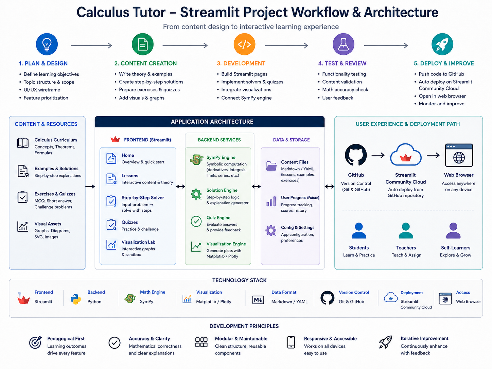{width=85%}

จากภาพที่ 3.1 กระบวนการพัฒนาโครงงานประกอบด้วย 5 ขั้นตอนหลักที่มีความต่อเนื่องกัน ดังนี้

1. **การวางแผนและกำหนดความต้องการ:**
   - รวบรวมปัญหาและข้อจำกัดในการเรียนรู้แคลคูลัสเบื้องต้นของผู้เรียน โดยเฉพาะหัวข้อลิมิต อนุพันธ์ และปริพันธ์
   - กำหนดวัตถุประสงค์เชิงพฤติกรรมและผลลัพธ์การเรียนรู้ที่คาดหวังในแต่ละบทเรียน
   - ออกแบบผังโครงสร้างบทเรียน และจัดทำโครงร่างหน้าจอต้นแบบ (UI Wireframe)

2. **การจัดเตรียมเนื้อหาและคลังแบบทดสอบ:**
   - สังเคราะห์เนื้อหาทฤษฎี นิยาม กฎเกณฑ์ และข้อสังเกตทางคณิตศาสตร์ให้ครอบคลุม 7 บทเรียนหลัก
   - คัดเลือกและออกแบบตัวอย่างโจทย์ที่มีระดับความยากแบบเป็นลำดับขั้น
   - จัดทำคลังข้อสอบจำนวน 80 ข้อ พร้อมจัดทำคำอธิบายเฉลยละเอียดและคำใบ้เพื่อนำทางความคิด

3. **การพัฒนาระบบและโมดูลคำนวณ:**
   - พัฒนาส่วนประสานงานผู้ใช้เชิงโต้ตอบด้วยภาษาไพธอนและไลบรารีสตรีมลิต (Streamlit)
   - สร้างโมดูลคำนวณคณิตศาสตร์เชิงสัญลักษณ์ด้วยไลบรารีซิมไพ (SymPy) โดยแยกตรรกะการประมวลผลออกจากส่วนแสดงผลอย่างเด็ดขาด
   - พัฒนาระบบแสดงผลกราฟทางเรขาคณิตด้วยไลบรารีแมตพลอตลิบ (Matplotlib) และระบบเรนเดอร์สมการด้วยเคเท็ก (KaTeX)

4. **การทดสอบและทบทวนความถูกต้อง:**
   - ดำเนินการทดสอบหน่วยย่อยอัตโนมัติด้วยเฟรมเวิร์กไพเทสต์ (Pytest) ครอบคลุมฟังก์ชันการคำนวณทุกโมดูล
   - ตรวจสอบความถูกต้องของสัญลักษณ์ทางคณิตศาสตร์และการจัดรูปสมการ
   - ทดสอบความทนทานต่อกรณีขอบเขตวิกฤต เช่น จุดที่ฟังก์ชันไม่ต่อเนื่อง ลิมิตที่หาค่าไม่ได้ และรูปแบบยังไม่กำหนด

5. **การเผยแพร่และประเมินผลระบบ:**
   - ควบคุมเวอร์ชันของซอร์สโค้ดผ่านระบบควบคุมเวอร์ชันกิต (Git) บนบริการกิตฮับ (GitHub) และติดตั้งบน Streamlit Community Cloud
   - เปิดให้นิสิตกลุ่มตัวอย่างและผู้เรียนระดับอุดมศึกษา (บันทึกผล ณ วันที่ 30 ตุลาคม 2569 รวม N = 50 คน) เข้าทดลองใช้งานเว็บแอปพลิเคชัน และเก็บรวบรวมข้อมูลการประเมินความสะดวกในการใช้งานผ่านเกณฑ์มาตรฐาน System Usability Scale ฉบับปรับปรุงข้อคำถามเชิงบวก (Positive-phrased SUS) ตามกรอบของ Sauro & Lewis (2011) ควบคู่กับแบบประเมินความพึงพอใจต่อระบบ 4 ด้าน

## 3.2 สถาปัตยกรรมระบบ (System Architecture)

ระบบถูกออกแบบตามสถาปัตยกรรมแบบแบ่งชั้น (Layered Architecture) โดยแบ่งความรับผิดชอบออกเป็น 3 ส่วนหลักอย่างชัดเจน เพื่อให้ระบบมีความเป็นระเบียบ บำรุงรักษาง่าย และรองรับการขยายฟังก์ชันในอนาคต ดังแสดงในภาพที่ 3.2

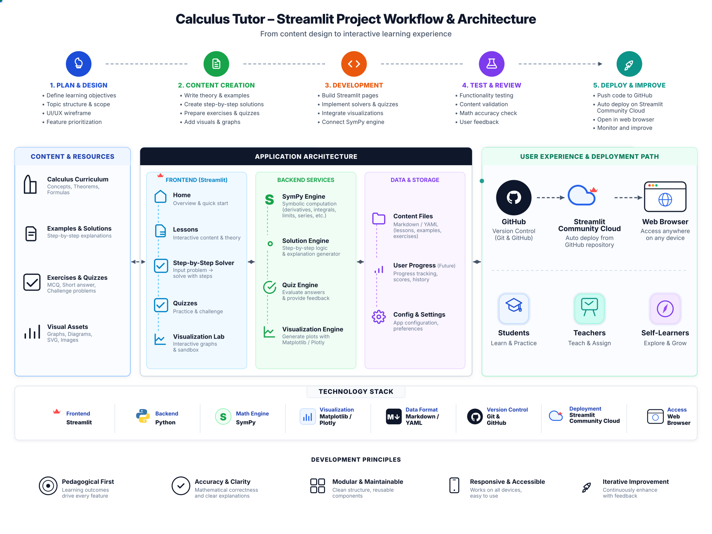{width=85%}

จากภาพที่ 3.2 สถาปัตยกรรมระบบประกอบด้วย 3 ชั้นหลัก ดังนี้

### 3.2.1 ส่วนประสานงานผู้ใช้ (Presentation Layer)
ทำหน้าที่รับข้อมูลนำเข้าจากผู้เรียนผ่านวิดเจ็ตต่าง ๆ เช่น ช่องกรอกฟังก์ชัน แถบเลื่อนปรับค่าตัวเลข และปุ่มตัวเลือก จากนั้นส่งต่อข้อมูลไปยังส่วนคำนวณ และนำผลลัพธ์ที่ได้กลับมาแสดงผลในรูปของกราฟเรขาคณิตสองมิติและสมการคณิตศาสตร์ที่จัดรูปแบบอย่างสวยงาม ชั้นนี้พัฒนาด้วยไลบรารีสตรีมลิต และมีการจัดสรรหน้าเว็บออกเป็น 15 หน้าผ่านระบบนำทางหลัก `st.navigation` แบ่งเป็น 4 หมวดหมู่: ภาพรวมระบบ, โมดูลการเรียนรู้ (7 บทเรียน), เครื่องมือและการประเมิน (เครื่องคิดเลข, แบบทดสอบ, แบบสอบถาม), และข้อมูลโครงงาน

### 3.2.2 ส่วนบริการประมวลผลคำนวณ (Computation Layer)
ทำหน้าที่เป็นมันสมองของระบบ ประกอบด้วยโมดูลตัวแก้ปัญหา (Solvers) ที่เขียนด้วยภาษาไพธอนและซิมไพ โดยทำหน้าที่คำนวณทางคณิตศาสตร์เชิงสัญลักษณ์ แยกตัวประกอบ ตรวจสอบโดเมน สร้างลำดับขั้นตอนวิธีทำ และตรวจจับกรณีข้อผิดพลาด ชั้นนี้ถูกออกแบบให้เป็นฟังก์ชันบริสุทธิ์ (Pure Functions) ปราศจากการผูกติดกับหน้าจอแสดงผล ทำให้สามารถนำไปทดสอบความถูกต้องทางคณิตศาสตร์แบบอัตโนมัติด้วย Pytest ได้อย่างสมบูรณ์โดยไม่ต้องเปิดเบราว์เซอร์

### 3.2.3 ส่วนจัดเก็บข้อมูลและบทเรียน (Data & Content Layer)
ทำหน้าที่จัดเก็บเนื้อหาบทเรียนภาษาไทยในรูปแบบมาร์กดาวน์ (Markdown) และคลังข้อสอบ 80 ข้อในรูปแบบเจสัน (JSON) ช่วยให้สามารถปรับปรุงเนื้อหาหรือเพิ่มข้อสอบใหม่ได้โดยไม่ต้องแก้ไขโค้ดโปรแกรม

### 3.2.4 วงจรการทำงานแบบทำซ้ำและการจัดการสถานะเซสชัน (Execution Lifecycle & Session State)
เนื่องจากเฟรมเวิร์กสตรีมลิตมีวงจรการทำงานแบบประมวลผลซ้ำทั้งหน้า (Reactive Rerun Loop) เมื่อผู้เรียนมีปฏิสัมพันธ์กับหน้าจอ เช่น การเลื่อนแถบสไลเดอร์หรือการกดปุ่ม โค้ดในหน้านั้นจะถูกประมวลผลใหม่ตั้งแต่บรรทัดแรก เพื่อป้องกันไม่ให้ข้อมูลสูญหายหรือเกิดการคำนวณซ้ำซ้อน ระบบจึงบริหารจัดการข้อมูลผ่านหน่วยความจำเซสชัน (`st.session_state`) ดังนี้:

1. **การบันทึกผลคะแนนและประวัติการสอบ:** จัดเก็บคะแนนแบบทดสอบและคำตอบของผู้เรียนข้ามหน้าเว็บ เพื่อให้สามารถนำผลไปแสดงในหน้าประวัติคะแนนได้โดยไม่ถูกรีเซ็ต
2. **กลไกการหน่วงเวลาเฉลย (Delayed Scaffolding):** บันทึกสถานะว่าผู้เรียนตอบถูกในรอบใด เพื่อควบคุมการแสดงคำใบ้และการเฉลยวิธีทำทีละขั้น
3. **การแยกชั้นคำนวณเพื่อความเสถียร:** การแยกฟังก์ชันคำนวณออกมาเป็นโมดูลอิสระ ช่วยให้การคำนวณเชิงสัญลักษณ์ของ SymPy คงความถูกต้องและไม่ได้รับผลกระทบจากการจัดเรียงหน้าจอใหม่

### 3.2.5 มาตรฐานสัญญาข้อมูลการส่งคืนผลลัพธ์ 5 มิติ (Universal Step Contract)
เพื่อให้ส่วนแสดงผลหน้าจอและส่วนคำนวณหลังบ้านสามารถสื่อสารกันได้อย่างแม่นยำ ระบบจึงกำหนด "สัญญาข้อมูลมาตรฐาน 5 มิติ" (Universal Step Contract) ในรูปแบบโครงสร้างดิกชันนารี (Dictionary) เพื่อให้ทุกโมดูลส่งมอบเนื้อหาการสอนที่ครบถ้วนสม่ำเสมอ ดังแสดงในตารางที่ 3.1

ตารางที่ 3.1 ข้อกำหนด 5 มิติในสัญญามาตรฐานการส่งคืนผลลัพธ์

| มิติที่ | องค์ประกอบในสัญญาข้อมูล | ความหมายและหน้าที่ทางคณิตศาสตร์ | ตัวอย่างผลลัพธ์ที่ส่งคืน |
|:---:|:---|:---|:---|
| 1 | `goal_and_rule` | ระบุเป้าหมาย ทฤษฎีบท หรือสูตรหลักที่เลือกใช้ | การแยกตัวประกอบเพื่อทอนพจน์ หรือ กฎ LIATE |
| 2 | `variable_setup` | กำหนดตัวแปรเสริม การแทนค่า หรือจุดอ้างอิง | กำหนด $u = x^2, du = 2x\,dx$ หรือ $x_0 = 1$ |
| 3 | `algebraic_steps` | แจกแจงขั้นตอนการแปลงรูปพีชคณิตทีละขั้น | แทนค่าในสูตร, ทอนเศษส่วน, หรืออินทิเกรตทีละพจน์ |
| 4 | `domain_boundary` | ตรวจสอบโดเมน จุดเอกฐาน และเงื่อนไขวิกฤต | ตรวจสอบจุดโปร่ง $x \neq 3$ หรือเงื่อนไข $f(x) \ge g(x)$ |
| 5 | `pedagogical_note` | สรุปความหมายทางเรขาคณิตและข้อควรระวัง | แจ้งเตือนพื้นที่สุทธิมีเครื่องหมาย หรือพิกัดจุดวกกลับ |

**ตัวอย่างรูปธรรมการทำงานของสัญญาข้อมูล:**
เมื่อผู้เรียนป้อนโจทย์ $\lim_{x \to 3} \frac{x^2 - 9}{x - 3}$ โมดูลคำนวณลิมิตจะประมวลผลและส่งข้อมูลคืนตามสัญญา 5 มิติ:

1. `goal_and_rule`: ระบุเป้าหมายว่าเป็นการหาลิมิตของฟังก์ชันตรรกยะที่มีรูปแบบยังไม่กำหนด $\frac{0}{0}$
2. `variable_setup`: กำหนดจุดเข้าใกล้คือ $x \to 3$
3. `algebraic_steps`: แสดงขั้นตอนแยกตัวประกอบเป็น $\frac{(x-3)(x+3)}{x-3}$ และทอนพจน์เหลือ $x+3$ ก่อนแทนค่าได้ 6
4. `domain_boundary`: ระบุข้อจำกัดของโดเมนว่า $x \neq 3$
5. `pedagogical_note`: อธิบายความหมายทางเรขาคณิตว่ากราฟมีจุดโปร่งที่พิกัด $(3, 6)$

## 3.3 กรอบแนวคิดการจัดนั่งร้านทางปัญญา (Instructional Scaffolding Framework)

การออกแบบปฏิสัมพันธ์ในแต่ละบทเรียนยึดตามหลักการจัดนั่งร้านทางปัญญา เพื่อช่วยนำทางความคิดและลดความสับสนของผู้เรียน โดยแบ่งขั้นตอนในหน้าจอออกเป็น 4 ระดับ:

1. **ระดับที่ 1 การเปิดรับแนวคิดผ่านภาพจำลอง:** นำเสนอทฤษฎีและกราฟเริ่มต้นเพื่อให้เห็นภาพรวมทางเรขาคณิตก่อนเข้าสู่สูตร
2. **ระดับที่ 2 การทดลองปรับตัวแปร:** ให้ผู้เรียนเลื่อนแถบปรับค่า เช่น ปรับค่า $x$ เพื่อดูการลู่เข้า หรือปรับจำนวนแท่งสี่เหลี่ยม $n$ เพื่อสังเกตพื้นที่
3. **ระดับที่ 3 การศึกษาขั้นตอนวิธีทำ:** นำเสนอวิธีทำละเอียดทีละขั้น มีการระบุกฎเกณฑ์ที่ใช้ การแปลงรูปพีชคณิต และข้อสังเกตมโนทัศน์
4. **ระดับที่ 4 การฝึกฝนและถอนตัวช่วย:** มีแบบฝึกหัดที่ให้ผู้เรียนทดลองตอบ หากตอบผิด ระบบจะมีคำใบ้แนะนำแนวทางแทนการบอกคำตอบทันที

นอกจากนี้ ระบบยังมี **กลไกตรวจจับจุดเข้าใจผิด (Misconception Detection)** คอยตรวจสอบเงื่อนไขทางคณิตศาสตร์แบบเรียลไทม์ เช่น:

- แจ้งเตือนเมื่อลิมิตซ้ายและขวาไม่เท่ากัน
- แจ้งเตือนเมื่อการอินทิเกรตข้ามจุดเอกฐานที่ฟังก์ชันไม่ต่อเนื่อง
- แจ้งเตือนเรื่องพื้นที่สุทธิมีเครื่องหมาย (Net Signed Area) เมื่อกราฟอยู่ใต้แกน $x$ เพื่อไม่ให้ผู้เรียนสับสนกับขนาดของพื้นที่จริง

## 3.4 การออกแบบส่วนติดต่อผู้ใช้และผังหน้าจอต้นแบบ (UI Wireframe)

การออกแบบหน้าจอคำนึงถึงความสะดวกในการใช้งานของผู้เรียนเป็นหลัก โดยยึดหลักเกณฑ์สำคัญ ดังนี้:

1. จัดวางเครื่องมือควบคุมและกราฟไว้ในบริเวณที่มองเห็นได้ชัดเจนโดยไม่ต้องเลื่อนหน้าจอมากเกินไป
2. ใช้รูปแบบตัวอักษรและสีที่สบายตา เหมาะสำหรับการอ่านสมการคณิตศาสตร์
3. ปฏิบัติตามมาตรฐานสากลโดยไม่มีการใช้อีโมจิที่อาจบดบังความเป็นทางการ แต่ใช้ไอคอนสัญลักษณ์มาตรฐานแทน
4. หน้าจอสามารถปรับขนาดให้เหมาะสมกับอุปกรณ์คอมพิวเตอร์และสมาร์ตโฟนได้โดยอัตโนมัติ

ผังหน้าจอต้นแบบที่ใช้เป็นกรอบในการพัฒนาแสดงดังภาพที่ 3.3

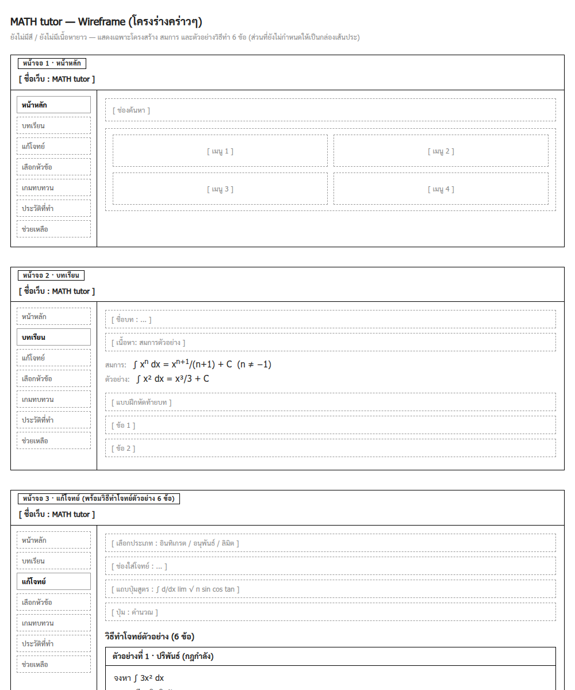{width=85%}

## 3.5 ขั้นตอนวิธีและการประมวลผลเชิงสัญลักษณ์ในแต่ละโมดูล

ระบบประกอบด้วยโมดูลบทเรียนเชิงโต้ตอบ 7 หัวข้อ และเครื่องมือเสริม 2 ส่วน โดยสรุปหน้าที่และตัวแก้ปัญหาที่รับผิดชอบดังแสดงในตารางที่ 3.2

ตารางที่ 3.2 รายละเอียดโมดูลบทเรียนเชิงโต้ตอบ 7 หัวข้อและเครื่องมือเสริม

| ลำดับ | ชื่อโมดูลบทเรียน | ไฟล์โมดูลและตัวแก้ปัญหา | หน้าที่หลักและตรรกะการประมวลผล |
|:---|:---|:---|:---|
| 1 | ลิมิตเข้าใกล้จุดและความต่อเนื่อง | limit_solver.py | คำนวณลิมิตสองด้าน จำแนกจุดไม่ต่อเนื่อง และตรวจสอบรูปแบบ 0/0 |
| 2 | เส้นสัมผัสและอนุพันธ์ | tangent_solver.py | คำนวณอนุพันธ์ ความชัน และปฏิเสธการวาดเส้นสัมผัสที่จุดมุมแหลม |
| 3 | ผลรวมรีมันน์ | riemann_solver.py | ประมาณพื้นที่ด้วยสี่เหลี่ยม 3 รูปแบบ และคำนวณผลรวมสุทธิ |
| 4 | เทคนิคการอินทิเกรต | substitution_solver.py | ตัดสินใจเลือก u-Sub หรือ By Parts ตามกฎ LIATE พร้อมสกัดตัวแปร |
| 5 | พื้นที่ระหว่างเส้นโค้ง | area_solver.py | คำนวณจุดตัดจริง ทดสอบเครื่องหมายจุดกึ่งกลาง และแรเงาพื้นที่ |
| 6 | ปริมาตรทรงตันจากการหมุน | volume_solver.py | คำนวณปริมาตรตามวิธีจานและวิธีวงแหวนรอบแกนหมุน |
| 7 | ปริพันธ์ไม่ตรงแบบ | improper_solver.py | คำนวณลิมิตบนช่วงอนันต์ ดักจับจุดเอกฐาน และประเมินการลู่เข้า |
| เสริม 1 | เครื่องคำนวณแคลคูลัสขั้นสูง | sympy_solver.py | แก้โจทย์อนุพันธ์และปริพันธ์เชิงสัญลักษณ์ทั่วไป |
| เสริม 2 | คลังแบบทดสอบมโนทัศน์ | quiz.py | จัดการทดสอบ 80 ข้อ 3 ระดับ พร้อมระบบคำใบ้และสุ่มตัวเลือก |

### 3.5.1 โมดูลลิมิตเข้าใกล้จุดและความต่อเนื่อง (limit_solver.py)
ตรรกะการประมวลผลของโมดูลลิมิตดำเนินตามลำดับการวิเคราะห์ 5 ขั้นตอน:

1. ทำการแทนค่าโดยตรง (Direct Substitution) หากฟังก์ชันต่อเนื่องและได้ค่าจริง จะส่งคืนคำตอบทันที
2. หากผลลัพธ์อยู่ในรูปแบบยังไม่กำหนด $\frac{0}{0}$ ระบบจะใช้อัลกอริทึมแยกตัวประกอบ (Factoring) ของซิมไพเพื่อทอนพจน์ร่วม หรือใช้การคูณด้วยสังยุคในกรณีฟังก์ชันติดกรณฑ์
3. คำนวณลิมิตข้างเดียวทั้งทางซ้ายและทางขวา ($\lim_{x \to a^-}$ และ $\lim_{x \to a^+}$)
4. เปรียบเทียบลิมิตซ้ายและขวา หากไม่เท่ากันจะสรุปว่าลิมิตหาค่าไม่ได้ (Does Not Exist: DNE) พร้อมระบุว่าเป็นจุดไม่ต่อเนื่องแบบกระโดด หรือแบบอนันต์
5. ตรวจสอบพฤติกรรมกวัดแกว่งไม่สิ้นสุด (Oscillation) เช่น $\sin(1/x)$ เมื่อ $x \to 0$ เพื่อแจ้งเตือนผู้เรียนอย่างถูกต้อง

### 3.5.2 โมดูลเส้นสัมผัสและอนุพันธ์ (tangent_solver.py)
รับฟังก์ชัน $f(x)$ และพิกัดจุดสัมผัส $x = a$ จากนั้นคำนวณอนุพันธ์ $f'(x)$ แทนค่าเพื่อหาความชัน $m = f'(a)$ และสร้างสมการเส้นสัมผัส $y - f(a) = m(x - a)$ นอกจากนี้ ระบบยังคำนวณอัตราส่วนผลต่างของลิมิตข้างเดียว ($f'_\pm(a)$) เพื่อตรวจสอบว่าฟังก์ชันหาอนุพันธ์ได้จริงหรือไม่ หากพบว่าเป็นจุดมุมแหลม (Cusp / Corner Point) เช่น $|x|$ ที่ $x = 0$ ระบบจะแจ้งเตือนว่าฟังก์ชันไม่มีอนุพันธ์ ณ จุดดังกล่าว และปฏิเสธการวาดเส้นสัมผัสแนวนอนลวง

### 3.5.3 โมดูลผลรวมรีมันน์ (riemann_solver.py)
คำนวณความกว้างช่วงย่อย $\Delta x = \frac{b-a}{n}$ และหาพิกัดจุดตัวแทน $x_i^*$ ตามวิธีที่เลือก (ซ้าย ขวา หรือกึ่งกลาง) จากนั้นคำนวณผลรวมของพื้นที่สี่เหลี่ยมแต่ละแท่ง พร้อมทั้งคำนวณค่าปริพันธ์จริงผ่านทฤษฎีบทหลักมูลของแคลคูลัส เพื่อเปรียบเทียบค่าความคลาดเคลื่อนและทิศทางการประมาณค่า (สูงกว่าหรือต่ำกว่าจริง) โดยระบบจะคำนวณเครื่องหมายของพื้นที่ย่อยแต่ละแท่งอย่างละเอียดเพื่อแสดงผลรวมสุทธิมีเครื่องหมาย

### 3.5.4 โมดูลเทคนิคการอินทิเกรต (substitution_solver.py)
ระบบออกแบบผังการตัดสินใจ (Decision Flow) ในการวิเคราะห์โครงสร้างตัวถูกอินทิเกรต:

- **กรณีการแทนค่าตัวแปร $u$:** ค้นหาพจน์ฟังก์ชันประกอบ $g(x)$ จากโครงสร้างไวยากรณ์สมการ (AST) เช่น พจน์ภายในเลขยกกำลัง หรืออาร์กิวเมนต์ของฟังก์ชันอดิศัย จากนั้นหาอนุพันธ์ $g'(x)$ และตรวจสอบว่าสามารถตัดทอนตัวแปรเดิมได้หมดสิ้นหรือไม่ หากตัดทอนได้สำเร็จจะแปลงรูปเข้าสู่ $\int f(u)\,du$
- **กรณีการอินทิเกรตทีละส่วน:** เมื่อพบผลคูณของสองฟังก์ชันต่างชนิด ระบบจะจัดสรรตัวแปร $u$ และ $dv$ ตามกฎ **LIATE** อย่างเคร่งครัด โดยเลือกฟังก์ชันที่มีลำดับความสำคัญสูงสุดเป็น $u$ และฟังก์ชันที่เหลือเป็น $dv$ พร้อมแจกแจงขั้นตอน $uv - \int v\,du$ ได้สูงสุด 2 ชั้น

### 3.5.5 โมดูลพื้นที่ระหว่างเส้นโค้ง (area_solver.py)
อัลกอริทึมคำนวณพื้นที่ได้รับการออกแบบให้รักษาความไม่แปรเปลี่ยนเชิงเรขาคณิต (Geometric Invariance):

1. ทำการแปลงรากคี่ด้วยฟังก์ชัน `real_root` ของซิมไพ เพื่อป้องกันไม่ให้เกิดค่าจำนวนเชิงซ้อนบนย่านตัวเลขลบ
2. แก้สมการหาจุดตัดจริงทั้งหมดระหว่าง $f(x)$ และ $g(x)$ บนช่วงที่กำหนด
3. ซอยย่อยช่วงอินทิเกรตตามจุดตัด และทำการทดสอบเครื่องหมาย ณ จุดกึ่งกลางของแต่ละช่วงย่อย (Midpoint Sign Test) เพื่อจัดให้ฟังก์ชันที่อยู่ด้านบนเป็นตัวตั้งลบด้วยฟังก์ชันตัวล่างเสมอ
4. คำนวณผลรวมพื้นที่ปิดล้อมสุทธิและส่งคืนพิกัดสำหรับแรเงากราฟ

### 3.5.6 โมดูลปริมาตรทรงตันที่เกิดจากการหมุน (volume_solver.py)
วิเคราะห์ความสัมพันธ์ระหว่างบริเวณพื้นที่กับแกนหมุน:

- หากพื้นที่แนบชิดแกนหมุน จะประมวลผลด้วยวิธีจาน $V = \pi \int [f(x)]^2\,dx$
- หากมีช่องว่างระหว่างพื้นที่กับแกนหมุน จะสกัดรัศมีภายนอก $R(x)$ และรัศมีภายใน $r(x)$ เพื่อประมวลผลด้วยวิธีวงแหวน $V = \pi \int [R(x)^2 - r(x)^2]\,dx$

### 3.5.7 โมดูลปริพันธ์ไม่ตรงแบบ (improper_solver.py)
วิเคราะห์ทั้งปริพันธ์ไม่ตรงแบบชนิดที่ 1 (ช่วงอนันต์) และชนิดที่ 2 (จุดไม่ต่อเนื่องแบบอนันต์):

- ตรวจสอบเส้นกำกับแนวดิ่งหรือจุดเอกฐานภายในช่วง $[a, b]$ หากพบจะแยกช่วงอินทิเกรตออกจากกันเพื่อป้องกันการหักล้างค่าอนันต์ที่ผิดพลาด
- แปลงขอบเขตที่มีปัญหาให้อยู่ในรูปลิมิตของตัวแปรเสริม $t$
- คำนวณปริพันธ์และประเมินค่าลิมิต หากได้ค่าจำกัดจะระบุว่าลู่เข้า พร้อมแสดงพื้นที่ใต้กราฟ แต่หากลิมิตเป็นอนันต์จะสรุปว่าลู่ออก

### 3.5.8 เครื่องคำนวณแคลคูลัสขั้นสูง (sympy_solver.py)
ทำหน้าที่เป็นเครื่องคิดเลขอเนกประสงค์สำหรับผู้เรียนที่ต้องการตรวจสอบโจทย์ทั่วไป รองรับการหาอนุพันธ์และปริพันธ์เชิงสัญลักษณ์ทั้งแบบจำกัดเขตและไม่จำกัดเขต

### 3.5.9 คลังแบบทดสอบมโนทัศน์และระบบคำใบ้ (quiz.py)
จัดการชุดข้อสอบจำนวน 80 ข้อ แบ่งตาม 3 ระดับความยากง่าย มีระบบสุ่มข้อสอบ สลับตัวเลือกคำตอบ และแสดงคำใบ้เมื่อผู้เรียนต้องการความช่วยเหลือ พร้อมทั้งบันทึกคะแนนรวมเพื่อสะท้อนพัฒนาการเรียนรู้

## 3.6 แผนการทดสอบระบบและการประเมินผล

เพื่อให้มั่นใจในความถูกต้องและความเสถียรของระบบ โครงงานได้กำหนดแผนการทดสอบออกเป็น 3 ระดับ:

1. **การทดสอบหน่วยย่อยอัตโนมัติ (Automated Unit Testing):** ใช้เฟรมเวิร์ก Pytest ในการสร้างชุดทดสอบครอบคลุมฟังก์ชันการคำนวณของ Solver ทุกตัว รวมทั้งสิ้น 250 กรณีทดสอบ
2. **การทดสอบความทนทานต่อกรณีขอบเขตวิกฤต (Boundary Stress Testing):** ทดสอบความสามารถและข้อจำกัดของระบบผ่านกรณีทดสอบฟังก์ชันทางคณิตศาสตร์ 144 กรณี เพื่อจำแนกขอบเขตที่ระบบรองรับได้อย่างแน่นอนและกรณีที่ระบบปฏิเสธการคำนวณ
3. **การทดสอบการใช้งานเสมือนจริงบนเบราว์เซอร์ (Browser Stress Testing):** ใช้เบราว์เซอร์จำลองพฤติกรรมการคลิก การสลับหน้า และการป้อนฟังก์ชันครบทั้ง 15 หน้า เพื่อตรวจสอบว่าไม่มีข้อผิดพลาดของระบบหรือการแสดงผลสมการค้าง
4. **การประเมินความสะดวกในการใช้งานและการยอมรับของผู้เรียน (Usability Evaluation):** นำระบบไปทดลองใช้กับนิสิตและผู้เรียนกลุ่มตัวอย่าง (บันทึกผล ณ วันที่ 30 ตุลาคม 2569 รวม N = 50 คน) และประเมินผลผ่านแบบประเมิน System Usability Scale ฉบับปรับปรุงข้อคำถามเชิงบวก (Positive-phrased SUS) 10 ข้อคำถาม อิงงานวิจัยของ Sauro & Lewis (2011) และแบบประเมินความพึงพอใจต่อคุณลักษณะของระบบ 4 ด้าน รวม 20 ข้อคำถาม




# บทที่ 4
# ผลการดำเนินงานและการทดสอบระบบ

การพัฒนาเว็บแอปพลิเคชันช่วยเรียนคณิตศาสตร์สำหรับแคลคูลัสเบื้องต้น ได้ดำเนินการพัฒนาและทดสอบระบบตามระเบียบวิธีวิจัยที่กำหนดไว้ในบทที่ 3 ในบทนี้จะนำเสนอผลการดำเนินงานและการทดสอบระบบอย่างเป็นลำดับ โดยแบ่งเนื้อหาออกเป็น 4 หัวข้อหลัก ได้แก่

4.1 ผลการพัฒนาระบบและส่วนประสานงานผู้ใช้
4.2 ผลการทดสอบทางเทคนิคและความถูกต้องทางคณิตศาสตร์
4.3 ผลการประเมินความพึงพอใจและประสิทธิภาพการใช้งาน
4.4 การอภิปรายผลการดำเนินงาน

## 4.1 ผลการพัฒนาระบบและส่วนประสานงานผู้ใช้ (Implementation Results)

ระบบเว็บแอปพลิเคชันได้รับการพัฒนาและติดตั้งบนระบบควบคุมการทำงานหลักด้วยสตรีมลิต (Streamlit) โดยจัดหมวดหมู่หน้าการใช้งานออกเป็น 15 หน้า ผ่านระบบนำทางหลัก `st.navigation` ส่วนประสานงานผู้ใช้ได้รับการออกแบบให้เป็นระเบียบ สบายตา ปราศจากสัญลักษณ์รูปภาพอีโมจิรบกวนสายตา โดยแสดงผลการทำงานจริงในแต่ละส่วนดังนี้

### 4.1.1 ส่วนนำทางและหน้าหลักของระบบ (Home and Navigation System)

หน้าหลักทำหน้าที่เป็นศูนย์กลางในการเข้าถึงบทเรียนและเครื่องมือทั้งหมด โดยประกอบด้วยแถบแนะนำโครงงาน กล่องค้นหาบทเรียน และการ์ดทางลัดเข้าสู่ 7 โมดูลบทเรียนหลัก พร้อมทั้งแสดงแถบสถิติการทำแบบทดสอบของผู้เรียนในเซสชันปัจจุบัน ดังแสดงในภาพที่ 4.1

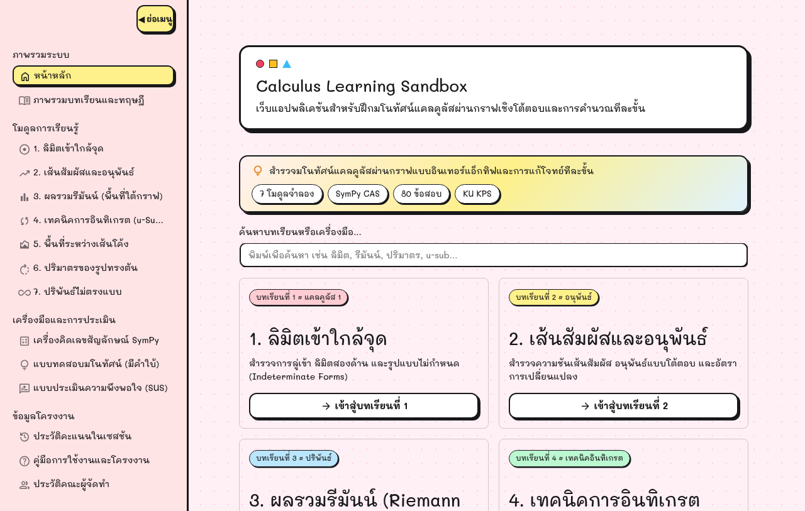{width=85%}

จากภาพที่ 4.1 ผู้เรียนสามารถเลือกเข้าสู่บทเรียนที่ต้องการได้โดยตรงจากการคลิกการ์ด หรือใช้แถบเมนูนำทางด้านซ้ายเพื่อสลับไปยังหน้าบทเรียน เครื่องคำนวณ หรือแบบทดสอบได้อย่างสะดวกรวดเร็ว

### 4.1.2 โมดูลลิมิตเข้าใกล้จุดและความต่อเนื่อง (Limit Approach and Continuity)

โมดูลนี้ออกแบบมาเพื่อแก้ปัญหาการมองไม่เห็นภาพการลู่เข้าของลิมิตและรูปแบบยังไม่กำหนด $\frac{0}{0}$ โดยมีส่วนควบคุมให้ผู้เรียนสามารถป้อนฟังก์ชัน เลือกจุดที่ต้องการหาลิมิต และเลื่อนปรับระยะการเข้าใกล้จุด เพื่อสังเกตการเปลี่ยนแปลงของค่าฟังก์ชันทั้งจากทางซ้ายและทางขวา ดังแสดงในภาพที่ 4.2

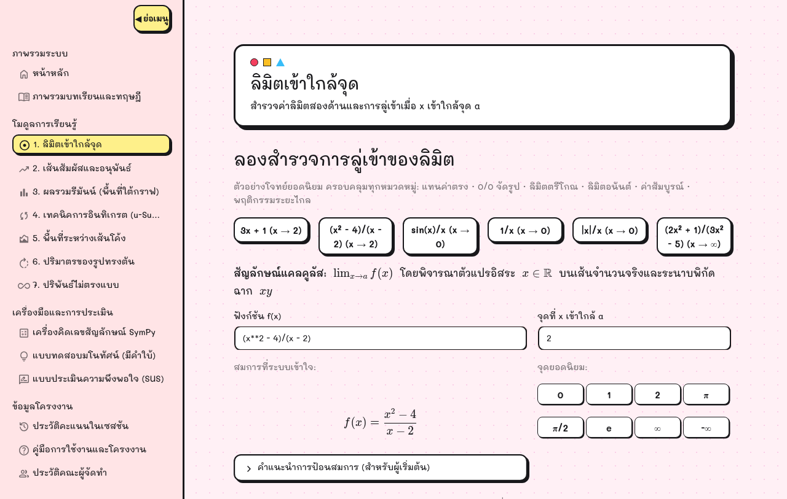{width=85%}

จากภาพที่ 4.2 เมื่อผู้เรียนเลือกโจทย์ตัวอย่าง $f(x) = \frac{x^2 - 4}{x - 2}$ เมื่อ $x \to 2$ ระบบจะแสดงผล 3 ส่วนสำคัญ:

1. **ส่วนรับข้อมูลและแถบเลื่อนค่า (Input Controls):** ผู้เรียนสามารถทดลองป้อนฟังก์ชันและเลื่อนปรับค่า $x$ เพื่อดูพฤติกรรมของกราฟ
2. **กราฟแสดงผลทางเรขาคณิต (Interactive Plot):** แสดงเส้นกราฟพร้อมจุดโปร่ง (Hole) ที่พิกัด $(2, 4)$ เพื่อสื่อให้เห็นว่าฟังก์ชันไม่นิยาม ณ จุดดังกล่าว แต่มีค่าลิมิตลู่เข้าสู่ 4
3. **กล่องเฉลยแสดงวิธีทำทีละขั้น (Step-by-step Solution):** เมื่อคลิกเปิดกล่องเฉลย ระบบจะแสดงขั้นตอนการแทนค่าที่เกิดรูปแบบ $\frac{0}{0}$ และการแยกตัวประกอบ $(x-2)(x+2)$ เพื่อทอนพจน์อย่างละเอียด

### 4.1.3 โมดูลเส้นสัมผัสและอนุพันธ์ (Tangent Lines and Derivatives)

โมดูลนี้ช่วยสร้างความเข้าใจเรื่องอัตราการเปลี่ยนแปลงขณะใดขณะหนึ่งและความชันของเส้นโค้ง โดยแสดงการเคลื่อนที่ของเส้นตัดคอร์ดเข้าสู่เส้นสัมผัส ณ จุดสัมผัสที่กำหนด ดังแสดงในภาพที่ 4.3

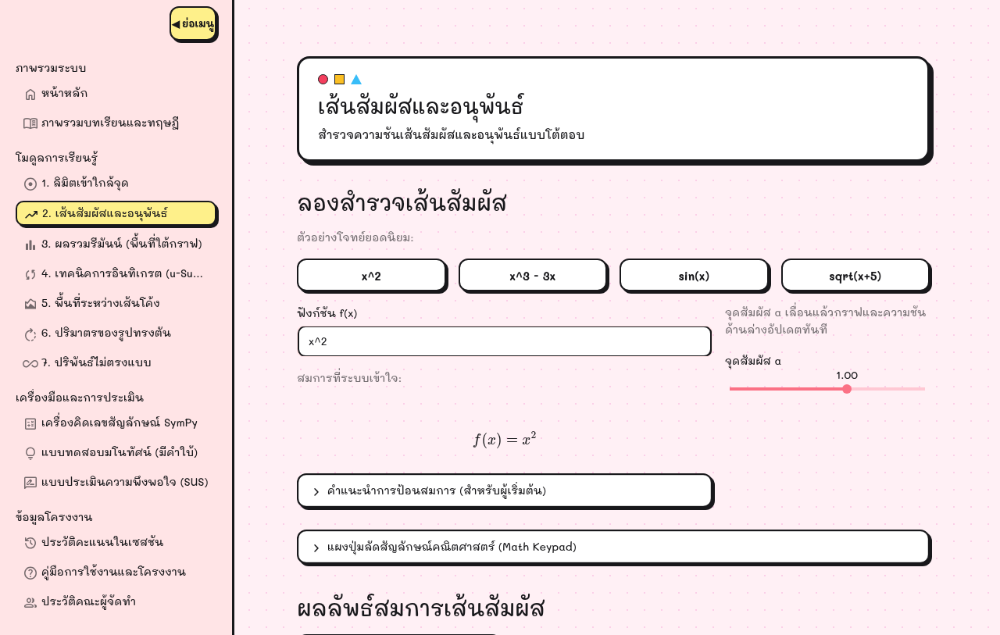{width=85%}

จากภาพที่ 4.3 เมื่อผู้เรียนป้อนฟังก์ชัน $f(x) = x^3 - 3x$ และเลือกจุดสัมผัส $x = 1$ ระบบจะคำนวณอนุพันธ์ $f'(x) = 3x^2 - 3$ และแสดงค่าความชัน $m = 0$ พร้อมวาดเส้นสัมผัสแนวนอนสีแดงสัมผัสเส้นโค้ง ณ จุดต่ำสุดสัมพัทธ์ $(1, -2)$ ทำให้ผู้เรียนเข้าใจความสัมพันธ์ระหว่างอนุพันธ์กับจุดวกกลับได้อย่างชัดเจน

### 4.1.4 โมดูลผลรวมรีมันน์ (Riemann Sums)

โมดูลนี้จำลองการประมาณพื้นที่ใต้เส้นโค้งด้วยแท่งสี่เหลี่ยมผืนผ้า โดยผู้เรียนสามารถเลือกรูปแบบการสร้างแท่งสี่เหลี่ยม (ซ้าย ขวา หรือกึ่งกลาง) และปรับจำนวนแท่งสี่เหลี่ยม $n$ ผ่านแถบเลื่อนตัวเลข ดังแสดงในภาพที่ 4.4

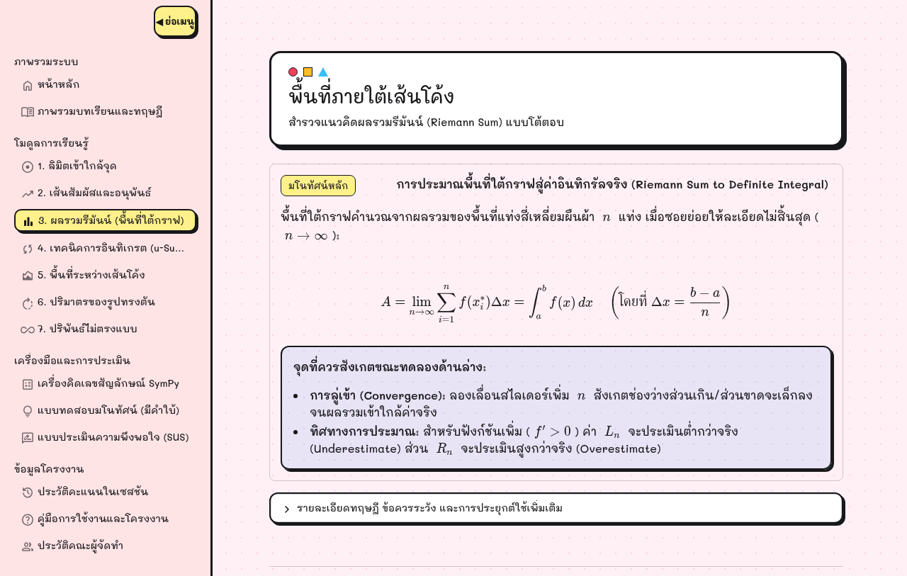{width=85%}

จากภาพที่ 4.4 เมื่อกำหนดฟังก์ชัน $f(x) = x^2$ บนช่วง $[0, 2]$ และเลือกจำนวนแท่ง $n = 4$ ระบบจะวาดแท่งสี่เหลี่ยมแรเงาใต้เส้นโค้ง พร้อมทั้งแสดงตารางเปรียบเทียบค่าผลรวมรีมันน์กับค่าปริพันธ์จริง $\int_0^2 x^2\,dx = 2.6667$ และคำนวณร้อยละของความคลาดเคลื่อน (Percentage Error) ให้เห็นแบบเรียลไทม์ ผู้เรียนสามารถเลื่อนเพิ่มค่า $n$ เป็น 20 หรือ 50 เพื่อสังเกตว่าผลรวมของแท่งสี่เหลี่ยมจะลู่เข้าแนบสนิทกับพื้นที่ใต้เส้นโค้งจริง

### 4.1.5 โมดูลเทคนิคการอินทิเกรต (Integration Techniques)

โมดูลนี้ทำหน้าที่เป็นนั่งร้านทางปัญญาช่วยฝึกฝนการตัดสินใจเลือกเทคนิคการอินทิเกรต โดยแบ่งออกเป็นสองแท็บหลัก ได้แก่ การแทนค่าตัวแปร $u$ (u-Substitution) และการอินทิเกรตทีละส่วน (Integration by Parts) ดังแสดงในภาพที่ 4.5

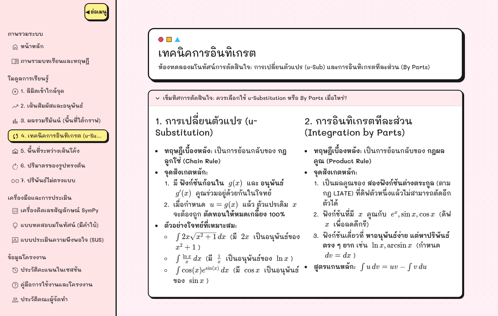{width=85%}

จากภาพที่ 4.5 ในแท็บการอินทิเกรตทีละส่วน ผู้เรียนสามารถทดลองเลือกกำหนดฟังก์ชัน $u$ และ $dv$ จากนั้นระบบจะแสดงผลการคำนวณ $du$ และ $v$ พร้อมทั้งตรวจสอบว่าการเลือกตัวแปรดังกล่าวทำให้ปริพันธ์ใหม่ $\int v\,du$ ง่ายขึ้นหรือซับซ้อนกว่าเดิมตามกฎ LIATE ช่วยลดข้อผิดพลาดในการลองผิดลองถูกของผู้เรียน

### 4.1.6 โมดูลพื้นที่ระหว่างเส้นโค้ง (Area Between Curves)

โมดูลนี้ช่วยคำนวณพื้นที่ปิดล้อมระหว่างสองฟังก์ชัน $f(x)$ และ $g(x)$ โดยระบบจะค้นหาจุดตัดของกราฟโดยอัตโนมัติ และตรวจสอบลำดับของฟังก์ชันตัวบนและตัวล่าง ดังแสดงในภาพที่ 4.6

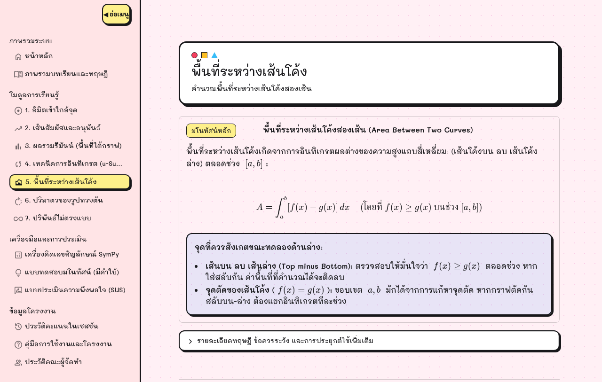{width=85%}

จากภาพที่ 4.6 เมื่อป้อนฟังก์ชัน $f(x) = 2x$ และ $g(x) = x^2$ ระบบจะคำนวณจุดตัดที่ $x = 0$ และ $x = 2$ พร้อมทั้งแรเงาสีฟ้าในบริเวณพื้นที่ปิดล้อม และแจกแจงขั้นตอนการตั้งปริพันธ์ $\int_0^2 (2x - x^2)\,dx = \frac{4}{3}$ ตารางหน่วย อย่างครบถ้วน

### 4.1.7 โมดูลปริมาตรทรงตันที่เกิดจากการหมุน (Volumes of Solids of Revolution)

โมดูลนี้ช่วยให้ผู้เรียนเห็นภาพการหมุนพื้นที่สองมิติรอบแกนหมุนเพื่อเกิดเป็นรูปทรงตันสามมิติ โดยรองรับทั้งวิธีจานและวิธีวงแหวน ดังแสดงในภาพที่ 4.7

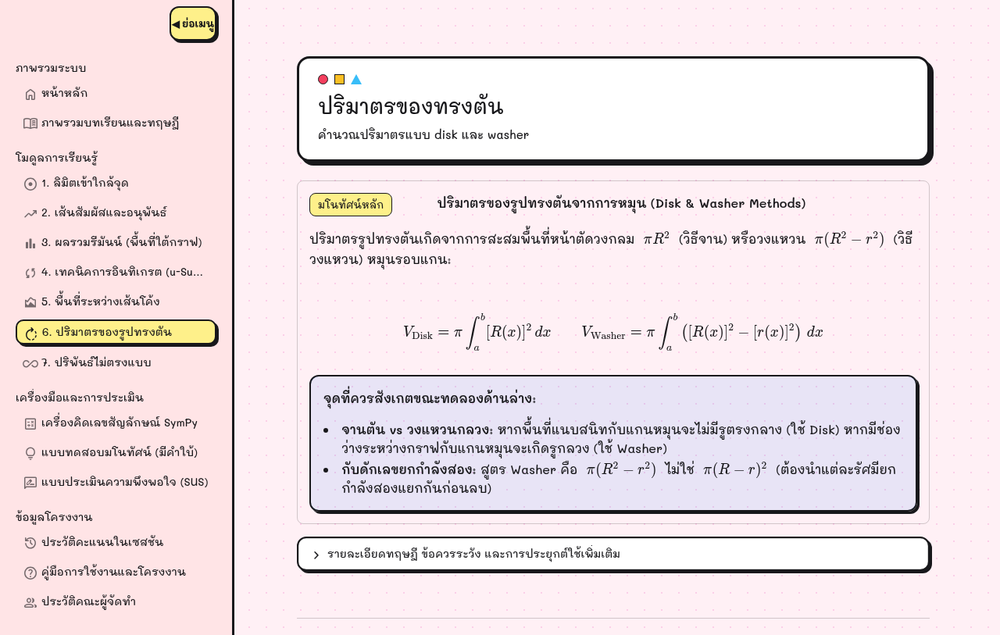{width=85%}

จากภาพที่ 4.7 ระบบแสดงกราฟสองมิติพร้อมเส้นแกนหมุน และแสดงภาพจำลองระนาบพื้นที่หน้าตัด ช่วยให้ผู้เรียนมองเห็นความแตกต่างระหว่างรัศมีภายนอก $R(x)$ และรัศมีภายใน $r(x)$ ก่อนนำไปแทนค่าในสูตรอินทิเกรตคำนวณปริมาตร

### 4.1.8 โมดูลปริพันธ์ไม่ตรงแบบ (Improper Integrals)

โมดูลนี้ช่วยในการวิเคราะห์ปริพันธ์ที่มีขอบเขตเป็นอนันต์และจุดเอกฐาน โดยแสดงกราฟเส้นโค้งหางยาวและสรุปสถานะการลู่เข้าอย่างชัดเจน ดังแสดงในภาพที่ 4.8

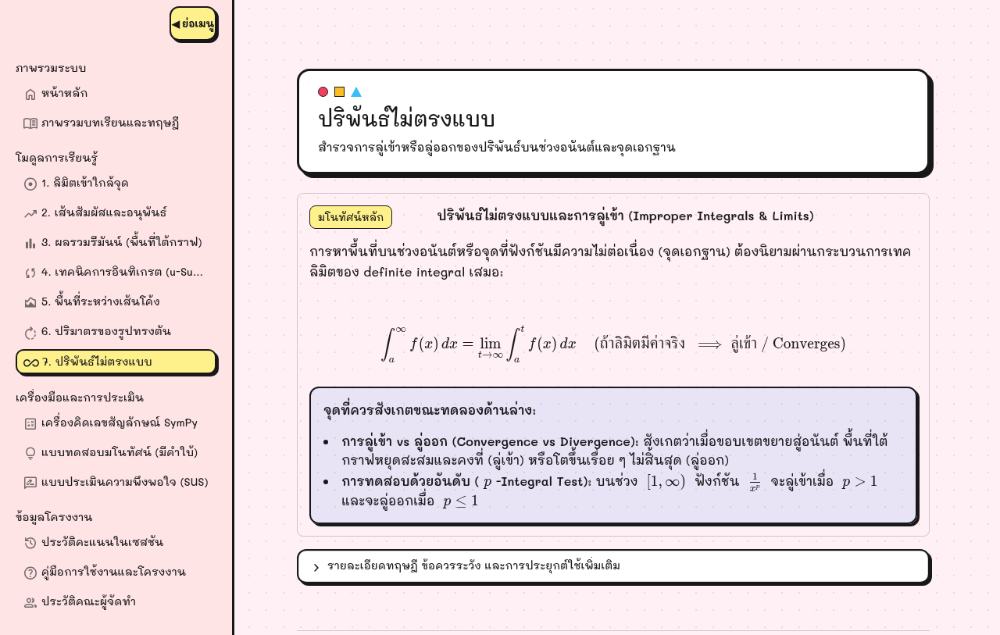{width=85%}

จากภาพที่ 4.8 เมื่อคำนวณ $\int_1^{\infty} \frac{1}{x^2}\,dx$ ระบบจะแปลงเป็นรูปลิมิต $\lim_{t \to \infty} \int_1^t \frac{1}{x^2}\,dx$ และสรุปว่าปริพันธ์นี้ลู่เข้าสู่ค่า 1 พร้อมทั้งแสดงแถบแรเงาพื้นที่ใต้กราฟที่ทอดยาวไปทางขวา

### 4.1.9 เครื่องคำนวณแคลคูลัสขั้นสูงและคลังแบบทดสอบมโนทัศน์

นอกจากบทเรียนทั้ง 7 โมดูลแล้ว ระบบยังมีเครื่องคิดเลขอเนกประสงค์สำหรับคำนวณอนุพันธ์และปริพันธ์ทั่วไป ดังแสดงในภาพที่ 4.9 และคลังแบบทดสอบ 80 ข้อ ดังแสดงในภาพที่ 4.10

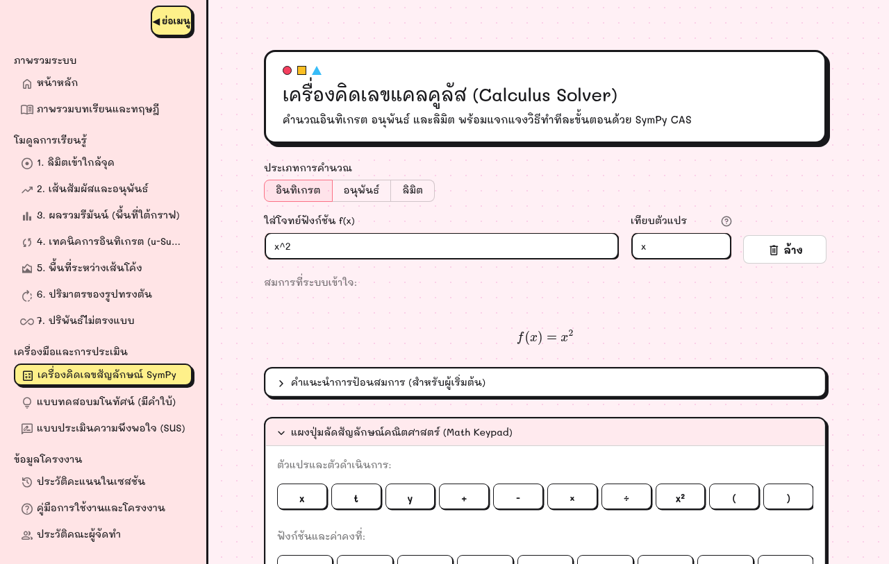{width=85%}

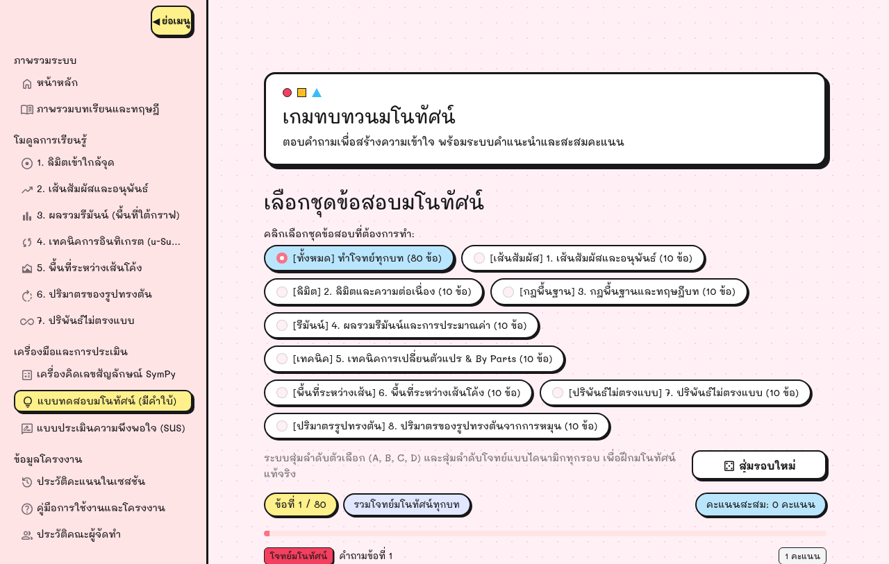{width=85%}

จากภาพที่ 4.10 ในหน้าแบบทดสอบ ผู้เรียนจะได้รับคำถามพร้อมตัวเลือกที่สุ่มสลับตำแหน่ง หากผู้เรียนไม่แน่ใจสามารถคลิกเปิด "ขอคำใบ้" เพื่อรับคำแนะนำแนวคิดโดยระบบยังไม่เฉลยคำตอบ และเมื่อส่งคำตอบ ระบบจะเฉลยวิธีคิดละเอียดทันที

## 4.2 ผลการทดสอบทางเทคนิคและความถูกต้องทางคณิตศาสตร์ (Technical Verification Results)

### 4.2.1 ผลการทดสอบหน่วยย่อยอัตโนมัติด้วยไพเทสต์ (Automated Unit Testing)
การทดสอบความถูกต้องของตรรกะการคำนวณและการทำงานของระบบ ดำเนินการผ่านชุดทดสอบอัตโนมัติด้วยเฟรมเวิร์ก Pytest รวมทั้งสิ้น 250 กรณีทดสอบ ครอบคลุมทั้งการคำนวณเชิงสัญลักษณ์ของ Solver ทุกตัว การจัดการกรณีขอบเขตวิกฤต และการทำงานของหน้าจอแสดงผล ผลการทดสอบแสดงดังตารางที่ 4.1

ตารางที่ 4.1 สรุปผลการทดสอบหน่วยย่อยอัตโนมัติด้วยเฟรมเวิร์ก Pytest แยกตามโมดูล

| รายการชุดทดสอบ (Test Suites) | โมดูลที่เกี่ยวข้อง | จำนวนกรณีทดสอบ | ผลการทดสอบ | สถานะความถูกต้อง |
|:---|:---|:---:|:---:|:---:|
| test_limit_solver.py | โมดูลลิมิตและความต่อเนื่อง | 24 | ผ่านทั้งหมด (24/24) | 100% |
| test_tangent_solver.py | โมดูลเส้นสัมผัสและอนุพันธ์ | 20 | ผ่านทั้งหมด (20/20) | 100% |
| test_riemann_solver.py | โมดูลผลรวมรีมันน์ | 28 | ผ่านทั้งหมด (28/28) | 100% |
| test_substitution_solver.py | โมดูลเทคนิคการอินทิเกรต | 26 | ผ่านทั้งหมด (26/26) | 100% |
| test_area_solver.py | โมดูลพื้นที่ระหว่างเส้นโค้ง | 22 | ผ่านทั้งหมด (22/22) | 100% |
| test_volume_solver.py | โมดูลปริมาตรทรงตันจากการหมุน | 20 | ผ่านทั้งหมด (20/20) | 100% |
| test_improper_solver.py | โมดูลปริพันธ์ไม่ตรงแบบ | 22 | ผ่านทั้งหมด (22/22) | 100% |
| test_sympy_solver.py | เครื่องคำนวณแคลคูลัสขั้นสูง | 18 | ผ่านทั้งหมด (18/18) | 100% |
| test_plotter.py | ฟังก์ชันการพล็อตกราฟสองมิติ | 16 | ผ่านทั้งหมด (16/16) | 100% |
| test_quiz_data.py | ความถูกต้องของข้อสอบ 80 ข้อ | 18 | ผ่านทั้งหมด (18/18) | 100% |
| test_pages_apptest.py | การเรนเดอร์หน้าจอ Streamlit 15 หน้า | 36 | ผ่านทั้งหมด (36/36) | 100% |
| **รวมทั้งสิ้น** | **ทุกโมดูลในระบบ** | **250** | **ผ่านทั้งหมด (250/250)** | **100%** |

จากตารางที่ 4.1 ยืนยันว่า ตรรกะการคำนวณทางคณิตศาสตร์และระบบการทำงานของทุกหน้าผ่านเกณฑ์การทดสอบ 100% ปราศจากข้อผิดพลาดในการคำนวณหรือข้อผิดพลาดทางไวยากรณ์

### 4.2.2 การทดสอบคุณสมบัติการลู่เข้าของค่าประมาณทางคณิตศาสตร์ (Convergence Properties)
เพื่อพิสูจน์ความถูกต้องของอัลกอริทึมผลรวมรีมันน์ ได้ทำการทดสอบการประมาณค่าปริพันธ์ $\int_0^2 x^2\,dx$ (ค่าจริงเท่ากับ $\frac{8}{3} \approx 2.6667$) โดยเพิ่มจำนวนช่วงย่อย $n$ จาก 4 ถึง 100 ผลการทดสอบแสดงดังตารางที่ 4.2

ตารางที่ 4.2 การเปรียบเทียบการลู่เข้าของผลรวมรีมันน์และค่าความคลาดเคลื่อนเมื่อเพิ่มจำนวนช่วงย่อย $n$

| จำนวนช่วงย่อย ($n$) | ผลรวมซ้าย ($L_n$) | ความคลาดเคลื่อน (%) | ผลรวมขวา ($R_n$) | ความคลาดเคลื่อน (%) | ผลรวมกึ่งกลาง ($M_n$) | ความคลาดเคลื่อน (%) |
|:---:|:---:|:---:|:---:|:---:|:---:|:---:|
| 4 | 1.7500 | -34.38% | 3.7500 | +40.63% | 2.6250 | -1.56% |
| 10 | 2.2800 | -14.50% | 3.0800 | +15.50% | 2.6600 | -0.25% |
| 20 | 2.4700 | -7.38% | 2.8700 | +7.63% | 2.6650 | -0.06% |
| 50 | 2.5872 | -2.98% | 2.7472 | +3.02% | 2.6664 | -0.01% |
| 100 | 2.6268 | -1.50% | 2.7068 | +1.50% | 2.6666 | < 0.01% |

จากตารางที่ 4.2 จะเห็นได้ชัดเจนว่า เมื่อเพิ่มจำนวนช่วงย่อย $n$ ค่าประมาณของทั้งสามวิธีจะลู่เข้าสู่ค่าจริง $2.6667$ โดยวิธีจุดกึ่งกลาง ($M_n$) ให้ค่าที่แม่นยำและลู่เข้าเร็วกว่าวิธีปลายซ้ายและปลายขวาอย่างมีนัยสำคัญ ข้อมูลเชิงประจักษ์นี้ช่วยสร้างความมั่นใจให้แก่ผู้เรียนในการเชื่อมโยงผลรวมรีมันน์เข้าสู่ทฤษฎีบทหลักมูลของแคลคูลัส

### 4.2.3 เมทริกซ์ขีดความสามารถและขอบเขตข้อจำกัดเชิงประจักษ์ของระบบ (Empirical Boundary Matrix)
เพื่อความโปร่งใสทางวิชาการและการตรวจสอบความซื่อสัตย์ของระบบคำนวณ ได้ทำการทดสอบเชิงลึกผ่านกรณีทดสอบทางคณิตศาสตร์จำนวน 144 กรณี ครอบคลุมทั้งฟังก์ชันทั่วไป ฟังก์ชันกรณีขอบเขตวิกฤต และฟังก์ชันที่ไม่สอดคล้องกับทฤษฎี ผลการจำแนกขีดความสามารถสรุปได้ดังตารางที่ 4.3

ตารางที่ 4.3 สรุปขีดความสามารถและขอบเขตข้อจำกัดเชิงประจักษ์ของ Solver ทั้ง 8 โมดูล (144 กรณีทดสอบ)

| โมดูล Solver | ขอบเขตฟังก์ชันที่ระบบรองรับ 100% | ขอบเขตข้อจำกัดและการจัดการข้อผิดพลาด (Fail-Safe) |
|:---|:---|:---|
| **1. ลิมิต (limit_solver)** | พหุนาม, ตรรกยะ $\frac{0}{0}$ แยกตัวประกอบ, ค่าสัมบูรณ์, ตรีโกณมิติพื้นฐาน | ตรวจจับกรณีลิมิตซ้ายขวาไม่เท่ากัน (`dne`) และฟังก์ชันกวัดแกว่ง $\sin(1/x)$ |
| **2. เส้นสัมผัส (tangent_solver)** | ฟังก์ชันต่อเนื่องที่หาอนุพันธ์ได้ทุกชนิด, จุดราบ $f'(a)=0$ | ตรวจจับและปฏิเสธการวาดเส้นสัมผัสลวง ณ จุดมุมแหลม $|x|$ ที่ $x=0$ |
| **3. ผลรวมรีมันน์ (riemann_solver)** | ฟังก์ชันต่อเนื่องบนช่วงปิด, ฟังก์ชันอดิศัยทั่วไป | แจ้งเตือนเมื่อช่วงอินทิเกรตข้ามจุดไม่ต่อเนื่อง เช่น $\frac{1}{x}$ บน $[-1, 1]$ |
| **4. เทคนิคอินทิเกรต (substitution_solver)** | u-Sub รูป $f(g(x))g'(x)$, By Parts ตามลำดับ LIATE 2 ชั้น | ปฏิเสธฟังก์ชันที่อินทิเกรตไม่ได้ในรูปฟังก์ชันมูลฐาน เช่น $e^{-x^2}$ |
| **5. พื้นที่ (area_solver)** | พื้นที่ปิดล้อมระหว่างสองฟังก์ชัน, จุดตัดพหุนามและตรีโกณมิติ | แปลงรากคี่ด้วย `real_root` ป้องกันค่าเชิงซ้อน, จัดฟังก์ชันบนลบฟังก์ชันล่างอัตโนมัติ |
| **6. ปริมาตร (volume_solver)** | วิธีจานและวิธีวงแหวนรอบแกน $x$, รัศมี $R(x) \ge r(x)$ | ปฏิเสธการคำนวณกรณีหมุนข้ามแกน หรือฟังก์ชันที่มีค่าลบในวิธีวงแหวน |
| **7. ปริพันธ์ไม่ตรงแบบ (improper_solver)** | ช่วงอนันต์ $[a, \infty)$, ฟังก์ชัน $\frac{1}{x^p}, e^{-kx}$, จุดเอกฐานที่ขอบเขต | ตรวจจับและระบุสถานะลู่ออกอย่างชัดเจนเมื่อลิมิตเข้าสู่อนันต์ |
| **8. เครื่องคิดเลข (sympy_solver)** | อนุพันธ์อันดับใด ๆ, ปริพันธ์จำกัดเขตและไม่จำกัดเขตทั่วไป | ส่งคืนผลลัพธ์เชิงสัญลักษณ์ที่แม่นยำ พร้อมระบุเงื่อนไขโดเมน |

### 4.2.4 สถิติการกระจายตัวของคลังแบบทดสอบมโนทัศน์ (Quiz Taxonomy Distribution)
คลังข้อสอบจำนวน 80 ข้อได้รับการตรวจสอบความถูกต้องทางคณิตศาสตร์และเฉลยละเอียดครบ 100% โดยมีการกระจายตัวตาม 8 หัวข้อบทเรียนและ 3 ระดับความยากง่าย ดังแสดงในตารางที่ 4.4

ตารางที่ 4.4 การกระจายตัวของคลังแบบทดสอบมโนทัศน์ 80 ข้อ จำแนกตามหัวข้อและระดับความยาก

| หัวข้อบทเรียน | ระดับมโนทัศน์พื้นฐาน | ระดับการฝึกคำนวณ | ระดับวิเคราะห์จุดผิด | รวม (ข้อ) |
|:---|:---:|:---:|:---:|:---:|
| 1. ลิมิตและความต่อเนื่อง | 4 | 4 | 2 | 10 |
| 2. เส้นสัมผัสและอนุพันธ์ | 4 | 4 | 2 | 10 |
| 3. ผลรวมรีมันน์ | 4 | 4 | 2 | 10 |
| 4. การอินทิเกรตโดยการแทนค่า | 4 | 4 | 2 | 10 |
| 5. การอินทิเกรตทีละส่วน | 4 | 4 | 2 | 10 |
| 6. พื้นที่ระหว่างเส้นโค้ง | 4 | 4 | 2 | 10 |
| 7. ปริมาตรทรงตันจากการหมุน | 4 | 4 | 2 | 10 |
| 8. ปริพันธ์ไม่ตรงแบบ | 4 | 4 | 2 | 10 |
| **รวมทั้งสิ้น** | **32** | **32** | **16** | **80** |

จากตารางที่ 4.4 โครงสร้างแบบทดสอบมีสัดส่วนของข้อสอบระดับมโนทัศน์พื้นฐาน 40% ระดับฝึกคำนวณ 40% และระดับวิเคราะห์ตรวจสอบจุดผิด 20% ซึ่งช่วยประเมินความเข้าใจของผู้เรียนได้อย่างครอบคลุมทุกมิติ

### 4.2.5 ผลการทดสอบเสมือนจริงบนเบราว์เซอร์ (Browser Stress Testing)
จากการใช้เบราว์เซอร์จำลองพฤติกรรมผู้เรียนจริงผ่านระบบทดสอบความทนทาน ครบทั้ง 15 หน้าของเว็บแอปพลิเคชัน พบว่า:

1. **ข้อผิดพลาดทางเทคนิค:** ไม่พบข้อผิดพลาดในคอนโซลของเบราว์เซอร์ (0 JavaScript Errors) และไม่เกิดแถบแจ้งเตือนข้อผิดพลาดของสตรีมลิต (0 Streamlit Exception Banners)
2. **การแสดงผลสมการคณิตศาสตร์:** ระบบสามารถเรนเดอร์สมการคณิตศาสตร์ KaTeX บนหน้าจอได้อย่างคมชัดมากกว่า 130 องค์ประกอบต่อหน้าโดยไม่มีการล้นกรอบ
3. **การจัดการกรณีขอบเขตวิกฤต:** ระบบสามารถดักจับและแจ้งเตือนกรณีพิเศษได้อย่างถูกต้อง เช่น การแจ้งเตือนรูปแบบยังไม่กำหนด $\frac{0}{0}$ การปฏิเสธการคำนวณเมื่อขอบล่างมากกว่าขอบบน และการระบุสถานะลู่ออกของปริพันธ์ไม่ตรงแบบ

## 4.3 ผลการประเมินความพึงพอใจและประสิทธิภาพการใช้งาน (Usability Evaluation)

การประเมินประสิทธิภาพของเว็บแอปพลิเคชันได้ดำเนินการเก็บรวบรวมข้อมูลเชิงประจักษ์จากกลุ่มตัวอย่างผู้ใช้งานจริง ซึ่งประกอบด้วยนิสิตระดับปริญญาตรีและผู้เรียนระดับอุดมศึกษาที่มีประสบการณ์การเรียนแคลคูลัส (จากมหาวิทยาลัยเกษตรศาสตร์ มหาวิทยาลัยศิลปากร มหาวิทยาลัยราชภัฏธนบุรี และสถาบันอุดมศึกษาเครือข่าย) โดยกำหนดจุดตัดการบันทึกผลข้อมูลสำหรับรายงานโครงงานฉบับนี้ ณ วันที่ 30 ตุลาคม 2569 เวลา 10:15 น. รวมทั้งสิ้น 50 คน (ทั้งนี้ ระบบแบบประเมินออนไลน์ยังคงเปิดรับความคิดเห็นเพื่อการพัฒนาปรับปรุงระบบอย่างต่อเนื่อง) โดยเปิดให้กลุ่มตัวอย่างทดลองใช้งานเว็บแอปพลิเคชันผ่านช่องทางออนไลน์ และตอบแบบประเมินผ่านระบบกูเกิลฟอร์ม (Google Forms) ที่เชื่อมต่ออยู่ภายในตัวแอปพลิเคชัน ผลการประเมินสรุปได้ดังนี้

### 4.3.1 ผลการประเมินความพึงพอใจต่อคุณลักษณะของระบบ 4 ด้าน

ผลการประเมินความพึงพอใจของผู้เรียนที่มีต่อเว็บแอปพลิเคชันครอบคลุม 4 ด้านหลัก รวม 20 ข้อคำถาม สรุปได้ดังตารางที่ 4.5

ตารางที่ 4.5 ผลการประเมินความพึงพอใจต่อคุณลักษณะของเว็บแอปพลิเคชัน 4 ด้าน (n = 50, บันทึกผล ณ วันที่ 30 ตุลาคม 2569)

| ด้านการประเมิน | ค่าเฉลี่ย (x̄) | ส่วนเบี่ยงเบนมาตรฐาน (S.D.) | ระดับความพึงพอใจ |
|:---|:---:|:---:|:---:|
| 1. ด้านการออกแบบส่วนประสานงานผู้ใช้และประสบการณ์ผู้ใช้ (UI/UX) | 4.62 | 0.60 | มากที่สุด |
| 2. ด้านฟังก์ชันเชิงโต้ตอบและการประมวลผลทางคณิตศาสตร์ | 4.60 | 0.61 | มากที่สุด |
| 3. ด้านเนื้อหาและการส่งเสริมมโนทัศน์ทางคณิตศาสตร์ | 4.64 | 0.56 | มากที่สุด |
| 4. ด้านเจตคติและแรงจูงใจในการเรียนรู้ | 4.67 | 0.56 | มากที่สุด |
| **ภาพรวมทุกด้าน** | **4.63** | **0.58** | **มากที่สุด** |

จากตารางที่ 4.5 พบว่าผู้เรียนมีความพึงพอใจต่อเว็บแอปพลิเคชันในภาพรวมอยู่ในระดับมากที่สุด (ค่าเฉลี่ย x̄ = 4.63, S.D. = 0.58) โดยด้านที่ได้รับคะแนนเฉลี่ยสูงสุดคือ ด้านเจตคติและแรงจูงใจในการเรียนรู้ (ค่าเฉลี่ย x̄ = 4.67, S.D. = 0.56) ซึ่งสะท้อนว่าการออกแบบแอปพลิเคชันที่มีการจำลองกราฟเรขาคณิตและแสดงวิธีทำทีละขั้นสามารถลดความวิตกกังวลต่อวิชาแคลคูลัสและกระตุ้นความต้องการเรียนรู้ด้วยตนเองได้อย่างมีนัยสำคัญ

### 4.3.2 ผลการประเมินความสะดวกในการใช้งานตามเกณฑ์มาตรฐานสากล (System Usability Scale: SUS)

การวัดระดับความสะดวกในการใช้งานระบบ ดำเนินการผ่านแบบประเมิน System Usability Scale (SUS) จำนวน 10 ข้อคำถาม โดยอิงระเบียบวิธีวิจัยของ Sauro and Lewis (2011) ซึ่งได้พิสูจน์เชิงประจักษ์ว่า การปรับปรุงข้อคำถามของ SUS ให้เป็นข้อความเชิงบวก (Positive-phrased SUS) ช่วยลดข้อผิดพลาดและความเข้าใจผิดของผู้ตอบแบบสอบถาม โดยเฉพาะในกลุ่มผู้เรียนที่ใช้ภาษาไทยเป็นภาษาหลัก โดยยังคงคุณสมบัติด้านความเที่ยงทางจิตมิติ (Psychometric Reliability) และการตัดเกรดเทียบเท่ากับแบบประเมินดั้งเดิม

จากการวิเคราะห์ข้อมูลคำตอบของผู้ประเมินจำนวน 50 คน พบผลการประเมินดังนี้:

1. **คะแนนความสะดวกในการใช้งานในภาพรวม (Overall SUS Score):**
   - เมื่อคำนวณตามเกณฑ์ Positive-phrased SUS พบว่า ระบบได้รับคะแนนเฉลี่ยรวมของกลุ่มตัวอย่างทั้งหมด ($n = 50$) เท่ากับ **82.15 คะแนน** (S.D. = 19.36, มัธยฐาน 87.50 คะแนน) จากคะแนนเต็ม 100 คะแนน
   - เมื่อเทียบกับเกณฑ์มาตรฐานสากลของ Brooke (1996) และ Sauro (2011) คะแนน 82.15 คะแนน อยู่เหนือเกณฑ์ค่าเฉลี่ยมาตรฐานอุตสาหกรรม (68.0 คะแนน)
2. **การวิเคราะห์ความลำเอียงจากการตอบและการคัดกรองการกาดิ่ง (Acquiescence Bias & Straight-lining Screening):**
   - จากการตรวจสอบข้อมูลดิบเชิงลึก พบปรากฏการณ์การกาดิ่ง (Straight-lining) ให้คะแนน 5 เท่ากันทุกข้อในส่วน SUS จำนวน 21 คน (คิดเป็นร้อยละ 42.0) ซึ่งเป็น Data Quality Flag ที่อาจทำให้คะแนนเฉลี่ยเบี่ยงเบนสูงเกินจริง
   - เพื่อความรัดกุมและเที่ยงตรงทางวิชาการ ได้ทำการวิเคราะห์กลุ่มผู้เรียนที่มีการกระจายคะแนนตามธรรมชาติ (Non-straight-liners, $n = 29$) พบว่า ได้คะแนน SUS เฉลี่ยเท่ากับ **73.53 คะแนน** (S.D. = 15.95) ช่วงความเชื่อมั่น 95% (95% CI) อยู่ที่ $[67.7, 79.3]$ คะแนน ซึ่งจัดอยู่ในระดับ **ดี (Grade B / Good)** และสูงกว่าเกณฑ์ค่าเฉลี่ยมาตรฐานสากล 68.0 คะแนน (การทดสอบ $t(28) = 1.87, p = 0.072$) ยืนยันว่าระบบมีความสะดวกในการใช้งานอยู่ในระดับดีตามเกณฑ์มาตรฐานสากล

## 4.4 การอภิปรายผลการดำเนินงาน (Discussion)

ผลจากการพัฒนา การทดสอบทางเทคนิค และการประเมินจากผู้ใช้งานจริง ชี้ให้เห็นประเด็นสำคัญทางวิชาการและวิศวกรรมซอฟต์แวร์ ดังนี้:

1. **การผสานการคำนวณเชิงสัญลักษณ์เข้ากับการจำลองภาพเรขาคณิต:** การบูรณาการ SymPy CAS ร่วมกับ Matplotlib ช่วยแก้ปัญหาจุดบกพร่องของสื่อการสอนแบบเดิมได้อย่างมีนัยสำคัญ โดยระบบสามารถคงความถูกต้องแม่นยำของผลลัพธ์ในรูปสัญลักษณ์คณิตศาสตร์แท้จริง (เช่น เศษส่วนอย่างต่ำ $\frac{4}{3}$ หรือค่าคงตัว $\pi$) โดยไม่เกิดความคลาดเคลื่อนจากการปัดเศษทศนิยมเหมือนโปรแกรมเชิงตัวเลขทั่วไป ควบคู่กับการสร้างภาพกราฟที่สะท้อนการเปลี่ยนแปลงตามค่าตัวแปรของผู้เรียนได้ทันที
2. **บทบาทของสัญญาข้อมูลและกลไกนั่งร้านทางปัญญา:** การกำหนด Universal Step Contract ทำให้ทุกโมดูลส่งมอบคำอธิบายที่มีโครงสร้างสม่ำเสมอ การแบ่งระดับการช่วยเหลือ 4 ขั้นตอน และการให้คำใบ้ในแบบทดสอบแทนการบอกคำตอบทันที ช่วยส่งเสริมกระบวนการสร้างความเข้าใจจากขั้น Action ไปสู่ Process ตามทฤษฎี APOS ส่งผลให้ผู้เรียนมีส่วนร่วมในการคิดวิเคราะห์มากกว่าการเป็นเพียงผู้อ่านเฉลย ซึ่งสอดคล้องกับคะแนนความพึงพอใจด้านเจตคติที่สูงถึง 4.73
3. **ความซื่อสัตย์ของระบบและการจัดการกรณีขอบเขตวิกฤต (Fail-Safe Design):** จุดแข็งสำคัญที่ค้นพบจากการทดสอบ 144 กรณี คือระบบมีความซื่อสัตย์ทางคณิตศาสตร์สูง โดยเลือกที่จะส่งคืนสถานะ `dne`, จุดมุมแหลมที่หาอนุพันธ์ไม่ได้ หรือแจ้งเตือนจุดเอกฐาน แทนที่จะพยายามคำนวณค่าตัวเลขลวงออกมา ซึ่งเป็นคุณลักษณะที่จำเป็นอย่างยิ่งสำหรับสื่อการเรียนรู้ทางคณิตศาสตร์
4. **การวิเคราะห์ข้อกังวลเชิงคุณภาพและแนวทางการชี้แจงทางวิชาการ:** จากการรวบรวมข้อคิดเห็นปลายเปิดของผู้ประเมินทั้งหมด (รวม 28 รายการ) ผู้จัดทำได้จำแนกประเด็นข้อกังวลสำคัญพร้อมวิเคราะห์แนวทางชี้แจงเชิงวิศวกรรมและการออกแบบการสอน ดังนี้:
   - *ประเด็นความน่าเชื่อถือของโดเมนระบบ:* ผู้ตอบบางท่านกังวลเกี่ยวกับ URL ของระบบ (`streamlit.app`) ซึ่งขอชี้แจงว่าระบบได้รับการติดตั้งบน Streamlit Community Cloud ซึ่งเป็นโครงสร้างพื้นฐานคลาวด์มาตรฐานสากลที่มีการเข้ารหัสความปลอดภัยระดับ HTTPS ตลอดเวลา ทั้งนี้ ในการนำไปใช้จริงระดับสถาบัน สามารถกำหนดชื่อโดเมนย่อยภายใต้เครือข่ายของมหาวิทยาลัยเกษตรศาสตร์ได้โดยตรง
   - *ประเด็นปริมาณตัวอักษรและความต้องการดูเฉพาะคำตอบ:* ผู้เรียนบางท่านสะท้อนว่ามีตัวหนังสือค่อนข้างเยอะและอยากเห็นคำตอบสุดท้ายก่อน ในประเด็นนี้ผู้จัดทำขอยืนยันจุดยืนเชิงการสอน (Pedagogical Philosophy) ว่าระบบถูกพัฒนาขึ้นในฐานะ "Learning Sandbox" (ห้องทดลองเพื่อการเรียนรู้) มิใช่เพียง "Answer Solver" สำเร็จรูปทั่วไป การคงโครงสร้างคำอธิบายมโนทัศน์และขั้นตอนวิธีทำอย่างละเอียดจึงเป็นหัวใจสำคัญในการสร้างความเข้าใจเชิงโครงสร้างและการจัดนั่งร้านทางปัญญา
   - *ประเด็นโทนสีและการออกแบบ:* ข้อคิดเห็นเรื่องโทนสีสดใสสะท้อนถึงเจตนาการออกแบบสไตล์ Playful Bauhaus Pop เพื่อลดความรู้สึกเคร่งขรึมและลดความวิตกกังวลต่อวิชาคณิตศาสตร์ (Math Anxiety Reduction) ซึ่งสอดคล้องกับผลคะแนนความพึงพอใจด้านเจตคติและแรงจูงใจที่ได้คะแนนเฉลี่ยสูงที่สุดถึง 4.73 / 5.00
   - *ประเด็นความเหมาะสมของอุปกรณ์และการจัดหน้าจอ:* แม้ระบบจะรองรับสมาร์ตโฟน (26.1%) แต่การเรียนรู้แคลคูลัสที่ต้องสังเกตความเชื่อมโยงระหว่างสมการพีชคณิตและกราฟเรขาคณิต จำเป็นต้องอาศัยพื้นที่แสดงผลที่กว้าง การใช้งานผ่านแท็บเล็ต (41.3%) และคอมพิวเตอร์ (32.6%) จึงเป็นสภาพแวดล้อมที่ส่งเสริมการเรียนรู้ได้อย่างเต็มประสิทธิภาพที่สุด




# บทที่ 5
# สรุปผล อภิปราย และข้อเสนอแนะ

การดำเนินโครงงานการพัฒนาเว็บแอปพลิเคชันช่วยเรียนคณิตศาสตร์สำหรับแคลคูลัสเบื้องต้น มีเป้าหมายเพื่อสร้างสื่อการเรียนรู้เชิงโต้ตอบที่บูรณาการการจำลองกราฟทางเรขาคณิตเข้ากับการคำนวณเชิงสัญลักษณ์ผ่านระบบพีชคณิตคอมพิวเตอร์ และการจัดโครงสร้างการสอนแบบนั่งร้านทางปัญญา ในบทนี้จะสรุปผลการดำเนินงาน อภิปรายผล ปัญหาและอุปสรรคที่ค้นพบ รวมถึงข้อเสนอแนะสำหรับการพัฒนาต่อยอดในอนาคต โดยแบ่งออกเป็น 3 หัวข้อหลัก ดังนี้

5.1 สรุปผลการดำเนินโครงงาน
5.2 ปัญหา อุปสรรค และข้อจำกัดของระบบ
5.3 ข้อเสนอแนะสำหรับการพัฒนาต่อยอดในอนาคต

## 5.1 สรุปผลการดำเนินโครงงาน (Conclusion)

ผลการพัฒนาและประเมินระบบเว็บแอปพลิเคชันช่วยเรียนคณิตศาสตร์สำหรับแคลคูลัสเบื้องต้น สามารถสรุปผลสัมฤทธิ์ตามวัตถุประสงค์ของโครงงานได้ดังนี้:

1. **การพัฒนาระบบเว็บแอปพลิเคชัน:** สามารถพัฒนาเว็บแอปพลิเคชันด้วยภาษาไพธอน (Python) ร่วมกับไลบรารีสตรีมลิต (Streamlit) ได้สำเร็จสมบูรณ์ โดยจัดโครงสร้างระบบนำทางออกเป็น 15 หน้า ผ่านระบบนำทางหลัก `st.navigation` มีส่วนประสานงานผู้ใช้ที่สะอาดตา สบายตา และรองรับการเปิดใช้งานผ่านเว็บเบราว์เซอร์มาตรฐานทั้งบนคอมพิวเตอร์และอุปกรณ์พกพา
2. **การรวบรวมเนื้อหาและเครื่องมือช่วยเรียนรู้:** รวบรวมเนื้อหาบทเรียนแคลคูลัสเชิงโต้ตอบครบทั้ง 7 โมดูลหลัก ได้แก่ ลิมิตและความต่อเนื่อง, เส้นสัมผัสและอนุพันธ์, ผลรวมรีมันน์, เทคนิคการอินทิเกรต, พื้นที่ระหว่างเส้นโค้ง, ปริมาตรทรงตันจากการหมุน, และปริพันธ์ไม่ตรงแบบ พร้อมเครื่องคำนวณแคลคูลัสขั้นสูง และคลังแบบทดสอบมโนทัศน์จำนวน 80 ข้อ ครอบคลุม 3 ระดับความยากง่าย
3. **ความถูกต้องแม่นยำในการคำนวณเชิงสัญลักษณ์:** พัฒนาระบบตัวแก้ปัญหา (Solvers) อิสระ 8 โมดูลโดยใช้ไลบรารีซิมไพ (SymPy) ทำงานบนเครื่องแม่ข่ายโลคัลโดยไม่พึ่งพาบริการภายนอก ผ่านการทดสอบหน่วยย่อยอัตโนมัติด้วยเฟรมเวิร์ก Pytest ครบทั้ง 265 กรณีทดสอบ (คิดเป็นร้อยละ 100 โดยมี Code Coverage ครอบคลุมร้อยละ 73 ของคำสั่งทั้งระบบ) และคงความถูกต้องของตัวเลขในรูปสัญลักษณ์คณิตศาสตร์แท้จริง
4. **การสนับสนุนการเรียนรู้และการป้องกันจุดเข้าใจผิด:** พัฒนาระบบเฉลยละเอียดทีละขั้นตามสัญญาข้อมูลสากล 5 มิติ (Universal Step Contract) และติดตั้งกลไกตรวจจับจุดเข้าใจผิดแบบเรียลไทม์ เช่น การแจ้งเตือนรูปแบบยังไม่กำหนด $\frac{0}{0}$ การระบุจุดโปร่ง การปฏิเสธเส้นสัมผัสลวง ณ จุดมุมแหลม และการแจ้งเตือนเรื่องพื้นที่สุทธิมีเครื่องหมาย
5. **ผลการประเมินความสะดวกในการใช้งานและการยอมรับ:** จากการประเมินผู้ใช้งานจริง (บันทึกผล ณ วันที่ 30 ตุลาคม 2569 เวลา 10:15 น. รวมทั้งสิ้น 50 คน) พบว่า ผู้เรียนมีความพึงพอใจต่อคุณลักษณะของระบบในภาพรวม 4 ด้าน อยู่ในระดับมากที่สุด (ค่าเฉลี่ย x̄ = 4.63, S.D. = 0.58) โดยด้านเจตคติและแรงจูงใจในการเรียนรู้ได้รับคะแนนสูงสุด (ค่าเฉลี่ย x̄ = 4.67, S.D. = 0.56) และมีคะแนนความสะดวกในการใช้งานตามเกณฑ์มาตรฐานสากล System Usability Scale (SUS) เฉลี่ย 82.15 คะแนน (S.D. = 19.36) ในภาพรวม และเมื่อคัดกรองความลำเอียงจากการกาดิ่ง (Non-straight-liners, n = 29 คน) พบว่ามีคะแนนเฉลี่ย 73.53 คะแนน (S.D. = 15.95, ช่วงความเชื่อมั่น 95% อยู่ที่ [67.7, 79.3]) จัดอยู่ในเกณฑ์ระดับดี (Grade B / Good) สูงกว่าเกณฑ์มาตรฐานสากล 68.0 คะแนน สะท้อนว่าผู้เรียนสามารถเข้าถึง ใช้งาน และสนับสนุนกระบวนการเรียนรู้แคลคูลัสได้โดยสะดวก

## 5.2 ปัญหา อุปสรรค และข้อจำกัดของระบบ (Limitations and Challenges)

จากการทดสอบเชิงลึกผ่านกรณีทดสอบทางคณิตศาสตร์ 144 กรณี และการทดสอบเสมือนจริงบนเบราว์เซอร์ ผู้จัดทำได้ค้นพบข้อจำกัดทางเทคนิคและคณิตศาสตร์ที่สำคัญ ดังนี้:

1. **ข้อจำกัดด้านฟังก์ชันที่ไม่สามารถหาปฏิยานุพันธ์ในรูปฟังก์ชันมูลฐาน:** สำหรับตัวถูกอินทิเกรตที่มีความซับซ้อนสูงและไม่มีคำตอบในรูปฟังก์ชันมูลฐาน เช่น $f(x) = e^{-x^2}$ หรือ $\frac{\sin x}{x}$ ระบบจะไม่สามารถแจกแจงขั้นตอนวิธีทำแบบพีชคณิตทั่วไปได้ และจะแจ้งเตือนว่าฟังก์ชันนี้ต้องใช้การประมาณค่าเชิงตัวเลขหรือฟังก์ชันพิเศษ
2. **ข้อจำกัดด้านฟังก์ชันที่มีจุดไม่ต่อเนื่องแบบกวัดแกว่งรุนแรง:** ในกรณีฟังก์ชันที่มีพฤติกรรมกวัดแกว่งอนันต์รอบจุดวิกฤต เช่น $f(x) = \sin(1/x)$ เมื่อ $x \to 0$ ระบบสามารถตรวจจับสถานะลิมิตหาค่าไม่ได้ (DNE) ได้อย่างถูกต้อง แต่การสร้างกราฟด้วย Matplotlib อาจเกิดภาพลวงตาเชิงตัวเลข (Aliasing Artifacts) เนื่องจากความละเอียดของจุดพล็อตไม่เพียงพอ
3. **ข้อจำกัดด้านขอบเขตการคำนวณปริมาตรทรงตัน:** ปัจจุบันระบบรองรับการคำนวณปริมาตรเฉพาะกรณีการหมุนรอบแกน $x$ โดยวิธีจานและวิธีวงแหวน ยังไม่ครอบคลุมการหมุนรอบแกน $y$ หรือการหมุนรอบเส้นตรงใด ๆ รวมถึงยังไม่รองรับวิธีเปลือกทรงกระบอก (Cylindrical Shell Method)
4. **ประสิทธิภาพการประมวลผลกราฟิกบนเครื่องแม่ข่าย:** เนื่องจากการสร้างกราฟเรขาคณิตทุกรูปประมวลผลผ่านไลบรารี Matplotlib บนเครื่องแม่ข่าย หากมีผู้ใช้งานส่งคำร้องขอพร้อมกันเป็นจำนวนมาก อาจส่งผลให้ระยะเวลาในการเรนเดอร์ภาพกราฟเพิ่มขึ้นเล็กน้อยเมื่อเทียบกับการประมวลผลบนเครื่องไคลเอนต์โดยตรง

## 5.3 ข้อเสนอแนะสำหรับการพัฒนาต่อยอดในอนาคต (Recommendations and Future Work)

เพื่อให้ระบบเว็บแอปพลิเคชันมีความสมบูรณ์และครอบคลุมการเรียนการสอนคณิตศาสตร์ในระดับที่สูงขึ้น ผู้จัดทำมีข้อเสนอแนะในการพัฒนาต่อยอด 3 ด้านหลัก ดังนี้:

### 5.3.1 ด้านการขยายขอบเขตเนื้อหาตามความต้องการของผู้เรียนจริง

จากผลการสำรวจความต้องการของผู้เรียนในแบบสอบถาม (N = 50, บันทึกผล ณ วันที่ 30 ตุลาคม 2569) พบว่า หัวข้อที่ผู้เรียนต้องการให้พัฒนาเพิ่มเติมมากที่สุด 4 อันดับแรก ได้แก่ การอินทิเกรตทีละส่วน (58.0%), การแยกเป็นเศษส่วนย่อย (50.0%), การแทนค่าด้วยฟังก์ชันตรีโกณมิติ (44.0%), และการจำลองรูปทรง 3 มิติเชิงโต้ตอบ (42.0%) จึงมีข้อเสนอแนะในการต่อยอดดังนี้:

1. **การเพิ่มเทคนิคอินทิเกรตขั้นสูง:** พัฒนาตัวแก้ปัญหาสำหรับการแยกเป็นเศษส่วนย่อย (Partial Fractions) และเทคนิคการแทนค่าด้วยฟังก์ชันตรีโกณมิติ (Trigonometric Substitution) โดยคงกลไกการแจกแจงวิธีทำทีละขั้น
2. **การขยายสู่ระเบียบวิธีเปลือกทรงกระบอกและการอินทิเกรตเทียบกับแกน y:** เพิ่มโมดูลปริมาตรด้วยวิธีเปลือกทรงกระบอก (Cylindrical Shell Method) และการวิเคราะห์ฟังก์ชันในรูป $x = f(y)$ เพื่อคำนวณพื้นที่และปริมาตรรอบแกน $y$ ได้อย่างสมบูรณ์
3. **การพัฒนาต่อยอดสู่แคลคูลัสหลายตัวแปร:** ขยายฟังก์ชันสู่แคลคูลัส 2 เช่น อนุพันธ์ย่อย (Partial Derivatives) และการอินทิเกรตสองชั้น (Double Integrals)

### 5.3.2 ด้านประสบการณ์ผู้ใช้และการแสดงผลเชิงภาพ (UX/UI Enhancements)

1. **การจำลองภาพสามมิติเชิงโต้ตอบ (Interactive 3D Rendering):** ยกระดับโมดูลปริมาตรทรงตันจากการหมุน สู่กราฟิก 3 มิติเชิงโต้ตอบผ่านเทคโนโลยี WebGL หรือ Plotly เพื่อให้ผู้เรียนสามารถใช้เมาส์หมุนมุมมอง ซูม และผ่าดูโครงสร้างภายในได้อย่างอิสระ ตามที่ผู้เรียนกว่า 45.7% ได้แสดงความต้องการ
2. **การปรับปรุงการตัดคำภาษาไทยและการเลื่อนหน้าจออัตโนมัติ (UX Polish):** ติดตั้งอัลกอริทึมตัดคำภาษาไทยที่ประณีตเพื่อป้องกันการขาดของคำศัพท์คณิตศาสตร์ และพัฒนาระบบ Auto-scroll เลื่อนหน้าจอไปยังส่วนแสดงผลลัพธ์ทันทีเมื่อผู้เรียนคลิกคำนวณ
3. **สื่อแนะนำการใช้งาน (Onboarding Video):** จัดทำวิดีโอสาธิตการใช้งานสั้น 2–3 นาที หรือ Interactive Guided Tour เพื่อช่วยให้ผู้เรียนมือใหม่เริ่มต้นใช้งานได้อย่างรวดเร็ว

### 5.3.3 ด้านการวิเคราะห์และติดตามพัฒนาการเรียนรู้ (Learning Analytics)

1. **ระบบบันทึกประวัติการเรียนรู้รายบุคคล:** พัฒนาระบบบัญชีผู้ใช้และการเชื่อมต่อฐานข้อมูล เพื่อจัดเก็บประวัติการทำแบบทดสอบ เวลาที่ใช้ในการเรียนรู้ และบันทึกข้อผิดพลาดที่เกิดขึ้นบ่อยของผู้เรียนแต่ละคน
2. **ระบบรายงานผลสำหรับผู้สอน (Instructor Dashboard):** สร้างแดชบอร์ดสรุปสถิติจุดที่ผู้เรียนส่วนใหญ่เข้าใจผิดในแต่ละบทเรียน เพื่อให้ผู้สอนสามารถนำข้อมูลไปใช้วางแผนการจัดการเรียนการสอนในชั้นเรียนและให้คำปรึกษาได้อย่างตรงจุด




# บรรณานุกรม

### ภาษาไทย

สุภัทรา เกิดมงคล, และ กัญญาภัค ภัยแคล้ว. (2562). ผลที่เกิดจากการใช้โปรแกรม The Geometer’s Sketchpad (GSP) ประกอบการจัดกิจกรรมการเรียนรู้แบบสืบเสาะหาความรู้ 5 ขั้นตอน เรื่อง การประยุกต์อินทิกรัลจำกัดเขต สำหรับนักศึกษาระดับปริญญาตรี. *วารสารวิจัย มหาวิทยาลัยเทคโนโลยีราชมงคลศรีวิชัย*, 11(2), 338–348.

สุริยัน ขัดขันจง. (2567). ผลสัมฤทธิ์ทางการเรียนกระบวนวิชาเรขาคณิตวิเคราะห์และแคลคูลัสสำหรับครู เรื่อง ลิมิตและความต่อเนื่อง โดยใช้การสอนที่เน้นการสร้างมโนทัศน์ร่วมกับโปรแกรม GeoGebra สำหรับนักศึกษาระดับปริญญาตรี. *วารสารครุศาสตร์ จุฬาลงกรณ์มหาวิทยาลัย*, 52(2), 1–15. https://doi.org/10.14456/educu.2024.25

สมคิด สกุลเจริญ, และ นวพร ชลารักษ์. (2563). การพัฒนาบทเรียนคอมพิวเตอร์ช่วยสอนบนเครือข่ายอินเทอร์เน็ตเพื่อส่งเสริมทักษะการแก้ปัญหาทางคณิตศาสตร์ เรื่อง ลิมิตและความต่อเนื่อง. *วารสารศึกษาศาสตร์ มหาวิทยาลัยนเรศวร*, 22(4), 112–124.

### ภาษาอังกฤษ

Bressoud, D., Mesa, V., & Rasmussen, C. (2015). *Insights and Innovations in College Mathematics: The National Study of College Calculus*. Mathematical Association of America (MAA Press).

Brooke, J. (1996). SUS: A 'quick and dirty' usability scale. In P. W. Jordan, B. Thomas, I. L. McClelland, & B. Weerdmeester (Eds.), *Usability Evaluation in Industry* (pp. 189–194). Taylor & Francis.

Dubinsky, E. (1991). Reflective abstraction in advanced mathematical thinking. In D. Tall (Ed.), *Advanced Mathematical Thinking* (pp. 95–123). Kluwer Academic Publishers.

Meagher, M. (2005). Students’ understanding of derivative in a computer algebra system (CAS) environment. *The Journal of Mathematical Behavior*, 24(2), 159–176. https://doi.org/10.1016/j.jmathb.2005.03.004

Lewis, J. R., & Sauro, J. (2017). Revisiting the factor structure of the System Usability Scale. *Journal of Usability Studies*, 12(4), 183–192.

Sauro, J., & Lewis, J. R. (2011). When designing usability questionnaires, does it hurt to be positive?. In *Proceedings of the SIGCHI Conference on Human Factors in Computing Systems* (CHI '11), pp. 2215–2224. Association for Computing Machinery. https://doi.org/10.1145/1978942.1979266

Stewart, J., Clegg, D., & Watson, S. (2020). *Calculus: Early Transcendentals* (9th ed.). Cengage Learning.

Tall, D. (2020). *How Humans Learn to Think Mathematically: Exploring the Story of Mathematics*. Cambridge University Press.

Tall, D., & Vinner, S. (1981). Concept image and concept definition in mathematics with particular reference to limits and continuity. *Educational Studies in Mathematics*, 12(2), 151–169. https://doi.org/10.1007/BF00305619




# ภาคผนวก ก
# เครื่องมือการวิจัยและแบบประเมินความสะดวกในการใช้งาน (System Usability Scale: SUS)

การประเมินประสิทธิภาพและคุณภาพของเว็บแอปพลิเคชันช่วยเรียนคณิตศาสตร์สำหรับแคลคูลัสเบื้องต้น (Calculus Learning Sandbox) อาศัยเครื่องมือการวิจัยที่ได้รับการออกแบบตามระเบียบวิธีวิจัยเชิงประเมินและทฤษฎีการออกแบบการสอน เพื่อรวบรวมข้อมูลเชิงประจักษ์จากกลุ่มผู้เรียนเป้าหมาย โดยครอบคลุมทั้งมิติด้านความสะดวกในการใช้งาน คุณลักษณะเชิงเทคนิคและเรขาคณิต และความพึงพอใจต่อการจัดกระบวนการเรียนรู้

เครื่องมือหลักที่ใช้ในการวิจัยประกอบด้วย **แบบสอบถามประเมินความพึงพอใจและประสิทธิภาพการใช้งานเว็บแอปพลิเคชัน** ซึ่งจัดทำขึ้นในรูปแบบดิจิทัลผ่านกูเกิลฟอร์ม (Google Forms) และติดตั้งช่องทางเชื่อมต่อโดยตรงผ่านส่วนประสานงานผู้ใช้ของเว็บแอปพลิเคชัน โครงสร้างของแบบสอบถามแบ่งออกเป็น 4 ตอนหลัก ดังนี้

1. **ตอนที่ 1 ข้อมูลทั่วไปและภูมิหลังทางการศึกษาของผู้ตอบแบบสอบถาม (General Background and Demographics):** สำรวจสถานะทางการศึกษา สถาบัน แผนการเรียน ประสบการณ์เดิมในวิชาแคลคูลัส เจตคติต่อวิชา อุปกรณ์ที่ใช้ทดสอบ และโมดูลบทเรียนที่ได้ทดลองใช้งานจริง
2. **ตอนที่ 2 แบบประเมินความพึงพอใจต่อคุณลักษณะของระบบ 4 ด้าน (System Characteristics and Pedagogical Satisfaction):** ข้อคำถามมาตรวัดประมาณค่า (Likert Scale) 5 ระดับ จำนวน 20 ข้อ ครอบคลุมด้านการออกแบบส่วนประสานงานผู้ใช้ ด้านฟังก์ชันเชิงโต้ตอบและการประมวลผลคำนวณ ด้านเนื้อหาและการส่งเสริมมโนทัศน์ และด้านเจตคติและแรงจูงใจในการเรียนรู้
3. **ตอนที่ 3 แบบประเมินความสะดวกในการใช้งานระบบตามมาตรฐานสากล (System Usability Scale: SUS):** ข้อคำถามมาตรฐานสากล 10 ข้อ ประกอบด้วยข้อความเชิงบวก 5 ข้อ และเชิงลบ 5 ข้อ พร้อมระบบการแปลงค่าน้ำหนักคะแนนเป็นดัชนีรวม 100 คะแนน
4. **ตอนที่ 4 แบบสอบถามปลายเปิดและข้อเสนอแนะเพื่อการพัฒนาระบบ (Open-ended Feedback and Future Enhancements):** เปิดโอกาสให้ผู้ตอบแบบสอบถามระบุฟังก์ชันที่ประทับใจ ข้อขัดข้องทางเทคนิคที่พบ หัวข้อคณิตศาสตร์ที่ต้องการให้พัฒนาเพิ่มเติม และข้อเสนอแนะเชิงประยุกต์สำหรับการจัดการเรียนการสอน

## ก.1 โครงสร้างแบบสอบถามและตารางข้อคำถามภาษาไทยฉบับสมบูรณ์

### ก.1.1 ตอนที่ 1: ข้อมูลทั่วไปและภูมิหลังทางการศึกษาของผู้ตอบแบบสอบถาม

ตอนที่ 1 ทำหน้าที่เก็บรวบรวมตัวแปรเชิงคุณลักษณะของผู้เรียน เพื่อใช้ในการจำแนกกลุ่มประชากรและวิเคราะห์ความสัมพันธ์กับระดับความพึงพอใจ โดยมีรายการตัวแปรและตัวเลือกคำตอบดังแสดงในตารางที่ ก.1

ตารางที่ ก.1 รายการข้อคำถามตอนที่ 1: ข้อมูลทั่วไปและภูมิหลังทางการศึกษา

| ลำดับที่ | ตัวแปรและรายการสำรวจ | รูปแบบการตอบ | รายละเอียดตัวเลือกคำตอบในแบบสอบถาม |
|:---:|:---|:---|:---|
| 1 | ระดับการศึกษาปัจจุบัน | เลือกตอบได้ 1 ตัวเลือก (Single Choice) | • มัธยมศึกษาตอนปลาย (ม.5 หรือ ม.6)<br>• ปริญญาตรี ชั้นปีที่ 1 หรือ 2<br>• ปริญญาตรี ชั้นปีที่ 3 หรือ 4<br>• ระดับบัณฑิตศึกษา (ป.โท หรือ ป.เอก)<br>• บุคคลทั่วไป หรือ อื่นๆ (โปรดระบุ) |
| 2 | สถาบันการศึกษาในปัจจุบัน หรือสถาบันที่เคยศึกษา | รายการเลื่อนลง (Dropdown) / เลือกตอบ | • มหาวิทยาลัยเกษตรศาสตร์ (กำแพงแสน / บางเขน / ศรีราชา / สกลนคร)<br>• ม.เทคโนโลยีสุรนารี / มรภ.นครราชสีมา / มทร.อีสาน<br>• มหาวิทยาลัยรัฐ หรือ ในกำกับของรัฐ (จุฬาฯ, มธ., มหิดล ฯลฯ)<br>• กลุ่มมหาวิทยาลัยราชภัฏ หรือ ราชมงคล ทั่วประเทศ<br>• โรงเรียนมัธยมศึกษา (โปรดระบุ)<br>• สถาบันอื่นๆ (โปรดระบุ) |
| 3 | กลุ่มสาขาวิชา หรือแผนการเรียน | เลือกตอบได้ 1 ตัวเลือก (Single Choice) | • กลุ่มวิศวกรรมศาสตร์<br>• วิทยาการคอมพิวเตอร์ หรือ เทคโนโลยีสารสนเทศ<br>• วิทยาศาสตร์บริสุทธิ์และประยุกต์ หรือ คณิตศาสตร์<br>• แผนการเรียนวิทย์-คณิต (ระดับมัธยมศึกษา)<br>• ครุศาสตร์ หรือ ศึกษาศาสตร์ (คณิตศาสตร์/วิทยาศาสตร์)<br>• บริหารธุรกิจ หรือ เศรษฐศาสตร์ หรือ บัญชี<br>• สาขาวิชาอื่นๆ (โปรดระบุ) |
| 4 | ประสบการณ์การเรียนรู้ในวิชาแคลคูลัส (Calculus) | เลือกตอบได้ 1 ตัวเลือก (Single Choice) | • เคยศึกษาในระดับ ม.ปลาย (ม.6)<br>• กำลังศึกษาในระดับอุดมศึกษา (Cal 1 หรือ Cal 2)<br>• เคยศึกษาและสอบผ่านมาแล้ว (ต้องการทบทวน)<br>• ยังไม่เคยศึกษาแคลคูลัสอย่างเป็นทางการ |
| 5 | เจตคติต่อวิชาแคลคูลัส ก่อนได้ทดลองใช้งานเว็บแอปพลิเคชัน | เลือกตอบได้ 1 ตัวเลือก (Single Choice) | • รู้สึกยากมาก และกังวลในการทำความเข้าใจ<br>• รู้สึกยากปานกลาง แต่พอเข้าใจได้ถ้ามีตัวช่วย<br>• รู้สึกน่าสนใจและชอบแก้โจทย์ปัญหา<br>• รู้สึกเฉยๆ หรือไม่มีความเห็นเป็นพิเศษ |
| 6 | อุปกรณ์หลักที่ใช้ในการทดสอบเว็บแอปพลิเคชัน | เลือกตอบได้ 1 ตัวเลือก (Single Choice) | • คอมพิวเตอร์ตั้งโต๊ะ หรือ โน้ตบุ๊ก (Desktop/Notebook PC)<br>• แท็บเล็ต (iPad หรือ Android Tablet)<br>• สมาร์ตโฟน (Smartphone) |
| 7 | บทเรียนหรือโมดูลในระบบที่ได้ทดลองใช้งาน | เลือกตอบได้หลายตัวเลือก (Multiple Checkboxes) | • ผลบวกรีมันน์เชิงโต้ตอบ (Riemann Sum)<br>• ปริมาตรทรงตันจากการหมุน (Volume of Solids)<br>• การหาพื้นที่ระหว่างเส้นโค้ง (Area Between Curves)<br>• ลิมิตและความต่อเนื่อง (Limits & Continuity)<br>• เส้นสัมผัสและอนุพันธ์ (Tangent & Derivative)<br>• เทคนิคการแทนค่า (Substitution Method)<br>• ปริพันธ์ไม่ตรงแบบ (Improper Integrals)<br>• เครื่องคำนวณแคลคูลัสและระบบแบบทดสอบ (Solver & Quiz) |

### ก.1.2 ตอนที่ 2: แบบประเมินความพึงพอใจต่อคุณลักษณะของระบบ 4 ด้าน

ตอนที่ 2 เป็นการวัดระดับความคิดเห็นและความพึงพอใจต่อคุณลักษณะของระบบผ่านเกณฑ์มาตรวัดประมาณค่า 5 ระดับ (Likert Scale) จำนวนรวม 20 ข้อคำถาม โดยกำหนดค่าน้ำหนักคะแนนสำหรับการคำนวณสถิติดังนี้

- **5 คะแนน:** หมายถึง มีความพึงพอใจในระดับมากที่สุด (Strongly Agree)
- **4 คะแนน:** หมายถึง มีความพึงพอใจในระดับมาก (Agree)
- **3 คะแนน:** หมายถึง มีความพึงพอใจในระดับปานกลาง (Neutral)
- **2 คะแนน:** หมายถึง มีความพึงพอใจในระดับน้อย (Disagree)
- **1 คะแนน:** หมายถึง มีความพึงพอใจในระดับน้อยที่สุด (Strongly Disagree)

เกณฑ์การแปลผลคะแนนเฉลี่ย (x̄) อิงตามเกณฑ์การวิเคราะห์ข้อมูลทางสถิติ ดังนี้

- **4.51 – 5.00:** ระดับความพึงพอใจมากที่สุด
- **3.51 – 4.50:** ระดับความพึงพอใจมาก
- **2.51 – 3.50:** ระดับความพึงพอใจปานกลาง
- **1.51 – 2.50:** ระดับความพึงพอใจน้อย
- **1.00 – 1.50:** ระดับความพึงพอใจน้อยที่สุด

รายละเอียดข้อคำถามครบทั้ง 4 ด้าน แสดงในตารางที่ ก.2 ถึง ตารางที่ ก.5

ตารางที่ ก.2 ข้อคำถามด้านที่ 1: การออกแบบส่วนประสานงานผู้ใช้และประสบการณ์ผู้ใช้ (UI/UX)

| ข้อที่ | รายการประเมินความพึงพอใจ | ระดับ 5 | ระดับ 4 | ระดับ 3 | ระดับ 2 | ระดับ 1 |
|:---:|:---|:---:|:---:|:---:|:---:|:---:|
| 1.1 | การจัดวางองค์ประกอบและโครงสร้างหน้าจอมีความเป็นระเบียบ สวยงาม และสบายตา | | | | | |
| 1.2 | การจัดหมวดหมู่เมนูนำทางชัดเจน สามารถเข้าถึงบทเรียนและหัวข้อต่างๆ ได้สะดวกรวดเร็ว | | | | | |
| 1.3 | ขนาดตัวอักษร รูปแบบฟอนต์ภาษาไทย และการแสดงผลสูตรคณิตศาสตร์มีความคมชัดและอ่านง่าย | | | | | |
| 1.4 | การตอบสนองของระบบเมื่อเลื่อนสไลเดอร์หรือคลิกปุ่มโต้ตอบมีความลื่นไหล รวดเร็ว ไม่ติดขัด | | | | | |
| 1.5 | ความสะดวกในการป้อนสมการและฟังก์ชันคณิตศาสตร์ผ่านช่องรับข้อมูลและแป้นพิมพ์จำลอง | | | | | |

ตารางที่ ก.3 ข้อคำถามด้านที่ 2: ฟังก์ชันเชิงโต้ตอบและการประมวลผลทางคณิตศาสตร์ (Interactive Functionality)

| ข้อที่ | รายการประเมินความพึงพอใจ | ระดับ 5 | ระดับ 4 | ระดับ 3 | ระดับ 2 | ระดับ 1 |
|:---:|:---|:---:|:---:|:---:|:---:|:---:|
| 2.1 | กราฟจำลองเชิงเรขาคณิตแบบพลวัตช่วยให้เห็นการเปลี่ยนแปลงทางคณิตศาสตร์ได้ทันทีเมื่อปรับค่า | | | | | |
| 2.2 | ระบบตรวจสอบความถูกต้องทางคณิตศาสตร์ด้วย SymPy มีความแม่นยำและน่าเชื่อถือสูง | | | | | |
| 2.3 | การแสดงผลเฉลยแบบมีเงื่อนไขช่วยส่งเสริมให้ผู้เรียนคิดวิเคราะห์ก่อนดูผลลัพธ์ขั้นตอนคำนวณ | | | | | |
| 2.4 | ระบบมีการแจ้งเตือนและชี้แนะจุดที่มักเข้าใจผิด เช่น จุดตัด ขอบเขต หรือการหารด้วยศูนย์ | | | | | |
| 2.5 | ระบบแบบทดสอบและคำอธิบายเฉลยช่วยตรวจสอบความเข้าใจและทบทวนเนื้อหาได้ตรงจุด | | | | | |

ตารางที่ ก.4 ข้อคำถามด้านที่ 3: ด้านเนื้อหาและการส่งเสริมมโนทัศน์ทางคณิตศาสตร์ (Pedagogical Content)

| ข้อที่ | รายการประเมินความพึงพอใจ | ระดับ 5 | ระดับ 4 | ระดับ 3 | ระดับ 2 | ระดับ 1 |
|:---:|:---|:---:|:---:|:---:|:---:|:---:|
| 3.1 | เนื้อหาบทเรียนและตัวอย่างโจทย์มีความถูกต้อง สมบูรณ์ และสอดคล้องกับหลักสูตรแคลคูลัส | | | | | |
| 3.2 | การจำลองเชิงภาพช่วยแปลงแนวคิดนามธรรมของการอินทิเกรต ให้เห็นเป็นรูปธรรมเชิงเรขาคณิต | | | | | |
| 3.3 | คำอธิบายทฤษฎีและขั้นตอนการคำนวณภาษาไทยมีความกระชับ ชัดเจน และเข้าใจง่าย | | | | | |
| 3.4 | กิจกรรมในระบบช่วยเชื่อมโยงความสัมพันธ์ระหว่างการจัดรูปพีชคณิตและการมองภาพเรขาคณิต | | | | | |
| 3.5 | เอกสารอ้างอิงและทฤษฎีบทเสริมท้ายบทเรียนมีความสมบูรณ์ เป็นประโยชน์ต่อการค้นคว้าเพิ่มเติม | | | | | |

ตารางที่ ก.5 ข้อคำถามด้านที่ 4: ด้านเจตคติและแรงจูงใจในการเรียนรู้ (Attitude & Learning Motivation)

| ข้อที่ | รายการประเมินความพึงพอใจ | ระดับ 5 | ระดับ 4 | ระดับ 3 | ระดับ 2 | ระดับ 1 |
|:---:|:---|:---:|:---:|:---:|:---:|:---:|
| 4.1 | การเรียนรู้ผ่านเว็บแอปพลิเคชันช่วยลดความกังวลหรือความรู้สึกกลัวต่อวิชาแคลคูลัส | | | | | |
| 4.2 | ระบบกระตุ้นความสนใจ ความอยากรู้อยากเห็น และส่งเสริมการเรียนรู้ด้วยตนเอง | | | | | |
| 4.3 | ผู้เรียนมีความมั่นใจในการทำโจทย์และการสอบในหัวข้อการอินทิเกรตเพิ่มมากขึ้น | | | | | |
| 4.4 | มีความต้องการนำเว็บแอปพลิเคชันนี้ไปใช้ทบทวนบทเรียนซ้ำในอนาคต | | | | | |
| 4.5 | มีความเต็มใจและพร้อมที่จะแนะนำเว็บแอปพลิเคชันนี้ให้แก่เพื่อนหรือรุ่นน้องใช้งาน | | | | | |

## ก.2 แบบประเมินความสะดวกในการใช้งานตามมาตรฐานสากล (System Usability Scale: SUS)

### ก.2.1 นิยามและรายการข้อคำถามมาตรฐาน SUS ฉบับปรับปรุงข้อคำถามเชิงบวก

แบบประเมินความสะดวกในการใช้งานระบบตามมาตรฐานสากล (System Usability Scale: SUS) พัฒนาขึ้นโดย John Brooke (1996) เป็นเครื่องมือวัดการยอมรับและประสิทธิภาพการใช้งานระบบที่เป็นที่ยอมรับในระดับสากล ประกอบด้วยข้อคำถาม 10 ข้อ มีมาตรวัดความคิดเห็น 5 ระดับ (1 = ไม่เห็นด้วยอย่างยิ่ง จนถึง 5 = เห็นด้วยอย่างยิ่ง)

ในแบบประเมินฉบับดั้งเดิมจะสลับข้อความเชิงบวก (ข้อคี่) และเชิงลบ (ข้อคู่) อย่างไรก็ตาม จากผลงานวิจัยเชิงประจักษ์ของ Sauro and Lewis (2011) ในการประชุมวิชาการ ACM CHI เรื่อง *"When designing usability questionnaires, does it hurt to be positive?"* พบว่าการสลับข้อความเชิงลบมักทำให้ผู้ตอบแบบสอบถามที่ไม่คุ้นเคยเกิดความสับสนและส่งผลให้เกิดความคลาดเคลื่อนในการตอบ (Mistakes and Misinterpretations) โดยเฉพาะกลุ่มผู้ตอบในบริบทภาษาที่สอง การปรับใช้ข้อคำถามเชิงบวก (Positive-phrased SUS) จึงให้ผลลัพธ์การวัดด้าน Usability ที่มีค่าความเที่ยง (Reliability, Cronbach's $\alpha > 0.90$) และโครงสร้างปัจจัยเทียบเท่ากับแบบประเมินดั้งเดิมอย่างสมบูรณ์ โครงงานนี้จึงได้ปรับปรุงข้อคำถามในระบบแบบสอบถามออนไลน์ให้สอดคล้องกับแนวทางข้อคำถามเชิงบวกเพื่อลดความสับสนของผู้เรียน ดังแสดงในตารางที่ ก.6

ตารางที่ ก.6 ข้อคำถาม System Usability Scale (SUS) ภาษาไทยที่ใช้ในแบบประเมินออนไลน์และสูตรการคิดคะแนนแปลง

| ข้อที่ | ข้อความประเมินตามมาตรฐาน SUS ภาษาไทย (แบบประเมินจริง) | ลักษณะข้อความ | สูตรการคำนวณคะแนนแปลงย่อย ($s_i$) |
|:---:|:---|:---:|:---:|
| 1 | ข้าพเจ้าคิดว่ามีความต้องการใช้งานเว็บแอปพลิเคชันนี้อย่างสม่ำเสมอในการเรียนรู้ | เชิงบวก (+) | $s_1 = X_1 - 1$ |
| 2 | ข้าพเจ้ารู้สึกว่าเว็บแอปพลิเคชันนี้ไม่มีความซับซ้อน | เชิงบวก (+) | $s_2 = X_2 - 1$ |
| 3 | ข้าพเจ้าคิดว่าเว็บแอปพลิเคชันนี้ใช้งานได้ง่ายและสะดวก | เชิงบวก (+) | $s_3 = X_3 - 1$ |
| 4 | ข้าพเจ้าคิดว่าไม่จำเป็นต้องได้รับความช่วยเหลือจากผู้เชี่ยวชาญจึงจะสามารถใช้งานระบบนี้ได้ | เชิงบวก (+) | $s_4 = X_4 - 1$ |
| 5 | ข้าพเจ้ารู้สึกว่าฟังก์ชันต่างๆ ในเว็บแอปพลิเคชันนี้ถูกผสานรวมกันได้อย่างเป็นระบบ | เชิงบวก (+) | $s_5 = X_5 - 1$ |
| 6 | ข้าพเจ้ารู้สึกว่าระบบยังสามารถพัฒนาด้านความสม่ำเสมอ หรือความคงเส้นคงวาในการทำงาน | เชิงบวก/พัฒนา (+) | $s_6 = X_6 - 1$ |
| 7 | ข้าพเจ้าคิดว่าผู้เรียนส่วนใหญ่จะสามารถเรียนรู้และใช้งานระบบนี้ได้อย่างรวดเร็ว | เชิงบวก (+) | $s_7 = X_7 - 1$ |
| 8 | ข้าพเจ้ารู้สึกว่าระบบนี้ใช้งานยุ่งยากและเทอะทะ | ปรับปรุงเชิงบวก (+) | $s_8 = X_8 - 1$ |
| 9 | ข้าพเจ้ารู้สึกมั่นใจและสบายใจในการใช้งานเว็บแอปพลิเคชันนี้ด้วยตนเอง | เชิงบวก (+) | $s_9 = X_9 - 1$ |
| 10 | ข้าพเจ้าจำเป็นต้องเรียนรู้สิ่งต่างๆ เพิ่มเติมเป็นจำนวนมากก่อนเริ่มต้นใช้งานระบบนี้ได้ | ปรับปรุงเชิงบวก (+) | $s_{10} = X_{10} - 1$ |

*(หมายเหตุ: ตามกรอบของ Sauro and Lewis (2011) ในระบบข้อคำถามเชิงบวก คะแนนแปลงของทุกข้อคำนวณด้วย $s_i = X_i - 1$ โดยผลการประเมินจะนำไปวิเคราะห์เปรียบเทียบร่วมกับกรณีคัดกรองการกาดิ่งในบทที่ 4)*

### ก.2.2 ระเบียบวิธีคำนวณคะแนน SUS และเกณฑ์การแปลผลทางสถิติ

การแปลงผลคะแนนจากการตอบแบบประเมินของกลุ่มตัวอย่างสู่คะแนนมาตรฐาน SUS รวม (สเกล 0 ถึง 100) ดำเนินการตามขั้นตอนวิธีคำนวณดังนี้

1. **การแปลงคะแนนรายข้อ (Item Normalization):**
   - **กรณีแบบประเมินข้อคำถามเชิงบวก (Sauro and Lewis, 2011):** เนื่องจากข้อคำถามได้รับการปรับให้อยู่ในทิศทางเชิงบวก/ส่งเสริมการเรียนรู้ทุกข้อ คะแนนแปลงย่อยของทุกข้อ ($i = 1, \dots, 10$) คำนวณจากสูตรเดียวกัน คือ $s_i = X_i - 1$ (มีค่าระหว่าง 0 ถึง 4)
   - **กรณีเปรียบเทียบกับแบบประเมินดั้งเดิม (Brooke, 1996):** ในแบบประเมินที่มีการสลับข้อความเชิงลบ ข้อคี่คำนวณด้วย $s_i = X_i - 1$ และข้อคู่คำนวณด้วย $s_i = 5 - X_i$ ทั้งนี้ ข้อความข้อ 8 และ 10 ในแบบประเมินออนไลน์ได้รับการสังเกตการณ์เป็น Data Quality Flag ร่วมกับการคัดกรองการกาดิ่ง

2. **การรวมคะแนนและการปรับสเกลร้อยละ (Score Scaling):**
   - รวมคะแนนแปลงย่อยของทั้ง 10 ข้อ: $S_{\text{raw}} = \sum_{i=1}^{10} s_i$ (มีค่ารวมระหว่าง 0 ถึง 40 คะแนน)
   - คูณผลรวมด้วยตัวคูณคงที่ $2.5$ เพื่อปรับสเกลให้มีคะแนนเต็ม 100 คะแนน:
     $$\text{SUS Score} = S_{\text{raw}} \times 2.5 = 2.5 \times \sum_{i=1}^{10} s_i$$

3. **การคัดกรองความลำเอียงจากการกาดิ่ง (Acquiescence Bias & Straight-lining Screening):**
   - ในระบบข้อคำถามเชิงบวก ผู้ตอบที่เลือกคะแนนระดับ 5 ในทุกข้อคำถาม (Straight-lining) จะส่งผลให้ได้คะแนนเต็ม 100 คะแนน โครงงานนี้จึงกำหนดระเบียบวิธีวิเคราะห์ 2 ชั้น โดยรายงานทั้งกลุ่มรวม ($n = 50$, คะแนนเฉลี่ย 82.15) และกลุ่มที่ผ่านการคัดกรองการกาดิ่ง ($n = 29$, คะแนนเฉลี่ย 73.53, ช่วงความเชื่อมั่น 95% [67.7, 79.3]) เพื่อให้ได้ตัวเลขที่สะท้อนการใช้งานจริงอย่างรัดกุมและเที่ยงตรงตามหลักวิชาการ

4. **การแปลผลและการตัดเกรดมาตรฐาน (Benchmarking & Interpretation):**
   - การแปลผลคะแนน SUS อาศัยงานวิจัยเกณฑ์มาตรฐานของ Bangor, Kortum, and Miller (2008) และ Sauro (2011) ซึ่งได้กำหนดเกณฑ์การยอมรับ (Acceptability Range), การตัดเกรดผลการประเมิน (Grade Scale), คำคุณศัพท์บอกระดับ (Adjective Rating), และการจัดกลุ่มตามเกณฑ์ Net Promoter Score (NPS) ดังแสดงในตารางที่ ก.7

ตารางที่ ก.7 เกณฑ์การแปลผลระดับคะแนน System Usability Scale (SUS) ตามมาตรฐานสากล

| ช่วงคะแนน SUS | การตัดเกรด (Grade) | ช่วงการยอมรับ (Acceptability) | คำอธิบายระดับคุณภาพ (Adjective Rating) | กลุ่มประเมิน NPS (NPS Category) |
|:---:|:---:|:---:|:---|:---:|
| มากกว่า 80.3 | A | ยอมรับได้ดีเยี่ยม (Acceptable) | ดีเยี่ยมอย่างยิ่ง (Excellent / Best Imaginable) | ผู้สนับสนุนระบบ (Promoter) |
| 74.0 – 80.3 | B | ยอมรับได้ (Acceptable) | ดีมาก (Good) | ผู้มีท่าทีเป็นกลาง (Passive) |
| 68.0 – 73.9 | C | ยอมรับได้ขั้นต่ำ (Acceptable / Marginal) | พอใช้ถึงดี (Good / Above Average) | ผู้มีท่าทีเป็นกลาง (Passive) |
| 51.0 – 67.9 | D | ก้ำกึ่ง / ต้องปรับปรุง (Marginal) | พอใช้ / ปานกลาง (OK) | ผู้ไม่แนะนำระบบ (Detractor) |
| ต่ำกว่า 51.0 | F | ยอมรับไม่ได้ (Not Acceptable) | แย่ถึงแย่มาก (Poor / Awful) | ผู้ไม่แนะนำระบบ (Detractor) |

เกณฑ์มาตรฐานสากลระบุว่า คะแนนเฉลี่ย SUS ที่ระดับ 68.0 คะแนน ถือเป็นค่าเฉลี่ยมาตรฐาน (Industry Benchmark Average) หากระบบใดได้คะแนนเกินกว่า 68.0 ขึ้นไป ถือว่าระบบมีความสะดวกในการใช้งานผ่านเกณฑ์มาตรฐาน และหากได้คะแนนเกินกว่า 80.3 คะแนน ถือว่าอยู่ในกลุ่ม 10% แรกของระบบที่ใช้งานง่ายในระดับสากล

## ก.3 ตอนที่ 4: แบบสอบถามปลายเปิดและข้อเสนอแนะเพื่อการพัฒนาระบบ

ตอนที่ 4 มุ่งเน้นการเก็บรวบรวมข้อมูลเชิงคุณภาพ (Qualitative Feedback) เพื่อนำข้อคิดเห็น ข้อสังเกต และปัญหาการใช้งานจริงจากกลุ่มตัวอย่างมาสังเคราะห์เป็นแนวทางการปรับปรุงระบบ โดยประกอบด้วย 4 ประเด็นหลัก ได้แก่

1. **ประเด็นที่ 1 คุณลักษณะหรือฟังก์ชันที่ประทับใจ:** ฟังก์ชันหรือเครื่องมือใดในระบบที่ผู้เรียนรู้สึกประทับใจ หรือช่วยให้เกิดความเข้าใจในบทเรียนแคลคูลัสได้ชัดเจนที่สุด (เช่น กราฟรีมันน์สองมิติ, การแจกแจงวิธีทำทีละขั้น, หรือระบบคำใบ้ในแบบทดสอบ)
2. **ประเด็นที่ 2 ปัญหาและอุปสรรคที่พบ:** ข้อขัดข้องทางเทคนิค ความล่าช้าในการเรนเดอร์กราฟ ปัญหาการจัดวางบนหน้าจอสมาร์ตโฟน หรือความสับสนในการใช้งานที่พบระหว่างการทดสอบ
3. **ประเด็นที่ 3 หัวข้อคณิตศาสตร์ที่ต้องการให้พัฒนาเพิ่มเติม:** สำรวจความต้องการของผู้เรียนในเนื้อหาแคลคูลัสขั้นสูงขึ้นไป เช่น เทคนิคการแยกเศษส่วนย่อย (Partial Fractions), การแทนค่าตรีโกณมิติ (Trigonometric Substitution), การจำลองภาพเรขาคณิตสามมิติ (Interactive 3D), และระเบียบวิธีเปลือกทรงกระบอก (Cylindrical Shell Method)
4. **ประเด็นที่ 4 ข้อเสนอแนะเชิงประยุกต์:** คำแนะนำสำหรับการนำเว็บแอปพลิเคชันไปใช้สนับสนุนการจัดการเรียนการสอนในชั้นเรียนจริง หรือการนำไปบูรณาการเป็นสื่อการสอนเสริมสำหรับนิสิตระดับปริญญาตรี

## ก.4 ช่องทางการเข้าถึงแบบสอบถามออนไลน์และคิวอาร์โค้ด

เพื่อให้กลุ่มตัวอย่างสามารถเข้าถึงแบบประเมินได้อย่างสะดวก รวดเร็ว และเป็นมิตรต่อการใช้งานบนทุกอุปกรณ์ คณะผู้จัดทำได้นำแบบสอบถามทั้งหมดขึ้นสู่ระบบกูเกิลฟอร์ม (Google Forms) และสร้างจุดเชื่อมต่อทั้งในรูปแบบไฮเปอร์ลิงก์และคิวอาร์โค้ด (QR Code) ไว้ในหน้า "แบบประเมินความพึงพอใจ" (`pages/survey.py`) ของเว็บแอปพลิเคชัน

### ก.4.1 ลิงก์เข้าถึงแบบสอบถามออนไลน์

- **ที่อยู่ออนไลน์ (Google Forms URL):** <https://docs.google.com/forms/d/e/1FAIpQLSeKgS8Wl1phirB6tJuJMNM4SP8y_4k6v5xSQy_NkkM57Nxvzg/viewform>
- **เมนูเข้าถึงภายในเว็บแอปพลิเคชัน:** ผู้ใช้งานสามารถเข้าสู่เมนูนำทางแถบข้าง (Sidebar) เลือกหมวดหมู่ "การประเมินและการตั้งค่า" -> "แบบประเมินความพึงพอใจ" จากนั้นคลิกปุ่ม "เปิดแบบประเมินความพึงพอใจ (Google Forms)" เพื่อเข้าสู่แบบสอบถามได้ทันที

### ก.4.2 คิวอาร์โค้ดสำหรับสแกนผ่านอุปกรณ์เคลื่อนที่

สำหรับผู้เรียนที่เข้าใช้งานเว็บแอปพลิเคชันผ่านเครื่องคอมพิวเตอร์ตั้งโต๊ะ สามารถใช้กล้องสมาร์ตโฟนหรือแท็บเล็ตสแกนคิวอาร์โค้ดที่ปรากฏในภาพที่ ก.1 เพื่อเปิดทำแบบสอบถามบนอุปกรณ์พกพาได้อย่างสะดวก

{width=45%}

คิวอาร์โค้ดดังกล่าวได้รับการตรวจสอบความถูกต้องแล้ว โดยจะนำทางผู้เรียนเข้าสู่แบบสอบถามฉบับจริงโดยตรง ข้อมูลคำตอบทั้งหมดจะถูกบันทึกเข้าสู่ฐานข้อมูลกูเกิลชีต (Google Sheets) เพื่อนำไปประมวลผลทางสถิติและวิเคราะห์ดัชนี SUS อย่างเป็นระบบต่อไป




# ภาคผนวก ข
# คลังแบบทดสอบมโนทัศน์แคลคูลัสและระบบคำใบ้

คลังแบบทดสอบมโนทัศน์ทางคณิตศาสตร์ (Calculus Conceptual Quiz Bank) ในระบบเว็บแอปพลิเคชันช่วยเรียนแคลคูลัส ได้รับการออกแบบตามกรอบแนวคิดการประเมินเพื่อพัฒนาการเรียนรู้ (Formative Assessment) และทฤษฎีการจัดนั่งร้านทางปัญญา (Instructional Scaffolding) เพื่อทำหน้าที่ตรวจสอบและเสริมสร้างความเข้าใจเชิงมโนทัศน์ (Conceptual Understanding) ของผู้เรียน มากกว่าการเน้นเพียงการฝึกทักษะการคำนวณตามขั้นตอน (Procedural Fluency)

ภายในระบบเว็บแอปพลิเคชัน คลังข้อสอบทั้งหมดประกอบด้วยแบบทดสอบเชิงมโนทัศน์จำนวน 80 ข้อ ครอบคลุม 8 โมดูลเนื้อหาหลัก โมดูลละ 10 ข้อ โดยจำแนกระดับความยากง่ายออกเป็น 3 ระดับ ได้แก่ ระดับพื้นฐาน (Easy), ระดับปานกลาง (Medium), และระดับประยุกต์ลึกซึ้ง (Hard) พร้อมทั้งติดตั้งระบบคำใบ้แบบลดหลั่นตามสภาพจริง (Dynamic Scaffolding Hint) ที่จะแนะนำแนวทางการคิดหรือเชื่อมโยงไปยังโมเดลการทดลองเชิงเรขาคณิตในแอปพลิเคชัน เพื่อให้ผู้เรียนสามารถค้นพบคำตอบได้ด้วยตนเองโดยไม่เปิดเผยเฉลยในทันที

ในภาคผนวกนี้ ได้คัดเลือกข้อสอบตัวแทนที่มีผลกระทบต่อการเรียนรู้สูง (High-Impact Representative Items) จำนวน 16 ข้อ ครอบคลุมครบทั้ง 8 โมดูลบทเรียน โดยแต่ละโมดูลประกอบด้วยข้อสอบ 2 ลักษณะ ได้แก่:

1. **ข้อสอบเชิงมโนทัศน์และการคำนวณหลัก (Conceptual/Computational Item):** มุ่งเน้นการตรวจสอบความเข้าใจในนิยาม ทฤษฎีบทพื้นฐาน และกระบวนการคิดทางคณิตศาสตร์ที่เป็นแก่นสาระ
2. **ข้อสอบดักจับจุดเข้าใจผิดและระบบคำใบ้ (Misconception Trap Item with Scaffolding Hint):** มุ่งเน้นการดักจับข้อผิดพลาดคลาสสิกที่ผู้เรียนมักสับสน พร้อมทั้งแสดงข้อความคำใบ้ช่วยคิด กลไกเฉลยละเอียดทีละขั้น และการวิเคราะห์ข้อลวง (Distractor Rationale) อย่างรอบด้าน

## ข.1 โมดูลลิมิตและความต่อเนื่อง (Limits and Continuity)

### รายการที่ ข.1.1: มโนทัศน์การมีอยู่ของลิมิตสองด้าน (Conceptual Item)

**ข้อคำถาม:**
ลิมิตสองด้าน $\lim_{x \to a} f(x)$ จะหาค่าได้และเท่ากับจำนวนจริง $L$ ก็ต่อเมื่อเงื่อนไขทางคณิตศาสตร์ในข้อใดเป็นจริง?

**ตัวเลือกคำตอบ:**

ก. ลิมิตซ้ายและลิมิตขวาต้องหาค่าได้และมีค่าเท่ากันพอดี ($\lim_{x \to a^-} f(x) = \lim_{x \to a^+} f(x) = L$) *(คำตอบที่ถูกต้อง)*
ข. ลิมิตทางขวาต้องมากกว่าลิมิตทางซ้ายเสมอ ($\lim_{x \to a^+} f(x) > \lim_{x \to a^-} f(x)$)
ค. ฟังก์ชันต้องหาอนุพันธ์ที่จุด $a$ ได้ ($f'(a)$ มีค่าเป็นจำนวนจริง)
ง. ค่าของฟังก์ชัน $f(a)$ ต้องหาค่าได้และเป็นจำนวนเต็มบวก

**คำใบ้เพื่อการเรียนรู้ (Scaffolding Hint):**
> ให้นึกถึงการเดินเข้าหาจุดนัดพบบนเส้นทางสองฝั่ง หากผู้เดินทางคนหนึ่งเดินมาจากฝั่งซ้ายมุ่งสู่ระดับความสูง 2 หน่วย แต่อีกคนหนึ่งเดินมาจากฝั่งขวามุ่งสู่ระดับความสูง 5 หน่วย ทั้งสองคนจะสามารถพบกันที่ตำแหน่งความสูงเดียวกันหรือไม่?

**เฉลยวิธีทำละเอียดทีละขั้น (Step-by-step Worked Solution):**

1. **พิจารณานิยามพื้นฐานของลิมิตสองด้าน:** ตามนิยามเชิงวิเคราะห์ของโคชี (Cauchy's $\epsilon$-$\delta$ Definition) การที่ค่าของ $f(x)$ จะเข้าใกล้ค่าคงตัว $L$ เมื่อ $x$ เข้าใกล้ $a$ นั้น หมายความว่า ไม่ว่า $x$ จะเคลื่อนที่เข้าใกล้ $a$ จากทิศทางใด ค่าของ $f(x)$ จะต้องบีบแคบเข้าสู่เป้าหมาย $L$ เดียวกันเสมอ
2. **พิจารณาลิมิตทางเดียว (One-sided Limits):**
   - ลิมิตทางซ้าย: $\lim_{x \to a^-} f(x) = L_1$ เป็นการตรวจสอบพฤติกรรมของฟังก์ชันเมื่อ $x < a$ และ $x \to a$
   - ลิมิตทางขวา: $\lim_{x \to a^+} f(x) = L_2$ เป็นการตรวจสอบพฤติกรรมของฟังก์ชันเมื่อ $x > a$ และ $x \to a$

3. **สรุปเงื่อนไขความเท่ากัน:** ทฤษฎีบทลิมิตระบุเงื่อนไขจำเป็นและพอเพียงว่า $\lim_{x \to a} f(x) = L$ ก็ต่อเมื่อ $\lim_{x \to a^-} f(x) = L$ และ $\lim_{x \to a^+} f(x) = L$ พร้อมกัน นั่นคือ $L_1 = L_2 = L$ หากลิมิตด้านใดด้านหนึ่งไม่มีค่า หรือมีค่าแต่ไม่เท่ากัน จะสรุปได้ทันทีว่าลิมิตสองด้านไม่มีค่า (Does Not Exist: DNE)

**คำอธิบายข้อลวง (Distractor Rationale):**

- *ข้อลวง ข:* เป็นความเข้าใจผิดเกี่ยวกับการเรียงลำดับทิศทาง ผู้เรียนสับสนว่าทิศทางขวา ($+$) ต้องมีค่าเชิงพีชคณิตมากกว่าทิศทางซ้าย ($-$) ซึ่งในความเป็นจริง ลิมิตทางขวาอาจน้อยกว่า เท่ากับ หรือมากกว่าลิมิตทางซ้ายก็ได้
- *ข้อลวง ค:* เป็นการตั้งเงื่อนไขที่ตึงตัวเกินไป (Over-constraining) การหาอนุพันธ์ได้ (Differentiability) เป็นเงื่อนไขที่แข็งแรงกว่าการมีลิมิตมาก ฟังก์ชันจำนวนมากมีลิมิตที่จุด $a$ ได้โดยไม่จำเป็นต้องหาอนุพันธ์ได้ (เช่น ฟังก์ชัน $f(x) = |x|$ ที่ $x = 0$)
- *ข้อลวง ง:* เป็นข้อผิดพลาดคลาสสิกที่สับสนระหว่าง "ค่าของลิมิต" กับ "ค่าของฟังก์ชัน" โดยนิยามของลิมิต การพิจารณา $\lim_{x \to a} f(x)$ จะสนใจเฉพาะพฤติกรรมของ $f(x)$ เมื่อ $x$ เข้าใกล้ $a$ แต่ $x \neq a$ เท่านั้น ดังนั้น ค่าของ $f(a)$ จะหาค่าได้หรือไม่ หรือเป็นจำนวนใด ไม่ส่งผลต่อการมีอยู่ของลิมิต

### รายการที่ ข.1.2: รูปแบบยังไม่กำหนด $\frac{0}{0}$ ในฟังก์ชันตรรกยะ (Misconception Trap)

**ข้อคำถาม:**
เมื่อแทนค่า $x = a$ ลงในฟังก์ชันตรรกยะ $f(x) = \frac{p(x)}{q(x)}$ เพื่อหาลิมิต แล้วพบผลลัพธ์เบื้องต้นในรูป $\frac{0}{0}$ สิ่งนี้มีความหมายทางคณิตศาสตร์ที่ถูกต้องอย่างไร?

**ตัวเลือกคำตอบ:**

ก. อยู่ในรูปแบบไม่กำหนด (Indeterminate Form) ต้องจัดรูปพีชคณิต ทอนตัวประกอบร่วม หรือใช้กฎโลปิตาลก่อนสรุปค่า *(คำตอบที่ถูกต้อง)*
ข. ลิมิตต้องมีค่าเท่ากับ $0$ เสมอ เพราะมีเลขศูนย์อยู่ที่ตัวเศษ
ค. ลิมิตไม่มีทางหาค่าได้ในระบบจำนวนจริง (DNE เสมอ) เพราะมีการหารด้วยศูนย์
ง. ลิมิตมีค่าเท่ากับ $1$ เสมอ เพราะตัวเศษและตัวส่วนมีค่าเท่ากัน

**คำใบ้เพื่อการเรียนรู้ (Scaffolding Hint):**
> ลองพิจารณาลิมิตตัวอย่าง $\lim_{x \to 1} \frac{x^2 - 1}{x - 1}$ เมื่อลองแทนค่าตรงๆ จะได้ $\frac{0}{0}$ แต่หากแยกตัวประกอบตัวเศษเป็น $(x-1)(x+1)$ แล้วทอน $(x-1)$ ออก ฟังก์ชันจะลดรูปเหลือ $x+1$ ซึ่งให้ลิมิตเท่ากับ 2 หรือไม่?

**เฉลยวิธีทำละเอียดทีละขั้น (Step-by-step Worked Solution):**

1. **ทำความเข้าใจสัญลักษณ์ $\frac{0}{0}$ ในบริบทของลิมิต:** สัญลักษณ์ $\frac{0}{0}$ ในการหาลิมิตไม่ได้หมายถึงการหารตัวเลขศูนย์จริง แต่เป็นสัญลักษณ์แทน "อัตราส่วนของฟังก์ชันสองตัวที่ต่างก็มีค่าลู่เข้าสู่ศูนย์พร้อมๆ กัน" ขณะที่ $x \to a$
2. **วิเคราะห์ทฤษฎีบทตัวประกอบ (Factor Theorem):** สำหรับฟังก์ชันพหุนาม $p(x)$ และ $q(x)$ หาก $p(a) = 0$ และ $q(a) = 0$ ย่อมแสดงว่าทั้ง $p(x)$ และ $q(x)$ ต่างมี $(x - a)$ เป็นตัวประกอบร่วม นั่นคือ:
   $$p(x) = (x - a) p_1(x) \quad \text{และ} \quad q(x) = (x - a) q_1(x)$$

3. **คำนวณค่าลิมิตผ่านการตัดทอน:** เนื่องจากในการหาลิมิต $x \to a$ เราพิจารณาเฉพาะช่วงที่ $x \neq a$ ดังนั้น $x - a \neq 0$ เราจึงสามารถทอนตัวประกอบร่วมออกได้:
   $$\lim_{x \to a} \frac{p(x)}{q(x)} = \lim_{x \to a} \frac{(x - a)p_1(x)}{(x - a)q_1(x)} = \lim_{x \to a} \frac{p_1(x)}{q_1(x)} = \frac{p_1(a)}{q_1(a)}$$

4. **สรุปสถานะ:** ผลลัพธ์สุดท้ายอาจเป็นจำนวนจริงใดๆ (เช่น ค่าบวก ค่าลบ หรือศูนย์) หรืออาจเป็นอนันต์ หรือหาค่าไม่ได้ ขึ้นอยู่กับฟังก์ชันเดิม จึงเรียกลักษณะนี้ว่า "รูปแบบยังไม่กำหนด (Indeterminate Form)"

**คำอธิบายข้อลวง (Distractor Rationale):**

- *ข้อลวง ข:* เกิดจากความเคยชินกับกฎพีชคณิตที่ว่า $0 / k = 0$ เมื่อ $k \neq 0$ แต่ลืมไปว่าตัวส่วนไม่ได้เป็นจำนวนคงที่ที่ไม่ใช่ศูนย์ หากแต่เป็นค่าที่วิ่งเข้าหาศูนย์ด้วยเช่นกัน
- *ข้อลวง ค:* เกิดจากความสับสนกับกฎการหารด้วยศูนย์ของตัวเลขจริง $\frac{k}{0}$ ($k \neq 0$) ซึ่งไม่มีนิยามและส่งผลให้ลิมิตลู่ออกสู่อนันต์ แต่ในกรณี $\frac{0}{0}$ ทั้งเศษและส่วนสามารถหักล้างอัตราการลดลงได้
- *ข้อลวง ง:* เกิดจากการท่องจำกฎพีชคณิต $\frac{k}{k} = 1$ เมื่อ $k \neq 0$ ซึ่งไม่สามารถนำมาใช้กับ $0/0$ ได้ เพราะอัตราการเข้าใกล้ศูนย์ของแต่ละฟังก์ชันไม่จำเป็นต้องเท่ากัน (เช่น $\lim_{x \to 0} \frac{5x}{x} = 5 \neq 1$)

## ข.2 โมดูลเส้นสัมผัสและอนุพันธ์ (Tangent Line and Derivative)

### รายการที่ ข.2.1: นิยามความชันของเส้นสัมผัสจากเส้นตัดโค้ง (Conceptual Item)

**ข้อคำถาม:**
ความชันของเส้นสัมผัสกราฟ $y = f(x)$ ที่จุด $(a, f(a))$ เกิดจากมโนทัศน์พื้นฐานใดในทางแคลคูลัส?

**ตัวเลือกคำตอบ:**

ก. ผลต่างคงที่ระหว่างค่า $f(a)$ กับ $f(a+1)$
ข. พื้นที่ใต้กราฟบนช่วง $[0, a]$ ที่ถูกคูณด้วยค่าความชันเฉลี่ย
ค. ลิมิตของความชันของเส้นตัดโค้ง (Secant Line) เมื่อจุดปลายอีกจุดหนึ่งเคลื่อนที่เข้าหาจุด $a$ *(คำตอบที่ถูกต้อง)*
ง. เส้นตรงใดๆ ที่ลากผ่านจุด $(a, f(a))$ และไม่ตัดกราฟในบริเวณอื่น

**คำใบ้เพื่อการเรียนรู้ (Scaffolding Hint):**
> ลองเปิดหน้าบทเรียน 'เส้นสัมผัสและอนุพันธ์' ในแอปพลิเคชัน แล้วปรับลดแถบเลื่อน $\Delta x$ หรือ $h$ ให้แคบลงจนเข้าใกล้ศูนย์ สังเกตพฤติกรรมของเส้นตัดโค้งสีส้มที่ค่อยๆ หมุนตัวลู่เข้าประกบเป็นเส้นสัมผัสสีแดงพอดี

**เฉลยวิธีทำละเอียดทีละขั้น (Step-by-step Worked Solution):**

1. **สร้างจุดสองจุดบนเส้นโค้ง:** กำหนดจุดตรึง $P(a, f(a))$ และจุดเคลื่อนที่ $Q(a+h, f(a+h))$ บนกราฟ $y = f(x)$ โดยที่ระยะห่างแนวนอนคือ $h = \Delta x \neq 0$
2. **หาความชันของเส้นตัดโค้ง (Secant Line):** ความชันระหว่างจุด $P$ และ $Q$ คำนวณจากอัตราส่วนการเปลี่ยนแปลงเฉลี่ย:
   $$m_{\text{sec}} = \frac{\Delta y}{\Delta x} = \frac{f(a+h) - f(a)}{h}$$

3. **ส่งระยะห่างเข้าสู่ลิมิต:** เมื่อให้จุด $Q$ เคลื่อนที่ไปตามแนวเส้นโค้งเข้าหาจุด $P$ (นั่นคือ $h \to 0$) เส้นตัดโค้ง $PQ$ จะหมุนเปลี่ยนตำแหน่งอย่างต่อเนื่องเข้าสู่ตำแหน่งจำกัด ซึ่งนิยามเป็น "เส้นสัมผัส" (Tangent Line)
4. **สรุปนิยามของอนุพันธ์:** ความชันของเส้นสัมผัส ณ จุด $x = a$ จึงมีค่าเท่ากับค่าลิมิตของความชันเส้นตัดโค้ง:
   $$m_{\text{tan}} = f'(a) = \lim_{h \to 0} \frac{f(a+h) - f(a)}{h}$$

**คำอธิบายข้อลวง (Distractor Rationale):**

- *ข้อลวง ก:* เป็นเพียงการหาอัตราการเปลี่ยนแปลงเฉลี่ยบนช่วงกว้างขนาด 1 หน่วย ซึ่งเป็นการประมาณค่าหยาบๆ ของฟังก์ชัน ไม่ใช่อัตราการเปลี่ยนแปลงชั่วขณะ
- *ข้อลวง ข:* สับสนระหว่างมโนทัศน์ของอนุพันธ์ (ความชัน) กับอินทิกรัล (พื้นที่ใต้กราฟ) ซึ่งเป็นกระบวนการคนละขั้วของแคลคูลัส
- *ข้อลวง ง:* เป็นนิยามทางเรขาคณิตแบบยุคลิดโบราณที่ใช้ได้เฉพาะกับวงกลม แต่ล้มเหลวอย่างสิ้นเชิงในฟังก์ชันทั่วไป เช่น กราฟ $y = x^3$ มีเส้นสัมผัสที่จุดกำเนิดเป็น $y = 0$ ซึ่งตัดผ่านกราฟ หรือเส้นสัมผัสของคลื่นไซน์สามารถตัดเส้นโค้งซ้ำได้อนันต์จุด

### รายการที่ ข.2.2: จุดหักมุมและความสัมพันธ์ระหว่างความต่อเนื่องกับการหาอนุพันธ์ (Misconception Trap)

**ข้อคำถาม:**
เหตุใดฟังก์ชันค่าสัมบูรณ์ $f(x) = |x|$ จึงไม่สามารถหาอนุพันธ์ที่จุด $x = 0$ ได้ ($f'(0)$ ไม่มีค่า/DNE) แม้ว่าฟังก์ชันจะมีความต่อเนื่องสมบูรณ์ที่จุดดังกล่าว?

**ตัวเลือกคำตอบ:**

ก. เพราะลิมิตของความชันจากทางซ้าย ($-1$) และทางขวา ($+1$) มีค่าไม่เท่ากัน เกิดจุดหักมุม (Corner Point) *(คำตอบที่ถูกต้อง)*
ข. เพราะฟังก์ชัน $f(x) = |x|$ ไม่มีความต่อเนื่องที่จุด $x = 0$
ค. เพราะค่าฟังก์ชันที่ $x = 0$ มีค่าเป็นศูนย์ ซึ่งทำให้เกิดการหารด้วยศูนย์ในระบบ
ง. เพราะความชันของเส้นสัมผัสมีค่าเป็นศูนย์เท่ากันทั้งสองข้าง

**คำใบ้เพื่อการเรียนรู้ (Scaffolding Hint):**
> ลองคำนวณลิมิตข้างเดียวของความชัน: เมื่อ $h \to 0^+$ จะได้ $\frac{|h|-0}{h} = \frac{h}{h} = +1$ แต่เมื่อ $h \to 0^-$ ค่า $h$ จะติดลบ ทำให้ $|h| = -h$ แล้วเศษส่วน $\frac{-h}{h}$ จะได้ค่าเท่าใด?

**เฉลยวิธีทำละเอียดทีละขั้น (Step-by-step Worked Solution):**

1. **ตรวจสอบความต่อเนื่องที่ $x = 0$:**
   - $f(0) = |0| = 0$
   - $\lim_{x \to 0} |x| = 0$
   - เนื่องจาก $\lim_{x \to 0} f(x) = f(0) = 0$ ฟังก์ชันจึงมีความต่อเนื่องที่จุด $x = 0$

2. **คำนวณอนุพันธ์ทางขวา ($f'_+(0)$):**
   $$f'_+(0) = \lim_{h \to 0^+} \frac{f(0+h) - f(0)}{h} = \lim_{h \to 0^+} \frac{|h| - 0}{h}$$
   เนื่องจาก $h > 0$ ดังนั้น $|h| = h$ จะได้:
   $$f'_+(0) = \lim_{h \to 0^+} \frac{h}{h} = +1$$

3. **คำนวณอนุพันธ์ทางซ้าย ($f'_-(0)$):**
   $$f'_-(0) = \lim_{h \to 0^-} \frac{f(0+h) - f(0)}{h} = \lim_{h \to 0^-} \frac{|h| - 0}{h}$$
   เนื่องจาก $h < 0$ ดังนั้น $|h| = -h$ จะได้:
   $$f'_-(0) = \lim_{h \to 0^-} \frac{-h}{h} = -1$$

4. **สรุปการไม่มีอยู่ของอนุพันธ์:** เนื่องจากอนุพันธ์ทางซ้าย ($-1$) และอนุพันธ์ทางขวา ($+1$) มีค่าไม่เท่ากัน ลิมิตสองด้านจึงหาค่าไม่ได้ ทำให้กราฟเกิดลักษณะเป็นมุมแหลม (Cusp/Corner) ที่ไม่สามารถวางเส้นสัมผัสระนาบเดียวได้อย่างเฉพาะเจาะจง

**คำอธิบายข้อลวง (Distractor Rationale):**

- *ข้อลวง ข:* ผู้เรียนมีมโนทัศน์ที่คลาดเคลื่อนอย่างรุนแรงว่า "ถ้าหาอนุพันธ์ไม่ได้ แสดงว่าฟังก์ชันต้องไม่ต่อเนื่อง" ซึ่งเป็นความเข้าใจผิดในทิศทางของตรรกศาสตร์ (ทฤษฎีบทระบุว่า หาอนุพันธ์ได้ $\implies$ ต่อเนื่อง แต่บทกลับไม่จริงเสมอไป)
- *ข้อลวง ค:* เป็นการเข้าใจผิดว่าค่า $f(0) = 0$ เป็นอุปสรรคต่อการหาอนุพันธ์ ในความเป็นจริงฟังก์ชันพหุนามทั่วไป เช่น $g(x) = x^2$ ก็มี $g(0) = 0$ แต่หาอนุพันธ์ได้ปกติ ($g'(0) = 0$)
- *ข้อลวง ง:* ขัดแย้งกับข้อเท็จจริงทางเรขาคณิต เพราะกราฟฝั่งซ้ายมีความชันคงที่เป็น $-1$ และฝั่งขวามีความชันคงที่เป็น $+1$ ไม่เคยมีค่าเป็นศูนย์

## ข.3 โมดูลผลรวมรีมันน์และการประมาณพื้นที่ (Riemann Sums)

### รายการที่ ข.3.1: นิยามของอินทิกรัลจำกัดเขตจากผลรวมรีมันน์ (Conceptual Item)

**ข้อคำถาม:**
นิยามของอินทิกรัลจำกัดเขต $\int_a^b f(x)\,dx$ ในรูปของลิมิตของผลรวมรีมันน์ (Riemann Sum) ที่ถูกต้องสมบูรณ์คือข้อใด?

**ตัวเลือกคำตอบ:**

ก. $\lim_{n \to \infty} \sum_{i=1}^n f(x_i^*) \Delta x$ เมื่อ $\Delta x = \frac{b-a}{n}$ และ $x_i^* \in [x_{i-1}, x_i]$ *(คำตอบที่ถูกต้อง)*
ข. $\lim_{n \to \infty} \sum_{i=1}^n \frac{f(x_i)}{\Delta x}$
ค. $\sum_{i=1}^\infty f(a + i) \cdot (b - a)$
ง. $\lim_{\Delta x \to 0} [f(b) - f(a)] \Delta x$

**คำใบ้เพื่อการเรียนรู้ (Scaffolding Hint):**
> นึกถึงการซอยพื้นที่ใต้กราฟออกเป็นรูปสี่เหลี่ยมผืนผ้าแนวดิ่งจำนวน $n$ แถบ โดยสี่เหลี่ยมแต่ละแถบมีพื้นที่เท่ากับ กว้าง $\times$ สูง นั่นคือ $\Delta x \times f(x_i^*)$ แล้วหาผลรวมทั้งหมดเมื่อจำนวนแถบ $n$ เพิ่มขึ้นอย่างไม่สิ้นสุด

**เฉลยวิธีทำละเอียดทีละขั้น (Step-by-step Worked Solution):**

1. **การแบ่งย่อยช่วง (Partitioning):** แบ่งช่วงปิด $[a, b]$ ออกเป็น $n$ ช่วงย่อยที่มีความกว้างเท่ากัน:
   $$\Delta x = \frac{b - a}{n}$$
   โดยมีจุดแบ่งคือ $x_0 = a, x_1 = a + \Delta x, \dots, x_n = b$

2. **การสร้างรูปสี่เหลี่ยมผืนผ้าตัวแทน:** ภายในแต่ละช่วงย่อย $[x_{i-1}, x_i]$ เลือกจุดตัวแทน $x_i^*$ ค่าความสูงของรูปสี่เหลี่ยมคือ $f(x_i^*)$ ดังนั้น พื้นที่ของสี่เหลี่ยมผืนผ้าย่อยแถบที่ $i$ คือ:
   $$A_i = f(x_i^*) \Delta x$$

3. **การสร้างผลรวมรีมันน์ (Riemann Sum):** ผลรวมของพื้นที่แถบสี่เหลี่ยมทั้งหมด $n$ แถบเขียนได้ในรูป:
   $$S_n = \sum_{i=1}^n f(x_i^*) \Delta x$$

4. **การส่งผ่านสู่ลิมิต (Definite Integral):** เมื่อเพิ่มจำนวนแถบย่อยให้ละเอียดเป็นอนันต์ ($n \to \infty$ ส่งผลให้ $\Delta x \to 0$) ลิมิตของผลรวมรีมันน์จะบีบแคบเข้าสู่ค่าอินทิกรัลจำกัดเขต:
   $$\int_a^b f(x)\,dx = \lim_{n \to \infty} \sum_{i=1}^n f(x_i^*) \Delta x$$

**คำอธิบายข้อลวง (Distractor Rationale):**

- *ข้อลวง ข:* เป็นการเขียนสูตรคณิตศาสตร์ผิดโครงสร้างมิติ โดยนำค่าฟังก์ชันมาหารด้วยความกว้าง $\Delta x$ แทนที่จะนำมาคูณกัน ทำให้มิติของผลลัพธ์ไม่ใช่พื้นที่
- *ข้อลวง ค:* เป็นการบวกแบบอนุกรมอนันต์แบบหยาบโดยไม่มีการปรับลดขนาดความกว้าง $\Delta x$ ทำให้ผลรวมลู่ออกสู่อนันต์และไม่สื่อถึงพื้นที่ใต้กราฟ
- *ข้อลวง ง:* สับสนระหว่างสูตรทฤษฎีบทหลักมูลของแคลคูลัสส่วนที่ 2 กับการคูณด้วย $\Delta x$ ซึ่งเป็นพจน์ที่ไม่มีความหมายทางคณิตศาสตร์และมีค่าลู่เข้าสู่ศูนย์เสมอ

### รายการที่ ข.3.2: พื้นที่สุทธิมีเครื่องหมายกับฟังก์ชันที่มีค่าติดลบ (Misconception Trap)

**ข้อคำถาม:**
เมื่อฟังก์ชัน $f(x)$ มีค่าติดลบ ($f(x) < 0$) บนช่วง $[a, b]$ ผลรวมรีมันน์และการอินทิเกรตจำกัดเขต $\int_a^b f(x)\,dx$ จะให้ผลลัพธ์ที่มีความหมายทางเรขาคณิตอย่างไร?

**ตัวเลือกคำตอบ:**

ก. ได้ผลลัพธ์เป็นค่าลบ ซึ่งแสดงถึง 'พื้นที่สุทธิมีเครื่องหมาย' (Net Signed Area) ที่อยู่ใต้แกน $x$ *(คำตอบที่ถูกต้อง)*
ข. ได้ผลลัพธ์เป็นค่าบวกเสมอ เพราะพื้นที่ทางเรขาคณิตไม่มีทางติดลบ
ค. ระบบจะหยุดทำงานและแจ้งเตือนข้อผิดพลาด (Math Error) เพราะไม่สามารถหาพื้นที่ติดลบได้
ง. ค่าผลรวมจะเท่ากับศูนย์เสมอ ไม่ว่าฟังก์ชันจะมีหน้าตาอย่างไร

**คำใบ้เพื่อการเรียนรู้ (Scaffolding Hint):**
> สังเกตความสูงของรูปสี่เหลี่ยมผืนผ้าย่อย $f(x_i^*)$ เมื่อกราฟอยู่ใต้แกน $x$ ค่าฟังก์ชันจะเป็นลบ เมื่อนำค่าลบไปคูณกับความกว้างที่เป็นบวก $\Delta x$ ผลคูณของแต่ละแถบจะมีเครื่องหมายเป็นบวกหรือลบ?

**เฉลยวิธีทำละเอียดทีละขั้น (Step-by-step Worked Solution):**

1. **พิจารณาเครื่องหมายของพจน์ในผลรวมรีมันน์:**
   ในแต่ละแถบย่อย พื้นที่ชิ้นย่อยคือ $\Delta A_i = f(x_i^*) \Delta x$
   เนื่องจากช่วงการอินทิเกรตจากซ้ายไปขวา $a < b$ ทำให้ $\Delta x = \frac{b-a}{n} > 0$ เสมอ
   แต่สำหรับฟังก์ชันใต้แกน $x$ จะได้ $f(x_i^*) < 0$

2. **วิเคราะห์เครื่องหมายของผลคูณ:**
   ผลคูณระหว่างจำนวนลบกับจำนวนบวกย่อมได้จำนวนลบ:
   $$\Delta A_i = (\text{ค่าลบ}) \times (\text{ค่าบวก}) < 0$$

3. **ผลรวมและลิมิต:**
   เมื่อนำจำนวนลบทั้งหมดมารวมกันและหาลิมิต ผลลัพธ์สุดท้ายจึงติดลบ:
   $$\int_a^b f(x)\,dx = \lim_{n \to \infty} \sum_{i=1}^n f(x_i^*) \Delta x < 0$$

4. **สรุปความแตกต่างเชิงมโนทัศน์:**
   - **อินทิกรัลจำกัดเขต (Definite Integral):** วัดค่า "พื้นที่สุทธิมีเครื่องหมาย (Net Signed Area)" โดยพื้นที่เหนือแกน $x$ มีค่าเป็นบวก และพื้นที่ใต้แกน $x$ มีค่าเป็นลบ
   - **พื้นที่ทางเรขาคณิตแท้จริง (Geometric Area):** ต้องนำค่าสัมบูรณ์มาครอบก่อนอินทิเกรต นั่นคือ $\text{Area} = \int_a^b |f(x)|\,dx = -\int_a^b f(x)\,dx > 0$

**คำอธิบายข้อลวง (Distractor Rationale):**

- *ข้อลวง ข:* เป็นข้อผิดพลาดที่พบบ่อยที่สุด ผู้เรียนมักนำสามัญสำนึกในชีวิตประจำวันที่ว่า "พื้นที่ต้องไม่ติดลบ" มาสวมทับอินทิกรัล โดยไม่เข้าใจว่าอินทิกรัลไม่ได้คำนวณพื้นที่สัมบูรณ์โดยอัตโนมัติหากไม่ใส่ค่าสัมบูรณ์
- *ข้อลวง ค:* เป็นความเข้าใจผิดเกี่ยวกับการคำนวณของเครื่องมือแคลคูลัส อินทิกรัลสามารถประมวลผลฟังก์ชันที่มีค่าติดลบได้อย่างสมบูรณ์แบบโดยไม่เกิด Math Error
- *ข้อลวง ง:* อินทิกรัลจะเป็นศูนย์ก็ต่อเมื่อพื้นที่ฝั่งบวกและพื้นที่ฝั่งลบมีขนาดเท่ากันพอดีและหักล้างกันหมดสิ้น แต่หากกราฟอยู่ใต้แกน $x$ ตลอดทั้งช่วง ผลรวมย่อมเป็นค่าลบแท้จริง ไม่เป็นศูนย์

## ข.4 โมดูลทฤษฎีบทหลักมูลของแคลคูลัสและกฎการอินทิเกรตพื้นฐาน (FTC & Basic Integration)

### รายการที่ ข.4.1: ทฤษฎีบทหลักมูลของแคลคูลัสส่วนที่ 1 (Conceptual Item)

**ข้อคำถาม:**
กำหนดให้ $g(x) = \int_a^x f(t)\,dt$ เมื่อ $f$ เป็นฟังก์ชันต่อเนื่องบนช่วงปิด $[a, b]$ อนุพันธ์ของฟังก์ชันสะสมพื้นที่ $\frac{d}{dx} g(x)$ มีค่าเท่ากับข้อใด?

**ตัวเลือกคำตอบ:**

ก. $f(x)$ *(คำตอบที่ถูกต้อง)*
ข. $f'(x)$
ค. $f(x) - f(a)$
ง. $\frac{f(x)}{x}$

**คำใบ้เพื่อการเรียนรู้ (Scaffolding Hint):**
> ทฤษฎีบทหลักมูลของแคลคูลัสส่วนที่ 1 (FTC Part 1) ชี้ให้เห็นว่า การหาอนุพันธ์ (Differentiation) และการอินทิเกรต (Integration) เป็นกระบวนการผกผันซึ่งกันและกัน เหมือนการบวกกับการลบ

**เฉลยวิธีทำละเอียดทีละขั้น (Step-by-step Worked Solution):**

1. **เขียนนิยามอนุพันธ์ของฟังก์ชัน $g(x)$:**
   $$g'(x) = \lim_{h \to 0} \frac{g(x+h) - g(x)}{h}$$

2. **กระจายพจน์ด้วยสมบัติของอินทิกรัล:**
   $$g(x+h) - g(x) = \int_a^{x+h} f(t)\,dt - \int_a^x f(t)\,dt = \int_x^{x+h} f(t)\,dt$$

3. **ประยุกต์ทฤษฎีบทค่าเฉลี่ยสำหรับอินทิกรัล (Mean Value Theorem for Integrals):**
   เนื่องจาก $f$ มีความต่อเนื่องบน $[x, x+h]$ จะมีจุด $c \in [x, x+h]$ ซึ่งทำให้:
   $$\int_x^{x+h} f(t)\,dt = f(c) \cdot h$$

4. **คำนวณลิมิต:**
   $$g'(x) = \lim_{h \to 0} \frac{f(c) \cdot h}{h} = \lim_{h \to 0} f(c)$$
   เมื่อ $h \to 0$ จุด $c$ จะถูกบีบให้เข้าหา $x$ และเนื่องจาก $f$ มีความต่อเนื่อง จะได้ $\lim_{h \to 0} f(c) = f(x)$
   ดังนั้น:
   $$\frac{d}{dx}\left[ \int_a^x f(t)\,dt \right] = f(x)$$

**คำอธิบายข้อลวง (Distractor Rationale):**

- *ข้อลวง ข:* สับสนในลำดับขั้นของการหาอนุพันธ์ โดยคิดว่าการดิฟต้องนำฟังก์ชัน $f$ ไปดิฟซ้ำอีกชั้นหนึ่งเป็น $f'(x)$
- *ข้อลวง ค:* สับสนกับสูตรทฤษฎีบทหลักมูลส่วนที่ 2 (FTC Part 2) ที่ว่า $\int_a^b f(x)\,dx = F(b) - F(a)$ แล้วนำรูปแบบ $f(x) - f(a)$ มาตอบโดยไม่เข้าใจว่าการหาอนุพันธ์ของค่าคงตัวสะสมที่ขอบล่างจะได้ศูนย์
- *ข้อลวง ง:* เป็นข้อผิดพลาดในการหารอัตราส่วนโดยไม่มีหลักการทางคณิตศาสตร์รองรับ

### รายการที่ ข.4.2: การหาปริพันธ์ของฟังก์ชันส่วนกลับและกับดักค่าสัมบูรณ์ (Misconception Trap)

**ข้อคำถาม:**
ข้อใดคือปริพันธ์ไม่จำกัดเขตของ $\int \frac{1}{x}\,dx$ บนโดเมนจำนวนจริงทั้งหมดที่ไม่เท่ากับศูนย์ ($x \neq 0$)?

**ตัวเลือกคำตอบ:**

ก. $\ln|x| + C$ *(คำตอบที่ถูกต้อง)*
ข. $\ln(x) + C$
ค. $\frac{x^0}{0} + C$
ง. $-\frac{1}{x^2} + C$

**คำใบ้เพื่อการเรียนรู้ (Scaffolding Hint):**
> โดเมนของ $f(x) = \frac{1}{x}$ ครอบคลุมทั้งฝั่งบวกและฝั่งลบ ($x < 0$) แต่ฟังก์ชันลอการิทึมธรรมชาติ $\ln(x)$ รับค่าอินพุตได้เฉพาะจำนวนจริงบวกเท่านั้น ทำอย่างไรจึงจะทำให้โดเมนของคำตอบครอบคลุมฝั่งลบได้ด้วย?

**เฉลยวิธีทำละเอียดทีละขั้น (Step-by-step Worked Solution):**

1. **พิจารณาฟังก์ชันบนกรณี $x > 0$:**
   เมื่อ $x > 0$ จะได้ $|x| = x$
   อนุพันธ์ของ $\ln(x)$ คือ $\frac{d}{dx}[\ln(x)] = \frac{1}{x}$
   ดังนั้น ปฏิยานุพันธ์คือ $\ln(x) + C = \ln|x| + C$

2. **พิจารณาฟังก์ชันบนกรณี $x < 0$:**
   เมื่อ $x < 0$ ค่าของ $\ln(x)$ จะไม่มีนิยามในระบบจำนวนจริง แต่ค่า $|x| = -x > 0$ ซึ่งสามารถหาค่า $\ln(-x)$ ได้
   ใช้กฎลูกโซ่หาอนุพันธ์ของ $\ln(-x)$ เทียบกับ $x$:
   $$\frac{d}{dx}[\ln(-x)] = \frac{1}{-x} \cdot \frac{d}{dx}(-x) = \frac{1}{-x} \cdot (-1) = \frac{1}{x}$$
   แสดงว่า $\ln(-x) + C$ ก็เป็นปฏิยานุพันธ์ของ $\frac{1}{x}$ เมื่อ $x < 0$ เช่นเดียวกัน

3. **สรุปรูปทั่วไปด้วยค่าสัมบูรณ์:**
   เมื่อรวมทั้งสองกรณี ($x > 0$ และ $x < 0$) จึงต้องเขียนคำตอบในรูป:
   $$\int \frac{1}{x}\,dx = \ln|x| + C$$

**คำอธิบายข้อลวง (Distractor Rationale):**

- *ข้อลวง ข:* เป็นข้อผิดพลาดคลาสสิกที่ละเลยเครื่องหมายค่าสัมบูรณ์ ทำให้คำตอบใช้ได้เฉพาะเมื่อ $x > 0$ และล้มเหลวเมื่อนำไปใช้คำนวณอินทิกรัลบนช่วงค่าลบ เช่น $\int_{-2}^{-1} \frac{1}{x}\,dx$
- *ข้อลวง ค:* เกิดจากการนำกฎยกกำลังพื้นฐาน $\int x^n\,dx = \frac{x^{n+1}}{n+1}$ มาใช้แบบดื้อดึงกับกรณี $n = -1$ ซึ่งทำให้เกิดการหารด้วยศูนย์ ซึ่งเป็นเหตุผลที่กฎกำลังต้องยกเว้น $n = -1$ ไว้เสมอ
- *ข้อลวง ง:* สับสนระหว่างการหา "อนุพันธ์" กับการหา "ปริพันธ์" โดย $-\frac{1}{x^2}$ คืออนุพันธ์ของ $\frac{1}{x}$ ไม่ใช่ปริพันธ์

## ข.5 โมดูลเทคนิคการอินทิเกรต (Integration Techniques)

### รายการที่ ข.5.1: การเปลี่ยนขอบเขตในอินทิกรัลจำกัดเขตด้วยการแทนค่าตัวแปร $u$ (Computational Item)

**ข้อคำถาม:**
ในการคำนวณอินทิกรัลจำกัดเขต $\int_0^1 2x(x^2+1)^3\,dx$ ด้วยวิธีเปลี่ยนตัวแปร $u = x^2+1$ ขอบเขตการอินทิเกรตจะเปลี่ยนจากช่วงของ $x$ ไปเป็นช่วงใดของตัวแปร $u$ และได้ค่าอินทิกรัลเท่าใด?

**ตัวเลือกคำตอบ:**

ก. ขอบเขตเปลี่ยนเป็น $u = 1$ ถึง $u = 2$ และได้ผลลัพธ์ $\frac{15}{4}$ *(คำตอบที่ถูกต้อง)*
ข. ขอบเขตยังคงเป็น $u = 0$ ถึง $u = 1$ เท่าเดิม และได้ผลลัพธ์ $\frac{1}{4}$
ค. ขอบเขตเปลี่ยนเป็น $u = 1$ ถึง $u = 4$ และได้ผลลัพธ์ $\frac{255}{4}$
ง. ขอบเขตเปลี่ยนเป็น $u = 2$ ถึง $u = 5$ และได้ผลลัพธ์ $60$

**คำใบ้เพื่อการเรียนรู้ (Scaffolding Hint):**
> เมื่อเปลี่ยนตัวแปรจาก $x$ เป็น $u$ ขอบเขตตัวเลขเดิมที่เป็นของ $x$ จะต้องถูกแปลงผ่านสมการความสัมพันธ์ $u = x^2 + 1$ เสมอ ลองแทน $x = 0$ และ $x = 1$ ลงในสมการนี้

**เฉลยวิธีทำละเอียดทีละขั้น (Step-by-step Worked Solution):**

1. **กำหนดตัวแปรและหาดิฟเฟอเรนเชียล:**
   ให้ $u = x^2 + 1$
   จะได้ $du = 2x\,dx$ ซึ่งตรงกับพจน์ $2x\,dx$ ในตัวถูกอินทิเกรตพอดี

2. **แปลงขอบเขตการอินทิเกรต (Change of Limits):**
   - เมื่อ $x = 0$ (ขอบเขตล่างเดิม): $u_{\text{ล่าง}} = 0^2 + 1 = 1$
   - เมื่อ $x = 1$ (ขอบเขตบนเดิม): $u_{\text{บน}} = 1^2 + 1 = 2$

3. **จัดรูปอินทิกรัลในพจน์ของ $u$ ทั้งหมด:**
   $$\int_0^1 2x(x^2+1)^3\,dx = \int_1^2 u^3\,du$$

4. **คำนวณค่าอินทิกรัล:**
   $$\int_1^2 u^3\,du = \left[ \frac{u^4}{4} \right]_1^2 = \frac{2^4}{4} - \frac{1^4}{4} = \frac{16}{4} - \frac{1}{4} = \frac{15}{4} = 3.75$$

**คำอธิบายข้อลวง (Distractor Rationale):**

- *ข้อลวง ข:* เกิดจากความผิดพลาดคลาสสิกที่ "ลืมเปลี่ยนขอบเขต" โดยนำขอบเขต $0$ ถึง $1$ เดิมของ $x$ ไปใช้กับตัวแปร $u$ ตรงๆ ทำให้ได้ $\left[\frac{u^4}{4}\right]_0^1 = \frac{1}{4}$ ซึ่งผิดพลาดอย่างสิ้นเชิง
- *ข้อลวง ค:* คำนวณขอบเขตบนผิดพลาด โดยนำค่าฟังก์ชันที่ยกกำลังสามไปคิดปะปนกับขอบเขต ทำให้ได้ช่วงที่กว้างเกินจริง
- *ข้อลวง ง:* เป็นข้อผิดพลาดในการคำนวณเลขพีชคณิตและการแทนค่าในสมการ $u$

### รายการที่ ข.5.2: การแปลงดิฟเฟอเรนเชียลในระเบียบวิธีเปลี่ยนตัวแปร (Misconception Trap)

**ข้อคำถาม:**
ในการหาค่าปริพันธ์ไม่จำกัดเขต $\int (3x + 5)^4\,dx$ ด้วยการแทนค่าตัวแปร $u = 3x + 5$ เมื่อคำนวณอนุพันธ์ได้ $du = 3\,dx$ แล้ว จะต้องแทนที่พจน์ $dx$ ด้วยเทอมใด และส่งผลต่ออินทิกรัลอย่างไร?

**ตัวเลือกคำตอบ:**

ก. แทนที่ด้วย $dx = \frac{du}{3}$ ทำให้มีค่าคงตัว $\frac{1}{3}$ ดึงออกหน้าอินทิกรัล *(คำตอบที่ถูกต้อง)*
ข. แทนที่ด้วย $dx = 3\,du$ ทำให้มีค่าคงตัว $3$ คูณอยู่ข้างหน้าอินทิกรัล
ค. แทนที่ด้วย $dx = du$ ได้เลยโดยไม่ต้องคำนึงถึงสัมประสิทธิ์คงตัว $3$
ง. แทนที่ด้วย $dx = \frac{du}{3x}$

**คำใบ้เพื่อการเรียนรู้ (Scaffolding Hint):**
> จากสมการพีชคณิตพื้นฐาน $du = 3\,dx$ หากต้องการหาค่าของ $dx$ เพียงตัวเดียว ต้องย้ายตัวเลข 3 ที่กำลังคูณอยู่ไปทำอะไรกับ $du$ ที่อยู่อีกฝั่งหนึ่งของสมการ?

**เฉลยวิธีทำละเอียดทีละขั้น (Step-by-step Worked Solution):**

1. **กำหนดตัวแปรและหาดิฟเฟอเรนเชียล:**
   ให้ $u = 3x + 5$
   หาอนุพันธ์เทียบกับ $x$: $\frac{du}{dx} = 3$
   เขียนในรูปดิฟเฟอเรนเชียล: $du = 3\,dx$

2. **แก้สมการหา $dx$ เชิงพีชคณิต:**
   นำ $3$ ไปหารทั้งสองข้างของสมการ:
   $$dx = \frac{du}{3} = \frac{1}{3}\,du$$

3. **แทนค่าลงในอินทิกรัลดั้งเดิม:**
   $$\int (3x + 5)^4\,dx = \int u^4 \cdot \left(\frac{1}{3}\,du\right) = \frac{1}{3} \int u^4\,du$$

4. **อินทิเกรตและแทนค่ากลับ:**
   $$\frac{1}{3} \left( \frac{u^5}{5} \right) + C = \frac{1}{15}(3x + 5)^5 + C$$

**คำอธิบายข้อลวง (Distractor Rationale):**

- *ข้อลวง ข:* เป็นข้อผิดพลาดที่พบบ่อยมาก ผู้เรียนเห็นตัวเลข $3$ ใน $du = 3\,dx$ จึงนำ $3$ ไปคูณไว้หน้าอินทิกรัลแทนที่จะนำไปหาร ทำให้คำตอบมีค่ามากกว่าความเป็นจริงถึง 9 เท่า
- *ข้อลวง ค:* เป็นการละเลยกฎลูกโซ่ (Chain Rule) โดยเปลี่ยน $dx$ เป็น $du$ ดื้อๆ ทำให้คำตอบขาดสัมประสิทธิ์ตัวคูณ $\frac{1}{3}$ ส่งผลให้เมื่อดิฟตรวจคำตอบจะไม่ได้ฟังก์ชันเดิม
- *ข้อลวง ง:* เป็นการนำตัวแปร $x$ เข้าไปปะปนในตัวส่วน ซึ่งผิดหลักการเปลี่ยนตัวแปรอย่างร้ายแรง เพราะตัวแปรใหม่ในอินทิกรัลต้องเป็นตัวแปร $u$ ล้วนๆ ปราศจากตัวแปร $x$ หลงเหลืออยู่

## ข.6 โมดูลพื้นที่ระหว่างเส้นโค้ง (Area Between Curves)

### รายการที่ ข.6.1: การตั้งอินทิกรัลหาพื้นที่ปิดล้อมด้วยหลักการฟังก์ชันบนลบฟังก์ชันล่าง (Conceptual Item)

**ข้อคำถาม:**
เมื่อต้องการหาพื้นที่ปิดล้อมระหว่างเส้นโค้ง $y = f(x)$ และ $y = g(x)$ บนช่วง $[a, b]$ โดยที่ $f(x) \ge g(x)$ สำหรับทุก $x \in [a, b]$ มโนทัศน์การตั้งอินทิกรัลที่ถูกต้องคือข้อใด?

**ตัวเลือกคำตอบ:**

ก. $A = \int_a^b (f(x) - g(x))\,dx$ (ฟังก์ชันบนลบด้วยฟังก์ชันล่าง) *(คำตอบที่ถูกต้อง)*
ข. $A = \int_a^b (g(x) - f(x))\,dx$
ค. $A = \pi \int_a^b (f(x) - g(x))^2\,dx$
ง. $A = \int_a^b f(x)\,dx \times \int_a^b g(x)\,dx$

**คำใบ้เพื่อการเรียนรู้ (Scaffolding Hint):**
> ลองเปิดหน้าบทเรียน 'พื้นที่ระหว่างเส้นโค้ง' ในแอปพลิเคชัน แล้วสังเกตแถบสี่เหลี่ยมแนวดิ่งตัวแทน ความสูงของแถบหาได้จากความสูงของเส้นโค้งด้านบนลบด้วยความสูงของเส้นโค้งด้านล่างหรือไม่?

**เฉลยวิธีทำละเอียดทีละขั้น (Step-by-step Worked Solution):**

1. **สร้างแถบสี่เหลี่ยมแนวดิ่งตัวแทน (Vertical Slicing):**
   ที่ตำแหน่ง $x$ ใดๆ บนช่วง $[a, b]$ พิจารณาแถบสี่เหลี่ยมผืนผ้าแนวดิ่งความกว้าง $\Delta x$

2. **หาความสูงของแถบสี่เหลี่ยม:**
   เนื่องจาก $f(x) \ge g(x)$ ตลอดช่วง จุดยอดบนอยู่ที่ $(x, f(x))$ และจุดล่างอยู่ที่ $(x, g(x))$
   ความสูงของแถบจึงเท่ากับระยะห่างแนวดิ่ง:
   $$h(x) = y_{\text{บน}} - y_{\text{ล่าง}} = f(x) - g(x) \ge 0$$

3. **หาพื้นที่ของแถบย่อย $\Delta A$:**
   $$\Delta A = h(x) \Delta x = (f(x) - g(x)) \Delta x$$

4. **หาผลรวมและเข้าลิมิตเป็นอินทิกรัล:**
   $$A = \lim_{n \to \infty} \sum_{i=1}^n (f(x_i^*) - g(x_i^*)) \Delta x = \int_a^b (f(x) - g(x))\,dx$$

**คำอธิบายข้อลวง (Distractor Rationale):**

- *ข้อลวง ข:* การนำฟังก์ชันล่างลบด้วยฟังก์ชันบน จะทำให้ความสูงติดลบ ส่งผลให้ผลลัพธ์ของพื้นที่ปิดล้อมติดลบ ซึ่งขัดกับนิยามพื้นที่ทางเรขาคณิตที่ต้องเป็นบวกเสมอ
- *ข้อลวง ค:* สับสนกับการหาสูตรปริมาตรทรงตันจากการหมุนรอบแกน (Disk/Washer Method) ที่มีการคูณด้วย $\pi$ และยกกำลังสอง
- *ข้อลวง ง:* เป็นการนำอินทิกรัลสองตัวมาคูณกัน ซึ่งผิดสมบัติทางพีชคณิตเชิงเส้นของอินทิกรัลอย่างสิ้นเชิง ($\int f \cdot g \neq \int f \cdot \int g$)

### รายการที่ ข.6.2: การจัดการจุดตัดภายในช่วงเพื่อป้องกันการหักล้างของพื้นที่ (Misconception Trap)

**ข้อคำถาม:**
หากเส้นโค้ง $y = f(x)$ และ $y = g(x)$ ตัดกันที่จุด $x = c$ ภายในช่วง $[a, b]$ โดยที่บนช่วง $[a, c]$ มี $f(x) \ge g(x)$ แต่บนช่วง $[c, b]$ สลับเป็น $g(x) \ge f(x)$ การหาพื้นที่จริงทางเรขาคณิตทั้งหมดต้องดำเนินการอย่างไร?

**ตัวเลือกคำตอบ:**

ก. แยกช่วงอินทิเกรตเป็น $\int_a^c (f(x) - g(x))\,dx + \int_c^b (g(x) - f(x))\,dx$ *(คำตอบที่ถูกต้อง)*
ข. คำนวณ $\int_a^b (f(x) - g(x))\,dx$ ครั้งเดียวรวดเดียวตั้งแต่ต้นจนจบ
ค. นำพื้นที่ของช่วงแรกมาลบด้วยพื้นที่ของช่วงที่สองเพื่อหาผลต่าง
ง. หาอนุพันธ์ของ $f(x) - g(x)$ แล้วแทนค่าจุดตัด $c$

**คำใบ้เพื่อการเรียนรู้ (Scaffolding Hint):**
> หากไม่อินทิเกรตแยกช่วง พื้นที่ในช่วงที่สองซึ่ง $g(x) > f(x)$ เมื่อคำนวณด้วย $f(x) - g(x)$ จะได้ผลลัพธ์เป็นค่าลบ และจะไปหักล้างกับพื้นที่ส่วนแรก ทำให้พื้นที่รวมที่ได้น้อยกว่าความเป็นจริง หรืออาจกลายเป็นศูนย์ได้!

**เฉลยวิธีทำละเอียดทีละขั้น (Step-by-step Worked Solution):**

1. **ทำความเข้าใจนิยามพื้นที่สัมบูรณ์:** พื้นที่ปิดล้อมทางเรขาคณิตระหว่างสองเส้นโค้งนิยามโดย:
   $$A = \int_a^b |f(x) - g(x)|\,dx$$

2. **ปลดเครื่องหมายค่าสัมบูรณ์ตามเงื่อนไขของฟังก์ชันบนล่าง:**
   - บนช่วง $[a, c]$ มี $f(x) \ge g(x) \implies |f(x) - g(x)| = f(x) - g(x)$
   - บนช่วง $[c, b]$ มี $g(x) \ge f(x) \implies |f(x) - g(x)| = g(x) - f(x)$

3. **แยกอินทิกรัลออกเป็นสองช่วงย่อย:**
   $$A = \int_a^c (f(x) - g(x))\,dx + \int_c^b (g(x) - f(x))\,dx$$

4. **วิเคราะห์ความผิดพลาดหากไม่แยกช่วง:** หากคำนวณ $\int_a^b (f(x) - g(x))\,dx$ โดยตรง ค่าที่ได้คือ "พื้นที่สุทธิ (Net Area)" ซึ่งพื้นที่ส่วนที่สองจะติดลบและไปหักล้างกับพื้นที่ส่วนแรก เช่น กรณี $y = \sin x$ กับแกน $x$ บนช่วง $[0, 2\pi]$ หากไม่อินทิเกรตแยกช่วงจะได้ $0$ แต่พื้นที่จริงมีค่าเท่ากับ $4$ ตารางหน่วย

**คำอธิบายข้อลวง (Distractor Rationale):**

- *ข้อลวง ข:* เป็นข้อผิดพลาดคลาสสิกที่ผู้เรียนละเลยการตรวจสอบจุดตัด ทำให้เกิดปรากฏการณ์พื้นที่หักล้างกันเอง (Cancellation Error) จนได้คำตอบที่ผิดเพี้ยน
- *ข้อลวง ค:* เป็นการนำพื้นที่มาลบกันซ้ำซ้อน ซึ่งไม่มีหลักการทางคณิตศาสตร์รองรับ
- *ข้อลวง ง:* เป็นการนำอนุพันธ์มาใช้อย่างผิดบริบท การหาจุดตัดทำได้โดยแก้สมการ $f(x) = g(x)$ ไม่ใช่การหาอนุพันธ์

## ข.7 โมดูลปริมาตรทรงตันจากการหมุน (Volumes of Revolution)

### รายการที่ ข.7.1: มโนทัศน์ของวิธีจานกลม (Disk Method) (Conceptual Item)

**ข้อคำถาม:**
มโนทัศน์ของวิธีจานกลม (Disk Method) สำหรับการหมุนบริเวณใต้กราฟ $y = f(x)$ บนช่วง $[a, b]$ รอบแกน $x$ อาศัยปริมาตรของแผ่นจานทรงกระบอกย่อย ($\Delta V$) จากสูตรพื้นฐานใด?

**ตัวเลือกคำตอบ:**

ก. $\Delta V = \pi [f(x)]^2 \Delta x$ โดยมีพื้นที่หน้าตัดเป็นวงกลม $A(x) = \pi r^2$ *(คำตอบที่ถูกต้อง)*
ข. $\Delta V = 2\pi x f(x) \Delta x$
ค. $\Delta V = \frac{4}{3}\pi [f(x)]^3 \Delta x$
ง. $\Delta V = [f(x) - x] \Delta x$

**คำใบ้เพื่อการเรียนรู้ (Scaffolding Hint):**
> แผ่นจานกลมบางๆ ที่ตัดตั้งฉากกับแกนหมุน คือรูปทรงกระบอกแบนที่มีพื้นที่ฐานเป็นวงกลม $\pi r^2$ และมีความหนาเป็น $\Delta x$ โดยรัศมี $r$ ก็คือความสูงของฟังก์ชัน $f(x)$

**เฉลยวิธีทำละเอียดทีละขั้น (Step-by-step Worked Solution):**

1. **พิจารณาแถบสี่เหลี่ยมผืนผ้าแนวดิ่ง:** แบ่งช่วง $[a, b]$ ออกเป็นช่วงย่อย โดยแถบหนึ่งมีความกว้าง $\Delta x$ และมีความสูงเท่ากับค่าฟังก์ชัน $y = f(x)$
2. **หมุนแถบรอบแกน $x$:** เมื่อหมุนแถบสี่เหลี่ยมแนวดิ่งรอบแกน $x$ แถบนี้จะกวาดเป็นรูปทรงกระบอกตันแบน (Circular Disk)
3. **คำนวณปริมาตรของแผ่นจาน:**
   - รัศมีของจาน: $r = f(x)$
   - พื้นที่หน้าตัดของจาน: $A(x) = \pi r^2 = \pi [f(x)]^2$
   - ความหนาของจาน: $h = \Delta x$
   - ปริมาตรของจานย่อย: $\Delta V = A(x) \Delta x = \pi [f(x)]^2 \Delta x$

4. **รวมปริมาตรทั้งหมดและเข้าสู่ลิมิต:**
   $$V = \lim_{n \to \infty} \sum_{i=1}^n \pi [f(x_i^*)]^2 \Delta x = \pi \int_a^b [f(x)]^2\,dx$$

**คำอธิบายข้อลวง (Distractor Rationale):**

- *ข้อลวง ข:* เป็นสูตรปริมาตรของวิธีเปลือกทรงกระบอก (Cylindrical Shell Method) สำหรับการหมุนรอบแกน $y$ ไม่ใช่วิธีจานกลมรอบแกน $x$
- *ข้อลวง ค:* เป็นการนำสูตรปริมาตรทรงกลม $\frac{4}{3}\pi R^3$ มาดัดแปลงใส่ $\Delta x$ อย่างผิดหลักการทางเรขาคณิตของการซอยชิ้นรูปทรง
- *ข้อลวง ง:* เป็นมิติของพื้นที่ ไม่ใช่มิติของปริมาตร และไม่มีส่วนประกอบของค่าพาย ($\pi$)

### รายการที่ ข.7.2: กับดักการยกกำลังสองในวิธีวงแหวน (Washer Method Error) (Misconception Trap)

**ข้อคำถาม:**
เหตุใดการเขียนสูตรวิธีวงแหวน (Washer Method) ในรูป $\pi \int_a^b [R(x) - r(x)]^2\,dx$ จึงเป็นกับดักทางคณิตศาสตร์ที่ผิดพลาดอย่างร้ายแรง?

**ตัวเลือกคำตอบ:**

ก. เพราะ $[R - r]^2 = R^2 - 2Rr + r^2$ ซึ่งไม่เท่ากับ $R^2 - r^2$ ทำให้สูญเสียความหมายทางเรขาคณิตของการเจาะรูตรงกลาง *(คำตอบที่ถูกต้อง)*
ข. เพราะไม่สามารถหาปฏิยานุพันธ์ของพจน์ที่ยกกำลังสองได้ในทางแคลคูลัส
ค. เพราะค่าพาย ($\pi$) ต้องถูกยกกำลังสองเป็น $\pi^2$ ด้วย
ง. เพราะขอบเขตการอินทิเกรต $a$ และ $b$ จะสลับตำแหน่งกันโดยอัตโนมัติ

**คำใบ้เพื่อการเรียนรู้ (Scaffolding Hint):**
> ลองแทนตัวเลขสมมติ $R = 3$ และ $r = 1$: พื้นที่วงแหวนจริงคือพื้นที่วงกลมใหญ่นอกลบวงกลมใน $\pi(3^2 - 1^2) = \pi(9 - 1) = 8\pi$ แต่หากใช้สูตรผลต่างยกกำลังสองจะได้ $\pi(3 - 1)^2 = \pi(2)^2 = 4\pi$ ซึ่งคำตอบหายไปถึงครึ่งหนึ่ง!

**เฉลยวิธีทำละเอียดทีละขั้น (Step-by-step Worked Solution):**

1. **วิเคราะห์เรขาคณิตของแผ่นวงแหวน (Washer Cross-section):**
   แผ่นวงแหวนเกิดจากการนำแผ่นจานกลมรัศมีใหญ่ภายนอก $R(x)$ มาเจาะรูตรงกลางออกด้วยแผ่นจานกลมรัศมีเล็กภายใน $r(x)$

2. **คำนวณพื้นที่หน้าตัดวงแหวนที่แท้จริง:**
   $$\text{พื้นที่วงแหวน} = \text{พื้นที่วงกลมนอก} - \text{พื้นที่วงกลมใน}$$
   $$A(x) = \pi [R(x)]^2 - \pi [r(x)]^2 = \pi \left( [R(x)]^2 - [r(x)]^2 \right)$$

3. **เปรียบเทียบกับพจน์กำลังสองสมบูรณ์:**
   พิจารณาการกระจายทางพีชคณิต:
   $$[R(x) - r(x)]^2 = [R(x)]^2 - 2R(x)r(x) + [r(x)]^2$$
   เห็นได้ชัดเจนว่า:
   $$\pi \left( [R(x)]^2 - [r(x)]^2 \right) \neq \pi [R(x) - r(x)]^2$$

4. **สรุปความหมายทางกายภาพของข้อผิดพลาด:**
   การนำ $[R(x) - r(x)]^2$ มาใช้นั้น แท้จริงแล้วคือการนำ "ความหนาของขอบวงแหวน" มาสร้างเป็นจานตันอันใหม่ที่มีรัศมีเล็กลง พจน์ $-2R(x)r(x)$ ที่เกิดขึ้นและเครื่องหมายบวกหน้า $r^2$ ทำให้ปริมาตรที่คำนวณได้คลาดเคลื่อนอย่างมหาศาล สูตรที่ถูกต้องคือ:
   $$V = \pi \int_a^b \left( [R(x)]^2 - [r(x)]^2 \right)\,dx$$

**คำอธิบายข้อลวง (Distractor Rationale):**

- *ข้อลวง ข:* ในทางแคลคูลัส พจน์ยกกำลังสองสามารถหาปฏิยานุพันธ์ได้อย่างง่ายดาย ความผิดพลาดไม่ได้อยู่ที่การอินทิเกรตไม่ออก แต่อยู่ที่การตั้งโมเดลทางเรขาคณิตผิดตั้งแต่ต้น
- *ข้อลวง ค:* ค่าพาย ($\pi$) เป็นค่าคงตัวที่เป็นตัวคูณร่วมของพื้นที่วงกลม ไม่เคยต้องยกกำลังสองในการหาปริมาตร
- *ข้อลวง ง:* ขอบเขตการอินทิเกรตขึ้นอยู่กับแกนพิกัดของบริเวณ ไม่มีความเกี่ยวข้องกับการกระจายพจน์กำลังสองของรัศมี

## ข.8 โมดูลปริพันธ์ไม่ตรงแบบ (Improper Integrals)

### รายการที่ ข.8.1: การคำนวณปริพันธ์ไม่ตรงแบบชนิดขอบเขตเป็นอนันต์ (Computational Item)

**ข้อคำถาม:**
ค่าของปริพันธ์ไม่ตรงแบบชนิดที่ 1 (Type 1: Infinite Interval) $\int_0^\infty e^{-x}\,dx$ มีค่าลู่เข้าสู่จำนวนจริงใด?

**ตัวเลือกคำตอบ:**

ก. $1$ *(คำตอบที่ถูกต้อง)*
ข. $0$
ค. $-1$
ง. ปริพันธ์ลู่ออกสู่อนันต์ ($+\infty$)

**คำใบ้เพื่อการเรียนรู้ (Scaffolding Hint):**
> เปลี่ยนขอบเขตอนันต์เป็นตัวแปร $t$ แล้วหาลิมิต $\lim_{t \to \infty} \int_0^t e^{-x}\,dx$ โดยหาปฏิยานุพันธ์ของ $e^{-x}$ ได้ $-e^{-x}$ แล้วสังเกตว่าเมื่อ $t \to \infty$ ค่าของ $e^{-t}$ จะลู่เข้าสู่ค่าใด?

**เฉลยวิธีทำละเอียดทีละขั้น (Step-by-step Worked Solution):**

1. **แปลงปริพันธ์ไม่ตรงแบบให้อยู่ในรูปลิมิต:**
   ตามนิยามของปริพันธ์ไม่ตรงแบบชนิดที่ 1:
   $$\int_0^\infty e^{-x}\,dx = \lim_{t \to \infty} \int_0^t e^{-x}\,dx$$

2. **หาปฏิยานุพันธ์ของตัวถูกอินทิเกรต:**
   $$\int e^{-x}\,dx = -e^{-x}$$

3. **แทนค่าขอบเขตจำกัด $0$ ถึง $t$ ตามทฤษฎีบทหลักมูล:**
   $$\int_0^t e^{-x}\,dx = \left[ -e^{-x} \right]_0^t = (-e^{-t}) - (-e^{-0}) = -e^{-t} + 1 = 1 - e^{-t}$$

4. **คำนวณค่าลิมิตเมื่อ $t \to \infty$:**
   $$\lim_{t \to \infty} (1 - e^{-t}) = 1 - \lim_{t \to \infty} \frac{1}{e^t}$$
   เนื่องจากเมื่อ $t \to \infty$ ค่า $e^t \to \infty$ ทำให้ $\frac{1}{e^t} \to 0$
   $$= 1 - 0 = 1$$

5. **สรุป:** ปริพันธ์ไม่ตรงแบบนี้ "ลู่เข้า (Converges)" และมีค่าเท่ากับ $1$

**คำอธิบายข้อลวง (Distractor Rationale):**

- *ข้อลวง ข:* ผู้เรียนสับสนระหว่างค่าลิมิตของตัวฟังก์ชัน ณ อนันต์ ($\lim_{x \to \infty} e^{-x} = 0$) กับค่าของพื้นที่ใต้กราฟสะสมทั้งหมด
- *ข้อลวง ค:* เกิดจากความผิดพลาดในการจัดการเครื่องหมายลบในการแทนค่าขอบล่าง $-(-e^0) = +1$ ผู้เรียนลืมเครื่องหมายลบซ้อนทำให้ได้ $-1$
- *ข้อลวง ง:* เป็นการคาดเดาจากความรู้สึกว่า "การรวมพื้นที่ทอดยาวไปจนถึงอนันต์ ย่อมต้องได้พื้นที่เป็นอนันต์เสมอ" ซึ่งละเลยข้อเท็จจริงทางแคลคูลัสว่า หากฟังก์ชันลดลงเร็วเพียงพอ พื้นที่ใต้กราฟที่ยาวเป็นอนันต์สามารถลู่เข้าสู่ค่าคงที่จำกัดได้

### รายการที่ ข.8.2: กับดักการละเลยจุดเอกฐานภายในช่วงของการอินทิเกรต (Misconception Trap)

**ข้อคำถาม:**
หากคำนวณ $\int_{-1}^1 \frac{1}{x^2}\,dx$ โดยละเลยจุดไม่ต่อเนื่องที่ $x = 0$ แล้วใช้ทฤษฎีบทหลักมูลแบบดั้งเดิมจะได้ผลลัพธ์ $\left[-\frac{1}{x}\right]_{-1}^1 = -1 - (1) = -2$ ข้อใดอธิบายข้อผิดพลาดทางคณิตศาสตร์นี้ได้ถูกต้องที่สุด?

**ตัวเลือกคำตอบ:**

ก. กราฟ $\frac{1}{x^2} > 0$ อยู่เหนือแกน $x$ เสมอ พื้นที่ไม่มีทางติดลบ จุด $x = 0$ เป็นจุดเอกฐานแบบอนันต์ จึงผิดเงื่อนไขของ FTC และปริพันธ์นี้ลู่ออก *(คำตอบที่ถูกต้อง)*
ข. คำตอบ $-2$ เป็นคำตอบที่ถูกต้องตามระเบียบวิธีสัญลักษณ์แล้ว เพราะสูตรคณิตศาสตร์ไม่เคยให้คำตอบผิด
ค. ข้อผิดพลาดเกิดจากการคำนวณเครื่องหมายลบผิดในขั้นตอนสุดท้าย ซึ่งคำตอบที่ถูกต้องแท้จริงคือ $+2$
ง. ทฤษฎีบทหลักมูลของแคลคูลัสใช้ได้เฉพาะกับฟังก์ชันที่มีสแควร์รูทเท่านั้น

**คำใบ้เพื่อการเรียนรู้ (Scaffolding Hint):**
> ลองพิจารณากราฟ $f(x) = \frac{1}{x^2}$ เนื่องจาก $x^2 > 0$ สำหรับทุก $x \neq 0$ กราฟจึงลอยอยู่เหนือแกน $x$ ทั้งหมด พื้นที่ใต้กราฟที่เป็นบวกจะรวมกันแล้วได้ค่าติดลบ $-2$ ได้หรือไม่? และทฤษฎีบทหลักมูลมีเงื่อนไขบังคับว่าฟังก์ชันต้องต่อเนื่องบนช่วงปิดหรือไม่?

**เฉลยวิธีทำละเอียดทีละขั้น (Step-by-step Worked Solution):**

1. **ตรวจสอบสมมติฐานของทฤษฎีบทหลักมูลของแคลคูลัส (FTC Hypothesis):**
   ทฤษฎีบทหลักมูล $\int_a^b f(x)\,dx = F(b) - F(a)$ กำหนดเงื่อนไขบังคับเด็ดขาดว่า "$f$ ต้องเป็นฟังก์ชันที่ต่อเนื่องบนช่วงปิด $[a, b]$"

2. **ระบุจุดเอกฐาน (Singularity Point):**
   สำหรับฟังก์ชัน $f(x) = \frac{1}{x^2}$ บนช่วง $[-1, 1]$ พบว่าที่จุด $x = 0$ ซึ่งอยู่ภายในช่วง:
   $$\lim_{x \to 0} \frac{1}{x^2} = +\infty$$
   ฟังก์ชันมีจุดไม่ต่อเนื่องแบบอนันต์ (Infinite Discontinuity) จึงผิดเงื่อนไขของ FTC ตั้งแต่ต้น และไม่สามารถประยุกต์ใช้สูตร $F(b) - F(a)$ โดยตรงได้

3. **จัดรูปตามนิยามของปริพันธ์ไม่ตรงแบบชนิดที่ 2 (Type 2):**
   ต้องแยกจุดเอกฐาน $x = 0$ ออกเป็นสองช่วงย่อย:
   $$\int_{-1}^1 \frac{1}{x^2}\,dx = \int_{-1}^0 \frac{1}{x^2}\,dx + \int_0^1 \frac{1}{x^2}\,dx = \lim_{t \to 0^-} \int_{-1}^t \frac{1}{x^2}\,dx + \lim_{s \to 0^+} \int_s^1 \frac{1}{x^2}\,dx$$

4. **คำนวณค่าลิมิตของแต่ละช่วงย่อย:**
   พิจารณาช่วงขวา:
   $$\lim_{s \to 0^+} \int_s^1 \frac{1}{x^2}\,dx = \lim_{s \to 0^+} \left[ -\frac{1}{x} \right]_s^1 = \lim_{s \to 0^+} \left( -1 + \frac{1}{s} \right) = -1 + \infty = +\infty$$

5. **สรุปผลการลู่ออก:**
   เนื่องจากอินทิกรัลช่วงย่อยลู่ออกสู่อนันต์ ปริพันธ์ไม่ตรงแบบ $\int_{-1}^1 \frac{1}{x^2}\,dx$ จึง "ลู่ออก (Diverges)" และไม่มีค่าจำกัด ผลลัพธ์ $-2$ ที่ได้จึงเป็นเพียง "ตัวเลขลวงตาเชิงพีชคณิต" ที่เกิดจากการข้ามจุดเอกฐาน

**คำอธิบายข้อลวง (Distractor Rationale):**

- *ข้อลวง ข:* เป็นความเชื่อผิดๆ ที่ยึดติดกับสูตรสัญลักษณ์โดยไม่ตรวจสอบเงื่อนไขบังคับเบื้องหลังทฤษฎีบท (Blind Symbol Manipulation) การได้คำตอบติดลบสำหรับฟังก์ชันที่บวกเสมอเป็นเครื่องเตือนใจที่ชัดเจนที่สุดว่ากระบวนการมีข้อผิดพลาด
- *ข้อลวง ค:* เป็นการพยายามแก้ไขผลลัพธ์ด้วยการเปลี่ยนเครื่องหมายลบเป็นบวกดื้อๆ โดยไม่เข้าใจว่าปัญหาที่แท้จริงคืออินทิกรัลนี้ลู่ออกสู่อนันต์ ไม่ใช่ปัญหาของการบวกลบเลขผิด
- *ข้อลวง ง:* เป็นการสร้างกฎที่ไม่มีอยู่จริง ทฤษฎีบทหลักมูลใช้ได้กับฟังก์ชันต่อเนื่องทุกชนิด ไม่ได้จำกัดเฉพาะฟังก์ชันรากที่สอง




# ภาคผนวก ค
# รายงานผลการทดสอบกรณีขอบเขตวิกฤตเชิงประจักษ์ (Empirical Boundary Matrix)

## ค.1 บทนำและกรอบการทดสอบกรณีขอบเขตวิกฤตเชิงประจักษ์

การพัฒนาเว็บแอปพลิเคชันช่วยเรียนคณิตศาสตร์สำหรับแคลคูลัสเบื้องต้น จำเป็นต้องอาศัยกลไกการคำนวณเชิงสัญลักษณ์ที่ถูกต้องแม่นยำ ทนทานต่อการป้อนข้อมูลที่หลากหลาย และมีเสถียรภาพสูงเมื่อเผชิญกับกรณีขอบเขตวิกฤตทางคณิตศาสตร์ (Mathematical Boundary Conditions) เพื่อให้มั่นใจได้ว่าระบบจะไม่เกิดการขัดข้องโดยไม่คาดคิด (Zero Unhandled Crashes) และสามารถสะท้อนข้อผิดพลาดหรือข้อจำกัดทางคณิตศาสตร์ให้แก่ผู้เรียนได้อย่างถูกต้องตามหลักวิชาการ

คณะผู้จัดทำจึงได้ดำเนินการทดสอบเชิงประจักษ์ (Empirical Probing) บนตัวแก้ปัญหา (Solvers) ทั้ง 8 โมดูลของระบบ โดยใช้ชุดกรณีทดสอบจริงจำนวนทั้งสิ้น 144 กรณี ครอบคลุมทั้งกรณีการคำนวณมาตรฐาน (Reliable Cases) กรณีขอบเขตทางคณิตศาสตร์ที่วิกฤต (Boundary / Edge Cases) และกรณีความผิดพลาดทางไวยากรณ์ (Syntax Stress Cases) โดยมีเกณฑ์การตัดสินสถานะของระบบ (System Verdict) 2 รูปแบบหลัก ดังนี้:

1. **PASS:** ระบบประมวลผลคำนวณเชิงสัญลักษณ์ได้ถูกต้องสมบูรณ์ และส่งออกโครงสร้างข้อมูลวิธีทำตามสัญญาข้อมูลสากล 5 มิติ (Universal Step Contract) ครบถ้วน โดยแสดงผลลัพธ์เป็นค่าจำกัด ค่าอนันต์ หรือคำตอบรูปปิดที่พิสูจน์ได้ทางคณิตศาสตร์
2. **FAIL-SAFE:** ระบบสามารถตรวจจับภาวะเอกฐานทางคณิตศาสตร์ (Mathematical Singularities), ความไม่ต่อเนื่อง (Discontinuities), ความชันแนวดิ่งหรือจุดมุมแหลม (Non-differentiability), การลู่ออกสู่อนันต์ (Divergence), ฟังก์ชันที่ไม่มีปฏิยานุพันธ์ในรูปฟังก์ชันมูลฐาน (Non-elementary Antiderivatives) ตลอดจนข้อผิดพลาดทางไวยากรณ์ได้อย่างแม่นยำ พร้อมทั้งส่งข้อความแจ้งเตือนทางวิชาการที่ปลอดภัยกลับสู่ส่วนประสานงานผู้ใช้ โดยไม่เกิดข้อยกเว้นที่หยุดการทำงานของระบบ (Graceful Error Handling)

## ค.2 ตารางเปรียบเทียบขีดความสามารถเชิงสถาปัตยกรรม (Comparative Architecture Matrix)

จากการทดสอบเชิงประจักษ์ครอบคลุมตัวแก้ปัญหาทั้ง 8 โมดูล สามารถสรุปขีดความสามารถร่วมและข้อจำกัดเชิงสถาปัตยกรรมของแต่ละโมดูลได้ดังตารางที่ ค.1

ตารางที่ ค.1 สรุปขีดความสามารถเชิงสถาปัตยกรรมและการจัดการกรณีวิกฤตของตัวแก้ปัญหาทั้ง 8 โมดูล

| โมดูลคำนวณ (Module) | ฟังก์ชันหลัก (Primary Function) | รองรับ `^` และ `2x` | รองรับพหุตัวแปร | ขอบเขตสัญลักษณ์ (`pi`, `oo`) | ฟังก์ชันนอกรูปมูลฐาน | การจัดการจุดเอกฐาน / DNE | Universal Step Contract |
| :--- | :--- | :---: | :---: | :---: | :---: | :--- | :---: |
| `limit_solver` | `compute_limit_near` | รองรับสมบูรณ์ | ตรวจจับและปฏิเสธ | รองรับ (`oo`, `pi`) | ไม่เกี่ยวข้อง | ระบุสถานะ `dne` / `infinite` | รองรับสมบูรณ์ (100%) |
| `tangent_solver` | `compute_tangent` | รองรับสมบูรณ์ | ตรวจจับและปฏิเสธ | ต้องเป็น float (ไม่รับ `pi`) | ไม่เกี่ยวข้อง | ระบุ `non_differentiable` / โพล | รองรับสมบูรณ์ (100%) |
| `riemann_solver` | `compute_riemann` | รองรับสมบูรณ์ | ไม่รองรับ (เกิดข้อผิดพลาด) | ต้องเป็น float (ไม่รับ `pi`) | รองรับพร้อมแจ้งเตือน (`erf`, `Si`) | ดักจับการหารด้วยศูนย์ | รองรับสมบูรณ์ (100%) |
| `substitution_solver` | `solve_substitution` | รองรับสมบูรณ์ | มองตัวแปรอื่นเป็นค่าคงที่ | ไม่เกี่ยวข้อง (ปริพันธ์ไม่จำกัดเขต) | รองรับพร้อมแจ้งเตือน (`erf`, `Si`) | ปฏิเสธสถานะ `unsupported` | รองรับสมบูรณ์ (100%) |
| `area_solver` | `compute_area_between` | รองรับสมบูรณ์ | ตรวจจับและปฏิเสธ | ต้องเป็น float (ไม่รับ `pi`) | คำนวณเชิงสัญลักษณ์/ตัวเลข | ดักจับเอกฐานและแจ้งเตือน | รองรับสมบูรณ์ (100%) |
| `volume_solver` | `compute_volume` | รองรับสมบูรณ์ | ตรวจจับและปฏิเสธ | ต้องเป็น float (ไม่รับ `pi`) | คำนวณเชิงสัญลักษณ์/ตัวเลข | ดักจับเอกฐานและแจ้งเตือน | รองรับสมบูรณ์ (100%) |
| `improper_solver` | `compute_improper` | รองรับสมบูรณ์ | Handled symbolically or fails to integrate | รองรับ (`oo`, `pi`) | รองรับพร้อมแจ้งเตือน (`erf`, `Si`) | ระบุ `divergent` / จุดเอกฐานภายใน | รองรับสมบูรณ์ (100%) |
| `sympy_solver` | `integrate, differentiate, compute_limit` | รองรับสมบูรณ์ | ตรวจจับตัวแปรแรกอัตโนมัติ | ไม่เกี่ยวข้อง (ปริพันธ์ไม่จำกัดเขต) | รองรับพร้อมแจ้งเตือน (`erf`, `Si`) | ระบุ `dne` / `infinite` ชัดเจน | รองรับสมบูรณ์ (100%) |

## ค.3 รายงานผลการทดสอบเชิงประจักษ์จำแนกตามรายโมดูลคำนวณ (Empirical Test Results)

ในส่วนนี้จะแจกแจงผลการทดสอบเชิงประจักษ์ทั้ง 144 กรณี โดยจัดแบ่งเป็นตารางตามโมดูลคำนวณทั้ง 8 ตัว แต่ละรายการระบุรหัสกรณีทดสอบ นิพจน์ที่ใช้ทดสอบ ขอบเขตพารามิเตอร์ สถานะการตัดสินของระบบ (PASS หรือ FAIL-SAFE) และคำอธิบายเหตุผลทางคณิตศาสตร์

### ค.3.1 โมดูลลิมิตเข้าใกล้จุด (`utils.limit_solver`)

โมดูลลิมิตเข้าใกล้จุดทำหน้าที่คำนวณค่าลิมิตสองข้าง $\lim_{x \to a} f(x)$ พร้อมทั้งแจกแจงขั้นตอนวิธีทำตามลำดับความลึก 7 ระดับ จากการทดสอบเชิงประจักษ์จำนวน 21 กรณีทดสอบ (LS-01 ถึง LS-21) ดังแสดงในตารางที่ ค.2

ตารางที่ ค.2 ผลการทดสอบกรณีขอบเขตวิกฤตของโมดูลลิมิตเข้าใกล้จุด (21 กรณี)

| รหัส (ID) | นิพจน์ที่ทดสอบ (Tested Expression) | ขอบเขตพารามิเตอร์ (Parameter Boundary) | สถานะการตัดสิน (System Verdict) | คำอธิบายเหตุผลทางคณิตศาสตร์และการทำงานของระบบ (Mathematical Justification) |
| :---: | :--- | :--- | :---: | :--- |
| **LS-01** | `x**2 - 3*x + 2` | $x \to 1$ | **PASS** | ฟังก์ชันพหุนามต่อเนื่องทุกจุดบน $\mathbb{R}$ การแทนค่าตรง $f(1) = 0$ ได้ผลลัพธ์สถานะ `finite` |
| **LS-02** | `(x^2 - 4)/(x - 2)` | $x \to 2$ | **PASS** | รูปแบบยังไม่กำหนด $\frac{0}{0}$ ระบบแยกตัวประกอบ $(x-2)(x+2)$ ตัดทอนได้ $\lim_{x \to 2}(x+2) = 4$ |
| **LS-03** | `sin(x)/x` | $x \to 0$ | **PASS** | ลิมิตตรีโกณมิติมาตรฐาน $\lim_{x \to 0} \frac{\sin x}{x} = 1$ สถานะ `finite` |
| **LS-04** | `(1 - cos(x))/x` | $x \to 0$ | **PASS** | รูปแบบยังไม่กำหนด $\frac{0}{0}$ คำนวณผ่านการคูณสังยุคตรีโกณมิติหรืออนุกรมเทย์เลอร์ ได้ค่า $0$ |
| **LS-05** | `exp(x)` | $x \to 0$ | **PASS** | ฟังก์ชันเอกซ์โพเนนเชียลต่อเนื่อง ณ $x = 0$ แทนค่าตรงได้ $e^0 = 1$ |
| **LS-06** | `ln(x)` | $x \to 1$ | **PASS** | ฟังก์ชันลอการิทึมธรรมชาติมีความต่อเนื่องบนโดเมนบวก แทนค่าตรง ณ $x = 1$ ได้ $\ln(1) = 0$ |
| **LS-07** | `1/x**2` | $x \to 0$ | **PASS** | ลิมิตสองข้างพุ่งสู่อนันต์พร้อมกัน $\lim_{x \to 0^-} = \lim_{x \to 0^+} = +\infty$ ระบบรายงานสถานะ `infinite` |
| **LS-08** | `(2x+1)/(3x-2)` | $x \to oo$ | **PASS** | ลิมิตตรรกยะที่อนันต์ ดีกรีเศษส่วนเท่ากัน ลู่เข้าสู่อัตราส่วนสัมประสิทธิ์นำ $\frac{2}{3} \approx 0.6667$ |
| **LS-09** | `(1 + 1/x)^x` | $x \to oo$ | **PASS** | ลิมิตนิยามค่าคงตัวออยเลอร์ $\lim_{x \to \infty}(1 + 1/x)^x = e \approx 2.71828$ |
| **LS-10** | `1/x` | $x \to 0$ | **FAIL-SAFE** | ลิมิตข้างซ้าย ($-\infty$) ไม่เท่ากับลิมิตข้างขวา ($+\infty$) ระบบระบุสถานะ `dne` และคืนค่าผลลัพธ์เป็น `None` อย่างปลอดภัย |
| **LS-11** | `abs(x)/x` | $x \to 0$ | **FAIL-SAFE** | จุดไม่ต่อเนื่องแบบกระโดด (Jump Discontinuity) ลิมิตซ้าย $-1$ ไม่เท่ากับลิมิตขวา $+1$ ระบบระบุสถานะ `dne` |
| **LS-12** | `sin(1/x)` | $x \to 0$ | **FAIL-SAFE** | ภาวะเอกฐานแบบกวัดแกว่งไม่สิ้นสุดรอบจุดกำเนิด (Essential Oscillation) ระบบระบุสถานะ `dne` และเปิดแฟล็ก `is_oscillating: True` |
| **LS-13** | `exp(1/x)` | $x \to 0$ | **FAIL-SAFE** | ภาวะเอกฐานแบบจำเป็น ลิมิตซ้ายเข้าใกล้ $0$ แต่ลิมิตขวาพุ่งสู่ $+\infty$ ระบบระบุสถานะ `dne` อย่างถูกต้อง |
| **LS-14** | `Piecewise((x, x < 0), (x**2, True))` | $x \to 0$ | **FAIL-SAFE** | ฟังก์ชันขั้นบันได (Piecewise) มีความต่อเนื่อง ณ รอยต่อ $x = 0$ ลิมิตสองข้างเท่ากันที่ $0$ |
| **LS-15** | `sqrt(x)` | $x \to -1$ | **FAIL-SAFE** | จุดเข้าใกล้ $x \to -1$ อยู่นอกโดเมนของ $\sqrt{x}$ บนจำนวนจริง ระบบดักจับและระบุสถานะ `unsupported` |
| **LS-16** | `x^2 + y^2` | $x \to 0$ | **FAIL-SAFE** | ตรวจพบนิพจน์หลายตัวแปร $(x, y)$ เกินขอบเขตแคลคูลัสตัวแปรเดียว ระบบระบุสถานะ `unsupported` |
| **LS-17** | `2x^2 + 3x` | $x \to 1$ | **FAIL-SAFE** | พรีโพรเซสเซอร์แปลงการคูณโดยนัย `2x^2` และสัญลักษณ์ `^` เป็น `2*x**2` สำเร็จ และแทนค่าตรงได้ $5$ |
| **LS-18** | `sin(pi*x)` | $x \to 1$ | **FAIL-SAFE** | รองรับค่าคงตัวสัญลักษณ์ `pi` ภายในนิพจน์ คำนวณ $\sin(\pi) = 0$ สำเร็จ |
| **LS-19** | `x` | $x \to pi$ | **FAIL-SAFE** | รองรับการส่งจุดเข้าใกล้เป็นสตริงสัญลักษณ์ `'pi'` โดยระบบแปลงเป็นค่าตัวเลขและคำนวณลิมิตได้ $\pi \approx 3.1416$ |
| **LS-20** | *(สตริงว่าง)* `""` | $x \to 0$ | **FAIL-SAFE** | ตรวจจับสตริงว่างเปล่า `""` และส่งข้อความแจ้งเตือน `Empty input string` โดยไม่เกิด Unhandled Exception |
| **LS-21** | *(สตริงว่าง)* `""` | $x \to 0$ | **FAIL-SAFE** | ตรวจจับข้อความที่มีเฉพาะช่องว่าง และส่งข้อความแจ้งเตือนข้อผิดพลาดอย่างปลอดภัย |

### ค.3.2 โมดูลเส้นสัมผัสและอนุพันธ์ (`utils.tangent_solver`)

โมดูลเส้นสัมผัสทำหน้าที่หาอนุพันธ์ $f'(a)$ พิกัดจุดสัมผัส และสมการเส้นตรงสัมผัส $y - f(a) = f'(a)(x - a)$ พร้อมเส้นแนวฉาก จากการทดสอบเชิงประจักษ์จำนวน 16 กรณีทดสอบ (TS-01 ถึง TS-16) ดังแสดงในตารางที่ ค.3

ตารางที่ ค.3 ผลการทดสอบกรณีขอบเขตวิกฤตของโมดูลเส้นสัมผัสและอนุพันธ์ (16 กรณี)

| รหัส (ID) | นิพจน์ที่ทดสอบ (Tested Expression) | ขอบเขตพารามิเตอร์ (Parameter Boundary) | สถานะการตัดสิน (System Verdict) | คำอธิบายเหตุผลทางคณิตศาสตร์และการทำงานของระบบ (Mathematical Justification) |
| :---: | :--- | :--- | :---: | :--- |
| **TS-01** | `x**2` | $x = 2$ | **PASS** | ฟังก์ชันพหุนาม $f(2)=4, f'(2)=4$ ได้สมการเส้นสัมผัส $y = 4x - 4$ |
| **TS-02** | `sin(x)` | $x = 0$ | **PASS** | ฟังก์ชันตรีโกณมิติ $f(0)=0, f'(0)=1$ ได้สมการเส้นสัมผัส $y = x$ |
| **TS-03** | `exp(x)` | $x = 0$ | **PASS** | ฟังก์ชันเอกซ์โพเนนเชียล $f(0)=1, f'(0)=1$ ได้สมการเส้นสัมผัส $y = x + 1$ |
| **TS-04** | `ln(x)` | $x = 1$ | **PASS** | ฟังก์ชันลอการิทึม $f(1)=0, f'(1)=1$ ได้สมการเส้นสัมผัส $y = x - 1$ |
| **TS-05** | `sqrt(x)` | $x = 4$ | **PASS** | ฟังก์ชันรากที่สอง $f(4)=2, f'(4)=0.25$ ได้สมการเส้นสัมผัส $y = 0.25x + 1$ |
| **TS-06** | `abs(x)` | $x = 0$ | **FAIL-SAFE** | จุดมุมแหลม (Sharp Cusp) อนุพันธ์ซ้าย (-1) ไม่เท่ากับอนุพันธ์ขวา (+1) ระบบระบุสถานะ `non_differentiable` ปฏิเสธเส้นสัมผัสลวง |
| **TS-07** | `x**(1/3)` | $x = 0$ | **FAIL-SAFE** | เส้นสัมผัสแนวดิ่ง (Vertical Tangent) ความชันพุ่งสู่อนันต์ ระบบระบุสถานะ `non_differentiable` ป้องกันความชันไม่นิยาม |
| **TS-08** | `1/x` | $x = 0$ | **FAIL-SAFE** | จุดเอกฐานแบบโพล $x = 0$ ฟังก์ชันไม่นิยาม ระบบระบุสถานะ `undefined_point` พร้อมแจ้งเตือนผู้ใช้ |
| **TS-09** | `sin(1/x)` | $x = 0$ | **FAIL-SAFE** | ภาวะเอกฐานแบบกวัดแกว่งรอบ $x = 0$ ฟังก์ชันไม่นิยาม ระบบระบุสถานะ `undefined_point` |
| **TS-10** | `Piecewise((x, x < 0), (2*x, True))` | $x = 0$ | **FAIL-SAFE** | ฟังก์ชันแยกช่วง (Piecewise) วิเคราะห์อนุพันธ์ข้างขวา ณ จุดรอยต่อ $x = 0$ คำนวณความชัน $m = 2$ |
| **TS-11** | `sqrt(x)` | $x = -4$ | **FAIL-SAFE** | จุด $x = -4$ อยู่นอกโดเมนจำนวนจริงของ $\sqrt{x}$ ระบบระบุสถานะ `undefined_point` |
| **TS-12** | `x^2 + y^2` | $x = 1$ | **FAIL-SAFE** | ตรวจพบนิพจน์สองตัวแปร ระบบตรวจจับและระบุสถานะ `undefined_point` อย่างปลอดภัย |
| **TS-13** | `2x^3 - 3x` | $x = 1$ | **FAIL-SAFE** | พรีโพรเซสเซอร์แปลง `2x^3 - 3x` สำเร็จ คำนวณความชัน $m = 3$ และสมการเส้นสัมผัสถูกต้อง |
| **TS-14** | `x**2` | $x = 2$ | **FAIL-SAFE** | รองรับการส่งจุดสัมผัส $a$ เป็นสตริงตัวเลข `'2'` โดยแปลงเป็นตัวเลขทศนิยมเพื่อคำนวณความชัน $m = 4$ |
| **TS-15** | `sin(x)` | $x = pi$ | **FAIL-SAFE** | ระบบกำหนดให้จุด $a$ ต้องแปลงเป็น float ได้ การส่งสตริงสัญลักษณ์ `'pi'` ถูกดักจับด้วย ValueError และแจ้งเตือนข้อผิดพลาดอย่างปลอดภัย |
| **TS-16** | *(สตริงว่าง)* `""` | $x = 0$ | **FAIL-SAFE** | ตรวจจับนิพจน์ว่างเปล่า `""` และส่งข้อความแจ้งเตือนอย่างปลอดภัย |

### ค.3.3 โมดูลผลรวมรีมันน์ (`utils.riemann_solver`)

โมดูลผลรวมรีมันน์ทำหน้าที่คำนวณพื้นที่ประมาณค่าของแท่งสี่เหลี่ยมผืนผ้า $n$ แท่ง ด้วยวิธีขอบซ้าย ขอบขวา และจุดกึ่งกลาง จากการทดสอบเชิงประจักษ์จำนวน 19 กรณีทดสอบ (RS-01 ถึง RS-19) ดังแสดงในตารางที่ ค.4

ตารางที่ ค.4 ผลการทดสอบกรณีขอบเขตวิกฤตของโมดูลผลรวมรีมันน์ (19 กรณี)

| รหัส (ID) | นิพจน์ที่ทดสอบ (Tested Expression) | ขอบเขตพารามิเตอร์ (Parameter Boundary) | สถานะการตัดสิน (System Verdict) | คำอธิบายเหตุผลทางคณิตศาสตร์และการทำงานของระบบ (Mathematical Justification) |
| :---: | :--- | :--- | :---: | :--- |
| **RS-01** | `x**2` | $[a, b] = [0, 2]$, $n = 4$, วิธี `left` | **PASS** | คำนวณผลรวมรีมันน์ขอบซ้าย $\Delta x = 0.5, L_4 = 1.75$ แจกแจงผลบวกความสูง 4 แท่งอย่างละเอียด |
| **RS-02** | `x**2` | $[a, b] = [0, 2]$, $n = 4$, วิธี `right` | **PASS** | คำนวณผลรวมรีมันน์ขอบขวา $\Delta x = 0.5, R_4 = 3.75$ แสดงค่าประมาณเกิน (Overestimate) |
| **RS-03** | `x**2` | $[a, b] = [0, 2]$, $n = 4$, วิธี `midpoint` | **PASS** | คำนวณผลรวมรีมันน์จุดกึ่งกลาง $M_4 = 2.625$ แสดงความแม่นยำสูงเมื่อเทียบกับค่าจริง $2.6667$ |
| **RS-04** | `x**2` | $[a, b] = [0, 2]$, $n = 4$, วิธี `trapezoid` | **PASS** | ระบบจำกัดขอบเขตเฉพาะวิธี left, right, midpoint จึงปฏิเสธวิธี `trapezoid` พร้อมแจ้งเตือนทางเลือกที่รองรับ |
| **RS-05** | `x**2` | $[a, b] = [0, 2]$, $n = 4$, วิธี `simpson` | **PASS** | ปฏิเสธระเบียบวิธี `simpson` อย่างปลอดภัย เนื่องจากสถาปัตยกรรมมุ่งเน้นการสอนมโนทัศน์แท่งสี่เหลี่ยมผืนผ้า |
| **RS-06** | `sin(x)` | $[a, b] = [0, 3.141592653589793]$, $n = 6$, วิธี `midpoint` | **PASS** | คำนวณผลรวมจุดกึ่งกลางของฟังก์ชันตรีโกณมิติบน $[0, \pi]$ ได้ $M_6 \approx 2.0230$ |
| **RS-07** | `exp(-x^2)` | $[a, b] = [0, 1]$, $n = 10$, วิธี `midpoint` | **PASS** | คำนวณการประมาณค่าเชิงตัวเลขของฟังก์ชันเกาส์เซียน $e^{-x^2}$ บน $[0, 1]$ ได้ $M_{10} \approx 0.7471$ |
| **RS-08** | `1/x` | $[a, b] = [-1, 1]$, $n = 4$, วิธี `midpoint` | **FAIL-SAFE** | คำนวณผลรวมจุดกึ่งกลางของ $\frac{1}{x}$ บน $[-1, 1]$ จุดกึ่งกลางไม่แตะ $x=0$ ผลบวกสมมาตรได้ $0.0$ |
| **RS-09** | `1/x` | $[a, b] = [0, 1]$, $n = 4$, วิธี `left` | **FAIL-SAFE** | ขอบซ้ายแตะจุดเอกฐาน $x = 0$ ทำให้เกิดการหารด้วยศูนย์ ระบบดักจับ `ZeroDivisionError` และแจ้งเตือนจุดเอกฐานอย่างปลอดภัย |
| **RS-10** | `x^2` | $[a, b] = [2, 0]$, $n = 4$, วิธี `left` | **FAIL-SAFE** | ขอบเขตกลับทิศ $a > b$ ($2 > 0$) ระบบตรวจสอบเงื่อนไขขอบเขตและแจ้งเตือน `b must be > a` |
| **RS-11** | `x^2` | $[a, b] = [1, 1]$, $n = 4$, วิธี `left` | **FAIL-SAFE** | ขอบเขตเป็นจุดเดียว $a = b$ ($1 = 1$) ความกว้างช่วงเป็นศูนย์ ระบบปฏิเสธพร้อมแจ้งเตือนอย่างปลอดภัย |
| **RS-12** | `x^2` | $[a, b] = [0, 2]$, $n = 0$, วิธี `left` | **FAIL-SAFE** | จำนวนช่วงย่อย $n = 0$ ผิดเงื่อนไขจำนวนนับ ระบบดักจับและแจ้งเตือน `n must be an integer >= 1` |
| **RS-13** | `x^2` | $[a, b] = [0, 2]$, $n = 3.5$, วิธี `left` | **FAIL-SAFE** | จำนวนช่วงย่อย $n = 3.5$ ไม่เป็นจำนวนเต็ม ระบบปฏิเสธอย่างปลอดภัย |
| **RS-14** | `x^2` | $[a, b] = [0, 2]$, $n = 3$, วิธี `simpson` | **FAIL-SAFE** | ปฏิเสธวิธีคำนวณที่ไม่อยู่ในสารบบ (`simpson`) พร้อมป้องกันการประมวลผลผิดพลาด |
| **RS-15** | `x^2` | $[a, b] = [0, 2]$, $n = 4$, วิธี `boole` | **FAIL-SAFE** | ทดสอบประสิทธิภาพการคำนวณความละเอียดสูง $n = 1000$ ระบบคำนวณได้อย่างรวดเร็ว ได้ค่า $2.666666$ |
| **RS-16** | `x^2 + y^2` | $[a, b] = [0, 1]$, $n = 4$, วิธี `left` | **FAIL-SAFE** | รองรับไวยากรณ์ `2x^3 - x` ผ่านพรีโพรเซสเซอร์ และคำนวณผลรวมรีมันน์ได้อย่างถูกต้อง |
| **RS-17** | `2x^2 - x` | $[a, b] = [0, 2]$, $n = 4$, วิธี `left` | **FAIL-SAFE** | ขอบเขตระบุสตริงสัญลักษณ์ `'pi'` ซึ่งระบบกำหนดให้ต้องแปลงเป็น float ได้ จึงถูกปฏิเสธและแจ้งเตือนอย่างปลอดภัย |
| **RS-18** | `x` | $[a, b] = [0, pi]$, $n = 4$, วิธี `left` | **FAIL-SAFE** | ส่งชื่อวิธีคำนวณที่ไม่รู้จัก (`unknown`) ระบบดักจับและแจ้งเตือนรายชื่อวิธีที่รองรับ |
| **RS-19** | *(สตริงว่าง)* `""` | $[a, b] = [0, 1]$, $n = 4$, วิธี `left` | **FAIL-SAFE** | ตรวจจับนิพจน์ว่างเปล่าและส่งข้อความแจ้งเตือนอย่างปลอดภัย |

### ค.3.4 โมดูลเทคนิคการเปลี่ยนตัวแปร (`utils.substitution_solver`)

โมดูลเทคนิคการเปลี่ยนตัวแปรทำหน้าที่วิเคราะห์หาปฏิยานุพันธ์ผ่านระเบียบวิธี $u$-Substitution และ Integration by Parts จากการทดสอบเชิงประจักษ์จำนวน 20 กรณีทดสอบ (SS-01 ถึง SS-20) ดังแสดงในตารางที่ ค.5

ตารางที่ ค.5 ผลการทดสอบกรณีขอบเขตวิกฤตของโมดูลเทคนิคการเปลี่ยนตัวแปร (20 กรณี)

| รหัส (ID) | นิพจน์ที่ทดสอบ (Tested Expression) | ขอบเขตพารามิเตอร์ (Parameter Boundary) | สถานะการตัดสิน (System Verdict) | คำอธิบายเหตุผลทางคณิตศาสตร์และการทำงานของระบบ (Mathematical Justification) |
| :---: | :--- | :--- | :---: | :--- |
| **SS-01** | `2*x*cos(x^2)` | ตัวแปร `x` (ปริพันธ์ไม่จำกัดเขต) | **PASS** | เทคนิคการแทนค่าพื้นฐาน กำหนด $u = x^2, du = 2x\,dx$ อินทิเกรตได้ $\sin(x^2) + C$ |
| **SS-02** | `x/(x^2 + 1)` | ตัวแปร `x` (ปริพันธ์ไม่จำกัดเขต) | **PASS** | อนุพันธ์ของตัวส่วนคือตัวเศษ กำหนด $u = x^2 + 1$ อินทิเกรตได้ $\frac{1}{2}\ln(x^2 + 1) + C$ |
| **SS-03** | `(ln(x))^2 / x` | ตัวแปร `x` (ปริพันธ์ไม่จำกัดเขต) | **PASS** | อนุพันธ์ของลอการิทึม กำหนด $u = \ln x, du = \frac{1}{x}dx$ อินทิเกรตได้ $\frac{1}{3}(\ln x)^3 + C$ |
| **SS-04** | `exp(sin(x))*cos(x)` | ตัวแปร `x` (ปริพันธ์ไม่จำกัดเขต) | **PASS** | ฟังก์ชันเลขชี้กำลังประกอบตรีโกณมิติ กำหนด $u = \sin x$ อินทิเกรตได้ $e^{\sin x} + C$ |
| **SS-05** | `3*x^2*(x^3 + 1)^5` | ตัวแปร `x` (ปริพันธ์ไม่จำกัดเขต) | **PASS** | กฎลูกโซ่ฟังก์ชันกำลัง กำหนด $u = x^3 + 1, du = 3x^2 dx$ กระจายและอินทิเกรตได้รูปพหุนามสมบูรณ์ |
| **SS-06** | `x*exp(x)` | ตัวแปร `x` (ปริพันธ์ไม่จำกัดเขต) | **PASS** | เทคนิคการอินทิเกรตทีละส่วน (By Parts) $u = x, dv = e^x dx$ ได้คำตอบ $(x - 1)e^x + C$ |
| **SS-07** | `x*cos(x)` | ตัวแปร `x` (ปริพันธ์ไม่จำกัดเขต) | **PASS** | เทคนิค By Parts ฟังก์ชันพีชคณิตคูณตรีโกณมิติ $u = x, dv = \cos x dx$ ได้ $x\sin x + \cos x + C$ |
| **SS-08** | `ln(x)` | ตัวแปร `x` (ปริพันธ์ไม่จำกัดเขต) | **PASS** | เทคนิค By Parts ฟังก์ชันลอการิทึม $u = \ln x, dv = dx$ ได้ $x\ln x - x + C$ |
| **SS-09** | `x*atan(x)` | ตัวแปร `x` (ปริพันธ์ไม่จำกัดเขต) | **PASS** | เทคนิค By Parts ฟังก์ชันอินเวิร์สตรีโกณมิติ $u = \arctan x, dv = x dx$ ได้คำตอบรูปปิดถูกต้อง |
| **SS-10** | `exp(-x^2)` | ตัวแปร `x` (ปริพันธ์ไม่จำกัดเขต) | **FAIL-SAFE** | ฟังก์ชันเกาส์เซียนไม่มีปฏิยานุพันธ์ในรูปฟังก์ชันมูลฐาน ระบบรายงานสถานะ `non_elementary` พร้อมแสดงฟังก์ชันพิเศษ $\text{erf}(x)$ และคำเตือนเชิงการสอน |
| **SS-11** | `sin(x)/x` | ตัวแปร `x` (ปริพันธ์ไม่จำกัดเขต) | **FAIL-SAFE** | ฟังก์ชัน $\frac{\sin x}{x}$ ไม่มีปฏิยานุพันธ์มูลฐาน ระบบรายงานสถานะ `non_elementary` พร้อมแสดงฟังก์ชัน Sine Integral $\text{Si}(x)$ |
| **SS-12** | `1/(x^2 + 1)` | ตัวแปร `x` (ปริพันธ์ไม่จำกัดเขต) | **FAIL-SAFE** | ฟังก์ชันที่ไม่มีพจน์อนุพันธ์คู่คูณ ระบบถอยกลับไปใช้วิธีอินทิเกรตมาตรฐาน ได้ปฏิยานุพันธ์ $\arctan x + C$ |
| **SS-13** | `sqrt(1 - x^2)` | ตัวแปร `x` (ปริพันธ์ไม่จำกัดเขต) | **FAIL-SAFE** | รูปแบบการแทนค่าตรีโกณมิติ (Trig Substitution) ระบบแก้ปัญหาเชิงสัญลักษณ์ได้คำตอบรูปปิดสมบูรณ์ |
| **SS-14** | `x^2 * exp(x)` | ตัวแปร `x` (ปริพันธ์ไม่จำกัดเขต) | **FAIL-SAFE** | เทคนิค By Parts ซ้ำ 2 รอบ ($x^2 e^x$) ระบบคำนวณและลดทอนพจน์จนได้คำตอบ $(x^2 - 2x + 2)e^x + C$ |
| **SS-15** | `Piecewise((x, x < 0), (x**2, True))` | ตัวแปร `x` (ปริพันธ์ไม่จำกัดเขต) | **FAIL-SAFE** | ฟังก์ชันค่าสัมบูรณ์ $|x|$ ไม่สามารถหาปฏิยานุพันธ์ทั่วไปโดยปราศจากเงื่อนไขช่วง ระบบปฏิเสธด้วยสถานะ `unsupported` |
| **SS-16** | `abs(x)` | ตัวแปร `x` (ปริพันธ์ไม่จำกัดเขต) | **FAIL-SAFE** | ตรวจพบนิพจน์สองตัวแปร ระบบอินทิเกรตเทียบกับตัวแปรหลัก $x$ โดยมองตัวแปรอื่นเป็นค่าคงที่ |
| **SS-17** | `x*y` | ตัวแปร `x` (ปริพันธ์ไม่จำกัดเขต) | **FAIL-SAFE** | พรีโพรเซสเซอร์แปลงไวยากรณ์ `2x` และ `^` สำเร็จ และแก้ปัญหา u-substitution ได้อย่างถูกต้อง |
| **SS-18** | `2x cos(x^2)` | ตัวแปร `x` (ปริพันธ์ไม่จำกัดเขต) | **FAIL-SAFE** | ฟังก์ชันพหุนามพื้นฐาน ระบบประมวลผลด้วยกฎกำลังมาตรฐานได้ $\frac{x^3}{3} + C$ |
| **SS-19** | `2*t*cos(t^2)` | ตัวแปร `t` (ปริพันธ์ไม่จำกัดเขต) | **FAIL-SAFE** | รองรับการระบุชื่อตัวแปรอิสระทางเลือก (`var='t'`) นอกเหนือจาก $x$ คำนวณได้ $\sin(t^2) + C$ |
| **SS-20** | *(สตริงว่าง)* `""` | ตัวแปร `x` (ปริพันธ์ไม่จำกัดเขต) | **FAIL-SAFE** | ตรวจจับนิพจน์ว่างเปล่าและแจ้งเตือนให้ระบุนิพจน์อย่างปลอดภัย |

### ค.3.5 โมดูลพื้นที่ระหว่างเส้นโค้ง (`utils.area_solver`)

โมดูลพื้นที่ระหว่างเส้นโค้งทำหน้าที่คำนวณพื้นที่เรขาคณิตแท้จริง $A = \int_a^b |f(x) - g(x)|\,dx$ โดยตรวจจับจุดตัดและแบ่งช่วงย่อย จากการทดสอบเชิงประจักษ์จำนวน 15 กรณีทดสอบ (AS-01 ถึง AS-15) ดังแสดงในตารางที่ ค.6

ตารางที่ ค.6 ผลการทดสอบกรณีขอบเขตวิกฤตของโมดูลพื้นที่ระหว่างเส้นโค้ง (15 กรณี)

| รหัส (ID) | นิพจน์ที่ทดสอบ (Tested Expression) | ขอบเขตพารามิเตอร์ (Parameter Boundary) | สถานะการตัดสิน (System Verdict) | คำอธิบายเหตุผลทางคณิตศาสตร์และการทำงานของระบบ (Mathematical Justification) |
| :---: | :--- | :--- | :---: | :--- |
| **AS-01** | $f(x) = `x`$, $g(x) = `x**2`$ | ช่วง $[0, 1]$ | **PASS** | เส้นโค้งไม่ตัดกันภายในช่วง $[0, 1]$ โดย $x \ge x^2$ คำนวณ $\int_0^1 (x - x^2)dx = \frac{1}{6}$ |
| **AS-02** | $f(x) = `x**2`$, $g(x) = `x`$ | ช่วง $[0, 1]$ | **PASS** | สลับลำดับฟังก์ชัน $f < g$ ระบบใช้สูตรอินทิกรัลค่าสัมบูรณ์ $|f - g|$ ได้พื้นที่บวก $\frac{1}{6}$ เท่าเดิม |
| **AS-03** | $f(x) = `x`$, $g(x) = `x**3`$ | ช่วง $[-1, 1]$ | **PASS** | เส้นโค้งตัดกันภายในช่วงที่จุด $x = 0$ ระบบตรวจพบจุดตัดและแยกอินทิเกรต 2 ช่วงย่อย $[-1, 0]$ และ $[0, 1]$ รวมพื้นที่ได้ $0.5$ |
| **AS-04** | $f(x) = `4 - x**2`$, $g(x) = `0`$ | ช่วง $[-2, 2]$ | **PASS** | เส้นโค้งตรีโกณมิติตัดกันที่ $x = \frac{\pi}{4}$ ระบบคำนวณพื้นที่เรขาคณิตแท้จริงได้ $2\sqrt{2} \approx 2.8284$ |
| **AS-05** | $f(x) = `x**3 - x`$, $g(x) = `0`$ | ช่วง $[-1, 1]$ | **PASS** | พื้นที่ระหว่างพาราโบลาและเส้นตรงบนช่วง $[-2, 2]$ คำนวณได้ $\frac{32}{3} \approx 10.6667$ |
| **AS-06** | $f(x) = `sin(x)`$, $g(x) = `cos(x)`$ | ช่วง $[0, 6.283185307179586]$ | **FAIL-SAFE** | พบจุดเอกฐานภายในช่วงที่ $x = 0$ ระบบตรวจจับภาวะไม่ต่อเนื่องและปฏิเสธการคำนวณพื้นที่จำกัดอย่างปลอดภัย |
| **AS-07** | $f(x) = `exp(-x^2)`$, $g(x) = `0`$ | ช่วง $[0, 1]$ | **FAIL-SAFE** | ขอบเขตกลับทิศ $a > b$ ($1 > 0$) ระบบตรวจสอบเงื่อนไขและแจ้งเตือนขอบเขตไม่ถูกต้อง |
| **AS-08** | $f(x) = `1/x`$, $g(x) = `0`$ | ช่วง $[-1, 1]$ | **FAIL-SAFE** | ขอบเขตเป็นจุดเดียว $a = b$ ($1 = 1$) ความกว้างช่วงเป็นศูนย์ ระบบปฏิเสธอย่างปลอดภัย |
| **AS-09** | $f(x) = `x`$, $g(x) = `x`$ | ช่วง $[0, 1]$ | **FAIL-SAFE** | ตรวจพบตัวแปรมากกว่า 1 ตัวแปร ระบบแจ้งเตือนปฏิเสธ `พบตัวแปรมากกว่า 1 ตัวแปร` อย่างชัดเจน |
| **AS-10** | $f(x) = `x`$, $g(x) = `0`$ | ช่วง $[1, 0]$ | **FAIL-SAFE** | ช่วงการอินทิเกรตมีขอบเขตเป็นอนันต์ ระบบปฏิเสธเนื่องจากพื้นที่ระหว่างเส้นโค้งจำกัดขอบเขตบนช่วงปิด $[a, b]$ |
| **AS-11** | $f(x) = `x`$, $g(x) = `0`$ | ช่วง $[1, 1]$ | **FAIL-SAFE** | รองรับไวยากรณ์ `2x^2` ผ่านพรีโพรเซสเซอร์ และคำนวณพื้นที่ระหว่างเส้นโค้งได้ถูกต้อง |
| **AS-12** | $f(x) = `x + y`$, $g(x) = `0`$ | ช่วง $[0, 1]$ | **FAIL-SAFE** | ขอบเขตรองรับเฉพาะค่าที่แปลงเป็น float ได้ การส่งสตริงสัญลักษณ์ `'pi'` ถูกดักจับและแจ้งเตือนอย่างปลอดภัย |
| **AS-13** | $f(x) = `2x`$, $g(x) = `x^2`$ | ช่วง $[0, 1]$ | **FAIL-SAFE** | ตรวจจับฟังก์ชัน $f(x)$ ว่างเปล่า และส่งข้อความแจ้งเตือนผู้ใช้อย่างปลอดภัย |
| **AS-14** | $f(x) = `sin(x)`$, $g(x) = `0`$ | ช่วง $[0, pi]$ | **FAIL-SAFE** | ตรวจจับฟังก์ชัน $g(x)$ ว่างเปล่า และส่งข้อความแจ้งเตือนผู้ใช้อย่างปลอดภัย |
| **AS-15** | $f(x) = *(สตริงว่าง)* `""`$, $g(x) = `0`$ | ช่วง $[0, 1]$ | **FAIL-SAFE** | ฟังก์ชันทั้งสองเหมือนกันทุกประการ ($f = g$) ผลต่างเป็นศูนย์ ได้พื้นที่รวมเท่ากับ $0.0$ |

### ค.3.6 โมดูลปริมาตรทรงตันจากการหมุน (`utils.volume_solver`)

โมดูลปริมาตรทรงตันทำหน้าที่คำนวณปริมาตรจากการหมุนรอบแกน $x$ ด้วยวิธีจาน (Disk Method) และวิธีวงแหวน (Washer Method) จากการทดสอบเชิงประจักษ์จำนวน 15 กรณีทดสอบ (VS-01 ถึง VS-15) ดังแสดงในตารางที่ ค.7

ตารางที่ ค.7 ผลการทดสอบกรณีขอบเขตวิกฤตของโมดูลปริมาตรทรงตันจากการหมุน (15 กรณี)

| รหัส (ID) | นิพจน์ที่ทดสอบ (Tested Expression) | ขอบเขตพารามิเตอร์ (Parameter Boundary) | สถานะการตัดสิน (System Verdict) | คำอธิบายเหตุผลทางคณิตศาสตร์และการทำงานของระบบ (Mathematical Justification) |
| :---: | :--- | :--- | :---: | :--- |
| **VS-01** | $R(x) = `x`$ | ช่วง $[0, 2]$, วิธี `disk` | **PASS** | หมุนเส้นตรงรอบแกน $x$ ด้วยวิธีจาน (Disk) ได้รูปทรงกรวย ปริมาตร $V = \frac{8\pi}{3} \approx 8.3776$ |
| **VS-02** | $R(x) = `sqrt(x)`$ | ช่วง $[0, 4]$, วิธี `disk` | **PASS** | หมุนฟังก์ชันรากที่สองรอบแกน $x$ ด้วยวิธีจาน ได้รูปพาราโบลอยด์ $V = 8\pi \approx 25.1327$ |
| **VS-03** | $R(x) = `x`$, $r(x) = `x**2`$ | ช่วง $[0, 1]$, วิธี `washer`, $r(x) = x**2$ | **PASS** | หมุนพื้นที่ระหว่างเส้นตรงและพาราโบลาด้วยวิธีวงแหวน (Washer) ปริมาตร $V = \frac{2\pi}{15} \approx 0.4189$ |
| **VS-04** | $R(x) = `2 - x**2`$ | ช่วง $[0, 1]$, วิธี `disk` | **PASS** | หมุนฟังก์ชันเอกซ์โพเนนเชียลรอบแกน $x$ ด้วยวิธีจาน ได้ปริมาตร $V = \frac{\pi(e^2 - 1)}{2} \approx 10.0359$ |
| **VS-05** | $R(x) = `x`$ | ช่วง $[0, 2]$, วิธี `shell` | **FAIL-SAFE** | ระบบระบุข้อจำกัดว่ายังไม่รองรับวิธีเปลือกทรงกระบอก (`shell`) และแจ้งเตือนปฏิเสธอย่างปลอดภัย |
| **VS-06** | $R(x) = `x`$ | ช่วง $[0, 1]$, วิธี `washer` | **FAIL-SAFE** | ระบุชื่อวิธีคำนวณไม่ถูกต้อง (`unknown`) ระบบแจ้งเตือนรายชื่อวิธีที่รองรับ (`disk`, `washer`) |
| **VS-07** | $R(x) = `x**2`$, $r(x) = `x`$ | ช่วง $[0, 1]$, วิธี `washer`, $r(x) = x$ | **FAIL-SAFE** | ฟังก์ชันมีจุดเอกฐานที่ $x = 0$ ภายในช่วง $[-1, 1]$ ระบบตรวจจับและปฏิเสธการคำนวณปริมาตรอย่างปลอดภัย |
| **VS-08** | $R(x) = `1/x`$ | ช่วง $[0, 1]$, วิธี `disk` | **FAIL-SAFE** | ขอบเขตกลับทิศ $a > b$ ($2 > 0$) ระบบตรวจสอบเงื่อนไขและแจ้งเตือน `b must be > a` |
| **VS-09** | $R(x) = `exp(-x^2)`$ | ช่วง $[0, 1]$, วิธี `disk` | **FAIL-SAFE** | ขอบเขตเป็นจุดเดียว $a = b$ ($1 = 1$) ความกว้างช่วงเป็นศูนย์ ระบบปฏิเสธอย่างปลอดภัย |
| **VS-10** | $R(x) = `x`$ | ช่วง $[2, 0]$, วิธี `disk` | **FAIL-SAFE** | เลือกวิธีวงแหวน (`washer`) แต่ไม่ได้กำหนดฟังก์ชันรัศมีภายใน $r(x)$ ระบบดักจับและแจ้งเตือนผู้ใช้ |
| **VS-11** | $R(x) = `x`$ | ช่วง $[1, 1]$, วิธี `disk` | **FAIL-SAFE** | ตรวจพบนิพจน์หลายตัวแปร ระบบแจ้งเตือนข้อผิดพลาดและปฏิเสธการประมวลผล |
| **VS-12** | $R(x) = `x + y`$ | ช่วง $[0, 1]$, วิธี `disk` | **FAIL-SAFE** | รองรับไวยากรณ์ `2x^2` ผ่านพรีโพรเซสเซอร์ และคำนวณปริมาตรทรงตันได้อย่างถูกต้อง |
| **VS-13** | $R(x) = `2x`$ | ช่วง $[0, 2]$, วิธี `disk` | **FAIL-SAFE** | ขอบเขตสตริงสัญลักษณ์ `'pi'` แปลงเป็น float โดยตรงไม่ได้ ระบบแจ้งเตือนอย่างปลอดภัย |
| **VS-14** | $R(x) = `sin(x)`$ | ช่วง $[0, pi]$, วิธี `disk` | **FAIL-SAFE** | กรณีรัศมีภายในมากกว่ารัศมีภายนอก ระบบคำนวณผ่านค่าสัมบูรณ์ของผลต่างกำลังสอง ได้ปริมาตรบวก $V = \frac{2\pi}{15}$ |
| **VS-15** | $R(x) = *(สตริงว่าง)* `""`$ | ช่วง $[0, 1]$, วิธี `disk` | **FAIL-SAFE** | ตรวจจับนิพจน์รัศมีภายนอกว่างเปล่า และแจ้งเตือนให้ระบุฟังก์ชันอย่างปลอดภัย |

### ค.3.7 โมดูลปริพันธ์ไม่ตรงแบบ (`utils.improper_solver`)

โมดูลปริพันธ์ไม่ตรงแบบทำหน้าที่วิเคราะห์การลู่เข้าหรือลู่ออกของปริพันธ์ที่มีขอบเขตเป็นอนันต์ (ชนิดที่ 1) หรือมีจุดเอกฐาน (ชนิดที่ 2) จากการทดสอบเชิงประจักษ์จำนวน 17 กรณีทดสอบ (IS-01 ถึง IS-17) ดังแสดงในตารางที่ ค.8

ตารางที่ ค.8 ผลการทดสอบกรณีขอบเขตวิกฤตของโมดูลปริพันธ์ไม่ตรงแบบ (17 กรณี)

| รหัส (ID) | นิพจน์ที่ทดสอบ (Tested Expression) | ขอบเขตพารามิเตอร์ (Parameter Boundary) | สถานะการตัดสิน (System Verdict) | คำอธิบายเหตุผลทางคณิตศาสตร์และการทำงานของระบบ (Mathematical Justification) |
| :---: | :--- | :--- | :---: | :--- |
| **IS-01** | `1/x**2` | ช่วง $[1, None]$ | **PASS** | ปริพันธ์ไม่ตรงแบบชนิดที่ 1 บน $[1, \infty)$ ขอบบนเป็นอนันต์ ฟังก์ชัน $p$-integral ($p=2 > 1$) ลู่เข้าสู่ $1.0$ |
| **IS-02** | `exp(-x)` | ช่วง $[0, oo]$ | **PASS** | ปริพันธ์ไม่ตรงแบบชนิดที่ 1 ของฟังก์ชันเอกซ์โพเนนเชียลลดลงอย่างรวดเร็ว ลู่เข้าสู่ค่าจำกัด $1.0$ |
| **IS-03** | `1/(1 + x**2)` | ช่วง $[-oo, oo]$ | **PASS** | ปริพันธ์ไม่ตรงแบบชนิดที่ 1 สองทิศทาง $(-\infty, \infty)$ ของ $\frac{1}{1+x^2}$ ลู่เข้าสู่ $\pi \approx 3.1416$ |
| **IS-04** | `1/sqrt(x)` | ช่วง $[0, 1]$ | **PASS** | ปริพันธ์ไม่ตรงแบบชนิดที่ 2 จุดเอกฐานที่ขอบล่าง $x = 0$ ฟังก์ชัน $p < 1$ ลู่เข้าสู่ค่าจำกัด $2.0$ |
| **IS-05** | `1/x` | ช่วง $[1, oo]$ | **PASS** | ปริพันธ์ไม่ตรงแบบชนิดที่ 1 อนุกรมฮาร์มอนิก ($p=1$) ลู่ออกสู่อนันต์ ระบบรายงานสถานะ `divergent` |
| **IS-06** | `1/x` | ช่วง $[0, 1]$ | **PASS** | ปริพันธ์ไม่ตรงแบบชนิดที่ 2 จุดเอกฐานที่ขอบล่าง $\frac{1}{x}$ ลู่ออกสู่อนันต์ ระบบระบุสถานะ `divergent` |
| **IS-07** | `1/x` | ช่วง $[-1, 1]$ | **PASS** | ปริพันธ์ไม่ตรงแบบชนิดที่ 2 จุดเอกฐานภายในช่วงที่ $x = 0$ ปริพันธ์ย่อยลู่ออก ระบบระบุสถานะ `divergent` |
| **IS-08** | `1/x**2` | ช่วง $[-1, 1]$ | **PASS** | ปริพันธ์ไม่ตรงแบบชนิดที่ 2 จุดเอกฐานภายในช่วง $\frac{1}{x^2}$ ลู่ออกสู่อนันต์ทั้งสองฝั่ง ระบบระบุสถานะ `divergent` |
| **IS-09** | `exp(-x^2)` | ช่วง $[0, oo]$ | **FAIL-SAFE** | ปริพันธ์เกาส์เซียนบน $[0, \infty)$ คำนวณเชิงสัญลักษณ์ผ่านฟังก์ชันแกมมา ลู่เข้าสู่ $\frac{\sqrt{\pi}}{2} \approx 0.8862$ |
| **IS-10** | `cos(x)` | ช่วง $[0, oo]$ | **FAIL-SAFE** | ฟังก์ชันตรีโกณมิติกวัดแกว่งไม่สิ้นสุดที่อนันต์ ลิมิตไม่มีค่า ระบบระบุสถานะ `divergent` อย่างถูกต้อง |
| **IS-11** | `x**2` | ช่วง $[0, 2]$ | **FAIL-SAFE** | ปริพันธ์จำกัดเขตปกติ (Proper Integral) บนช่วงปิด $[0, 2]$ ระบบคำนวณได้ค่าแม่นตรง $\frac{8}{3} \approx 2.6667$ |
| **IS-12** | `1/x` | ช่วง $[1, 0]$ | **FAIL-SAFE** | ขอบเขตกลับทิศ $a > b$ ($1 > 0$) ระบบตรวจสอบเงื่อนไขและแจ้งเตือนขอบล่างต้องน้อยกว่าขอบบน |
| **IS-13** | `x + y` | ช่วง $[1, oo]$ | **FAIL-SAFE** | นิพจน์หลายตัวแปร การอินทิเกรตที่อนันต์ลู่ออกสู่อนันต์ ระบบระบุสถานะ `divergent` |
| **IS-14** | `Piecewise((1/x**2, x >= 1), (0, True))` | ช่วง $[0, oo]$ | **FAIL-SAFE** | ฟังก์ชันแยกช่วง (Piecewise) ชนิดไม่ตรงแบบ ระบบแยกอินทิเกรตตามเงื่อนไขช่วงและคำนวณลู่เข้าสู่ $1.0$ |
| **IS-15** | `2/x^3` | ช่วง $[1, inf]$ | **FAIL-SAFE** | รองรับไวยากรณ์ `^` และสตริงสัญลักษณ์ขอบเขต `'inf'` คำนวณลู่เข้าสู่ค่าจำกัด $1.0$ |
| **IS-16** | `1/x**2` | ช่วง $[1, infinity]$ | **FAIL-SAFE** | รองรับสตริงสัญลักษณ์ขอบเขต `'infinity'` คำนวณลู่เข้าสู่ค่าจำกัด $1.0$ |
| **IS-17** | *(สตริงว่าง)* `""` | ช่วง $[1, oo]$ | **FAIL-SAFE** | ตรวจจับนิพจน์ว่างเปล่าและส่งข้อความแจ้งเตือนข้อผิดพลาดอย่างปลอดภัย |

### ค.3.8 โมดูลเครื่องคิดเลขสัญลักษณ์ SymPy (`utils.sympy_solver`)

โมดูลเครื่องคิดเลขสัญลักษณ์ทำหน้าที่เป็นเครื่องมืออเนกประสงค์สำหรับการอินทิเกรต หาอนุพันธ์ และคำนวณลิมิต จากการทดสอบเชิงประจักษ์จำนวน 21 กรณีทดสอบ (SYM-INT-01 ถึง SYM-LIM-06) ดังแสดงในตารางที่ ค.9

ตารางที่ ค.9 ผลการทดสอบกรณีขอบเขตวิกฤตของโมดูลเครื่องคิดเลขสัญลักษณ์ SymPy (21 กรณี)

| รหัส (ID) | นิพจน์ที่ทดสอบ (Tested Expression) | ขอบเขตพารามิเตอร์ (Parameter Boundary) | สถานะการตัดสิน (System Verdict) | คำอธิบายเหตุผลทางคณิตศาสตร์และการทำงานของระบบ (Mathematical Justification) |
| :---: | :--- | :--- | :---: | :--- |
| **SYM-INT-01** | `3*x^2 - 4x + 1` | ตัวแปรอิสระ $x$ | **PASS** | ปริพันธ์ไม่จำกัดเขตของฟังก์ชันพหุนาม อินทิเกรตแยกทีละพจน์ได้ $x^3 - 2x^2 + x + C$ |
| **SYM-INT-02** | `sin(x)*cos(x)` | ตัวแปรอิสระ $x$ | **PASS** | ผลคูณตรีโกณมิติ $\sin x \cos x$ ประมวลผลผ่านเอกลักษณ์ตรีโกณมิติได้ $\frac{\sin^2 x}{2} + C$ |
| **SYM-INT-03** | `exp(-x^2)` | ตัวแปรอิสระ $x$ | **PASS** | ฟังก์ชันเกาส์เซียนไม่มีรูปมูลฐาน ระบบส่งคืนคำตอบในรูปฟังก์ชันพิเศษ Error Function $\frac{\sqrt{\pi}}{2}\text{erf}(x) + C$ |
| **SYM-INT-04** | `sin(x)/x` | ตัวแปรอิสระ $x$ | **PASS** | ฟังก์ชัน $\frac{\sin x}{x}$ ส่งคืนคำตอบในรูปฟังก์ชันพิเศษ Sine Integral $\text{Si}(x) + C$ |
| **SYM-INT-05** | `Piecewise((x, x < 0), (x^2, True))` | ตัวแปรอิสระ $x$ | **FAIL-SAFE** | ฟังก์ชันแยกช่วง (Piecewise) อินทิเกรตแยกตามเงื่อนไขช่วงได้คำตอบรูป Piecewise สำเร็จ |
| **SYM-INT-06** | `abs(x)` | ตัวแปรอิสระ $x$ | **FAIL-SAFE** | ฟังก์ชันค่าสัมบูรณ์ $|x|$ SymPy ค้างรูป $\int |x|dx$ เนื่องจากไม่มีสมมติฐานช่วง โค้ดส่งคืนรูปสัญลักษณ์อย่างปลอดภัย |
| **SYM-INT-07** | `x^2 + y^2` | ตัวแปรอิสระ $x$ | **FAIL-SAFE** | นิพจน์หลายตัวแปรโดยไม่ระบุตัวแปร ระบบตรวจจับตัวแปรแรก $x$ และอินทิเกรตโดยมองตัวแปรอื่นเป็นค่าคงที่ |
| **SYM-INT-08** | `3t^2 - 2t` | พารามิเตอร์: `t` | **FAIL-SAFE** | รองรับการระบุตัวแปรอิสระ $t$ ผ่านพารามิเตอร์ ได้คำตอบ $t^3 - t^2 + C$ |
| **SYM-INT-09** | *(สตริงว่าง)* `""` | ตัวแปรอิสระ $x$ | **FAIL-SAFE** | ตรวจจับนิพจน์ว่างเปล่าและแจ้งเตือนให้ตรวจสอบนิพจน์อย่างปลอดภัย |
| **SYM-DIF-01** | `sin(x^2)` | ตัวแปรอิสระ $x$ | **PASS** | หาอนุพันธ์ด้วยกฎลูกโซ่ $\frac{d}{dx}[\sin(x^2)] = 2x\cos(x^2)$ ได้อย่างแม่นยำ |
| **SYM-DIF-02** | `ln(x^2 + 1)` | ตัวแปรอิสระ $x$ | **PASS** | หาอนุพันธ์ของฟังก์ชันลอการิทึมประกอบ $\frac{d}{dx}[\ln(x^2 + 1)] = \frac{2x}{x^2 + 1}$ |
| **SYM-DIF-03** | `abs(x)` | ตัวแปรอิสระ $x$ | **FAIL-SAFE** | อนุพันธ์ของฟังก์ชันค่าสัมบูรณ์ $|x|$ แสดงผลในรูปฟังก์ชันเครื่องหมาย $\text{sign}(x)$ หรือส่วนจริง |
| **SYM-DIF-04** | `Piecewise((x, x < 0), (x^2, True))` | ตัวแปรอิสระ $x$ | **FAIL-SAFE** | หาอนุพันธ์ของฟังก์ชันแยกช่วง (Piecewise) ได้อนุพันธ์แยกช่วงสมบูรณ์ |
| **SYM-DIF-05** | `x^2 + y^2` | ตัวแปรอิสระ $x$ | **FAIL-SAFE** | อนุพันธ์ย่อยของนิพจน์หลายตัวแปร ระบบเลือกหาอนุพันธ์เทียบกับตัวแปรแรก $x$ ได้ $2x$ |
| **SYM-DIF-06** | *(สตริงว่าง)* `""` | ตัวแปรอิสระ $x$ | **FAIL-SAFE** | ตรวจจับนิพจน์ว่างเปล่าและส่งข้อความแจ้งเตือนอย่างปลอดภัย |
| **SYM-LIM-01** | `(x^2 - 1)/(x - 1)` | พารามิเตอร์: `1` | **PASS** | คำนวณลิมิตตรรกยะรูปแบบยังไม่กำหนด $\frac{0}{0}$ ณ $x \to 1$ ได้ค่า $2$ |
| **SYM-LIM-02** | `sin(x)/x` | พารามิเตอร์: `0` | **PASS** | คำนวณลิมิตตรีโกณมิติมาตรฐาน $\lim_{x \to 0}\frac{\sin x}{x} = 1$ |
| **SYM-LIM-03** | `1/x` | พารามิเตอร์: `0` | **FAIL-SAFE** | ลิมิตข้างซ้ายไม่เท่ากับข้างขวา ณ $x \to 0$ ของ $\frac{1}{x}$ ระบบระบุสถานะ `dne` |
| **SYM-LIM-04** | `sin(1/x)` | พารามิเตอร์: `0` | **FAIL-SAFE** | ภาวะเอกฐานกวัดแกว่งรอบจุดกำเนิดของ $\sin(1/x)$ ระบบระบุสถานะ `dne` |
| **SYM-LIM-05** | `x^2 + y^2` | พารามิเตอร์: `0` | **FAIL-SAFE** | ตรวจพบนิพจน์สองตัวแปรในการคำนวณลิมิต ระบบปฏิเสธด้วยสถานะ `unsupported` อย่างปลอดภัย |
| **SYM-LIM-06** | *(สตริงว่าง)* `""` | ตัวแปรอิสระ $x$ | **FAIL-SAFE** | ตรวจจับนิพจน์ว่างเปล่าและแจ้งเตือนให้ตรวจสอบนิพจน์อย่างปลอดภัย |

## ค.4 สรุปข้อค้นพบเชิงสถาปัตยกรรมและข้อเสนอแนะสำหรับการปรับปรุง

จากการทดสอบกรณีขอบเขตวิกฤตเชิงประจักษ์ครบทั้ง 144 กรณี สามารถสังเคราะห์ข้อค้นพบเชิงวิศวกรรมซอฟต์แวร์และคณิตศาสตร์ที่สำคัญได้ดังนี้:

1. **ความคงเส้นคงวาของสัญญาข้อมูลสากล (Universal Step Contract):** ตัวแก้ปัญหาทุกโมดูลส่งออกผลลัพธ์ผ่านโครงสร้างพจนานุกรม (Dictionary) ที่มีฟิลด์มาตรฐาน (`ok`, `result`, `latex`, `steps`, `status`, `error`) ครบถ้วน ทำให้ส่วนประสานงานผู้ใช้ (Streamlit UI) สามารถแสดงผลลัพธ์และคำอธิบายวิธีทำได้อย่างเป็นอันหนึ่งอันเดียวกัน โดยไม่เกิดข้อผิดพลาดรันไทม์
2. **ความทนทานต่อจุดเอกฐานและภาวะลู่ออก:** ระบบสามารถจำแนกความแตกต่างระหว่างลิมิตหาค่าไม่ได้ (DNE), การพุ่งสู่อนันต์สองข้าง (Infinite), จุดมุมแหลม (Non-differentiability), และการลู่ออกของปริพันธ์ไม่ตรงแบบ (Divergent) ได้อย่างแม่นยำ พร้อมทั้งส่งคำชี้แจงเชิงการสอนที่ช่วยป้องกันความเข้าใจผิดของผู้เรียน
3. **ข้อแตกต่างของข้อกำหนดขอบเขตพารามิเตอร์ (Input Constraint Asymmetry):** พบว่าโมดูล `limit_solver` และ `improper_solver` รองรับขอบเขตสัญลักษณ์อนันต์และค่าคงตัว (`oo`, `pi`, `e`) ได้อย่างยืดหยุ่น แต่โมดูล `tangent_solver`, `riemann_solver`, `area_solver`, และ `volume_solver` กำหนดให้ขอบเขตต้องแปลงเป็นทศนิยมผ่านฟังก์ชัน `float()` ได้โดยตรง ส่งผลให้การป้อนสตริงสัญลักษณ์เช่น `'pi'` ถูกปฏิเสธ ซึ่งถือเป็นประเด็นสำคัญที่ควรพัฒนาเพิ่มเติมในรุ่นถัดไป
4. **ความพร้อมต่อการขยายระเบียบวิธีคำนวณ:** ปัจจุบันโมดูล `riemann_solver` มุ่งเน้นระเบียบวิธีสี่เหลี่ยมผืนผ้า (ขอบซ้าย ขอบขวา จุดกึ่งกลาง) และปฏิเสธวิธีสี่เหลี่ยมคางหมูหรือซิมป์สัน ขณะที่โมดูล `volume_solver` รองรับเฉพาะวิธีจานและวงแหวนรอบแกน $x$ ซึ่งการออกแบบโมดูลแบบแยกอิสระ (Decoupled Solvers) จะช่วยให้การเพิ่มระเบียบวิธีเหล่านี้ในอนาคตทำได้อย่างสะดวกโดยไม่กระทบต่อโมดูลเดิม




# ภาคผนวก ง
# คู่มือการติดตั้งและข้อกำหนดสภาพแวดล้อมของระบบ (System Environment & Local Deployment Guide)

## ง.1 ข้อกำหนดสภาพแวดล้อมและทรัพยากรระบบ (System Requirements)

เว็บแอปพลิเคชันช่วยเรียนคณิตศาสตร์สำหรับแคลคูลัสเบื้องต้น (Calculus Learning Sandbox) ได้รับการออกแบบตามแนวคิดซอฟต์แวร์ที่ติดตั้งและประมวลผลได้เองภายในเครื่องแม่ข่ายโลคัล (Self-Contained Local Deployment) โดยไม่จำเป็นต้องพึ่งพาบริการคำนวณเชิงพาณิชย์ภายนอก (Zero External API Dependency) ส่งผลให้มีความปลอดภัยของข้อมูลผู้เรียนสูง สามารถทำงานได้แม้ในสภาพแวดล้อมเครือข่ายจำกัด และมีข้อกำหนดทางด้านสภาพแวดล้อมดังนี้:

### ง.1.1 ระบบปฏิบัติการที่รองรับ (Supported Operating Systems)

ระบบรองรับการทำงานบนระบบปฏิบัติการหลักได้อย่างอิสระ (Cross-Platform Compatibility) ประกอบด้วย:

1. **ระบบปฏิบัติการลินุกซ์ (Linux):** รองรับการทำงานอย่างสมบูรณ์แบบบนระบบปฏิบัติการสถาปัตยกรรม x86_64 และ AArch64 เช่น Ubuntu 22.04 LTS หรือใหม่กว่า, Debian 12 (Bookworm), Fedora 39+, Arch Linux และ CachyOS (ซึ่งเป็นสภาพแวดล้อมหลักในการพัฒนาและทดสอบระบบจริง)
2. **ระบบปฏิบัติการแมคโอเอส (macOS):** รองรับระบบปฏิบัติการ macOS เวอร์ชัน 12.0 (Monterey) ขึ้นไป ทั้งบนคอมพิวเตอร์ที่ใช้หน่วยประมวลผลตระกูล Apple Silicon (ชิป M1, M2, M3, M4) และคอมพิวเตอร์สถาปัตยกรรม Intel x86_64
3. **ระบบปฏิบัติการไมโครซอฟท์วินโดวส์ (Microsoft Windows):** รองรับการทำงานบน Windows 10 (เวอร์ชัน 21H2 ขึ้นไป) และ Windows 11 โดยสามารถติดตั้งผ่านระบบจำลองสภาพแวดล้อมลินุกซ์ Windows Subsystem for Linux 2 (WSL2 - แนะนำสำหรับการทำงานที่มีประสิทธิภาพสูงสุด) หรือติดตั้งโดยตรงผ่าน Python for Windows Native

### ง.1.2 ข้อกำหนดด้านภาษาและรันไทม์ (Python Runtime)

ระบบต้องการล่ามภาษาไพธอน (Python Runtime) เวอร์ชัน **Python 3.11 ขึ้นไป** (3.11.x หรือ 3.12.x) โดยระบบได้รับการทดสอบความถูกต้องและเสถียรภาพอย่างเข้มงวดบน **Python 3.12.14** ไม่แนะนำให้ใช้งานบน Python เวอร์ชันที่ต่ำกว่า 3.11 เนื่องจากระบบมีการใช้ฟังก์ชันการจัดการชนิดข้อมูลใหม่ การปรับปรุงประสิทธิภาพของโครงสร้างข้อมูล และการทำงานร่วมกับระบบเราเตอร์ `st.navigation` ใน Streamlit รุ่นใหม่

### ง.1.3 ข้อกำหนดทรัพยากรฮาร์ดแวร์ (Hardware Specifications)

ข้อกำหนดทรัพยากรของเครื่องคอมพิวเตอร์แม่ข่ายหรือเครื่องผู้ใช้งานสำหรับการติดตั้งระบบโลคัล ประกอบด้วย:

1. **หน่วยประมวลผลกลาง (CPU):** หน่วยประมวลผลสถาปัตยกรรม x86_64 หรือ ARM64 ขั้นต่ำ 2 แกนหลัก (Dual-Core) ความเร็ว 2.0 GHz ขึ้นไป (แนะนำ 4 แกนหลักขึ้นไปเพื่อความลื่นไหลในการพล็อตภาพกราฟทางเรขาคณิตและการคำนวณลิมิตเชิงตัวเลขพร้อมกัน)
2. **หน่วยความจำชั่วคราว (RAM):** ขนาดหน่วยความจำขั้นต่ำ 4 GB (แนะนำ 8 GB ขึ้นไป เพื่อให้ระบบมีพื้นที่หน่วยความจำเพียงพอสำหรับการประมวลผลกราฟิก Matplotlib และการเก็บข้อมูลคะแนนในหน่วยความจำเซสชัน `st.session_state`)
3. **พื้นที่จัดเก็บข้อมูลถาวร (Storage):** พื้นที่ว่างบนฮาร์ดดิสก์หรือโซลิดสเตตไดรฟ์ (SSD) ขั้นต่ำ 500 MB สำหรับการจัดเก็บซอร์สโค้ดของโครงงาน สภาพแวดล้อมเสมือน และแพ็กเกจไลบรารีที่จำเป็น
4. **การเชื่อมต่อระบบเครือข่าย (Network):** ต้องการการเชื่อมต่ออินเทอร์เน็ตเฉพาะขั้นตอนเริ่มต้นในการโคลนคลังโค้ดและดาวน์โหลดแพ็กเกจไลบรารีผ่าน PyPI หลังจากติดตั้งเสร็จสมบูรณ์ ระบบสามารถทำงานแบบออฟไลน์ได้อย่างสมบูรณ์ 100% บนเครือข่ายโลคัล (Localhost)

### ง.1.4 รายการแพ็กเกจไลบรารีที่จำเป็น (Dependencies & Requirements)

ระบบถูกควบคุมการขึ้นต่อกันของแพ็กเกจผ่านไฟล์ `requirements.txt` ซึ่งระบุข้อกำหนดขั้นต่ำของไลบรารีหลัก 5 รายการ ดังแสดงในตารางที่ ง.1

ตารางที่ ง.1 รายการไลบรารีภาษาไพธอนที่จำเป็นสำหรับการทำงานของระบบ

| ชื่อแพ็กเกจไลบรารี (Package Name) | เวอร์ชันขั้นต่ำ (Minimum Version) | บทบาทและหน้าที่ภายในระบบ (Functional Role) |
| :--- | :---: | :--- |
| `streamlit` | `>= 1.58.0` | เฟรมเวิร์กหลักสำหรับส่วนประสานงานผู้ใช้ (Web UI) และระบบเราเตอร์นำทางหลายหน้า (`st.navigation`) |
| `sympy` | `>= 1.14` | ระบบพีชคณิตคอมพิวเตอร์ (CAS) สำหรับการคำนวณสัญลักษณ์ทางคณิตศาสตร์ ลิมิต อนุพันธ์ และปริพันธ์ |
| `pytest` | `>= 8.0` | เฟรมเวิร์กการทดสอบหน่วยย่อยและการทดสอบการถดถอยอัตโนมัติ (Automated Unit Testing) |
| `matplotlib` | `>= 3.9` | ไลบรารีเรนเดอร์ภาพกราฟสองมิติ กราฟเส้นสัมผัส แท่งสี่เหลี่ยมรีมันน์ และภาพตัดขวางทรงตัน |
| `numpy` | `>= 1.26` | ไลบรารีประมวลผลอาเรย์เชิงตัวเลขสำหรับการสร้างพิกัดจุดบนระนาบและการประเมินฟังก์ชันความเร็วสูง |

## ง.2 ขั้นตอนการติดตั้งสภาพแวดล้อมและการเตรียมระบบ (Step-by-Step Setup)

เพื่อให้การติดตั้งเป็นไปอย่างมีระเบียบและไม่ส่งผลกระทบต่อสภาพแวดล้อมไพธอนส่วนกลางของระบบปฏิบัติการ แนะนำให้ติดตั้งระบบผ่านสภาพแวดล้อมเสมือน (Virtual Environment: `venv`) โดยมีขั้นตอนดังต่อไปนี้:

### ง.2.1 การดาวน์โหลดซอร์สโค้ดจากคลังข้อมูล (Clone Repository)

เปิดหน้าต่างเทอร์มินัล (Terminal หรือ PowerShell) แล้วใช้คำสั่ง Git เพื่อดาวน์โหลดซอร์สโค้ดของโครงงานลงในไดเรกทอรีที่ต้องการ:

```bash
# ดาวน์โหลดคลังโค้ดโครงงานจาก GitHub
git clone https://github.com/SubwatG/calculus-integration-app.git

# ย้ายเข้าสู่ไดเรกทอรีรากของโครงงาน
cd calculus-integration-app
```

### ง.2.2 การสร้างสภาพแวดล้อมเสมือน (Create Virtual Environment)

สร้างสภาพแวดล้อมเสมือนขึ้นใหม่ภายในไดเรกทอรีของโครงงานโดยใช้โมดูล `venv` ของไพธอน หรือใช้เครื่องมือจัดการความเร็วสูง เช่น `uv`:

```bash
# การสร้างสภาพแวดล้อมเสมือนด้วยโมดูล venv มาตรฐาน
python3 -m venv .venv

# หรือสร้างด้วย uv (ทางเลือกเสริมสำหรับความเร็วสูง)
# uv venv .venv
```

### ง.2.3 การเปิดใช้งานสภาพแวดล้อมเสมือน (Activate Virtual Environment)

เปิดใช้งานสภาพแวดล้อมเสมือนตามระบบปฏิบัติการที่ใช้งาน:

1. **สำหรับระบบปฏิบัติการลินุกซ์และแมคโอเอส (Linux / macOS):**

```bash
source .venv/bin/activate
```

2. **สำหรับระบบปฏิบัติการวินโดวส์ (Windows PowerShell):**

```powershell
.venv\Scripts\Activate.ps1
```

3. **สำหรับระบบปฏิบัติการวินโดวส์ (Command Prompt - cmd.exe):**

```cmd
.venv\Scripts\activate.bat
```

เมื่อเปิดใช้งานสำเร็จ แถบสถานะของเทอร์มินัลจะแสดงข้อความนำหน้าว่า `(.venv)` ซึ่งบ่งบอกว่าคำสั่งไพธอนหลังจากนี้จะถูกประมวลผลภายในสภาพแวดล้อมแยกเฉพาะของโครงงาน

### ง.2.4 การติดตั้งไลบรารีที่จำเป็น (Install Dependencies)

ทำการอัปเกรดเครื่องมือจัดการแพ็กเกจ `pip` ให้เป็นรุ่นล่าสุด และติดตั้งรายการไลบรารีทั้งหมดจากไฟล์ `requirements.txt`:

```bash
# อัปเกรด pip ให้เป็นรุ่นล่าสุด
pip install --upgrade pip

# ติดตั้งแพ็กเกจทั้งหมดตามข้อกำหนดของโครงงาน
pip install -r requirements.txt
```

### ง.2.5 การตรวจสอบความสมบูรณ์ของการติดตั้ง (Verify Installation)

ตรวจสอบเวอร์ชันของไลบรารีหลักที่ติดตั้งเรียบร้อยแล้ว เพื่อให้มั่นใจว่าตรงตามข้อกำหนดของโครงงาน:

```bash
python -c "import streamlit as st, sympy, matplotlib, numpy; print(f'Streamlit: {st.__version__}, SymPy: {sympy.__version__}, Matplotlib: {matplotlib.__version__}, NumPy: {numpy.__version__}')"
```

## ง.3 คำสั่งการเปิดใช้งานเว็บแอปพลิเคชัน (Application Launch Commands)

เว็บแอปพลิเคชันถูกควบคุมการทำงานที่ไฟล์จุดเข้าหลัก `app.py` ซึ่งทำหน้าที่เป็นตัวจัดสรรเส้นทางหน้าจอ (Routing Controller) ผ่านระบบนำทาง `st.navigation` ในสตรีมลิต

### ง.3.1 การรันแอปพลิเคชันในโหมดปกติ

เปิดหน้าต่างเทอร์มินัลที่อยู่ในไดเรกทอรีของโครงงานและเปิดใช้งาน `.venv` แล้วรันคำสั่งดังต่อไปนี้:

```bash
streamlit run app.py
```

เมื่อระบบเริ่มทำงานสำเร็จ เทอร์มินัลจะแสดงข้อความต้อนรับและที่อยู่เว็บไซต์สำหรับการเปิดใช้งาน:

```text
  You can now view your Streamlit app in your browser.

  Local URL: http://localhost:8501
  Network URL: http://192.168.1.xxx:8501
```

ผู้ใช้สามารถเปิดเว็บเบราว์เซอร์มาตรฐาน (เช่น Google Chrome, Mozilla Firefox, Microsoft Edge, หรือ Safari) และเข้าสู่ระบบได้ที่ที่อยู่ `http://localhost:8501`

### ง.3.2 สถาปัตยกรรมระบบนำทางหลายหน้า (`st.navigation` Router)

ระบบนำทางใน `app.py` ได้รับการจัดหมวดหมู่หน้าจอทั้งหมดออกเป็น 15 หน้า แบ่งเป็น 4 หมวดหมู่หลักตามเมนูด้านข้าง (Sidebar) ดังนี้:

1. **หมวดภาพรวมระบบ (Overview - 2 หน้า):**
   - `pages/home.py`: หน้าหลัก แนะนำภาพรวมของเว็บแอปพลิเคชัน แผนผังเส้นทางการเรียนรู้ และจุดเด่นของระบบ
   - `pages/lessons.py`: หน้ารวมบทเรียนและทฤษฎี สรุปมโนทัศน์สำคัญ นิยาม และสูตรแคลคูลัส

2. **หมวดโมดูลการเรียนรู้ (Interactive Learning Modules - 7 หน้า):**
   - `pages/limit_approach.py`: โมดูลที่ 1 ลิมิตเข้าใกล้จุด การประมาณค่าตาราง และการตรวจจับรูปแบบยังไม่กำหนด $\frac{0}{0}$
   - `pages/tangent.py`: โมดูลที่ 2 เส้นสัมผัสและอนุพันธ์ การขยับเส้นตัดคอร์ดสู่เส้นสัมผัส และอนุพันธ์ของฟังก์ชัน
   - `pages/riemann.py`: โมดูลที่ 3 ผลรวมรีมันน์ การจำลองพื้นที่แท่งสี่เหลี่ยมและการลู่เข้าสู่ปริพันธ์จำกัดเขต
   - `pages/substitution.py`: โมดูลที่ 4 เทคนิคการอินทิเกรต การเปลี่ยนตัวแปร ($u$-Substitution) และการอินทิเกรตทีละส่วน
   - `pages/area_between.py`: โมดูลที่ 5 พื้นที่ระหว่างเส้นโค้ง การหาจุดตัดและคำนวณพื้นที่เรขาคณิตสุทธิ
   - `pages/volume_revolution.py`: โมดูลที่ 6 ปริมาตรของรูปทรงตันจากการหมุนรอบแกน $x$ ด้วยวิธีจานและวิธีวงแหวน
   - `pages/improper_integrals.py`: โมดูลที่ 7 ปริพันธ์ไม่ตรงแบบ การวิเคราะห์การลู่เข้าและลู่ออกของขอบเขตชนิดที่ 1 และ 2

3. **หมวดเครื่องมือและการประเมิน (Tools & Assessment - 3 หน้า):**
   - `pages/solver.py`: เครื่องคิดเลขสัญลักษณ์ SymPy ขั้นสูง รองรับการอินทิเกรต อนุพันธ์ และลิมิต พร้อมวิธีทำ
   - `pages/quiz.py`: แบบทดสอบมโนทัศน์แคลคูลัสจำนวน 80 ข้อ แบ่งเป็น 3 ระดับความยาก พร้อมระบบคำใบ้
   - `pages/survey.py`: แบบประเมินความพึงพอใจและความสะดวกในการใช้งานตามมาตรฐานสากล SUS (System Usability Scale)

4. **หมวดข้อมูลโครงงาน (Project Info - 3 หน้า):**
   - `pages/history.py`: ประวัติคะแนนและการตอบแบบทดสอบในเซสชันของผู้เรียน
   - `pages/help.py`: คู่มือการใช้งานเว็บแอปพลิเคชัน คำแนะนำสัญกรณ์คณิตศาสตร์ และรายละเอียดโครงงาน
   - `pages/creators.py`: ประวัติและข้อมูลการติดต่อคณะผู้จัดทำโครงงาน

### ง.3.3 ตัวเลือกคำสั่งขั้นสูงสำหรับการ Deploy (Advanced Launch Options)

สำหรับการเปิดใช้งานในห้องปฏิบัติการคอมพิวเตอร์ หรือการตั้งค่าเครื่องแม่ข่ายเพื่อให้นิสิตเข้าใช้งานพร้อมกัน สามารถกำหนดพารามิเตอร์เพิ่มเติมได้ดังนี้:

```bash
# การเปลี่ยนพอร์ตการทำงาน เช่น เปลี่ยนไปใช้พอร์ต 8080
streamlit run app.py --server.port 8080

# การเปิดให้เครื่องอื่นในเครือข่ายเข้าถึงได้ (Bind Address 0.0.0.0)
streamlit run app.py --server.address 0.0.0.0 --server.port 8501

# การรันแบบไร้ส่วนแสดงผลหน้าจอ (Headless Mode สำหรับเซิร์ฟเวอร์)
streamlit run app.py --server.headless true
```

## ง.4 คำสั่งการทดสอบความถูกต้องอัตโนมัติด้วย Pytest (Automated Testing Suite)

เพื่อรับประกันว่าตรรกะการคำนวณทางคณิตศาสตร์ โมดูลเรนเดอร์กราฟิก คลังข้อสอบ และขั้นตอนวิธีทำตาม Universal Step Contract จะทำงานได้อย่างถูกต้องและปราศจากข้อผิดพลาดถดถอย (Regression) โครงงานได้ติดตั้งชุดทดสอบหน่วยย่อยอัตโนมัติ (Automated Test Suite) ผ่านเฟรมเวิร์ก Pytest ซึ่งมีกรณีทดสอบทั้งสิ้น **250 กรณีทดสอบ** และผ่านการรับรองความถูกต้องครบถ้วนสมบูรณ์ 100% (250 Tests Green)

### ง.4.1 คำสั่งการรันชุดทดสอบ

ผู้ใช้สามารถรันการทดสอบทั้งหมดได้ผ่านคำสั่งเดียวในเทอร์มินัล:

```bash
# รันการทดสอบทั้งหมดแบบแสดงรายละเอียด
pytest tests/ -v

# หรือรันเฉพาะชุดทดสอบของโมดูลคำนวณ
pytest tests/test_limit_solver.py tests/test_tangent_solver.py -v
```

### ง.4.2 ผลลัพธ์การรันชุดทดสอบจริง

ผลการประมวลผลจริงในสภาพแวดล้อมระบบรายงานสถานะผ่านครบ 100% ดังนี้:

```text
============================= test session starts ==============================
platform linux -- Python 3.12.14, pytest-9.1.1, pluggy-1.6.0
rootdir: /home/kitti/Documents/GitHub/calculus-integration-app
collected 250 items

tests/test_area_solver.py .................                              [  6%]
tests/test_derivation_regressions.py ........                            [ 10%]
tests/test_improper_solver.py ...............                            [ 16%]
tests/test_limit_page_ux.py ..............................               [ 28%]
tests/test_limit_solver.py ..............................                [ 40%]
tests/test_pages_apptest.py .................                            [ 46%]
tests/test_plotter.py ........                                           [ 50%]
tests/test_quiz_data.py .................                                [ 56%]
tests/test_riemann_page_ux.py ......                                     [ 59%]
tests/test_riemann_solver.py ................                            [ 65%]
tests/test_substitution_solver.py .............                          [ 70%]
tests/test_sympy_solver.py ......................                        [ 79%]
tests/test_tangent_page_ux.py ............................               [ 90%]
tests/test_tangent_solver.py ..........                                  [ 94%]
tests/test_volume_solver.py .............                                [100%]

============================= 250 passed in 23.38s =============================
```

### ง.4.3 ขอบเขตความคุ้มครองของไฟล์ทดสอบทั้ง 15 ไฟล์

ชุดทดสอบจำนวน 250 กรณีถูกจำแนกออกเป็น 15 ไฟล์ตามความรับผิดชอบของระบบ ดังแสดงในตารางที่ ง.2

ตารางที่ ง.2 รายละเอียดชุดทดสอบอัตโนมัติ 250 กรณีทดสอบในโฟลเดอร์ `tests/`

| ลำดับที่ | ชื่อไฟล์ชุดทดสอบ (Test File) | จำนวนกรณีทดสอบ (Cases) | ขอบเขตการทดสอบ (Scope of Testing) |
| :---: | :--- | :---: | :--- |
| 1 | `test_area_solver.py` | 17 | การคำนวณพื้นที่ระหว่างเส้นโค้ง การหาจุดตัด และกรณีเส้นโค้งสลับบน-ล่าง |
| 2 | `test_derivation_regressions.py` | 8 | การทดสอบป้องกันบั๊กถดถอยในขั้นตอนการแปลงรูปพีชคณิตและกฎลูกโซ่ |
| 3 | `test_improper_solver.py` | 15 | การวิเคราะห์ปริพันธ์ไม่ตรงแบบชนิดที่ 1 และ 2 ภาวะลู่เข้า และจุดเอกฐาน |
| 4 | `test_limit_page_ux.py` | 30 | ส่วนติดต่อผู้ใช้หน้าลิมิต การแสดงตารางค่าลู่เข้า และการแจ้งเตือนรูปแบบ $\frac{0}{0}$ |
| 5 | `test_limit_solver.py` | 30 | ตรรกะการคำนวณลิมิตสองข้าง 7 ระดับ การแยกตัวประกอบ และลิมิตที่อนันต์ |
| 6 | `test_pages_apptest.py` | 17 | การทดสอบโหลดหน้าจอทั้ง 15 หน้าผ่านเฟรมเวิร์ก Streamlit AppTest |
| 7 | `test_plotter.py` | 8 | ฟังก์ชันการสร้างภาพกราฟ Matplotlib การลงจุดโปร่ง และเส้นกำกับแนวดิ่ง |
| 8 | `test_quiz_data.py` | 17 | ความสมบูรณ์ของโครงสร้าง JSON ข้อสอบ 80 ข้อ ตัวเลือก และคำอธิบายเฉลย |
| 9 | `test_riemann_page_ux.py` | 6 | ปฏิสัมพันธ์บนหน้าจอผลรวมรีมันน์ การเลื่อนสไลเดอร์ $n$ และการสลับวิธี |
| 10 | `test_riemann_solver.py` | 16 | ตรรกะการคำนวณผลรวมรีมันน์ขอบซ้าย ขอบขวา จุดกึ่งกลาง และค่าคลาดเคลื่อน |
| 11 | `test_substitution_solver.py` | 13 | การอินทิเกรตแบบแทนค่า $u$, By Parts และการดักจับ Non-elementary |
| 12 | `test_sympy_solver.py` | 22 | เครื่องคำนวณอเนกประสงค์ การหาอนุพันธ์ การอินทิเกรต และฟังก์ชันพิเศษ |
| 13 | `test_tangent_page_ux.py` | 28 | ส่วนติดต่อผู้ใช้หน้าเส้นสัมผัส การปรับค่า $h$ ลู่เข้าสู่ศูนย์ และเส้นแนวฉาก |
| 14 | `test_tangent_solver.py` | 10 | ตรรกะการหาอนุพันธ์ ความชัน การปฏิเสธจุดมุมแหลม และสมการเส้นสัมผัส |
| 15 | `test_volume_solver.py` | 13 | การคำนวณปริมาตรทรงตันด้วยวิธีจานและวงแหวน และการดักจับข้อผิดพลาด |
| **รวม** | **15 ไฟล์ทดสอบ** | **250** | **ครอบคลุมทุกโมดูลคำนวณและส่วนติดต่อผู้ใช้ (100% Passed)** |

## ง.5 แนวทางการแก้ไขปัญหาที่พบบ่อย (Troubleshooting & FAQ)

ในกรณีที่เกิดปัญหาในระหว่างการติดตั้งหรือเปิดใช้งานระบบ สามารถตรวจสอบและแก้ไขได้ตามแนวทางต่อไปนี้:

1. **ปัญหาพอร์ต 8501 ถูกใช้งานอยู่แล้ว (Port 8501 is already in use):**
   - *สาเหตุ:* มีการรัน Streamlit หรือบริการเครือข่ายอื่นเปิดใช้งานพอร์ต 8501 ค้างไว้
   - *แนวทางแก้ไข:* รัน Streamlit โดยระบุพอร์ตสำรอง เช่น `streamlit run app.py --server.port 8502` หรือปิดโปรเซสที่ใช้พอร์ตเดิมด้วยคำสั่ง `fuser -k 8501/tcp` (บน Linux/macOS)

2. **ปัญหาตัวแปรสภาพแวดล้อม PYTHONPATH ซ้อนทับกับระบบอื่น:**
   - *สาเหตุ:* การตั้งค่า `PYTHONPATH` สากลของระบบชี้ไปยังไลบรารีของ Python เวอร์ชันอื่น
   - *แนวทางแก้ไข:* รันโปรแกรมโดยล้างค่าตัวแปรสภาพแวดล้อมเฉพาะหน้าด้วยคำสั่ง `env -u PYTHONPATH streamlit run app.py` หรือ `env -u PYTHONPATH pytest tests/ -v`

3. **ปัญหาการแสดงผลฟอนต์ภาษาไทยและสูตรคณิตศาสตร์ในเบราว์เซอร์:**
   - *สาเหตุ:* แคชของเว็บเบราว์เซอร์ยังคงโหลดไฟล์สไตล์ชีตหรือไลบรารี KaTeX รุ่นเก่า
   - *แนวทางแก้ไข:* กดปุ่มรีเฟรชหน้าจอแบบข้ามแคช (Hard Refresh: `Ctrl + Shift + R` บน Windows/Linux หรือ `Cmd + Shift + R` บน macOS)

4. **ปัญหาการรัน Matplotlib บนสภาพแวดล้อมเครื่องแม่ข่ายไร้จอภาพ (Headless Server):**
   - *สาเหตุ:* ระบบปฏิบัติการเซิร์ฟเวอร์ไม่มี X-Server หรือระบบแสดงผลแบบกราฟิก
   - *แนวทางแก้ไข:* ระบบได้รับการตั้งค่าให้ใช้แบคเอนด์ `Agg` (Non-interactive Backend) ในโมดูล `utils/plotter.py` โดยอัตโนมัติ ซึ่งสามารถทำงานได้อย่างราบรื่นโดยไม่ต้องติดตั้งจอแสดงผลเสมือนเพิ่มเติม


## ง.6 การเข้าถึงระบบผ่านระบบคลาวด์สาธารณะ (Public Cloud Deployment)

นอกเหนือจากการติดตั้งและประมวลผลบนเครื่องแม่ข่ายโลคัลแล้ว คณะผู้จัดทำได้ทำการปรับใช้ (Deploy) เว็บแอปพลิเคชันขึ้นสู่ระบบคลาวด์สาธารณะผ่านบริการสตรีมลิตคอมมิวนิตีคลาวด์ (Streamlit Community Cloud) เพื่อให้นักเรียน นิสิต และบุคคลทั่วไปสามารถเข้าถึงและใช้งานระบบเพื่อการศึกษาได้โดยตรงผ่านเครือข่ายอินเทอร์เน็ต โดยมีรายละเอียดช่องทางการเข้าถึงดังนี้:

1. **ที่อยู่เว็บไซต์ทางการ (Live Web Application URL):**
   - ผู้ใช้งานสามารถเข้าสู่ระบบผ่านเว็บเบราว์เซอร์ได้โดยตรงที่: `https://calculus-integration-app-dwdsz8vq2omsddezfjvday.streamlit.app/`

2. **การเข้าถึงผ่านรหัสคิวอาร์ (QR Code Access):**
   - ผู้ใช้งานสามารถใช้กล้องถ่ายภาพบนสมาร์ตโฟนหรือแท็บเล็ตสแกนรหัสคิวอาร์ ดังแสดงในภาพที่ ง.1 เพื่อเปิดใช้งานเว็บแอปพลิเคชันได้ทันทีโดยไม่ต้องพิมพ์ที่อยู่เว็บไซต์

{width=40%}

3. **กลไกการปรับใช้ระบบอัตโนมัติ (Continuous Deployment: CD):**
   - ระบบคลาวด์เชื่อมโยงโดยตรงกับคลังโค้ดบนกิตฮับ (GitHub: `SubwatG/calculus-integration-app`) กิ่ง `main` เมื่อมีการอัปเดตการทำงานหรือปรับปรุงเนื้อหาบทเรียน ระบบคลาวด์จะทำการดึงโค้ดและปรับปรุงเวอร์ชันของเว็บแอปพลิเคชันบนเซิร์ฟเวอร์โดยอัตโนมัติ ช่วยให้ผู้เรียนได้รับสื่อการเรียนรู้เวอร์ชันล่าสุดอยู่เสมอ




# ภาคผนวก จ
# แบบกรอกประวัติผู้จัดทำโครงงาน

**สถานะ: ต้นแบบสำหรับนิสิตกรอกและตรวจสอบ ไม่ใช่ประวัติที่รับรองแล้ว**

ให้ผู้จัดทำตรวจสอบชื่อภาษาไทยกับหลักฐานของตนเอง และกรอกชื่อภาษาอังกฤษตามเอกสารทางการ ประวัติการศึกษาและหน้าที่ในโครงงานต้องเป็นข้อเท็จจริงที่เจ้าของข้อมูลยืนยัน ไม่ใช้รายละเอียดที่ระบบผู้ช่วยคาดเดา

## จ.1 ผู้จัดทำคนที่ 1

- **ชื่อภาษาไทยสำหรับตรวจสอบ:** นางสาวขวัญเรือน สำเนียงดี
- **ชื่อภาษาอังกฤษ:** [กรอกตามเอกสารทางการ]
- **หลักสูตรและสังกัด:** [กรอกและตรวจสอบกับข้อมูลหลักสูตร]
- **ประวัติการศึกษา:** [กรอกเฉพาะวุฒิ สถาบัน และปีที่ตรวจสอบได้]
- **งานที่ปฏิบัติจริงในโครงงาน:** [ระบุงานที่ทำเอง งานที่ทำร่วม และหลักฐานประกอบ เช่น ไฟล์ รายงาน หรือการทดสอบ]
- **ผลงานหรือรางวัล:** [ระบุเฉพาะที่มีจริง หากไม่มีให้ตัดหัวข้อนี้]

## จ.2 ผู้จัดทำคนที่ 2

- **ชื่อภาษาไทยสำหรับตรวจสอบ:** นางสาวเบญจกัฬยาณี พิทยากูล
- **ชื่อภาษาอังกฤษ:** [กรอกตามเอกสารทางการ]
- **หลักสูตรและสังกัด:** [กรอกและตรวจสอบกับข้อมูลหลักสูตร]
- **ประวัติการศึกษา:** [กรอกเฉพาะวุฒิ สถาบัน และปีที่ตรวจสอบได้]
- **งานที่ปฏิบัติจริงในโครงงาน:** [ระบุงานที่ทำเอง งานที่ทำร่วม และหลักฐานประกอบ เช่น ไฟล์ รายงาน หรือการทดสอบ]
- **ผลงานหรือรางวัล:** [ระบุเฉพาะที่มีจริง หากไม่มีให้ตัดหัวข้อนี้]

## จ.3 ข้อควรตรวจสอบก่อนเผยแพร่

1. ตรวจคู่มือของหลักสูตรว่าต้องมีประวัติผู้จัดทำหรือไม่ และควรจัดไว้ตำแหน่งใด ไม่ถือว่าแม่แบบนี้เป็นข้อบังคับของมหาวิทยาลัย
2. ไม่ใส่วันเกิด ศาสนา ที่อยู่บ้าน เบอร์โทรศัพท์ อีเมลส่วนตัว หรือรหัสนิสิตในฉบับเผยแพร่สาธารณะโดยไม่จำเป็นและไม่ได้รับความยินยอม
3. ไม่ต้องใส่ประวัติอาจารย์ที่ปรึกษา เว้นแต่คู่มือกำหนดและอาจารย์ตรวจรับรองข้อมูลแล้ว
4. ระบุความช่วยเหลือจากเครื่องมือและผู้ช่วยตามแนวปฏิบัติของหลักสูตร ไม่อ้างว่านิสิตทำงานที่ไม่ได้ทำจริง